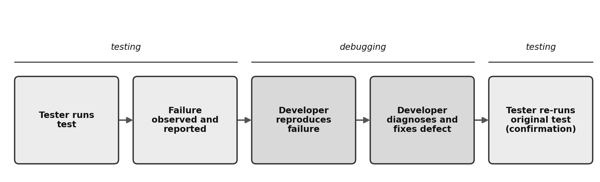
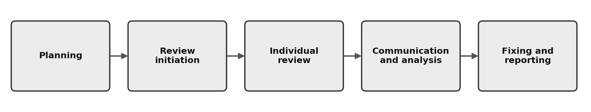
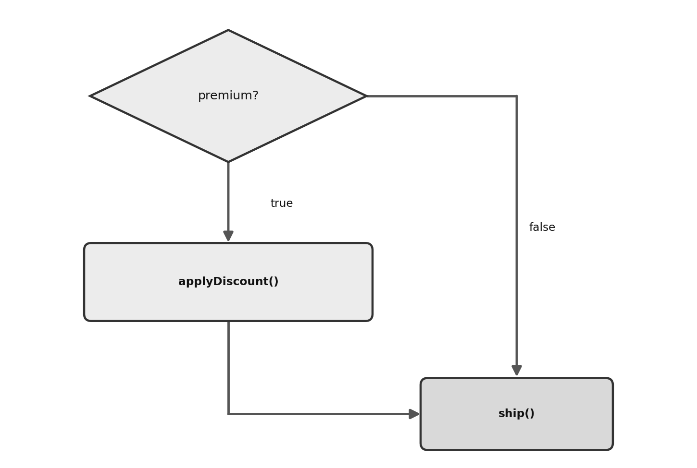
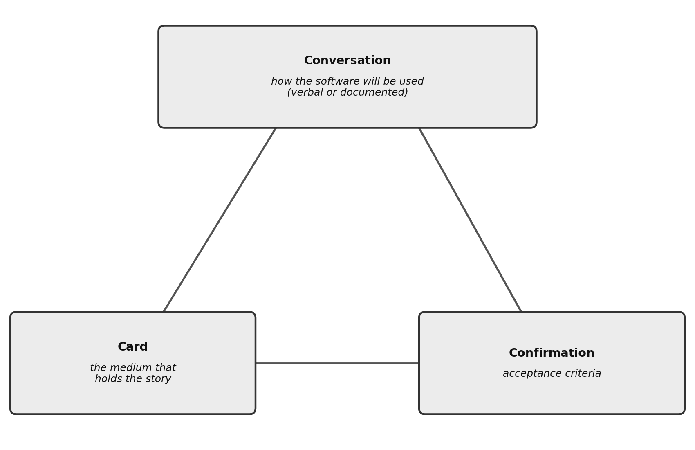

# ISTQB® CTFL v4.0 Exam Guide: From Fundamentals to Exam-Ready

*Independent · Unofficial study guide — not affiliated with or endorsed by ISTQB®*

### Covers all 64 Learning Objectives of the ISTQB® Certified Tester Foundation Level Syllabus v4.0 (technical baseline: v4.0.1 errata) — with worked examples for every K3 objective

Built on what the exam actually measures. Readable for a complete beginner, accurate for an experienced tester.

**Kadir Çamoğlu**

---

| | |
| --- | --- |
| Edition | First Edition (public draft) |
| Exam covered | ISTQB® Certified Tester Foundation Level (CTFL) |
| Syllabus | CTFL Syllabus v4.0 (April 2023); **technical baseline v4.0.1** (errata release — LO wording/terminology aligned to it) |
| Exam structure source | ISTQB® Exam Structure Tables v1.18 · Exam Structures and Rules v1.2 |
| Format covered | 40 questions · 60 minutes (+25% extension depends on your Member Board or exam provider — see *How the CTFL Exam Works*) · pass mark 26/40 (65%) |

\newpage

# Copyright & Trademark Notice

© 2026 Kadir Çamoğlu.

**Licence.** Except where otherwise noted, this work is licensed under the Creative Commons Attribution-NonCommercial 4.0 International licence (CC BY-NC 4.0): <https://creativecommons.org/licenses/by-nc/4.0/>. You may copy, share, and adapt it for non-commercial purposes, provided that you give appropriate credit, link to the licence, and indicate any changes you made. Material quoted from ISTQB® documents (including the learning-objective wording) and all trademarks are not covered by this licence.

**Independent, unofficial study guide.** This book is an **independent, unofficial study guide**. It is **not** affiliated with, endorsed, sponsored, licensed, approved, or accredited by the ISTQB® (International Software Testing Qualifications Board), its Member Boards, or any exam provider. It does not reproduce the text of the official syllabus: the explanations are the author's own. What is quoted from the syllabus, with attribution, is limited to the learning-objective identifiers and statements, the names of the seven testing principles, and the keyword lists. Terminology follows the official *ISTQB® Glossary*; the glossary entries in this book are written in the author's own words. Nothing in this book should be read as implying official or accredited status.

**Trademarks.** ISTQB® is a registered trademark of the International Software Testing Qualifications Board. “Certified Tester Foundation Level” and its abbreviation “CTFL” are used only to identify the certification and syllabus covered by this guide. All other trademarks are the property of their respective owners. No ISTQB® logo or accreditation badge is used in this book.

**Source acknowledgment.** This guide uses the *ISTQB® Certified Tester Foundation Level Syllabus v4.0.1* as its technical and structural basis. The authors of the v4.0.1 syllabus—Renzo Cerquozzi, Wim Decoutere, Jean-François Riverin, Arnika Hryszko, Martin Klonk, Meile Posthuma, Eric Riou du Cosquer (chair), Adam Roman, Lucjan Stapp, Stephanie Ulrich (vice chair), and Eshraka Zakaria—and the authors of the v4.0 syllabus—Renzo Cerquozzi, Wim Decoutere, Klaudia Dussa-Zieger, Jean-François Riverin, Arnika Hryszko, Martin Klonk, Michaël Pilaeten, Meile Posthuma, Stuart Reid, Eric Riou du Cosquer (chair), Adam Roman, Lucjan Stapp, Stephanie Ulrich (vice chair), and Eshraka Zakaria—and ISTQB® are acknowledged as the source and copyright owners of that syllabus. The ISTQB® Exam Working Group and ISTQB® are likewise acknowledged as the source and copyright owners of the *ISTQB® Exam Structure Tables v1.18* and *Exam Structures and Rules v1.2* used for exam-format alignment.


**Learning objectives.** The 64 Foundation Level learning objectives are referenced by their official identifiers (FL-x.y.z) and official English wording, drawn from the *ISTQB® CTFL Syllabus v4.0.1*. Reference is for study alignment; the official syllabus remains the authoritative source.

**Original content.** All explanations, examples, figures, exercises, and practice questions in this book are original. They are not taken from live ISTQB® exams or from the official ISTQB® sample exams.

**Accuracy.** Exam format, timing, and content can change. Before you sit the exam, check the current conditions on the official ISTQB® CTFL page (<https://www.istqb.org/certifications/certified-tester-foundation-level-ctfl-v4-0/>) and with your national Member Board or exam provider.

**No warranty.** Passing any certification exam depends on the candidate. This guide aims to prepare, not to guarantee.

**Feedback.** Errors, unclear passages and suggestions are welcome at kadir.camoglu@gmail.com.

First Edition (public draft) · 2026.

\newpage

# Generated Table of Contents

- [ISTQB® CTFL v4.0 Exam Guide: From Fundamentals to Exam-Ready](#istqb-ctfl-v4.0-exam-guide-from-fundamentals-to-exam-ready)
- [Copyright & Trademark Notice](#copyright-trademark-notice)
- [Introduction — About This Book](#introduction-about-this-book)
  - [What this book is](#what-this-book-is)
  - [Who this book is for](#who-this-book-is-for)
  - [A note on the book's questions](#a-note-on-the-books-questions)
  - [A note on terminology (v4.0 vs 2018)](#a-note-on-terminology-v4.0-vs-2018)
  - [What the exam is built on](#what-the-exam-is-built-on)
- [How to Use This Book](#how-to-use-this-book)
  - [Learning objectives and K-levels](#learning-objectives-and-k-levels)
  - [The three voices](#the-three-voices)
  - [How each chapter is structured](#how-each-chapter-is-structured)
  - [How the K3 sections work](#how-the-k3-sections-work)
  - [Study tracks](#study-tracks)
  - [Callouts, figures, and tables you will see](#callouts-figures-and-tables-you-will-see)
  - [What you will find at the back](#what-you-will-find-at-the-back)
- [How the CTFL Exam Works](#how-the-ctfl-exam-works)
  - [The exam at a glance (official facts)](#the-exam-at-a-glance-official-facts)
  - [Question distribution by chapter (40 questions)](#question-distribution-by-chapter-40-questions)
  - [Question distribution by cognitive level (40 questions)](#question-distribution-by-cognitive-level-40-questions)
  - [How CTFL questions are built](#how-ctfl-questions-are-built)
  - [A two-step answering strategy](#a-two-step-answering-strategy)
  - [Managing your 60 minutes](#managing-your-60-minutes)
- [Objective Map](#objective-map)
  - [Full learning-objective table](#full-learning-objective-table)
  - [Coverage + weight summary](#coverage-weight-summary)
  - [The eight K3 objectives (worked example + independent exercise + solution)](#the-eight-k3-objectives-worked-example-independent-exercise-solution)
- [Study Roadmap](#study-roadmap)
  - [Weight your study by the exam blueprint](#weight-your-study-by-the-exam-blueprint)
  - [Three tracks](#three-tracks)
  - [The four-week plan (about 1 to 1.5 hours a day)](#the-four-week-plan-about-1-to-1.5-hours-a-day)
  - [The three-week plan (about 1 to 1.5 hours a day, for candidates with some background)](#the-three-week-plan-about-1-to-1.5-hours-a-day-for-candidates-with-some-background)
  - [The two-week plan (about 1 to 1.5 hours a day, for experienced candidates)](#the-two-week-plan-about-1-to-1.5-hours-a-day-for-experienced-candidates)
  - [K3 workload](#k3-workload)
- [Chapter 1 — Fundamentals of Testing](#chapter-1-fundamentals-of-testing)
  - [1.1 What Is Testing?](#what-is-testing)
  - [1.2 Why Is Testing Necessary?](#why-is-testing-necessary)
  - [1.3 The Seven Testing Principles (FL-1.3.1 — K2)](#the-seven-testing-principles-fl-1.3.1-k2)
  - [1.4 Test Activities, Testware, and Test Roles](#test-activities-testware-and-test-roles)
  - [1.5 Essential Skills and Good Practices in Testing](#essential-skills-and-good-practices-in-testing)
  - [Chapter 1 summary](#chapter-1-summary)
  - [Chapter exercises](#chapter-exercises)
- [Chapter 2 — Testing Throughout the Software Development Lifecycle](#chapter-2-testing-throughout-the-software-development-lifecycle)
  - [2.1 Testing in the Context of a Software Development Lifecycle](#testing-in-the-context-of-a-software-development-lifecycle)
  - [2.2 Test Levels and Test Types](#test-levels-and-test-types)
  - [2.3 Maintenance Testing (FL-2.3.1 — K2)](#maintenance-testing-fl-2.3.1-k2)
  - [Chapter 2 summary](#chapter-2-summary)
  - [Cumulative retrieval](#cumulative-retrieval)
  - [Chapter exercises](#chapter-exercises-1)
- [Chapter 3 — Static Testing](#chapter-3-static-testing)
  - [3.1 Static Testing Basics](#static-testing-basics)
  - [3.2 Feedback and the Review Process](#feedback-and-the-review-process)
  - [Chapter 3 summary](#chapter-3-summary)
  - [Cumulative retrieval](#cumulative-retrieval-1)
  - [Chapter exercises](#chapter-exercises-2)
- [Chapter 4 — Test Analysis and Design](#chapter-4-test-analysis-and-design)
  - [4.1 Overview of Test Techniques (FL-4.1.1 — K2)](#overview-of-test-techniques-fl-4.1.1-k2)
  - [4.2 Black-box Test Techniques](#black-box-test-techniques)
  - [4.3 White-box Test Techniques](#white-box-test-techniques)
  - [4.4 Experience-based Test Techniques](#experience-based-test-techniques)
  - [4.5 Collaboration-based Test Approaches](#collaboration-based-test-approaches)
  - [Chapter 4 summary](#chapter-4-summary)
  - [Cumulative retrieval](#cumulative-retrieval-2)
  - [Chapter exercises](#chapter-exercises-3)
  - [Independent exercise solutions](#independent-exercise-solutions)
- [Chapter 5 — Managing the Test Activities](#chapter-5-managing-the-test-activities)
  - [5.1 Test Planning](#test-planning)
  - [5.2 Risk Management](#risk-management)
  - [5.3 Test Monitoring, Test Control and Test Completion](#test-monitoring-test-control-and-test-completion)
  - [5.4 Configuration Management (FL-5.4.1 — K2)](#configuration-management-fl-5.4.1-k2)
  - [5.5 Defect Management](#defect-management)
  - [Chapter 5 summary](#chapter-5-summary)
  - [Cumulative retrieval](#cumulative-retrieval-3)
  - [Chapter exercises](#chapter-exercises-4)
  - [Independent exercise solutions](#independent-exercise-solutions-1)
- [Chapter 6 — Test Tools](#chapter-6-test-tools)
  - [6.1 Tool Support for Testing](#tool-support-for-testing)
  - [6.2 Benefits and Risks of Test Automation](#benefits-and-risks-of-test-automation)
  - [Chapter 6 summary](#chapter-6-summary)
  - [Cumulative retrieval](#cumulative-retrieval-4)
  - [Chapter exercises](#chapter-exercises-5)
- [Answers & Rationale](#answers-rationale)
  - [Chapter 1 — Fundamentals of Testing](#chapter-1-fundamentals-of-testing-1)
  - [Chapter 2 — Testing Throughout the SDLC](#chapter-2-testing-throughout-the-sdlc)
  - [Chapter 3 — Static Testing](#chapter-3-static-testing-1)
  - [Chapter 4 — Test Analysis and Design](#chapter-4-test-analysis-and-design-1)
  - [Chapter 5 — Managing the Test Activities](#chapter-5-managing-the-test-activities-1)
  - [Chapter 6 — Test Tools](#chapter-6-test-tools-1)
  - [Cumulative retrieval — model answers](#cumulative-retrieval-model-answers)
- [Glossary](#glossary)
- [Commonly Confused Pairs — Master List](#commonly-confused-pairs-master-list)
- [Final Revision Plan](#final-revision-plan)
  - [What to re-read](#what-to-re-read)
  - [Which K3 techniques to re-drill](#which-k3-techniques-to-re-drill)
  - [Common confusions to re-check](#common-confusions-to-re-check)
  - [Timing and the day before](#timing-and-the-day-before)
- [Mock Exam 1 — 40 Questions with Rationale](#mock-exam-1-40-questions-with-rationale)
  - [Part 1 — Questions](#part-1-questions)
  - [Part 2 — Answer Key and Score Interpretation](#part-2-answer-key-and-score-interpretation)
  - [Part 3 — Answers, Explanations, and References](#part-3-answers-explanations-and-references)
- [Further Resources](#further-resources)

\newpage

# Introduction — About This Book


## What this book is

This book is a comprehensive companion for your CTFL exam preparation, not a dry restatement of the syllabus. The official syllabus defines the examinable scope and provides the authoritative technical baseline. This book complements it with practical examples, guided practice, and explicit links between neighbouring ideas.

Two principles run through every page. The first is strict fidelity to the official coverage. You will not lose time on unnecessary, advanced detail. The exam is built on 64 learning objectives (LOs) spread across six chapters, together with the syllabus keywords. In this book each chapter maps directly onto a syllabus chapter, and essential terms are defined where they are taught. The examples add context, but the examinable claims stay within the v4.0 scope. The second principle is fidelity to v4.0 terminology. The 2023 syllabus changed names, lists, and emphases compared with the older 2018 version, and this book follows the current terms exactly. The fifth testing principle, for example, is now officially "tests wear out"; it was formerly known as the "pesticide paradox" (some trainers also liken it to antibiotic resistance). So the term you study here is the term you meet on the exam. Throughout the book, critical terms are highlighted at first use and reinforced in summary tables.

This is a self-contained preparation source. You can read a chapter, solve the questions that follow it, and, when you get one wrong, learn why directly, without turning to another document.

## Who this book is for

The CTFL exam has no prerequisite, and neither does this book. It is written for beginners to software testing who want to learn the core concepts from the start; for developers, business analysts, and project managers aiming at an internationally recognised certificate and wanting a clear view of the exam scope; for practising testers who want to set their hands-on knowledge in a theoretical frame and update their terminology to v4.0; and for candidates retaking the exam who want to use the LO map and the question-weight tables to close specific gaps quickly. Terms are explained at first use and every concept is tied to a realistic workplace example, yet the content is kept away from shallow description: all the definitions, concepts, and distinctions align fully with the official standards you will meet on the exam.

One idea stands out across the whole book, and it is worth saying at the start: CTFL is an exam of vocabulary and distinctions with a practical core. Thirty-two of the forty questions test your ability to recall and tell apart official concepts (K1 and K2); the remaining eight test your ability to apply eight named techniques to small problems (K3). Well-built wrong options are usually near-misses, the neighbouring concept rather than something random. That is why learning the distinctions deliberately is the preparation strategy this book is built on.

## A note on the book's questions

Every question in this book is original; it reuses no official sample-exam items. For how to work through each chapter (the study tracks, the three voices, the K3 format), see the dedicated "How to Use This Book" section that follows.

## A note on terminology (v4.0 vs 2018)

This book uses the current official names verbatim, because the 2023 syllabus renamed several of them. The clearest example is the fifth principle, now "tests wear out" rather than the deprecated "pesticide paradox"; the seventh principle was also renamed, and this book teaches only its current name, the "absence-of-defects fallacy." Where a term changed, this book teaches the current name and mentions a deprecated one only as a brief historical caution, so you can recognise it in older study material. The exam uses the current names.

## What the exam is built on

The syllabus is framed by 14 Business Outcomes (BOs) and built on 64 learning objectives across six chapters. The Business Outcomes are not examined directly, but they explain why the topics matter; the book's coverage is driven by the 64 LOs and the syllabus keywords. A note on chapter numbers: this book refers to topics by name, not by syllabus chapter number (for example "boundary value analysis," "the review process"). Exam questions target learning objectives, not chapter numbers, so there is no need to memorise the numbering.

\newpage

# How to Use This Book


Before you start Chapter 1, this short section explains how the book works, so the structure serves you rather than surprising you.

## Learning objectives and K-levels

The exam is built on 64 **learning objectives (LOs)**. Each LO has an identifier (for example FL-4.2.1) and a cognitive level that tells you what the exam expects you to do with it. K1 (recall) asks you to remember a fact or a term. K2 (understand) asks you to explain, compare, or classify concepts. K3 (apply) asks you to use a technique to solve a small problem. There is no K4 at Foundation level. Of the 40 exam questions, 8 are K1, 24 are K2, and 8 are K3, so most of the exam rests on understanding and telling concepts apart, with a fifth (the eight K3 questions) applying named techniques.

## The three voices

The book uses three kinds of text. An **official term** is something to memorise verbatim, because the exam uses it exactly; learn the terms from each chapter's Keywords line and from the Glossary (bold is also used for labels and table titles, so it does not mark terms by itself). The official LO wording is the syllabus's own phrasing of an objective; it is quoted in the Objective Map so you can recognise it in question stems. The author's explanation is the ordinary prose that teaches, illustrates, and connects the ideas; it is where the learning happens, but it is not what you memorise.

## How each chapter is structured

Every chapter opens with its number of learning objectives, their K-level split, and its exam question count. A single **Keywords** line follows, listing the syllabus keywords the chapter teaches. Every keyword on that line is examinable, and each one has an entry in the Glossary at the back.

The chapter then teaches each objective in plain language with real-world examples. After the teaching text of each objective comes an *Exam focus* note naming the question shape and the trap it hides, followed by a few *Check your understanding* self-checks whose answers sit right below them, so you test what you learned immediately. The book contains 177 of these quick checks across the six chapters.

Each chapter ends with a one-sentence summary table, a "critical concept pairs" box, an "exam tips and traps" section, and a set of mixed chapter exercises. There are 61 chapter exercises in total. Their full answers and rationale live in the Answers & Rationale section at the back, and each answer cites its LO and K-level.

## How the K3 sections work

Each K3 objective is taught with a worked example, then an independent exercise, then its solution (given at the end of the chapter). Do the worked example with pen and paper, then attempt the exercise on your own before checking the solution. A worked example you only read is not practice; the eight K3 questions reward the technique you have actually run yourself.

## Study tracks

The Study Roadmap that follows offers three tracks by starting point: a fast track for candidates with prior testing experience, a standard track, and a beginner track from zero. Each gives a time budget and a day-by-day or week-by-week plan. Weight your study by the exam blueprint rather than the number of objectives: Chapters 4 and 5 hold 20 of the 40 questions, and all eight K3 questions.

## Callouts, figures, and tables you will see

Several recurring elements help you find your way through a chapter:

- **K-level tags** appear on every objective heading, so you always know whether the exam expects recall, understanding, or application. Each exercise's LO and K-level are given with its answer in Answers & Rationale.
- ***Exam focus*** notes follow the teaching text of each objective and name the question shape and a trap to watch for.
- ***In practice*** stories show a concept in a realistic workplace situation.
- **Numbered figures** (32 in total, for example Figure 1.1) draw a process, a model, or a technique so you can see it at a glance. Each figure has a caption that describes it in words.
- **Numbered teaching tables** (20 in total, for example Table 1.4) summarise a passage you have just read, such as the seven principles or the four review types. They do not replace the prose. Instead, they give you a compact view for revision.
- **Critical concept pairs** boxes at the end of each chapter contrast two concepts the exam likes to swap.
- **v4.0 terminology** notes mark the main names that changed from the 2018 syllabus (for example *tests wear out*), so you learn the current term and recognise the old one only as history.

## What you will find at the back

The back matter is built for practice and final revision. The **Answers & Rationale** section explains every chapter exercise option by option. The **Glossary** defines every syllabus keyword the chapters teach. **Commonly Confused Pairs — Master List** gathers the concept pairs from all six chapters into one list (a table per chapter), so you can revise every near-miss distinction in one sitting. The **Final Revision Plan** is a short checklist for your last week. **Mock Exam 1** is a full 40-question practice exam that includes "Select TWO" items in the official format, and each rationale ends with a "Review in this book" link that takes you to the section that teaches the objective. Finally, **Further Resources** lists the official ISTQB® documents and the standards this book is built on.

\newpage

# How the CTFL Exam Works

> **Before you book.** Exam conditions can change. The facts on this page come from the official ISTQB® documents named in the table below, but the time allowed, the delivery format, the languages offered, and the booking rules may be updated after this book is published. Before you book, check the official ISTQB® CTFL page at <https://www.istqb.org/certifications/certified-tester-foundation-level-ctfl-v4-0/>. Check also with your national Member Board or your exam provider, because they decide how the exam is run where you sit it.


## The exam at a glance (official facts)

| Item | Value | Source |
| -------- | ---------------------------------- | ------------------- |
| Questions | 40 multiple-choice (mostly "Select ONE"; some "Select TWO", which have 5 options) | Number: Exam Structure Tables v1.18; Select TWO format: the official sample exams A–D |
| Time | 60 minutes | Exam Structure Tables v1.18 |
| Extra time | +25% (75 min) when the exam is not in your native language; applied by your exam provider (see "Extra time" below) | Exam Structures and Rules v1.2 |
| Total points | 40 (1 point per question) | Exam Structure Tables v1.18 |
| Pass mark | 26 / 40 (65%) | Exam Structure Tables v1.18 |
| Cognitive levels | K1, K2, K3 (no K4 at Foundation) | Syllabus v4.0.1 |

> Technical baseline: this book follows the **English CTFL Syllabus v4.0.1** (errata release) and the exam structure tables cited above.

**Extra time.** ISTQB® rules allow 25% extra time when the exam is not in your native language; how this is applied depends on your exam provider and Member Board. For the 60-minute CTFL exam, the extension gives you 75 minutes. In other words, do not assume the extra 15 minutes when you plan your pacing. Ask your provider whether it applies to your booking, and plan for 60 minutes until they confirm it.


## Question distribution by chapter (40 questions)

| Chapter | Questions |
| --- | ---: |
| 1 — Fundamentals of Testing | 8 |
| 2 — Testing Throughout the SDLC | 6 |
| 3 — Static Testing | 4 |
| 4 — Test Analysis and Design | 11 |
| 5 — Managing the Test Activities | 9 |
| 6 — Test Tools | 2 |
| **Total** | **40** |

## Question distribution by cognitive level (40 questions)

| K-level | Questions | Points each |
| --- | ---: | ---: |
| K1 | 8 | 1 |
| K2 | 24 | 1 |
| K3 | 8 | 1 (K3 questions take ~3 min each) |
| **Total** | **40** | |

The three cognitive levels shape both what is asked and how long it takes. K1 (recall) questions ask you to remember a fact or recognise a term, and they are usually the quickest to answer. K2 (understand) questions ask you to explain, compare, or classify — you have to reason about the material, not just recognise it, and these make up the largest share of the exam. K3 (apply) questions ask you to work a technique through to a concrete result, such as deriving test cases with equivalence partitioning or boundary value analysis, computing a three-point estimate, or prioritising a set of test cases; each one takes noticeably longer than a recall question.

## How CTFL questions are built

Every question on the exam is multiple choice, and every question is worth one point. Within that frame, you will meet two answer formats. Most questions are "Select ONE" items with four options, of which exactly one is correct. A smaller number are "Select TWO" items, which usually offer five options. On a Select TWO item, you should expect to earn the point only when both of your selections are correct, so one right answer out of two is not enough.

The stem, the part of the question above the options, usually takes one of three shapes:

- **Recall questions (usually K1)** ask about the syllabus lists and definitions directly. In a question such as "Which of the following is a typical test objective?", one option comes from the official list, and the other three do not belong to it.
- **Scenario questions (most K2 items)** describe a short workplace situation in a few sentences and ask you to make one clear distinction. Is this confirmation testing or regression testing? Is this a project risk or a product risk? Is this an entry criterion or an exit criterion?
- **Application and calculation questions (all K3 items)** give you a small specification, table, or diagram and a task to carry out. How many test cases are needed for 100% coverage? What is the result of the three-point estimate? Which test case should be run first?

The official exam rules also allow a question to draw on material from more than one part of the syllabus, and every syllabus keyword is examinable for its definition. In practical terms, a Chapter 5 scenario may still rely on a Chapter 1 term, so the glossary and the concept pairs matter across the whole exam.

### The anatomy of a distractor

A well-built wrong option is rarely random: it usually sits right next to the correct answer. This book's rationales name the strongest distractor in every mock question and classify it by one of four sources:

- **The sibling concept.** The option names the neighbour of the target concept, for example regression testing where the scenario describes confirmation testing.
- **Right idea, wrong place.** The option is accurate, but it belongs somewhere else, for example the outputs of test implementation offered as the outputs of test design.
- **An overstated or reversed claim.** The option stretches a true statement too far or turns it round, for example "testing proves that no defects remain."
- **A calculation or derivation slip.** The value looks plausible but comes from a common slip in the technique, for example 17 where the partition actually starts at 18, or a plain average where the formula weights the most likely value.

This is why the book teaches distinctions so deliberately. When you know where distractors come from, you can usually name the reason an option is wrong, not just sense that it is. Do not ask only whether an option sounds true. Ask whether it is true for this concept, this activity, and this scenario.

## A two-step answering strategy

Every worked example in this book follows the same two-step method. It is worth turning into a habit, because it works on almost every K1 and K2 question.

1. **Eliminate the clearly wrong options.** You can often remove two options quickly. They belong to a concept from another chapter, they contradict a basic definition, or they do not fit the logic of the scenario.
2. **Reduce the remaining options to a single deciding criterion.** Ask yourself, "What is the one difference between these two options?" Then go back to the stem and look for the word that decides it. For example, "after the fix" points to confirmation testing, a concern about side effects of the change points to regression testing, and "before testing can start" points to entry criteria. The stem usually contains that clue.

K3 questions need a different second step. Solve the problem on paper first, and look at the options only when you have your own answer. Deriving the result independently is safer and usually faster than testing each option against the scenario one by one. It also protects you from distractors built on common slips, such as a 2-value boundary set offered where the question asks for 3-value boundary value analysis. Do not read the options first on a K3 question. Work the answer out, then find it in the list.

On a Select TWO item, apply the first step to each option on its own. Treat every option as a separate true-or-false statement about the scenario, and keep the two that survive.

The good news is that this strategy needs no extra knowledge. It simply makes you use what you already know in a fixed order, and with practice on the chapter questions it usually becomes automatic well before exam day.

## Managing your 60 minutes

Sixty minutes for forty questions is about ninety seconds each, but the time is not spread evenly. The official Exam Structures and Rules suggest about 1 minute for a K1 question, 1 to 2 minutes for a K2 question, and 3 minutes for a K3 question. Eight K1 and eight K3 questions already use about 32 minutes, which leaves roughly 70 seconds on average for each of the 24 K2 questions. Budget your time deliberately. This book recommends the **two-pass approach** for that. On the first pass, move quickly through the K1 and K2 questions, answer the ones you are sure of with the two-step strategy above, and flag anything you are unsure of. On the second pass, use the back half of your time for the K3 work and your flagged items. Every question is worth one point, so an unanswered question costs exactly as much as a wrong one. For that reason, never leave a blank. If your provider grants the 25% extension (see "Extra time" above), you have 75 minutes, which eases the pressure but does not remove the need to pace the K3 questions.

\newpage

# Objective Map

This book covers all **64 learning objectives** of the ISTQB® CTFL Syllabus v4.0. Each objective's official identifier (FL-x.y.z), its official wording, and its K-level are listed in the full objective table below; each chapter's opening gives its LO count, K-level split, and question count. This page shows how the book maps to them.

## Full learning-objective table

| Chapter | LO | Level | Official wording |
| ------- | ------- | ------ | ---------------------------------------- |
| 1 | FL-1.1.1 | K1 | Identify typical test objectives |
| 1 | FL-1.1.2 | K2 | Differentiate testing from debugging |
| 1 | FL-1.2.1 | K2 | Exemplify why testing is necessary |
| 1 | FL-1.2.2 | K1 | Recall the relation between testing and quality assurance |
| 1 | FL-1.2.3 | K2 | Distinguish between root cause, error, defect, and failure |
| 1 | FL-1.3.1 | K2 | Explain the seven testing principles |
| 1 | FL-1.4.1 | K2 | Explain the different test activities and related tasks |
| 1 | FL-1.4.2 | K2 | Explain the impact of context on the test process |
| 1 | FL-1.4.3 | K2 | Differentiate the testware that supports the test activities |
| 1 | FL-1.4.4 | K2 | Explain the value of maintaining traceability |
| 1 | FL-1.4.5 | K2 | Compare the different roles in testing |
| 1 | FL-1.5.1 | K2 | Give examples of the generic skills required for testing |
| 1 | FL-1.5.2 | K1 | Recall the advantages of the whole team approach |
| 1 | FL-1.5.3 | K2 | Distinguish the benefits and drawbacks of independence of testing |
| 2 | FL-2.1.1 | K2 | Explain the impact of the chosen software development lifecycle on testing |
| 2 | FL-2.1.2 | K1 | Recall good testing practices that apply to all software development lifecycles |
| 2 | FL-2.1.3 | K1 | Recall the examples of test-first approaches to development |
| 2 | FL-2.1.4 | K2 | Summarize how DevOps might have an impact on testing |
| 2 | FL-2.1.5 | K2 | Explain shift left |
| 2 | FL-2.1.6 | K2 | Explain how retrospectives can be used as a mechanism for process improvement |
| 2 | FL-2.2.1 | K2 | Distinguish the different test levels |
| 2 | FL-2.2.2 | K2 | Distinguish the different test types |
| 2 | FL-2.2.3 | K2 | Distinguish confirmation testing from regression testing |
| 2 | FL-2.3.1 | K2 | Summarize maintenance testing and its triggers |
| 3 | FL-3.1.1 | K1 | Recognize types of work products that can be examined by static testing |
| 3 | FL-3.1.2 | K2 | Explain the value of static testing |
| 3 | FL-3.1.3 | K2 | Compare and contrast static testing and dynamic testing |
| 3 | FL-3.2.1 | K1 | Identify the benefits of early and frequent stakeholder feedback |
| 3 | FL-3.2.2 | K2 | Summarize the activities of the review process |
| 3 | FL-3.2.3 | K1 | Recall which responsibilities are assigned to the principal roles when performing reviews |
| 3 | FL-3.2.4 | K2 | Compare and contrast the different review types |
| 3 | FL-3.2.5 | K1 | Recall the factors that contribute to a successful review |
| 4 | FL-4.1.1 | K2 | Distinguish black-box test techniques, white-box test techniques and experience-based test techniques |
| 4 | FL-4.2.1 | K3 | Use equivalence partitioning to derive test cases |
| 4 | FL-4.2.2 | K3 | Use boundary value analysis to derive test cases |
| 4 | FL-4.2.3 | K3 | Use decision table testing to derive test cases |
| 4 | FL-4.2.4 | K3 | Use state transition testing to derive test cases |
| 4 | FL-4.3.1 | K2 | Explain statement testing |
| 4 | FL-4.3.2 | K2 | Explain branch testing |
| 4 | FL-4.3.3 | K2 | Explain the value of white-box testing |
| 4 | FL-4.4.1 | K2 | Explain error guessing |
| 4 | FL-4.4.2 | K2 | Explain exploratory testing |
| 4 | FL-4.4.3 | K2 | Explain checklist-based testing |
| 4 | FL-4.5.1 | K2 | Explain how to write user stories in collaboration with developers and business representatives |
| 4 | FL-4.5.2 | K2 | Classify the different options for writing acceptance criteria |
| 4 | FL-4.5.3 | K3 | Use acceptance test-driven development (ATDD) to derive test cases |
| 5 | FL-5.1.1 | K2 | Exemplify the purpose and content of a test plan |
| 5 | FL-5.1.2 | K1 | Recognize how a tester adds value to iteration and release planning |
| 5 | FL-5.1.3 | K2 | Compare and contrast entry criteria and exit criteria |
| 5 | FL-5.1.4 | K3 | Use estimation techniques to calculate the required test effort |
| 5 | FL-5.1.5 | K3 | Apply test case prioritization |
| 5 | FL-5.1.6 | K1 | Recall the concepts of the test pyramid |
| 5 | FL-5.1.7 | K2 | Summarize the testing quadrants and their relationships with test levels and test types |
| 5 | FL-5.2.1 | K1 | Identify risk level by using risk likelihood and risk impact |
| 5 | FL-5.2.2 | K2 | Distinguish between project risks and product risks |
| 5 | FL-5.2.3 | K2 | Explain how product risk analysis may influence thoroughness and test scope |
| 5 | FL-5.2.4 | K2 | Explain what measures can be taken in response to analyzed product risks |
| 5 | FL-5.3.1 | K1 | Recall metrics used for testing |
| 5 | FL-5.3.2 | K2 | Summarize the purposes, content, and audiences for test reports |
| 5 | FL-5.3.3 | K2 | Exemplify how to communicate the status of testing |
| 5 | FL-5.4.1 | K2 | Summarize how configuration management supports testing |
| 5 | FL-5.5.1 | K3 | Prepare a defect report |
| 6 | FL-6.1.1 | K2 | Explain how different types of test tools support testing |
| 6 | FL-6.2.1 | K1 | Recall the benefits and risks of test automation |

Two maps, deliberately kept separate: the **LO coverage map** (what the book teaches) and the **exam blueprint** (how questions are weighted). Do not read LO count as exam weight.

## Coverage + weight summary

The last column is a rough study-priority signal (exam questions divided by LOs). It is a heuristic, not an official weighting. ISTQB® publishes question counts per group of learning objectives. Where a group contains a single LO, the count is per LO. Questions are not distributed evenly across a chapter's LOs. Read absolute exam-question count (the "Exam Q" column) as the primary weight: Chapter 6's 1.00 ratio comes from just 2 questions, while Chapter 5's lower ratio still carries 9. Chapter 5 has the most LOs (16) but yields 9 questions; Chapter 4 yields 11 questions from 14 LOs. No chapter is skippable — all content is examinable at K1.

| Chapter | LOs | K1 | K2 | K3 | Exam Q | Q per LO (study yield) |
| --- | ---: | ---: | ---: | ---: | ---: | ---: |
| 1 — Fundamentals of Testing | 14 | 3 | 11 | 0 | 8 | 0.57 |
| 2 — Testing Throughout the SDLC | 10 | 2 | 8 | 0 | 6 | 0.60 |
| 3 — Static Testing | 8 | 4 | 4 | 0 | 4 | 0.50 |
| 4 — Test Analysis and Design | 14 | 0 | 9 | 5 | 11 | 0.79 (highest) |
| 5 — Managing the Test Activities | 16 | 4 | 9 | 3 | 9 | 0.56 |
| 6 — Test Tools | 2 | 1 | 1 | 0 | 2 | 1.00 (small chapter) |
| **Total** | **64** | **14** | **42** | **8** | **40** | — |


## The eight K3 objectives (worked example + independent exercise + solution)
Each K3 LO gets a full worked example **and** a non-trivial independent exercise with a solution (a worked example alone is not practice).

- FL-4.2.1 (K3) Use equivalence partitioning to derive test cases
- FL-4.2.2 (K3) Use boundary value analysis to derive test cases
- FL-4.2.3 (K3) Use decision table testing to derive test cases
- FL-4.2.4 (K3) Use state transition testing to derive test cases
- FL-4.5.3 (K3) Use acceptance test-driven development (ATDD) to derive test cases
- FL-5.1.4 (K3) Use estimation techniques to calculate the required test effort
- FL-5.1.5 (K3) Apply test case prioritization
- FL-5.5.1 (K3) Prepare a defect report

\newpage

# Study Roadmap


This is the plan to read before Chapter 1. All the plans below follow the same cycle for each chapter: read the chapter, solve its exercises closed-book, then study the rationale for every question, including the ones you got right. The K3 chapters, Chapter 4 and Chapter 5, take twice as long. Do the worked examples and short exercises on paper rather than just reading them, because the exam will ask you to compute partitions, boundaries, table columns, transitions, estimates, priorities, and the contents of a defect report.

## Weight your study by the exam blueprint

Do not spread your time evenly across the objectives. Chapters 4 and 5 hold 20 of the 40 questions and all eight K3 questions, so they deserve the most time; Chapter 6 holds only 2. No chapter is skippable, since all content is examinable at K1, but the return on your hours is highest in Chapters 4 and 5.

## Three tracks

Choose a track by your starting point. The **beginner track** (from zero, roughly 1 to 1.5 hours a day, 28 to 42 hours in all) uses the four-week plan below in full. The **standard track** (some testing background, roughly 1 to 1.5 hours a day for three weeks, 21 to 32 hours in all) compresses that by combining the lighter chapters. The **fast track**, for candidates with prior testing experience (roughly 1 to 1.5 hours a day for two weeks, 14 to 21 hours in all), uses the two-week plan. If you already test for a living, you can self-place into the fast track by skimming each chapter's opening LO list and its Check Your Understanding items to find your weak spots, rather than reading every teaching section in full.

## The four-week plan (about 1 to 1.5 hours a day)

| Week | Days | Work |
| ------ | ------ | ---------------------------------------------- |
| 1 | 1–2 | Front matter: how the exam works, the blueprint, the objective map. Skim all chapter summaries for a first overview. |
| 1 | 3–5 | Chapter 1 (8 questions): read, exercises, rationale. Practise the seven principles and seven activities until you can write them from memory. |
| 1 | 6–7 | Chapter 2 (6 questions): read, exercises, rationale. Rebuild your own 5-level × 4-type table from memory. |
| 2 | 8–9 | Chapter 3 (4 questions): read, exercises, rationale. Drill the review roles and the four review types. |
| 2 | 10–14 | Chapter 4, part 1 (11 questions, the heaviest chapter): equivalence partitioning, BVA, decision tables. Do every short exercise on paper. |
| 3 | 15–17 | Chapter 4, part 2: state transition, white-box coverage, experience-based and collaboration-based approaches. Chapter exercises + rationale. |
| 3 | 18–21 | Chapter 5, part 1 (9 questions): planning, criteria, estimation, prioritisation. Recompute every worked example yourself. |
| 4 | 22–23 | Chapter 5, part 2: risks, monitoring/metrics, configuration and defect management. Exercises + rationale. |
| 4 | 24 | Chapter 6 (2 questions): one session, tool types, automation benefits/risks. |
| 4 | 25–26 | Rework your weakest LOs (your wrong chapter answers tell you where they are). Reread the critical concept pairs in the Commonly Confused Pairs — Master List. |
| 4 | 27–28 | Take Mock Exam 1 mixed and timed. Review every wrong answer by returning to the chapter section named in its rationale. |

## The three-week plan (about 1 to 1.5 hours a day, for candidates with some background)

| Week | Days | Work |
| ------ | ------ | ---------------------------------------------- |
| 1 | 1 | Front matter: how the exam works, the blueprint, the objective map. |
| 1 | 2–3 | Chapter 1 (8 questions): read, exercises, rationale. |
| 1 | 4 | Chapter 2 (6 questions) and Chapter 3 (4 questions): read the chapter summaries and the Exam focus notes first, then the sections you find unfamiliar; exercises + rationale. |
| 1 | 5–7 | Chapter 4, part 1 (11 questions): equivalence partitioning, BVA, decision tables. Do every short exercise on paper. |
| 2 | 8–10 | Chapter 4, part 2: state transition, white-box coverage, experience-based and collaboration-based approaches. Chapter exercises + rationale. |
| 2 | 11–14 | Chapter 5 (9 questions): planning, criteria, estimation, prioritisation, risks, monitoring, configuration and defect management. Recompute every worked example yourself. |
| 2 | 15 | Chapter 6 (2 questions) in one session. |
| 3 | 16–17 | Rework your weakest LOs (your wrong chapter answers tell you where they are). Pass through the Commonly Confused Pairs — Master List. |
| 3 | 18–19 | Take Mock Exam 1 mixed and timed. Review every wrong answer by returning to the chapter section named in its rationale. |
| 3 | 20–21 | Second pass over weak LOs and the K3 techniques; a final pass of the concept pairs the day before. |

## The two-week plan (about 1 to 1.5 hours a day, for experienced candidates)

| Day | Work |
| ----- | ------------------------------------------- |
| 1 | Front matter + read Chapter 1 |
| 2 | Chapter 1 exercises + rationale; read Chapter 2 |
| 3 | Chapter 2 exercises + rationale; whole of Chapter 3 (read + exercises + rationale) |
| 4–6 | Chapter 4, one technique pair a day, each short exercise on paper: (EP + BVA) · (decision tables + state transition) · (coverage + experience/collaboration); then chapter exercises + rationale |
| 7–9 | Chapter 5: (planning + estimation + prioritisation) · (risk + monitoring) · (defect report + chapter exercises + rationale) |
| 10 | Whole of Chapter 6; a full pass of the Commonly Confused Pairs — Master List |
| 11–12 | Weakest LOs first: rework this book's questions; review wrong answers with their rationale |
| 13–14 | Take Mock Exam 1 mixed and timed; review, then a final pass of the concept pairs the day before |

## K3 workload

Eight of the 40 questions are K3, and this fifth of the exam is the part most candidates find hardest. The exam may ask you to derive test cases with equivalence partitioning, boundary value analysis, decision tables, state transition testing, or ATDD; calculate a test estimate; prioritise test cases while respecting dependencies; or prepare a defect report. Schedule repeated problem-solving for these, not just rereading the worked examples. When to take the Mock Exam is built into all the plans above; review it with an error log by LO, keyword, and K-level. A short **Final Revision Plan** (a last-week checklist) sits in the back matter near the Mock Exam.

\newpage

# Chapter 1 — Fundamentals of Testing


**Learning objectives:** 14  ·  K1 3 / K2 11 / K3 0  ·  **Exam questions from this chapter:** 8

**Keywords:** coverage, debugging, defect, error, failure, quality, quality assurance, root cause, test analysis, test basis, test case, test completion, test condition, test control, test data, test design, test execution, test implementation, test monitoring, test object, test objective, test planning, test procedure, test process, test result, testing, testware, traceability, validation, verification

This chapter is the backbone of the book. Every later chapter builds on the vocabulary you set here, so the goal is not to solve problems but to build a firm command of the terms and the reasoning behind the official lists. There is no K3 (apply-level) objective in this chapter. Eight of the exam's forty questions come from this material, and they tend to test definitions, the two official lists (the seven principles and the seven activities), and the fine line between neighbouring ideas, such as the difference between an error, a defect, and a failure. Once the terminology is clear in your mind, these questions become fast, and many of them turn on a single word in the stem.

## 1.1 What Is Testing?

### Testing is more than running the software

When people first hear the word "testing," they usually picture someone running the software and watching what happens. Real testing is much wider than that. It includes planning the work, analysing what needs to be tested, designing the tests, preparing them, reporting the results, and judging the quality of the test object. (The work product being tested is called the **test object**.) In other words, the test process starts before a single line of code exists, and it continues after execution has finished.

The part you carry out by running the software is called **dynamic testing**. Work you do without running the software, such as reviewing a requirements document, is **static testing**, which Chapter 3 covers in detail. The point to hold on to is that testing is a chain of activities, and executing the software is only one link in it. Figure 1.1 shows this chain of activities and where static testing fits into it. Static testing can be applied to work products at any point in this chain.


There is one pair of terms worth fixing at the very start, because the rest of the book leans on it constantly. **Verification** asks, "Are we building the product right?" It checks whether the software meets its specified requirements. **Validation** asks, "Are we building the right product?" It checks whether the software meets the real business needs of users and stakeholders. The test process covers both. A product can pass every verification step and still fail validation. A payroll system, for example, may calculate every amount exactly as the specification says. However, if the specification never covered the part-time contracts that a third of the staff work on, every test can pass while the system still fails the people who use it.

### Typical test objectives (FL-1.1.1 — K1) {#fl-1-1-1}

The syllabus lists nine reasons behind test activities. On the exam you need to recognise each of them as a legitimate test objective:

- assessing work products such as requirements, user stories, designs, and code;
- triggering failures and uncovering defects;
- making sure the test object reaches the required coverage;
- lowering the risk that software quality is inadequate;
- checking whether the specified requirements are met;
- checking that the test object meets contractual, legal, and regulatory obligations;
- giving stakeholders clear information for informed decisions;
- creating confidence in the test object's quality;
- confirming that the test object is complete and behaves as stakeholders expect.

Test objectives can vary with the context, such as the work product being tested, the test level, the risks, the SDLC, and business factors such as time to market. Notice the two terms introduced above: objectives five and six are verification objectives, while objective nine is a validation objective.

To make a nine-item list easier to hold in mind, you can group the objectives into four themes. Evaluation and discovery covers evaluating work products and causing failures. Conformance and expectations covers verifying specified requirements, verifying legal and regulatory compliance, and meeting stakeholder expectations. Coverage and risk management covers ensuring the required coverage and reducing risk. Information and confidence covers supplying information for decisions and building confidence in quality.

*In practice.* Just before a release decision, the product owner asks the test team one question: "How confident are we in this product?" The team answers with the current coverage figures and the remaining risk analysis. At that moment, even if the recent test activities found no new defects, testing is meeting objectives seven and eight, providing information and building confidence. The value of testing does not depend on finding defects alone.

*Exam focus.* A common pattern gives you several similar-looking options and asks you to pick the one that is a genuine test objective. Watch for options that name activities from a different discipline: fixing defects is debugging (a development activity), and preventing defects by improving the process is quality assurance. Proving that no defects remain is, as the first principle will show, logically impossible. Before you choose an option, make sure it is not a development or QA activity.

**Check your understanding**

*CYU 1.1.1-a.* Which of the following objectives concerns validation rather than verification?

- (a) Checking that the specified requirements have been fulfilled
- (b) Checking that the test object complies with contractual and legal requirements
- (c) Checking that the test object is complete and works as the stakeholders expect
- (d) Checking that the required coverage of the test object has been reached

> Answer: (c). "Are we building the right product?" is validation. Options (a) and (b) check conformance to requirements, which is verification; (d) is a coverage objective.

*CYU 1.1.1-b.* Which of the following is NOT a legitimate test objective?

- (a) Building confidence in the quality of the test object
- (b) Providing stakeholders with information for their decisions
- (c) Improving the development process that produces defects
- (d) Reducing the risk of inadequate software quality

> Answer: (c). Improving the process to prevent defects is quality assurance, not a test objective. The other three appear on the official list.

*CYU 1.1.1-c.* Before a release, a team checks every functional requirement in the approved specification against the delivered build. Which kind of test objective are they pursuing?

- (a) A verification objective, because it checks conformance to specified requirements
- (b) A validation objective, because it checks the users' real needs
- (c) A quality assurance objective, because it improves the development process
- (d) A debugging objective, because it removes the defects found

> Answer: (a). Checking the product against what was specified answers "Are we building the product right?", which is verification. Validation would ask whether the product meets stakeholders' real needs; (c) and (d) are not test objectives at all.

### Testing and debugging (FL-1.1.2 — K2) {#fl-1-1-2}

Testing and debugging are two different activities with a clear division of labour. Testing triggers failures by running the software (dynamic testing) or finds defects directly in a work product (static testing). Debugging, by contrast, is a development activity: its purpose is to find, analyse, and remove the cause of a failure.

The good news is that the split is easy to remember once you separate their goals. Testing shows that failures occur, or finds defects directly. Debugging finds the cause of a failure and removes it. Testers (and the whole team) do the first; developers do the second. After a fix, the original test is run again to see whether the fix worked; that follow-up run is **confirmation testing**, which Chapter 2 covers. It is preferably done by the same person who ran the initial test. Figure 1.2 shows this cycle, from the first failed test to the confirming re-run.



When dynamic testing reveals a failure, debugging usually follows three steps: reproduce the failure, diagnose it (find the defect that caused it), and fix the defect. In static testing the process is simpler. Because no software is running, there is no failure to reproduce; the defect is already visible in the document or the code, so debugging here is simply a matter of correcting it directly.

**Table 1.1 — Testing versus debugging**

| Aspect | Testing | Debugging |
| -------- | ---------------------- | ---------------------- |
| Kind of activity | A test activity | A development activity |
| Main goal | Trigger failures (dynamic testing) or find defects directly (static testing) | Find, analyse, and remove the cause of a failure |
| Typical steps | Run the tests, observe failures, and report them | Reproduce the failure, diagnose the defect, and fix it; after static testing, simply remove the defect |
| Usually done by | Testers and the whole team | Developers |

*In practice.* You come home and notice water dripping from the bathroom ceiling. Seeing the leak and reporting it to the building manager is testing: its job is only to make the problem visible and record what is happening. Your upstairs neighbour calling a plumber, who inspects the ceiling, works out where the water comes from, diagnoses a burst pipe, and replaces it, is debugging. Afterwards, opening every upstairs tap on purpose to put the pipe under pressure and checking whether your ceiling still drips is confirmation testing.

*Exam focus.* A scenario question can give you a sequence of events and ask you to name the activities in order. The standard correct flow is testing, then debugging, then confirmation testing. A tempting wrong option swaps confirmation testing for regression testing. The difference matters, and Chapter 2 returns to it, but keep this hint for now: confirmation testing checks whether the original defect was fixed, whereas regression testing checks whether a change caused adverse consequences anywhere in the system.

**Check your understanding**

*CYU 1.1.2-a.* A developer reproduces a reported failure, diagnoses the defect in the code, and fixes it. Which activity is this?

- (a) Testing
- (b) Static testing
- (c) Debugging
- (d) Confirmation testing

> Answer: (c). Finding and removing the cause of a failure is debugging, a development activity. Testing only makes the failure visible; checking the fix is confirmation testing.

*CYU 1.1.2-b.* What is the core distinction between testing and debugging?

- (a) Testing finds the cause; debugging shows the failure
- (b) Testing triggers or shows the failure; debugging finds and removes the cause
- (c) Both are only the developer's responsibility
- (d) Both happen only in dynamic testing

> Answer: (b). Testing exposes failures (or finds defects directly); debugging is the development activity that locates and removes the cause.

*CYU 1.1.2-c.* During a review of a requirements specification, Tom finds a contradiction between two business rules. What does debugging involve in this case?

- (a) Reproducing the failure in a test environment before diagnosing it
- (b) Running confirmation testing before the defect can be removed
- (c) Removing the defect directly, because there is no failure to reproduce or diagnose
- (d) Nothing, because defects found by static testing do not need to be corrected

> Answer: (c). Static testing finds defects directly and cannot cause failures, so debugging is simply removing the defect. Reproduction and diagnosis belong to failures found by dynamic testing.

## 1.2 Why Is Testing Necessary?

### How testing contributes to success (FL-1.2.1 — K2) {#fl-1-2-1}

Testing contributes to a project's success in several concrete ways. It helps to treat each one as measurable value rather than a vague benefit. Finding defects early is the clearest example: catching a problem while a requirements document is still under review costs a few minutes of revision, whereas the same misunderstanding discovered in production can cause outages, emergency fixes, and unhappy users. Testing also evaluates quality directly, giving management real data across all the work products of the software development lifecycle so that release decisions rest on evidence. The defects that testing finds are then removed by debugging, which is not a testing activity, so testing contributes to higher quality indirectly. Testing is also not only the testers' business: any stakeholder can use their testing skills to help the project succeed. It keeps the end user's point of view present throughout development, which raises the chance that the delivered product meets real needs. And where test evidence is required, it helps the organisation meet contractual, legal, and regulatory standards.

*In practice.* While a hospital appointment system is being built, the requirements are reviewed before any code is written. A tester asks, "What happens if a patient tries to book two different doctors in the same time slot?" The rule for this case was simply left out of the analysis document. Catching the gap on paper costs a ten-minute meeting; letting thousands of patients discover it in production would be an operational crisis.

*Exam focus.* This objective can be tested with scenario-matching questions: you are given an event and asked whether it is a genuine contribution of testing. The trap to watch out for is an option in which testing itself repairs defects or adds quality directly. Testing contributes to quality indirectly: it finds the defects that debugging then removes. Before you mark an answer, make sure it describes the information, analysis, or evaluation that testing provides, not a coding or repair task.

**Check your understanding**

*CYU 1.2.1-a.* A vague rule in a requirements document is caught and fixed during a review, before any code is written. Which contribution of testing is this?

- (a) Finding defects early
- (b) Ensuring legal and contractual compliance
- (c) Representing the end user's point of view
- (d) Adding quality directly to the product

> Answer: (a). The defect was caught at the cheapest stage, before coding. Option (d) is wrong because testing does not add quality directly; it contributes indirectly, by finding defects that are then removed.

*CYU 1.2.1-b.* Which of the following is NOT a genuine contribution of testing?

- (a) Finding defects early and cheaply
- (b) Evaluating the quality of work products directly
- (c) Repairing the defects that are found
- (d) Providing evidence for regulatory compliance

> Answer: (c). Repairing defects is debugging, a development activity. What testing provides is information and evaluation.

*CYU 1.2.1-c.* A regulator asks a bank for documented test evidence before a new lending system may go live, and the team supplies its test reports. Which contribution of testing does this show?

- (a) Finding defects early, when they are cheaper to remove
- (b) Representing the users indirectly in the project
- (c) Removing defects so that the product reaches a higher quality
- (d) Meeting contractual, legal, or regulatory requirements

> Answer: (d). Contracts, laws, and regulators can all demand testing, and the resulting test evidence is what satisfies them. Option (c) describes debugging, not testing.

### Testing and quality assurance (FL-1.2.2 — K1) {#fl-1-2-2}

In everyday use, "testing" and "quality assurance (QA)" are often treated as the same thing. They are closely related, but they are not the same. Testing is a form of quality control: it is product-focused and corrective, working to reveal defects in existing work products or code. Quality assurance is process-focused and preventive, setting up the standards, processes, and good practices that make fewer defects likely in the first place. QA applies to both the development and the testing processes, and it is the responsibility of everyone on a project. It works on the basis that a good process, followed correctly, produces a good product.

In other words, testing examines the product that has been built, while QA improves the way the product is built. The two work together and feed each other. A recurring pattern of defects found by the test team, for instance, is a valuable input QA can use to spot and improve a weak point in the development process.

**Table 1.2 — Testing versus quality assurance**

| Aspect | Testing (a form of quality control) | Quality assurance (QA) |
| -------- | ---------------------- | ---------------------- |
| Focus | The product | The process |
| Nature | Corrective: reveals defects in existing work products | Preventive: sets up and improves processes so that fewer defects occur |
| Key question | "Does this product contain defects?" | "Are we following a process that produces a good product?" |
| Use of test results | To fix defects | As feedback on how well the development and test processes perform |

*Exam focus.* Questions on this objective turn on the distinction between "product and corrective" and "process and preventive." A wrong option may describe a process-level, defect-prevention activity and call it testing, or claim that the test activity itself goes and repairs the defects. Classify by asking whether the focus is the product or the process.

**Check your understanding**

*CYU 1.2.2-a.* After three projects, a team analyses where in its development process most defects are introduced and changes that step. Which activity is this?

- (a) Testing (a form of quality control)
- (b) Quality assurance (QA)
- (c) Confirmation testing
- (d) Debugging

> Answer: (b). A process-focused, preventive activity is quality assurance. Testing is product-focused and corrective.

*CYU 1.2.2-b.* A team defines code-review standards and process checklists so that fewer defects occur in future. Which activity is this?

- (a) Testing (quality control)
- (b) Confirmation testing
- (c) Regression testing
- (d) Quality assurance (QA)

> Answer: (d). This is preventive, process-level work, so it is quality assurance.

*CYU 1.2.2-c.* Which statement describes testing, as distinct from quality assurance?

- (a) It is a process-oriented, preventive approach
- (b) It works on the idea that a good process, followed correctly, produces a good product
- (c) It is a product-oriented, corrective approach
- (d) It works mainly by improving development standards across projects

> Answer: (c). Testing examines the product and reveals its defects so that they can be corrected. Options (a), (b), and (d) all describe quality assurance.

### Errors, defects, failures, and root causes (FL-1.2.3 — K2) {#fl-1-2-3}

This is one of the central conceptual chains in the syllabus, and it needs to be clear before the exam. The process follows a linear cause and effect. An **error** (also called a mistake) is a wrong action taken by a person, often under time pressure, complexity, fatigue, or lack of training. A **defect** (also called a fault or bug) is the concrete result of that error in a work product: a flaw left in a requirements document, a design, a line of code, or a configuration file. A **failure** is the wrong behaviour the software shows when a defect in the code is executed; it is the defect becoming externally visible. Figure 1.3 shows the full chain, including the root cause that starts it, which is explained later in this section.


The chain does not always run cleanly from start to finish, and two exceptions to it are worth knowing.

First, not every defect leads to a failure. Some defects sit in code that runs rarely or never (sometimes called a dormant defect). Imagine a booking system with a faulty calculation that only runs on 29 February. The defect may sit in the code for three years without causing a single failure, simply because no triggering leap day occurred in production during that time. The defect is real; it has just not produced a failure yet.

Second, errors and defects are not the only causes of failures. A system can sometimes fail because of its environment. The syllabus gives a physical example: radiation or electromagnetic fields can cause defects in firmware and lead to failures. Environmental conditions, not a human error in the code, are the source. (A related but distinct case is a test that reports a failure only because stale data was loaded into the environment. Strictly, that is a false-positive result, a wrong test result rather than a genuine failure.)

At the very start of this chain sits the **root cause**, the underlying reason that led to the error. Root cause analysis identifies the root cause, typically when a failure occurs or a defect is found. Addressing the root cause, for example by removing it, does more than fix one defect; it is expected to prevent similar failures or defects, or at least reduce how often they occur. In a billing system, for example, the root cause might be that tax-rule changes are passed to teams in informal emails with no review; the error is the developer misreading the rounding rule; the defect is the wrong rounding rule written into the code; and the failure is customers being charged the wrong amount each month. Correcting the code fixes that one billing problem, but addressing the root cause, by setting up a formal, reviewed change process for tax rules, makes it far less likely that the developer misreads the next rule as well.

**Table 1.3 — The root-cause chain in a billing system**

| Step in the chain | What it is | Billing-system example |
| -------- | ---------------------- | ------------------------------ |
| Root cause | The underlying reason the error happened | Tax-rule changes reach the teams in informal emails, with no review |
| Error | A person's wrong action | The developer misreads the rounding rule in the email |
| Defect | The flaw left in a work product | The code always rounds the tax amount down instead of rounding half up |
| Failure | The wrong behaviour seen at run time | Customers are charged the wrong amount each month |

*Exam focus.* Scenario questions can describe a sequence of events and ask which step is the error, the defect, the failure, or the root cause. Keep your anchors sharp: a person's action is an error, a static flaw sitting in a document or code is a defect, a system deviation you observe on screen or in output is a failure, and the underlying reason that led to the error (for example, time pressure, missing training, or a missing review step) is the root cause. Do not confuse these with a false-positive result, where a test reports a failure although there is no defect; Chapter 5 returns to it under defect management.

**Check your understanding**

*CYU 1.2.3-a.* A developer copies a discount rate from a price list, types one digit wrongly, and so writes a wrong discount rate into the code. When the code runs in production, customers are shown incorrect amounts. In this chain, what are the incorrect amounts shown to customers?

- (a) Error
- (b) Defect
- (c) Failure
- (d) Root cause

> Answer: (c). The defect being executed and becoming externally visible is a failure. The typing slip is the error; the wrong rate in the code is the defect.

*CYU 1.2.3-b.* A faulty calculation runs only on 29 February and has produced no failure in three years because no leap day occurred in production. What fact does this show?

- (a) Every failure comes from a defect
- (b) A defect does not necessarily lead to a failure
- (c) Defects cluster in certain areas
- (d) Testing proves the absence of defects

> Answer: (b). A defect that is never executed is real but produces no failure until it is triggered.

*CYU 1.2.3-c.* Correctly written firmware behaves wrongly because a strong electromagnetic field corrupts its memory. What fact does this show?

- (a) Failures can also be caused by environmental conditions, not only by errors and defects
- (b) Every defect must lead to a failure
- (c) The root cause is always a person
- (d) Static testing would have prevented this failure

> Answer: (a). The failure starts from an environmental condition, not from a human error: the field corrupts the firmware's memory even though the code was written correctly.

*CYU 1.2.3-d.* Under pressure to finish quickly, a product owner writes a user story with the wrong maximum loan term. The developer implements the story exactly as written. In production, an applicant receives a loan offer for a term the lender does not allow. Which of the following is a defect in this chain?

- (a) The time pressure on the product owner
- (b) The product owner's slip when writing the term
- (c) The wrong maximum term written in the user story
- (d) The loan offer with a term that is not allowed

> Answer: (c). A defect is a flaw in a work product, and a user story is a work product. The slip is the error, the loan offer is the failure, and the time pressure is a likely root cause.

## 1.3 The Seven Testing Principles (FL-1.3.1 — K2)

[]{#fl-1-3-1}The seven testing principles are general guidelines that apply across all test activities. On the exam you are expected to read a short business scenario and recognise which principle it points to. Here is each principle with a plain restatement and the kind of scenario that signals it.

The first principle is that **testing shows the presence, not the absence, of defects**. Testing can prove that defects exist, but it can never prove that none remain. The scenario signal is a claim like "all 2,000 of our tests passed, so our software has no defects," which is logically invalid.

The second is that **exhaustive testing is impossible**. Outside trivial cases, trying every possible input is out of reach, so test techniques, test case prioritisation, and risk-based testing focus the effort. The signal is a scenario noting millions of possible input combinations that cannot all be tried.

The third is that **early testing saves time and money**. The earlier a defect is caught and fixed, the lower its cost to the project. To find defects early, both static testing and dynamic testing should start as early as possible. The signal is a logic error caught while reviewing requirements (static testing) that avoids a later crisis.

The fourth is that **defects cluster together**. A small number of components usually contain most of the defects found or are responsible for most of the failures (an illustration of the Pareto principle). The signal is a statistic such as "80 percent of last quarter's critical outages came from the payment module alone."

The fifth is that **tests wear out**. If the same tests are run over and over with no change, they become increasingly ineffective at finding new defects, so test suites need to be reviewed and updated. In some cases, though, repeating the same tests can have a beneficial outcome, as in automated regression testing. This principle was formerly known as the "pesticide paradox"; use only the current name. The signal is a scenario such as "our regression suite has found no new defect in six months; we need to refresh it."

The sixth is that **testing is context dependent**. Not every project is tested the same way; the approach, rigour, and strategy for a medical device differ from those for a mobile game. The signal contrasts two very different systems that cannot be tested to the same depth.

The seventh is the **absence-of-defects fallacy**. Testing all the specified requirements and fixing all the defects found does not guarantee that the system will be a success. The system may still not meet users' needs and expectations, not help the customer reach its business goals, or be inferior to competing systems. The signal is a scenario where "every rule in the analysis document was verified and the system works flawlessly, but users abandon it because of a confusing interface."

The seventh principle deserves a little more attention, because it connects directly to the verification-versus-validation line drawn earlier. A development team can produce a product that is technically flawless against the written specification. But if the specification itself missed the user's real need in the first place, the delivered product will not be useful. Technical verification succeeded; validation failed.

**Table 1.4 — The seven testing principles at a glance**

| Official name | Plain meaning | How it shows up in exam scenarios |
| ---------------- | ---------------------- | ---------------------- |
| Testing shows the presence, not the absence of defects | Defects can be shown to exist, but a passing run cannot prove that none remain | Someone claims that because all tests passed, the software has no defects |
| Exhaustive testing is impossible | Outside trivial cases, full coverage is out of reach, so effort is focused with techniques, prioritisation, and risk | There are far too many input combinations to try them all |
| Early testing saves time and money | Defects removed early do not cause further defects in later work products | A requirements review catches a logic error before any code is written |
| Defects cluster together | A few components usually contain most of the defects or cause most of the failures | Most failures are traced back to one or two modules |
| Tests wear out | Repeating the same tests makes them less effective at finding new defects | An unchanged regression suite has found nothing new for months |
| Testing is context dependent | No single approach to testing fits every context | Two very different systems cannot be tested in the same way |
| Absence-of-defects fallacy | Verification alone does not make a system a success; validation is also needed | Every requirement was verified, yet users reject the product |

*In practice.* The fourth principle, that defects cluster, has direct strategic value. If the team's historical defect statistics show that most failures come from one module (say, the shipping integration), the test manager brings in a risk-based test strategy (Chapter 5) and gives that cluster a larger share of the test effort. This principle is not just a theoretical observation; it is an input to budget and resource management.

*Exam focus.* Almost every question on this objective gives you a short business scenario and asks which principle explains it. The first principle and the seventh are easy to confuse. The first is about the logical and mathematical limit of what testing can prove (you cannot claim that no defects remain). The seventh is about a system that was thoroughly verified, with the defects found fixed, but still fails in the user's world (the wrong product was built). If a scenario says "everything was verified and all bugs were cleared, but users cannot or will not use the system," it points to the seventh principle.

**Check your understanding**

*CYU 1.3.1-a.* "Our regression suite has found no new defect in six months; we need to refresh its steps." Which principle does this point to?

- (a) Tests wear out
- (b) Exhaustive testing is impossible
- (c) The absence-of-defects fallacy
- (d) Testing shows the presence, not the absence, of defects

> Answer: (a). As the same tests are repeated, they lose their power to find new defects, so suites need review and renewal.

*CYU 1.3.1-b.* "We cannot test a pacemaker's software to the same depth, rigour, and rules as a mobile game." Which principle is this based on?

- (a) Exhaustive testing is impossible
- (b) Tests wear out
- (c) The absence-of-defects fallacy
- (d) Testing is context dependent

> Answer: (d). There is no single universal way to test; the approach changes with the project's context.

*CYU 1.3.1-c.* "Our software has millions of possible input combinations, so we cannot try them all; we will prioritise by risk instead." Which principle does this reflect?

- (a) Exhaustive testing is impossible
- (b) Defects cluster together
- (c) Tests wear out
- (d) Early testing saves time and money

> Answer: (a). Testing everything is not feasible except in trivial cases, so risk-based prioritisation is used instead.

*CYU 1.3.1-d.* Defect data from the last three releases shows that most production failures came from two of the system's forty components. The test manager plans extra test effort for those two components. Which principle supports this decision?

- (a) Tests wear out
- (b) Exhaustive testing is impossible
- (c) Early testing saves time and money
- (d) Defects cluster together

> Answer: (d). A small number of components usually contain most of the defects, and observed clusters are an input to risk-based testing. Option (b) explains why effort must be focused at all, but not why it goes to these two components.

## 1.4 Test Activities, Testware, and Test Roles

### Test activities (FL-1.4.1 — K2) {#fl-1-4-1}

A test process usually consists of seven main groups of activities. They do not follow a strict linear order; across a project they overlap, repeat, run in parallel, and adapt to the project's context. An easy way to keep the four central activities apart is the question each one answers: test analysis answers "What to test?", test design answers "How to test?", test implementation answers "Are we ready to run the tests?", and test execution answers "Does the software behave as expected?" (The first two questions come from the syllabus itself.) Figure 1.4 shows all seven activities together: six of them in their usual logical order, and test monitoring and test control running alongside them.


- **Test planning** defines the test objectives and sets the overall approach for reaching them within the project's constraints of time, budget, and resources. Chapter 5 covers this in depth.
- **Test monitoring and control** runs continuously throughout the project. Monitoring checks all test activities continuously and compares actual progress against the plan; control takes the corrective actions needed to bring the process back on track when it drifts from its objectives.
- **Test analysis** answers "what to test?" Here the test basis is analysed. (The test basis is all the information a test is based on, such as requirements, user stories, architectural designs, or code.) Test analysis identifies testable features, derives **test conditions** (the testable aspects that the tests should cover), and prioritises them according to the related risks. It also evaluates the test basis and the test object to find defects they may contain, such as ambiguities, gaps, and contradictions, and to assess their testability. Test analysis is often supported by test techniques (Chapter 4).
- **Test design** answers "how to test?" It elaborates the test conditions into test cases and other testware, such as test charters, often identifying coverage items with the help of test techniques. It also defines the test data requirements, designs the test environment, and identifies the infrastructure and tools that will be needed.
- **Test implementation** builds everything technically needed to run the tests: writing test procedures with their steps, coding automation scripts, grouping test cases into suites, producing the actual test data, creating the execution schedule, and setting up and verifying the test environment so it is ready.
- **Test execution** runs the prepared tests according to the schedule and priority. It compares actual results with the expected results from design, records the outputs in logs, and analyses any anomaly. Anomalies are analysed to identify their likely causes and are then reported on the basis of the failures observed. Whether a reported anomaly is a real defect, a false-positive result, or a change request is settled later in defect management (Chapter 5).
- **Test completion** takes place at project milestones (for example, a release, the end of an iteration, or the completion of a test level). Open defects become backlog items or change requests; valuable testware is archived or handed over; the test environment is closed down to an agreed state; lessons learned are gathered for future improvement; and a test completion report is created and communicated to stakeholders.

*Exam focus.* Two common question patterns come from this material. The first gives you a specific task and asks which activity it belongs to. Test design and test implementation are easy to confuse: test design only "decides" what kind of data is needed and "designs" the environment, whereas "producing" that data or "setting up" the environment is test implementation. The second pattern checks that you know the activities do not follow a fixed order but run iteratively and flexibly according to the project.

**Check your understanding**

*CYU 1.4.1-a.* A tester runs the tests on schedule, compares actual results with expected results, and records the outputs. Which activity is this?

- (a) Test analysis
- (b) Test design
- (c) Test execution
- (d) Test planning

> Answer: (c). Running the tests, comparing results, and recording outputs is test execution.

*CYU 1.4.1-b.* When is test monitoring and control carried out?

- (a) Only during test execution
- (b) Only once, at the end of the project
- (c) Continuously, alongside all the activities
- (d) Only after planning is complete

> Answer: (c). Monitoring compares progress against the plan and control takes corrective action; both run throughout the process.

*CYU 1.4.1-c.* Maya studies the user stories for a new feature, identifies which features can be tested, and defines and prioritises test conditions for them. Which test activity is she carrying out?

- (a) Test planning
- (b) Test analysis
- (c) Test design
- (d) Test implementation

> Answer: (b). Analysing the test basis to identify testable features and to define and prioritise test conditions is test analysis. Test design would turn those conditions into test cases.

### Context factors (FL-1.4.2 — K2) {#fl-1-4-2}

The test process is not one size that fits every project. It is shaped by the context of the project and the organisation, and the exam expects you to explain how those factors affect the process directly. The syllabus groups the context factors into categories: stakeholders, team members, the business domain, technical factors, project constraints, organisational factors, the software development lifecycle in use, and the available tools. These shape decisions such as the test strategy, the techniques used, the degree of automation, the coverage level, the detail of the testware, and how testing is reported.

The scenarios below show the same idea in action. Safety-critical or regulated domains call for far more documentation, strict traceability, high test independence, and much stricter coverage requirements. An agile lifecycle with short iterations leads to lighter documentation, continuous regression testing, and much greater reliance on automation. A tight schedule or limited budget forces heavier risk-based prioritisation, a narrower scope, and decisions to release with open risks. Changing or unclear requirements bring more frequent reviews, continual replanning, and regular maintenance of the test cases. And the team's skills and tool availability directly determine how much of the process can be automated and which levels and techniques are practical.

**Table 1.5 — How context factors affect testing**

| Context factor | Example situation | Typical effect on testing |
| ---------------- | ---------------------- | ------------------------------ |
| Business domain | A safety-critical or regulated product | More documentation, strict traceability, higher independence, and stricter coverage |
| Software development lifecycle | An agile team with short iterations | Lighter documentation, continuous regression testing, and more automation |
| Project constraints | A tight schedule or a limited budget | Heavier risk-based prioritisation, a narrower scope, and release decisions with open risks |
| Stakeholders | Changing or unclear requirements | More frequent reviews, replanning, and regular maintenance of test cases |
| Team members and tools | The skills and tools that are available | How much can be automated, and which test levels and techniques are practical |

*In practice.* Two teams can sit side by side in the same company. The first tests the company's internal reporting dashboard with light, flexible exploratory sessions, while the team at the next desk tests a regulated payment gateway with formal traceability rules from every regulation down to every test step. Neither team is testing better or worse than the other; each is producing the right answer for its own context. This is the sixth principle, that testing is context dependent, in action.

*Exam focus.* A question can give you a specific context (for example, a safety-critical medical-device project or a very tight delivery schedule) and asks how the test process should respond. The core idea is clear: context shapes the process directly. More regulation brings more documentation and traceability; less time forces risk-based prioritisation. The usual trap is an option that treats one fixed process as universally correct for every project, because that contradicts the sixth principle. Diagnose the main context factor in the scenario first, then look for the effect that flows directly from it.

**Check your understanding**

*CYU 1.4.2-a.* In an agile team working in short iterations, what is the most likely effect on the test process?

- (a) Heavier documentation and lower automation
- (b) One identical process for every project
- (c) Removing traceability entirely
- (d) Continuous regression testing and greater reliance on automation

> Answer: (d). Short iterations bring lighter documentation, continuous regression, and heavier automation. Option (b) contradicts the sixth principle.

*CYU 1.4.2-b.* In a project with frequently changing requirements, what is the typical effect on testing?

- (a) Writing the tests once and freezing them
- (b) More frequent reviews, replanning, and test maintenance
- (c) Removing traceability
- (d) Abandoning automation completely

> Answer: (b). Changing requirements call for more frequent reviews, replanning, and ongoing test maintenance.

*CYU 1.4.2-c.* A project has a launch date that cannot move and a reduced test budget. What is the most likely effect on the test process?

- (a) Stronger risk-based prioritisation and a narrower test scope
- (b) Testing every input combination to make up for the short time
- (c) More formal documentation for every test case
- (d) Keeping the same scope and simply working faster

> Answer: (a). Time and budget are project constraints, and tight constraints push the team to test the highest risks first and to narrow the scope. Option (b) contradicts the principle that exhaustive testing is impossible.

### Testware (FL-1.4.3 — K2) {#fl-1-4-3}

Every test activity produces its own outputs, known as **testware**. (Testware is all the documents, data, scripts, records, and reporting components that the test process itself produces.) A question can ask you to match an output to the activity that produced it, so the mapping is worth learning.

Test planning produces the test plan, schedules, a risk register, and entry and exit criteria. Test monitoring and control produces test progress reports, documented control directives, and information about risks. Test analysis produces prioritised test conditions and defect reports about gaps found in the test basis. Test design yields the test cases and charters, the coverage items they aim at, and the requirements for test data and test environments. Test implementation turns these into ready-to-run material: procedures, automation scripts, grouped suites, the actual data, the execution schedule, and environment components such as stubs, drivers, simulators, and service virtualisations. Test execution produces test logs, pass/fail results, and defect reports derived from anomalies. Test completion produces the test completion report, change requests or backlog items for unresolved defects, archived testware, and lessons learned.

**Table 1.6 — Test activities, the questions they answer, and their typical testware**

| Test activity | Question it answers | Typical testware |
| ---------------- | ---------------------- | ------------------------------ |
| Test planning | How, with what, and when will we test? | Test plan, test schedule, risk register, entry criteria and exit criteria |
| Test monitoring and test control | Are we on track against the plan? | Test progress reports, documented control directives, information about risks |
| Test analysis | What to test? | Prioritised test conditions; defect reports about the test basis |
| Test design | How to test? | Prioritised test cases, test charters, coverage items, test data requirements, test environment requirements |
| Test implementation | Are we ready to run the tests? | Test procedures, manual and automated scripts, suites, data, the execution schedule, and environment components (stubs, drivers, simulators, service virtualisations) |
| Test execution | Does the software behave as expected? | Test logs, defect reports |
| Test completion | Can we close the work properly? | Test completion report, action items for improvement, documented lessons learned, change requests or product backlog items |

The key nuance in this mapping resolves a common confusion: test design defines the test data requirements, while test implementation creates that data in the database or system. The same holds for the environment; it is designed in test design and built and verified in test implementation.

*Exam focus.* This objective can appear as a direct matching question: you are given a specific work product (an automation script, say, or a test progress report) and asked which activity produced it. Each activity owns its output, and Table 1.6 is the mapping to learn. Watch the design-versus-implementation split closely (design specifies the data, implementation produces it). Before choosing, ask yourself whether the output answers "What to test?", "How to test?", or "Are we ready to run the tests?"

**Check your understanding**

*CYU 1.4.3-a.* Automation scripts and the actual test data are typical outputs of which activity?

- (a) Test design
- (b) Test implementation
- (c) Test analysis
- (d) Test planning

> Answer: (b). Writing the scripts and creating the data is test implementation; test design only defines the test data requirements.

*CYU 1.4.3-b.* For the test environment, which distinction is correct?

- (a) The environment is designed in test design and set up and verified in test implementation
- (b) Both designing and setting up the environment belong to test implementation
- (c) The environment is designed in test planning and set up in test execution
- (d) Both designing and setting up the environment belong to test design

> Answer: (a). Test design designs the environment; test implementation sets it up and verifies it. The same split applies to test data.

*CYU 1.4.3-c.* Stubs, drivers, and service virtualisations prepared so that the tests can run are typical work products of which activity?

- (a) Test design
- (b) Test analysis
- (c) Test execution
- (d) Test implementation

> Answer: (d). These are test environment items, which test implementation produces when it gets everything ready to run. Test design only defines the test environment requirements, and test execution uses the environment rather than building it.

### The value of traceability (FL-1.4.4 — K2) {#fl-1-4-4}

**Traceability** means maintaining the relationships between the test basis elements, the testware linked to them (such as test conditions, risks, and test cases), the test results, and the defects. The syllabus ties it first to test monitoring and test control: without these links, progress cannot be measured against the test basis.

Its value is practical. It supports coverage evaluation; for example, tracing test cases to requirements shows which requirements are covered and which are not. Tracing test results to risks shows the level of residual risk in the test object. It makes it possible to determine the impact of changes, it facilitates audits and helps meet IT governance criteria, and it makes test progress reports and test completion reports easier to understand by including the status of each test basis element. In this way stakeholders can judge product quality, process capability, and how far the project has moved toward its business goals.

*In practice.* A business analyst changes a single rule: the minimum password length rises from 8 to 12 characters. Because traceability is maintained, the tester does not comb through the whole project by hand. A query on the traceability information returns exactly the three test cases and one automation script tied to that requirement, and only those are updated. Without traceability, the same change would trigger a slow, uncertain hunt, and something would usually be missed.

*Exam focus.* The usual question describes a situation and asks which benefit of traceability it shows, or asks you to pick a genuine benefit from a list. The key idea is that traceability links requirements, test conditions, test cases, results, and defects, and that this linkage enables coverage evaluation, residual-risk evaluation, impact analysis, audits, and understandable reporting. Watch for the option that promises something traceability cannot do, such as preventing requirement changes or proving the absence of defects. Make sure the option describes finding or showing a relationship between work products, because that is what traceability provides.

**Check your understanding**

*CYU 1.4.4-a.* Being able to find instantly the test cases affected when a requirement changes is an example of which benefit of traceability?

- (a) Coverage evaluation
- (b) Impact analysis
- (c) Preventing requirement changes
- (d) Proving the absence of defects

> Answer: (b). Quickly finding the tests affected by a change is impact analysis. Options (c) and (d) are things traceability cannot do.

*CYU 1.4.4-b.* Which of the following is something traceability cannot provide?

- (a) Coverage evaluation
- (b) Impact analysis
- (c) Evaluating the level of residual risk
- (d) Preventing requirement changes

> Answer: (d). Traceability shows relationships; it does not prevent changes or prove the absence of defects.

*CYU 1.4.4-c.* Before an exit review, a test manager asks which requirements still have no test cases linked to them. Because traceability is maintained, the team answers at once. Which benefit of traceability does this show?

- (a) Coverage evaluation
- (b) Impact analysis of changes
- (c) Faster test execution
- (d) Proof that no defects remain

> Answer: (a). Tracing test cases to requirements shows which requirements are covered and which are not. Impact analysis (b) starts from a change, which this scenario does not mention.

### Roles in testing (FL-1.4.5 — K2) {#fl-1-4-5}

The syllabus defines two principal roles for test activities. These are not job titles but roles that express the responsibilities taken on, so one person can hold both roles on a project at the same time. Which activities each role takes on depends on the project and product context, the skills of the people, and the organisation. In Agile software development, for example, some test management tasks may be handled by the Agile team itself, while tasks that span several teams or the whole organisation may be performed by test managers outside the development team. The test management role can be taken by a team leader, a test manager, or a development manager, among others. The **test management role** focuses on leading, planning, and steering the test process end to end, and it covers test planning, test monitoring and control, and test completion. The **testing role** focuses on the direct technical and engineering work, and it covers test analysis, test design, test implementation, and test execution.

**Table 1.7 — The two roles in testing**

| Aspect | Test management role | Testing role |
| ---------------- | ---------------------- | ---------------------- |
| Overall responsibility | The test process, the test team, and leadership of the test activities | The engineering (technical) side of testing |
| Main activities | Test planning, test monitoring and test control, test completion | Test analysis, test design, test implementation, test execution |
| Examples of outputs | Test plan, test progress reports, test completion report | Test conditions, test cases, test procedures, test logs, defect reports |

*Exam focus.* The question pattern asks you to match a specific test task to one of these two roles. The distinction to hold on to is that high-level activities that make strategic decisions, manage budget, or steer the process (planning, monitoring and control, completion) belong to the test management role, whereas the analytical, case-writing, hands-on engineering activities belong to the testing role.

**Check your understanding**

*CYU 1.4.5-a.* A person prepares the test plan, monitors and controls progress against it, and writes the test completion report. Which role is this person taking?

- (a) The testing role
- (b) The developer role
- (c) The quality assurance role
- (d) The test management role

> Answer: (d). The activities that steer the process (planning, monitoring and control, completion) belong to the test management role.

*CYU 1.4.5-b.* Which statement about test roles is correct, according to ISTQB®?

- (a) One person cannot hold both roles at once
- (b) The roles are fixed job titles
- (c) One person can take on both roles, and in Agile teams some test management tasks may be handled by the team itself
- (d) The testing role manages the process and the test management role writes code

> Answer: (c). These are roles, not titles; one person can take on both, and in Agile software development some test management tasks may be handled by the team.

*CYU 1.4.5-c.* On a small project, Daniel writes the test plan early in the week. Later the same week, he designs test cases and runs them. Which statement is correct?

- (a) He holds only the test management role, because he wrote the plan
- (b) He takes on the test management role when planning and the testing role when designing and running tests
- (c) Designing and running test cases belongs to the test management role
- (d) One person is not allowed to hold both roles on the same project

> Answer: (b). Roles follow the work being done, not the person. Planning belongs to the test management role, while test design and test execution belong to the testing role, and one person may take on both.

## 1.5 Essential Skills and Good Practices in Testing

### Generic skills required for testing (FL-1.5.1 — K2) {#fl-1-5-1}

A successful tester needs a balanced set of skills that covers both technical and human strengths. Testing knowledge, meaning a command of test techniques, methods, and standards, raises the effectiveness of testing. Thoroughness, carefulness, curiosity, attention to detail, and being methodical let a tester notice the small, easily missed inconsistencies or log details that can be the early sign of a large system problem. Good communication skills, active listening, and being a team player make it possible to report critical defects in a constructive, professional way that the development team can hear without becoming defensive. Analytical thinking, critical thinking, and creativity help a tester break complex business rules into small pieces, question assumptions, and imagine the unusual failure modes a user might reach. Technical knowledge supports efficient use of automation tools, database queries, integration infrastructure, and test environments. And domain knowledge lets a tester understand users' real business needs; a tester on a banking project, for example, should know interest calculations, credit limits, or transfer rules well enough to call a system output "wrong" at a glance.

There is a psychological side to this work as well. Testers are often the bearers of bad news, because reporting defects and failures is a visible part of their work. Reporting results can feel to the product's author like criticism of their work, and confirmation bias can make it difficult for people to accept information that disagrees with what they currently believe. This is why defects and failures should be reported constructively, focusing on the work product rather than on people. Testers are not immune to the same bias when they judge their own tests.

*In practice.* Compare two defect reports raised for the same system crash. The first tester writes only "the code crashed again." That tone triggers a defensive reaction on the developer's side and harms collaboration. The second tester writes, "build 4.2 returns a 500 server error at step 3 of the payment flow; reproduction steps and logs attached." This report pulls the focus onto the work product instead of assigning blame to a person, and its real gain is that it protects professional trust between the teams and lets everyone look at the same problem together without friction.

*Exam focus.* This objective is tested with matching questions that give a tester's behaviour and ask which skill it shows. Confirmation bias may also appear; the syllabus links it to how people receive bad news, which is why communication skills matter. Before choosing an option, separate the tester's technical knowledge (what they know) firmly from their communication and behaviour (how they act).

**Check your understanding**

*CYU 1.5.1-a.* A developer dismisses a well-documented defect report because he is certain that his code is correct. Which factor named in the syllabus best explains his reaction?

- (a) Lack of domain knowledge
- (b) Confirmation bias
- (c) The absence-of-defects fallacy
- (d) Insufficient test independence

> Answer: (b). Confirmation bias makes it difficult to accept information that disagrees with what one already believes. This is why the syllabus stresses communication skills: test results can feel like criticism of the author. Options (a) and (d) do not explain the reaction, and (c) is a testing principle about meeting users' needs.

*CYU 1.5.1-b.* A tester on a banking project sees at a glance that an interest calculation's result is wrong. Which skill does this show?

- (a) Domain knowledge
- (b) Communication skills
- (c) Technical knowledge
- (d) Thoroughness

> Answer: (a). Knowing the user's real needs and business rules is domain knowledge.

*CYU 1.5.1-c.* Instead of writing "your code broke again," Priya reports a defect with the build number, the steps to reproduce it, and the relevant logs. Her report describes the work product, not the developer. Which skill is she showing?

- (a) Domain knowledge
- (b) Technical knowledge
- (c) Thoroughness and curiosity
- (d) Good communication skills

> Answer: (d). Reporting defects in a constructive, factual way that focuses on the work product is a communication skill. It keeps the developer from becoming defensive and helps the report to be understood.

### The whole team approach (FL-1.5.2 — K1) {#fl-1-5-2}

The **whole-team approach**, which comes from Extreme Programming, holds that quality is not the testers' job alone but a shared responsibility of everyone on the project. Any team member with the right knowledge and skill can take on any task. The team members share the same workspace, physical or virtual, because co-location makes communication and interaction easier. Testers work closely with the other team members to reach the desired quality levels. For example, they help business representatives to create suitable acceptance tests, and they work with developers to agree on the test strategy and on test automation approaches. In this way, testers pass testing knowledge to the rest of the team and influence how the product is developed. The main benefits are that it improves team dynamics, enhances communication and collaboration within the team, and combines the strengths of roles such as analyst, developer, and designer into real synergy for the project. The approach is not always appropriate, however: in a safety-critical context, for instance, a high level of test independence may be needed instead.

An everyday comparison sums it up well. In a fine restaurant, hygiene and food safety cannot be the job of a single inspector who checks the plate just before it reaches the table. The chef, the cooks, the servers, and the dishwashers all have to protect that hygiene chain together in the kitchen, because a bacterium introduced at any stage ruins the quality of the final plate. Software is the same: a tester cannot add, at the very end and only by inspecting the product, a quality that the rest of the team never built in from the start.

*Exam focus.* This objective is a direct recall question. It asks you to pick the definition of the whole-team approach or the benefits it brings. The core focus is that quality is a collective responsibility and that the synergy of the disciplines in the team matters. A trap to watch for hands quality responsibility to "an independent test team only" or "a separate QA department," which contradicts the whole-team philosophy by definition. Rule out any option that locks quality into a single role.

**Check your understanding**

*CYU 1.5.2-a.* Which of the following is a benefit of the whole-team approach?

- (a) It gives responsibility for quality to the independent test team only
- (b) It exempts developers from all test activities
- (c) It requires a separate QA department
- (d) It strengthens communication and collaboration and creates synergy

> Answer: (d). The approach strengthens team dynamics, communication, and the synergy of different skills. The others contradict it.

*CYU 1.5.2-b.* In the whole-team approach, whose responsibility is quality?

- (a) Only the testers'
- (b) Only a separate QA department's
- (c) The whole team's
- (d) Only the product owner's

> Answer: (c). Quality is the whole team's responsibility, shared by every member with the right knowledge and skill.

*CYU 1.5.2-c.* Which of the following contradicts the whole team approach?

- (a) Quality is checked only by the testers at the end of each iteration
- (b) Members with the right knowledge and skills can take on any task, whatever their job title
- (c) Testers work with business representatives so that they can write good acceptance tests
- (d) The team members share the same workspace, physical or virtual

> Answer: (a). In the whole team approach everyone is responsible for quality, so leaving it to testers at the end contradicts the idea. Options (b), (c), and (d) are all part of the approach.

### Independence of testing (FL-1.5.3 — K2) {#fl-1-5-3}

Independence in testing is not a binary, all-or-nothing idea. It is a spectrum that runs from the lowest to the highest level according to the structure of the project and the organisation. At the lowest level, with no independence, the author tests their own work. Above that, with some independence, the author's peers from the same team test it. Higher still, with high independence, testers from outside the author's team but within the organisation test it. At the highest, very high independence, testers from outside the organisation carry it out. Figure 1.5 places these four levels on a single scale.


Raising the level of independence can add real strength to a project. Independent testers, being free of the project's past pressures and coding assumptions, catch kinds of failures that escape the developers' notice, and they can question the business-logic assumptions that stakeholders or analysts accepted without challenge during specification and implementation. Independence is not a replacement for familiarity, however: developers can efficiently find many defects in their own code.

Higher independence also brings management drawbacks. An independent test team can become too isolated from the actual development team, which can cause poor collaboration, communication breakdowns, or an adversarial relationship with developers. Developers, knowing that a strong independent test team stands behind them, can fall into the comfort of "the test team catches everything anyway" and lose the sense that quality is their own responsibility. And an independent test team can come to be seen as a bottleneck at the end of the project and made the scapegoat for late releases.

**Table 1.8 — Benefits and drawbacks of independence of testing**

| Benefits of more independence | Drawbacks of more independence |
| --- | --- |
| Independent testers are likely to recognise different kinds of failures and defects, because their backgrounds, technical perspectives, and biases differ from the developers' | Independent testers may become isolated from the development team, which can lead to poor collaboration, communication problems, or an adversarial relationship |
| Independent testers can verify, challenge, or disprove assumptions that stakeholders made during specification and implementation | Developers may lose their sense of responsibility for quality |
| (the syllabus names only two benefits) | Independent testers can be viewed as a bottleneck and blamed for late releases |

For most projects, it is usually best to combine several levels of independence: for example, developers perform component and component integration testing, a test team performs system and system integration testing, and business representatives perform acceptance testing.

*Exam focus.* A question can state that an organisation is changing the level of independence in its test structure (for example, outsourcing the testing to an external company or embedding the tester inside the agile team) and ask you to pick the benefit or the drawback of that change for the project. Read the stem word by word, because a wrong option can place a true "benefit" sentence in the options when the question asked for a drawback. Even if a statement is technically correct, make sure it matches the direction the question wants (advantage or disadvantage).

**Check your understanding**

*CYU 1.5.3-a.* On the independence spectrum, which is the highest level of independence?

- (a) Authors testing their own work
- (b) Peers within the development team testing
- (c) An independent test team within the same organisation testing
- (d) Testers from outside the organisation testing

> Answer: (d). Independence rises from authors testing their own work (lowest) to testers outside the organisation (highest).

*CYU 1.5.3-b.* Which of the following is a benefit of increasing test independence?

- (a) Seeing different kinds of failures with a fresh background and fewer assumptions
- (b) Isolation from the development team and communication gaps
- (c) Being made the scapegoat for release delays
- (d) Developers losing their sense of responsibility for quality

> Answer: (a). An independent viewpoint helps to see different failures and to question assumptions; (b), (c), and (d) are drawbacks.

*CYU 1.5.3-c.* Which statement about independence of testing is correct?

- (a) Independence replaces familiarity, so developers should not test their own code
- (b) For most projects, it is usually best to combine several levels of independence
- (c) Testers from outside the organisation always find more defects than developers
- (d) Independence is binary: testing either is independent or it is not

> Answer: (b). A typical mix has developers testing components, a test team testing the system, and business representatives running acceptance testing. Option (a) is wrong because developers can efficiently find many defects in their own code.

## Chapter 1 summary

| Learning objective | One-sentence summary |
| -------- | ---------------------------------------- |
| 1.1.1 (K1) | The syllabus lists nine typical test objectives, which vary with the context; verification and validation are among them. |
| 1.1.2 (K2) | Dynamic testing triggers failures and static testing finds defects directly; debugging finds and removes the defects; confirmation testing checks the fix. |
| 1.2.1 (K2) | Testing contributes through early defect detection, quality evaluation, representing the end user, and evidence of legal compliance. |
| 1.2.2 (K1) | Testing is product-focused and corrective; quality assurance is process-focused and preventive. |
| 1.2.3 (K2) | The chain runs root cause to error to defect to failure, but not every defect causes a failure, and failures can also be caused by environmental conditions. |
| 1.3.1 (K2) | The seven principles are general guidelines for all testing; the first (presence, not absence, of defects) and the seventh (absence-of-defects fallacy) are easy to confuse. |
| 1.4.1 (K2) | The test process has seven flexible, iterative activities: planning, monitoring and control, analysis, design, implementation, execution, and completion. |
| 1.4.2 (K2) | Context factors (regulation, budget, methodology, team skill) shape the test process directly. |
| 1.4.3 (K2) | Each activity produces its own testware; design specifies the data requirement, implementation produces the data. |
| 1.4.4 (K2) | Traceability supports test monitoring and test control, coverage evaluation, residual-risk evaluation, impact analysis, audits, and understandable reporting. |
| 1.4.5 (K2) | The test management role steers strategy and process; the testing role does the analysis, design, implementation, and execution engineering work. |
| 1.5.1 (K2) | A tester's generic skills combine technical and domain knowledge with curiosity, thoroughness, critical thinking, and strong communication. |
| 1.5.2 (K1) | In the whole-team approach, quality is the whole team's shared responsibility, which brings strong communication and synergy. |
| 1.5.3 (K2) | Test independence is a flexible four-level spectrum with real benefits, such as fresh perspective, and drawbacks, such as isolation. |

### Critical concept pairs often confused

| This concept | is | not this concept | which is |
| ---------- | ------------------------- | ---------- | ------------------------- |
| Testing | triggering failures (dynamic testing) or finding defects directly (static testing) | Debugging | the development activity of finding, analysing, and removing the defects that cause a failure |
| Testing / quality control | product-focused and corrective: it reveals defects so that they can be corrected | Quality assurance (QA) | process-focused and preventive: it improves processes so that fewer defects occur |
| Error | a person's wrong action | Defect | the static flaw that action leaves in a document or code |
| Defect | a static flaw waiting in the code | Failure | the wrong behaviour the system shows when the defect is executed |
| Verification | building the product right, against the specification | Validation | building the right product, against the user's real needs |
| Test analysis | deriving test conditions from the test basis (what to test) | Test design | turning conditions into concrete test cases (how to test) |
| Test design | defining the test data requirements and designing the environment | Test implementation | producing that data and building and verifying the environment |
| Test monitoring | tracking progress against the plan and gathering metrics | Test control | taking corrective action when progress drifts from the plan |

### Exam tips and common traps — Chapter 1

A Chapter 1 question can turn on a single keyword in the stem, so slow down and catch those keywords. If the stem says "after the fix, the same test step is re-run with the same input," the target is confirmation testing. If it asks for "the underlying reason that led to the mistake," you are looking for the root cause.

In scenario flow questions, label the events yourself before you even look at the options: write "error" next to a person's action, "defect" next to the static flaw left in the code, and "failure" next to the deviation the system shows. Once you have labelled them, the distractors are easier to rule out. In principle questions, match the essence of the scenario to a single principle.

Two traps are worth knowing. The first is options that overstate what testing does. Testing does not repair defects itself, cannot inject quality into a project on its own, and can never prove that no defects remain. If an option gives testing a "repairing" or "absolute proof of no defects" role, it is wrong. The second is options that swap the outputs of neighbouring activities. A test case is an output of test design; turning those cases into automation code or producing their data is test implementation. Before you decide, ask yourself whether the output describes what or how something is done, or whether it makes the system fully ready to run.

For time management, follow the pacing in *How the CTFL Exam Works*: about a minute for a recall item. If, despite careful reading, you are stuck between two options, first eliminate the two that are logically impossible, then focus on the single-word nuance that separates the last two.

## Chapter exercises

Answers, rationale, and learning-objective references are in the "Answers & Rationale" section at the end of the book.

*PB-C1-001.* Before a release decision, a steering group asks the test team to state one legitimate outcome that testing can provide. Which outcome should the team name?

- (a) Repairing the defects found during test execution
- (b) Proving that the test object contains no defects
- (c) Building confidence in the quality of the test object
- (d) Improving the software development process that produces defects

*PB-C1-002.* A tester runs a test and observes a wrong currency symbol on the application screen. A developer then reproduces the failure in their own environment, finds a wrong locale parameter in the formatting function, and fixes it. When the tester re-runs the original test, it now passes. Which activities are described, in order?

- (a) Testing, then debugging, then confirmation testing
- (b) Debugging, then testing, then regression testing
- (c) Testing, then root cause analysis, then validation
- (d) Static testing, then debugging, then dynamic testing

*PB-C1-003.* A new release passed all 1,200 prepared test cases, every specified technical requirement was verified, and all known defects were fixed. Shortly after launch, users stopped using the product, saying its workflow did not match their real working practices. Which principle best explains this?

- (a) Tests wear out
- (b) The absence-of-defects fallacy
- (c) Defects cluster together
- (d) Testing shows the presence, not the absence, of defects

*PB-C1-004.* Which of the following work products is a typical output of test implementation?

- (a) Prioritised test conditions
- (b) Test cases
- (c) Automation scripts
- (d) The test completion report

*PB-C1-005.* A software company moves its system testing out of the development teams into a fully independent test department within the organisation. Which of the following is a possible drawback of this change?

- (a) Testers failing to detect the different kinds of failures that escape developers
- (b) Developers losing their personal sense of responsibility for software quality
- (c) Business-logic assumptions in analysis no longer being questionable
- (d) Unit tests no longer being run by developers

*PB-C1-006.* In an organisation, these activities are carried out: (1) running the test cases prepared against a release candidate; (2) reviewing draft requirements documents; (3) recording defects found during system testing; (4) checking whether the defined development processes are being followed correctly across projects. Which activity belongs to quality assurance (QA) rather than to quality control (testing)?

- (a) Activity 1
- (b) Activity 2
- (c) Activity 3
- (d) Activity 4

*PB-C1-007.* Analysing a billing crisis, a team finds this chain: a business analyst misunderstood a new tax regulation and wrote a wrong rule into the analysis document; the developer applied the rule to the code as written; the system computed a wrong tax rate; and many production customers were overcharged. Which item in this chain is the error?

- (a) The analyst misunderstanding the tax regulation
- (b) The wrong rule written into the analysis document
- (c) The wrong tax rate in the code
- (d) The overcharged customer invoices

*PB-C1-008.* Just before signing a formal contract, a project sponsor asks the test manager to run testing thorough enough "to prove that absolutely no defects remain in the system." Which principle explains why this request cannot logically and mathematically be met?

- (a) Defects cluster together
- (b) Tests wear out
- (c) The absence-of-defects fallacy
- (d) Testing shows the presence, not the absence, of defects

*PB-C1-009.* A team is about to test a software-controlled infusion pump subject to strict medical-device regulation. Their previous project was a light internal marketing dashboard. Given this change of context, which change to the test process is most likely?

- (a) Producing far more detailed test documentation and strict traceability to requirements
- (b) Reducing test independence to a minimum to speed up communication
- (c) Reducing the number of reviews to move through the work faster
- (d) Keeping the test process exactly as it was on the previous project

*PB-C1-010.* At the end of a release, a test manager archives the testware that may be reused and shuts the test environment down to an agreed state. Which of the following work products is a typical output of the activity she is carrying out?

- (a) Test logs
- (b) Test procedures
- (c) Prioritised test conditions
- (d) Change requests or product backlog items for defects that remain open

*PB-C1-011.* Maya defines the test scope, the schedule, and the exit criteria for the next release. Daniel derives test conditions from the business requirements and designs test cases to cover them. Considering the roles in testing described in the ISTQB® syllabus, which option matches each person to the correct role?

- (a) Maya takes on the testing role; Daniel takes on the test management role
- (b) Maya takes on the test management role; Daniel takes on the testing role
- (c) Both take on the test management role, because planning and design both happen before test execution
- (d) Both take on the testing role, because neither of them runs any tests

*PB-C1-012.* While checking a financial report, Priya notices that a column total differs by one cent from the sum of its rows. She keeps examining the logs and the data until she can show exactly which calculation step produces the difference, and then reports it. Which generic skill does this behaviour best show?

- (a) Domain knowledge
- (b) Communication skills
- (c) Thoroughness, carefulness, and attention to detail
- (d) Technical knowledge

\newpage

# Chapter 2 — Testing Throughout the Software Development Lifecycle


**Learning objectives:** 10  ·  K1 2 / K2 8 / K3 0  ·  **Exam questions from this chapter:** 6

**Keywords:** acceptance testing, black-box testing, component integration testing, component testing, confirmation testing, functional testing, integration testing, maintenance testing, non-functional testing, regression testing, shift left, system integration testing, system testing, test level, test object, test type, white-box testing

This chapter places testing at the centre of software development. The six exam questions drawn from it tend to turn on clean classifications: which test level does this scenario belong to, which test type is being applied, is this confirmation testing or regression testing, and which maintenance trigger is in play. Once the distinctions in this chapter are clear, most of these questions become short classification exercises.

## 2.1 Testing in the Context of a Software Development Lifecycle

### How the lifecycle shapes the test process (FL-2.1.1 — K2) {#fl-2-1-1}

A software development lifecycle (SDLC) model describes how the development activities on a project relate to one another and where each one sits. The model is the project's roadmap: it sets when the requirements become clear, when the code is written, and at which stage testing enters.

There are two broad families of model. Sequential models split development into linear phases that follow one another, such as the waterfall model and the V-model. Iterative models (for example, the spiral model and prototyping) and incremental models (for example, the Unified Process) deliver the product in repeating cycles and successive increments; Agile practices such as Scrum are widely used to organise this work. The chosen model changes the timing, scope, and workings of the test process directly. The syllabus names five areas the choice affects: the scope and timing of test activities, the level of detail of test documentation, the choice of test techniques and test approach, the extent of test automation, and the role and responsibilities of a tester.

In sequential models, dynamic testing starts relatively late, because a runnable build must exist first; static testing and reviews, however, can start much earlier. Documentation is more formal and detailed. The regression load grows steadily towards the integration phases near the end. Test automation is useful but not a hard dependency, and testers often work in separate test phases after development hands over. In iterative and agile approaches, dynamic testing starts very early and runs continuously, repeating in every cycle. Documentation is lighter and produced only as needed. The regression load grows sharply with each iteration, because every new increment is added on top of the working older system, which makes automation critical rather than optional; short cycles leave no room to run regression by hand. Most manual testing tends to use experience-based test techniques that need little prior test analysis and design. The tester is embedded in the development team as a continuous part of the process.

**Table 2.1 — Sequential versus iterative and incremental models: the effect on testing**

| Aspect | Sequential (waterfall, V-model) | Iterative and incremental (e.g., spiral, Unified Process) |
| ------------ | ------------------------------- | ------------------------------- |
| Dynamic testing | Starts relatively late, once runnable code exists; static testing can start early | Starts early and repeats in every iteration |
| Test documentation | More formal and detailed | Lighter, produced as needed |
| Test techniques and approach | Testers do test analysis and design in the early phases, long before execution | Most manual testing tends to use experience-based techniques that need little prior test analysis and design |
| Regression load | Builds up towards the later integration phases | Grows with every new increment |
| Test automation | Useful, but not a hard dependency | Critical, because short cycles leave no time for manual regression |
| Tester's role | Often works in separate test phases after development hands over | Embedded in the team throughout |

The V-model, the best-known sequential example, pairs each development phase on its left arm directly with a test level on its right arm. Iterative and incremental approaches work differently: each iteration delivers a working increment, so both static and dynamic testing may take place at every test level within it. In agile teams, an iteration is often a sprint of a few weeks. Figure 2.1 shows both shapes: the paired arms of the V, and the short loop in which an iterative team plans, builds, tests, and delivers an increment before starting again.

![Figure 2.1 — Sequential and iterative models compared. In the V-model (top), each development phase on the left arm is paired with a test level on the right arm: requirements with acceptance testing, system design with system testing, architectural design with integration testing, and detailed (component) design with component testing, with coding at the bottom of the V. In the iterative and incremental model (bottom), a plan, build, test, increment loop repeats, and every loop contains its own full set of test activities.](figures/fig_2_1_vmodel_vs_iterative.png)

*In practice.* Consider a team moving from a traditional waterfall project that releases once a year to an agile team running two-week sprints. By the third month, the team notices that running all the old tests by hand takes up an entire sprint. This is not a process mistake; it is the nature of the iterative model. Regression risk accumulates with every increment, which is why agile teams have to invest in test automation from the earliest sprints.

*Exam focus.* A question can give you a lifecycle model and asks about its direct effect on testing. The strategy is to contrast the two families: in sequential models, dynamic testing starts late (tied to code) and documentation is heavy; in agile approaches, testing repeats continuously and depends on automation. A tempting wrong option claims that in sequential models static testing must also wait until code is written. Document reviews (static testing) can begin at the earliest stage, as soon as drafts exist, whatever the software model.

**Check your understanding**

*CYU 2.1.1-a.* In a sequential model (for example, the V-model), when do dynamic test activities typically start?

- (a) As soon as the business requirements begin to be written
- (b) Relatively late, once a runnable build exists
- (c) Only when the user acceptance stage is reached
- (d) Never; sequential models contain no dynamic testing

> Answer: (b). Dynamic testing needs the system to be run, so it starts relatively late in a sequential model. Static testing of documents can start much earlier.

*CYU 2.1.1-b.* Why does the regression load grow with each new cycle in iterative and agile approaches?

- (a) Each new increment is added to the existing behaviour that must keep working
- (b) The volume of documentation multiplies each iteration
- (c) The test levels and environments change completely every sprint
- (d) Automation makes regression testing entirely unnecessary

> Answer: (a). Each sprint adds new features on top of the old ones, so the need to check that the old behaviour still works keeps growing.

*CYU 2.1.1-c.* An agile team delivers a working increment every two weeks and expects requirements to change throughout the project. Which statement about its manual testing is most likely to be true?

- (a) Detailed test procedures are written for every feature months before any code exists
- (b) Manual testing is postponed to a single system test phase at the end of the project
- (c) Manual testing stops, because every test is now automated in the pipeline
- (d) Most manual testing uses experience-based techniques that need little prior test analysis and design

> Answer: (d). The syllabus notes that agile projects favour lightweight documentation and extensive regression automation, and that most manual testing tends to use experience-based techniques (Chapter 4). Option (a) describes heavy up-front design, option (b) a sequential pattern, and option (c) ignores that manual testing is still needed.

### Good testing practices for every lifecycle (FL-2.1.2 — K1) {#fl-2-1-2}

Whatever development model is chosen, four universal good practices should be in place to protect quality. Every software development activity has a corresponding test activity, so that no development step is left outside quality control. Each test level has its own specific and distinct test objectives, a separation that stops the process from duplicating work and keeps the scope efficient. Test analysis and design for a given test level begin during the corresponding development phase, which puts the "early testing" principle directly into practice. And testers take part in reviewing work products as soon as draft documents are available, which catches defects before coding begins and supports the shift-left approach.

*Exam focus.* This objective is a direct list-recall question. Your task is to recognise these four universal rules among the options. Wrong options can sound sensible but are not one of the universal rules (for example, "automate 100 percent of the test cases on every project"). Check each option against the official four.

**Check your understanding**

*CYU 2.1.2-a.* Which of the following is one of the four universal good testing practices that apply regardless of the chosen model?

- (a) Automating every test case on the project without exception
- (b) Placing a corresponding, distinct test activity against each development activity
- (c) Running the test process only at the user acceptance stage to save time
- (d) Removing test documentation entirely to speed things up

> Answer: (b). A corresponding test activity for every development activity is the first of the four good practices.

*CYU 2.1.2-b.* When should test analysis and design for a given test level begin, as a good practice?

- (a) As soon as the corresponding development phase begins
- (b) Only after all coding on the project is 100 percent complete
- (c) In the last few days before the release decision
- (d) Only when a critical production failure is reported

> Answer: (a). Starting analysis and design alongside the corresponding development phase is an effective way to catch defects early.

*CYU 2.1.2-c.* Daniel, a test manager, drafts a checklist of testing practices that should hold on every project, whatever lifecycle it follows. Which item does NOT belong on this checklist?

- (a) Testers join reviews of user stories and specifications while these are still drafts
- (b) Component testing and system testing are given aims that do not duplicate each other
- (c) The same fixed test process is imposed on every project in the organisation, whatever its context
- (d) Each development activity, such as architecture design, is matched by a test activity

> Answer: (c). The four good practices are a corresponding test activity for each development activity, distinct objectives for each test level, early test analysis and design, and early tester involvement in reviews. Imposing one fixed process everywhere is not on the list, and it conflicts with the principle that testing is context dependent.

### Test-first approaches: TDD, ATDD, and BDD (FL-2.1.3 — K1) {#fl-2-1-3}

Three test-first approaches use test cases as a guide to steer development and secure quality from the start. Their shared philosophy is that the test is defined first, and the code is written only to make that test pass.

Test-driven development (TDD) is driven by the technical test cases the developer writes, at the component or code level. The workflow is to write a failing unit test first, write the simplest code that makes it pass, refactor both the tests and the code, and repeat the cycle. Acceptance test-driven development (ATDD) is driven by the formal acceptance criteria of user stories, at the acceptance or story level. Test cases are derived directly from the acceptance criteria before coding begins, and development is shaped to meet them. Behaviour-driven development (BDD) is driven by the behaviours the system should show, expressed in natural language, at the acceptance or story level. Its scenarios usually use the Given/When/Then format, which analysts, developers, testers, and business representatives can read and agree on together, and they should then be translated automatically into executable tests. In all three approaches, the tests created before implementation may remain in the automated test suite after the feature is complete, where they support later regression testing and document expected behaviour. All three implement the principle of early testing, follow shift left, and support an iterative development model.

**Table 2.2 — TDD, ATDD, and BDD at a glance**

| Approach | Driven by | Typical level | How to recognise it in a question stem |
| -------- | -------------------- | -------------------- | ------------------------------------------ |
| TDD | Technical test cases written by the developer | Component (code) | A failing unit test is written first, then just enough code to pass it, then refactoring |
| ATDD | Acceptance criteria of user stories | Acceptance (story) | Tests are derived from the acceptance criteria before the feature is coded |
| BDD | Desired behaviour, expressed in natural language | Usually story (business-facing) level | Given/When/Then scenarios that all stakeholders can read and agree on |

The Given/When/Then structure at the heart of BDD is easier to grasp with a concrete example. Given that the user has logged in and reached the basket page, When they press the "increase quantity" button next to a basket item, Then the basket total and the item count should update immediately. The shape is always the same: precondition (Given), action (When), expected result (Then).

*Exam focus.* You are given a short workflow or a developer's behaviour and asked which test-first approach it is. The clues are clear: failing developer unit tests written first point to TDD; test cases derived from a story's acceptance criteria point to ATDD; and the words "Given/When/Then" or "natural language all stakeholders can understand" point straight at BDD.

**Check your understanding**

*CYU 2.1.3-a.* A developer first sets up a small unit test that fails, then writes the simplest code to make it pass and optimises the structure. Which method is this?

- (a) Test-driven development (TDD)
- (b) Acceptance test-driven development (ATDD)
- (c) Behaviour-driven development (BDD)
- (d) Exploratory testing

> Answer: (a). A developer-level cycle that proceeds through unit tests before the code is written is the classic definition of TDD.

*CYU 2.1.3-b.* Natural-language scenarios written in the "Given/When/Then" pattern that non-technical stakeholders can fully agree on are the main characteristic of which approach?

- (a) TDD
- (b) ATDD
- (c) BDD
- (d) Exploratory testing

> Answer: (c). Expressing behaviour-based scenarios in the Given/When/Then structure in a shared language is the distinguishing feature of BDD.

*CYU 2.1.3-c.* Which statement best describes the difference between TDD and ATDD?

- (a) TDD derives its tests from acceptance criteria, while ATDD derives them from the developer's unit tests
- (b) TDD is used only after release, while ATDD is used only before coding starts
- (c) In TDD the tests are discarded once the code passes, while in ATDD they are kept as automated tests
- (d) TDD directs coding through developer-written tests at the component level, while ATDD derives tests from the acceptance criteria of user stories

> Answer: (d). TDD works at the code level, through tests the developer writes before the code. ATDD starts from acceptance criteria, which makes it a business-facing, story-level approach. Option (a) swaps the two, and in both approaches the tests may remain as automated tests.

### DevOps and the test process (FL-2.1.4 — K2) {#fl-2-1-4}

DevOps culture brings software development (Dev) and system operations (Ops) together around a shared, continuous delivery pipeline. It rests on continuous integration (CI), automated builds, automated test runs, and continuous delivery (CD). DevOps brings benefits for testing, and it also brings challenges.

Figure 2.2 shows such a pipeline as a loop that runs on every code change and ends in fast feedback to the team.


From a testing point of view, the syllabus lists six benefits. The team gets fast feedback on code quality and on whether a change adversely affects existing code. CI promotes shift left, because developers are encouraged to submit high-quality code together with component tests and static analysis. Automated CI/CD processes make stable test environments easier to establish. Non-functional quality characteristics, such as performance efficiency and reliability, become more visible. Automation through the delivery pipeline reduces the need for repetitive manual testing. Finally, the scale and range of the automated regression tests minimise the risk of regression. DevOps also brings challenges: someone has to design and set up the delivery pipeline, adopt and keep up the CI/CD tooling, and find the extra resources that test automation needs, which can be hard to build and sustain. One further trap, which is not on the syllabus list, is the belief that automation removes the need for human testing.

Test automation does not make human testing unnecessary. Exploratory testing, usability testing, and user acceptance testing keep their value and their critical importance, because only a person can answer questions such as "is this interface sensible?" or "does the system feel smooth?", which automated checks do not ask. The automation in a DevOps pipeline frees testers from routine work and buys them valuable time to focus on exactly this deeper testing.

*Exam focus.* A question can ask you to classify a statement as a benefit or a risk/cost of DevOps for testing. Fast automated feedback and stable environments are benefits; setting up and maintaining the pipeline, the CI/CD tools, and the test automation are challenges. Options claiming that DevOps makes manual testing obsolete or that the automation suite guarantees quality are wrong; rule out any such absolute statement.

**Check your understanding**

*CYU 2.1.4-a.* Which of the following is a risk or cost of adopting a DevOps culture with a continuous integration pipeline?

- (a) Getting instant feedback from the system after every code change
- (b) The high engineering effort needed to build and maintain the deployment pipeline and test-automation architecture
- (c) Test environments becoming far more stable, isolated, and reproducible
- (d) Large regression automation suites running continuously without human effort

> Answer: (b). Building, updating, and maintaining the automation infrastructure and the CI/CD pipeline is a real operational cost and effort. The others are benefits.

*CYU 2.1.4-b.* In an agile team applying DevOps successfully, which statement about test activities is correct?

- (a) The presence of automation makes exploratory, design, and usability testing entirely unnecessary
- (b) All tests showing green in the automation report guarantees no defects remain in the product
- (c) Exploratory, usability, and acceptance testing that need human analysis keep their critical value
- (d) All manual test perspectives should be removed to speed the process up

> Answer: (c). Automation is a great accelerator, but it never replaces intuitive and experience-based testing; the two approaches complement each other.

*CYU 2.1.4-c.* A team has just set up a CI pipeline that builds and tests every commit. Which of the following is a realistic benefit for testing?

- (a) The DevOps delivery pipeline has to be defined and established
- (b) CI/CD tools have to be introduced and then maintained
- (c) Developers receive fast feedback on whether a change adversely affects existing code
- (d) Test automation needs additional resources and can be difficult to establish and maintain

> Answer: (c). Fast feedback on code quality, including whether a change adversely affects existing code, is a benefit the syllabus names for DevOps. Options (a), (b), and (d) are the three challenges the syllabus lists, so they are costs rather than benefits.

### Shift left (FL-2.1.5 — K2) {#fl-2-1-5}

Shift left means performing testing earlier in the SDLC, for example before the code is written or before the components are integrated, moving activity toward the left side of the timeline. The syllabus notes that the principle of early testing from Chapter 1 is sometimes referred to as shift left.

It is important for the exam to be clear about what shift left does not mean. It does not mean that the system or acceptance testing done in the late stages of the project is neglected or removed. The late-stage tests are still carried out with the same rigour; it is just that the first moment quality is examined with a tester's eye is no longer the end of the project.

The syllabus gives five good practices: reviewing specifications from a tester's perspective; writing test cases before the code and running the code in a test harness during implementation (as in TDD and ATDD); using CI, and better still CD, so that automated component tests and fast feedback accompany every submission; completing static analysis of source code before dynamic testing or as part of an automated process; and, where possible, performing non-functional testing, such as performance efficiency testing, from the component test level onwards. Figure 2.3 places these practices on the lifecycle timeline and shows that the later test levels are still there.


Shift left may need extra training, effort, or cost early in the process, but it is expected to save effort and cost later. For it to work, stakeholders need to be convinced of the concept and bought into it.

*Exam focus.* Scenario questions can describe a team's behaviour and ask whether it is an example of shift left. The core test is simple: if the activity examines quality at an earlier stage than the usual chronological flow (a tester questioning a rule as the analyst writes it, static analysis run before dynamic testing), it is shift left. A trap to watch for is the option saying that in shift-left projects the late-stage system or acceptance tests are cancelled as unnecessary. Shift left does not remove tests; it adds early-stage test activities to the process.

**Check your understanding**

*CYU 2.1.5-a.* Which of the following project practices is a direct example of shift left?

- (a) Static-analysis tools triggered automatically on every code package developers submit
- (b) Running all test activities only after the software goes live, due to time constraints
- (c) Postponing document review meetings to the test completion stage at the very end
- (d) Involving testers only when the user acceptance testing stage is reached

> Answer: (a). Static analysis entering early on every commit examines quality while still in the coding stage, a clear shift-left example.

*CYU 2.1.5-b.* What is the clearest, most honest trade-off shift left brings to a project?

- (a) A completely free quality increase with no extra effort or planning
- (b) Removing the end-of-project system tests entirely and halving the total project time
- (c) A luxury applicable only to projects with 100 percent test automation
- (d) Extra effort, training, or cost early on, which is expected to save effort and cost later

> Answer: (d). The syllabus states that shift left may need extra training, effort, or costs early in the process but is expected to save efforts and costs later. Option (a) ignores that early cost, option (b) wrongly drops later testing, and option (c) invents a precondition.

*CYU 2.1.5-c.* An agile team decides to adopt shift left. Which statement about its testing is correct?

- (a) System testing and acceptance testing are dropped, because defects are now found earlier
- (b) Shift left is mainly a way to reduce the amount of test documentation
- (c) Test activities are added early in the lifecycle, and later test levels such as system and acceptance testing still take place
- (d) Shift left conflicts with the principle of early testing

> Answer: (c). Shift left brings testing forward, for example through reviews of specifications and tests written before the code, but it does not mean that testing later in the lifecycle is neglected. Option (d) reverses the relationship, because the syllabus notes that the principle of early testing is sometimes referred to as shift left.

### Retrospectives and process improvement (FL-2.1.6 — K2) {#fl-2-1-6}

A retrospective is often held at the end of an iteration or a project, at a release milestone, or whenever it is needed; its timing and organisation depend on the SDLC model. The participants, who are not only testers but also, for example, developers, architects, the product owner, and business analysts, discuss three questions: which practices worked and should be kept, which did not and could be better, and how to build the improvements in and keep the successes going. The results should be recorded, and they are normally part of the test completion report (Chapter 5). The value is broader than producing a list of complaints. Retrospectives improve test effectiveness and efficiency, strengthen the quality of testware, support team learning and collaboration, and help teams improve the test basis and their development and test practices.

For test engineering, retrospectives are the main engine of continuous improvement and quality, because the abstract complaints raised there are turned into concrete test-improvement actions in the next sprint. If defect reports keep missing details such as screenshots or logs that developers need, the team adopts a defect-reporting checklist. If manual regression testing takes too long and delays sprint deliveries, test cases are put through risk analysis and the most critical ones are prioritised and quickly moved into automation. If requirements documents are full of ambiguities that cause rule conflicts during testing, testers start joining backlog-refinement meetings from the outset (shift left is put into practice). And if preparing the test data needed to run the tests blocks progress every sprint, central, prepared, versioned, reusable test data pools are created.

*Exam focus.* A question can ask the main purpose of retrospectives, or asks you to match a problem raised in a retrospective to the most sensible test-improvement action. The heart of a retrospective is turning process lessons into a concrete, measurable change. Watch for options that present the retrospective as a meeting to find culprits, judge people, or score individual performance for late-found defects. The retrospective's aim is to improve the process, not the people.

**Check your understanding**

*CYU 2.1.6-a.* What is the main and primary purpose of a retrospective held in an agile team?

- (a) Identifying the people and developers responsible for critical defects found late
- (b) Analysing what went well and what did not, to improve the team and its way of working continuously
- (c) Scoring team members' individual performance and reporting it to human resources
- (d) Formally approving the technical code architecture of new business requirements from the customer

> Answer: (b). A retrospective is not a place to blame the team or measure performance; it is an improvement tool where the team examines its process and looks for ways to work more effectively.

*CYU 2.1.6-b.* In a retrospective, the shared complaint is "our regression tests take too long to run by hand and block releases." What is the most suitable concrete test improvement for this finding?

- (a) Filtering and prioritising the existing test cases by risk level and quickly automating the critical ones
- (b) Removing the issue from the agenda indefinitely to discuss again in later projects
- (c) Making the test team work overtime to run the whole regression suite by hand every sprint
- (d) Placing all the blame for the schedule delays directly on the testers

> Answer: (a). A bottleneck in the process (long-running tests) should be solved with a concrete, sensible process change such as risk-based prioritisation and automation.

*CYU 2.1.6-c.* Which outcome shows most clearly that a retrospective has led to real process improvement?

- (a) Detailed minutes of the meeting are signed and stored in the project archive
- (b) The team agrees on which individual was responsible for the late defects
- (c) A single fixed test process is announced for all future projects
- (d) An agreed improvement is followed up and changes how the team tests in the next iteration

> Answer: (d). The syllabus stresses that recommended improvements must be followed up, so a retrospective adds value when a lesson becomes a concrete change in the way of working. Recording the results is expected, but minutes alone change nothing, and blaming individuals or imposing a rigid process is not the aim.

## 2.2 Test Levels and Test Types

### The five test levels (FL-2.2.1 — K2) {#fl-2-2-1}

A test level is a group of test activities that are organised and managed together and tied to a specific stage of the software development lifecycle. The syllabus distinguishes the levels by a non-exhaustive list of attributes, so that test activities do not overlap, although levels may overlap in time. To tell one level from another, look at five attributes: each level's own test object (what is tested), its own test objectives (the aim), the test basis it draws on (which documents it is written from), the typical defects and failures expected, and the approach and team responsibilities (who carries it out).

Component testing (also called unit testing) has a single code module, function, or unit as its object, and its focus is whether the piece of code works correctly in full isolation from the outside world; developers usually carry it out in their own development environment, often with a test harness or unit test framework. Component integration testing takes the internal interfaces and connections between components as its object, and its focus is whether the modules inside the system share the right data and talk to each other correctly; developers or testers carry it out. System testing takes the whole integrated product as its object, and its focus is whether the product's end-to-end work flows, functional rules, and performance limits meet the targets; it may be carried out by an independent test team, and simulations of sub-systems can be used. System integration testing takes the interfaces between the system under test and other systems and external services as its object, whoever owns them, and its focus is whether the data exchanged across those interfaces, for example with a payment gateway or a separate in-house system, works without error; it needs a suitable test environment, preferably similar to the operational environment. Acceptance testing takes the whole system from the user's or customer's point of view as its object, and its focus is whether the product meets business needs and is ready to go live and be operated; ideally the intended users carry it out.

For component integration testing, the practical order depends heavily on the integration strategy. Bottom-up integration starts with lower-level components and adds callers above them; top-down integration starts with higher-level components and replaces unfinished lower components with stubs; big-bang integration connects many components at once. The first two strategies localise interface failures gradually, while big-bang integration can make the source of a failure harder to isolate. Integration testing is the umbrella term; the classic V-model in Figure 2.1 shows it as one level, which this syllabus splits into component integration testing and system integration testing.

**Table 2.3 — The five test levels**

| Test level | Test object | Focus | Typically performed by |
| ------------ | -------------------- | ---------------------- | -------------------- |
| Component testing | A single component (unit), in isolation | Does the component work correctly on its own? | Developers, in their development environment, often with a test harness or unit test framework |
| Component integration testing | Interfaces and interactions between components | Do the internal components exchange data correctly? | Developers or testers |
| System testing | The whole integrated system | End-to-end behaviour and non-functional quality characteristics | Often an independent test team |
| System integration testing | Interfaces to other systems and external services | Does data exchange with other systems and services work? | Testers, in an environment preferably similar to the operational one |
| Acceptance testing | The whole system, from the user's or customer's view | Does it meet business needs, and is it ready for deployment? | Ideally the intended users; also customers and operators |

Figure 2.4 lists the same five levels in the order the syllabus presents them; it is an order of presentation, not a ranking by size.


A point that is often missed about acceptance testing: its primary emphasis is not to hunt for as many new defects as possible. The main aim of this level is to show that the system meets business needs (validation) and to give management confidence that it is ready for deployment. Defects can still be found here, but the primary goal is not defect-hunting. Acceptance testing itself divides into forms such as user acceptance testing (UAT), operational acceptance testing (system-administration and backup tests), contractual and regulatory acceptance testing, and alpha and beta testing.

*In practice.* Take a food-delivery mobile app. Checking that the mathematical code function computing a 10 percent courier tip is correct is component testing. Verifying that the items in the user's basket (the basket module) are carried to the payment page (the payment module) with the amounts intact is component integration testing. Trying the whole flow from opening the app, searching for a dish, adding it to the basket, choosing an address, and completing the order is system testing. Verifying that at the payment step the app connects to an external payment gateway to collect the money, or sends the order to a restaurant's own ordering system through its API, is system integration testing. And, just before the app opens to everyone in the stores, having a 500-person pilot group of real couriers and a limited set of customers use it for a week with real-life scenarios to gather feedback is acceptance testing (beta testing).

*Exam focus.* Component integration testing and system integration testing are easy to confuse. One question avoids the trap: does the interface being tested stay inside the system under test, or does it connect that system to another system? If the interface is between the system's own components, the answer is component integration; if it links the system to another system or an external service, the answer is system integration, even when both systems belong to the same organisation.

**Check your understanding**

*CYU 2.2.1-a.* The developers of a payroll system join the new tax-calculation component to the existing payslip component and test the data passed between them, starting from the top-level controller and using stubs for lower-level components that are not finished. Which test level is this?

- (a) Component testing
- (b) System integration testing
- (c) Acceptance testing
- (d) Component integration testing

> Answer: (d). The tests target the interface between two components of the same system, which is component integration testing; the top-down order with stubs is one of the integration strategies it depends on. Component testing would test one component in isolation, and system integration testing would test an interface to another system.

*CYU 2.2.1-b.* What is the primary emphasis of user acceptance testing, and of acceptance testing in general?

- (a) Aggressively hunting hidden code defects deep in the system architecture
- (b) Showing stakeholders that the product meets business needs and is ready to go live and be deployed
- (c) Technically checking the internal loop structures of the lines of code written
- (d) Trying developers' function modules on their own, isolated from the outside world

> Answer: (b). Acceptance testing is less about finding defects and more a validation and confidence-building stage showing the system is ready for the business world.

*CYU 2.2.1-c.* A retailer's new online-shop system sends every order to the company's own warehouse-management system, which another internal team built and runs separately. The testers check the order data exchanged between the two systems. Which test level is this?

- (a) System integration testing
- (b) Component integration testing
- (c) Component testing
- (d) System testing

> Answer: (a). The interface links the system under test to another system, so this is system integration testing, even though both systems belong to the same organisation. Component integration testing would cover interfaces between components inside the online-shop system itself.

*CYU 2.2.1-d.* Which set of attributes does the syllabus use to distinguish one test level from another?

- (a) The test tool used, the size of the test team, and the duration of test execution
- (b) The test type, the test technique, and the coverage achieved
- (c) Test object, test objectives, test basis, defects and failures, and approach and responsibilities
- (d) The lifecycle model, the release date, and the number of test cases

> Answer: (c). These five attributes keep test levels from overlapping, because each level has its own object, objectives, basis, typical defects and failures, and approach and responsibilities. Test types and techniques, as in (b), can be used at every level, so they do not separate one level from another.

### The four test types (FL-2.2.2 — K2) {#fl-2-2-2}

Where test levels answer the question of when and over how much scope we test, test types group test activities by their specific objectives. There are four basic test types. Functional testing examines what the system does: does the software carry out the business rules, button behaviours, and functional requirements expected of it? Its main objective is to check functional completeness, functional correctness, and functional appropriateness. Non-functional testing measures how well the system performs those behaviours: it examines quality characteristics catalogued in standards such as ISO/IEC 25010, including performance efficiency, compatibility, usability (also called interaction capability), reliability, security, maintainability, portability (also called flexibility), and safety. Black-box testing derives test cases without ever looking inside the source code, working only from inputs and outputs and from the specified business behaviour and requirements. White-box testing builds test cases from the system's internal structure, such as code, architecture, work flows, and data flows.

The core rule about types and levels is that every test type can be applied at every test level without exception. A test type is not confined to a single level. A function's speed, for example, can be measured at the component level, and functional behaviour can be checked all the way up at the acceptance level.

The two pairs ask two different questions: functional or non-functional asks what quality is checked, and black-box or white-box asks where the tests are derived from, so one test usually belongs to one type from each pair.

Table 2.4 makes this rule concrete with one example for each type at each level. The focus changes from level to level, as the syllabus notes, but none of the four types belongs to a single level. Security, for example, appears at the component level and at the system integration level, not only at the system level.

**Table 2.4 — The four test types at each test level (examples)**

| Test level | Functional and non-functional | Black-box and white-box |
| ---------- | ------------------------------ | ------------------------------ |
| Component | Functional: an interest function returns the correct amount. Non-functional: a validation function rejects an injection string (security). | Black-box: from the function's specification. White-box: every branch of its code covered. |
| Component integration | Functional: the basket passes the correct total to payment. Non-functional: the link copes with peak message volume. | Black-box: from the interface specification. White-box: the call paths between the modules covered. |
| System | Functional: an order can be placed end to end. Non-functional: response times hold with 5,000 concurrent users. | Black-box: from user stories and screen designs. White-box: the main work flows covered. |
| System integration | Functional: a payment request reaches the bank's service and returns. Non-functional: the link resists interception (security). | Black-box: from the external API specification. White-box: the data flows between the systems covered. |
| Acceptance | Functional: a user completes a real business task. Non-functional: screen-reader users can operate the site (usability). | Black-box: from business scenarios. White-box: every path of the implemented approval work flow covered. |

*Exam focus.* Two distinctions solve the questions here. First: if the question asks what the system does or whether a button works correctly, the answer is functional testing; if it measures how fast, how secure, or how usable the system is, the answer is non-functional testing. Second: any option that limits a type to one level ("non-functional tests can only be done at the system level") is wrong, because a function's speed can be measured even at the code (component) level.

**Check your understanding**

*CYU 2.2.2-a.* A test team measures the system's response times for a new ticketing platform under the heavy demand of 5,000 concurrent users. Which test type is this?

- (a) Functional testing
- (b) Non-functional testing
- (c) White-box testing
- (d) Confirmation testing

> Answer: (b). It measures not what the system does but how well it performs under load (performance efficiency), so this is non-functional testing. White-box testing derives tests from internal structure, which this load test does not use. The test is probably also black-box, because the four types overlap; what makes it non-functional is that it measures how well the system performs.

*CYU 2.2.2-b.* An exam statement reads, "non-functional properties such as security and performance can be tested only once you reach the system test level." What is true of this claim?

- (a) It is certainly true, because a single piece of code can never have its speed or security measured
- (b) It is false; test types do not depend on levels, and every type can be run at every level, including component
- (c) It is true, because all non-functional properties only become clear at user acceptance
- (d) It is false, because non-functional tests can only be done with white-box techniques at code level

> Answer: (b). Types are not fixed to levels. Even while a developer is writing the code, that function's RAM use (a non-functional property) can be tested.

*CYU 2.2.2-c.* From which source does white-box testing derive its tests?

- (a) The specified behaviour in requirements documents, without reference to the internal structure
- (b) The users' day-to-day working habits observed in production
- (c) The interface agreements signed with external partner organisations
- (d) The implementation or internal structure of the test object, such as code, architecture, work flows, and data flows

> Answer: (d). White-box testing is structure-based and aims to cover the underlying structure to an acceptable level. Option (a) describes black-box testing, which works from specifications.

### Confirmation testing and regression testing (FL-2.2.3 — K2) {#fl-2-2-3}

Both activities are carried out after a change to the system (fixing a defect, say, or adding new code), but the questions they ask and their aims are different. Confirmation testing (also called re-testing) asks whether the original defect found has really been fixed. Its scope is risk-based. It may re-run every test that previously failed because of the defect and may add tests for changes needed to implement the fix. When time or money is tight, it may be restricted to repeating the steps that reproduced the failure and checking that the failure no longer occurs.

A note on terms: confirmation testing here is different from verification in Chapter 1. Verification checks whether the product was built to the specification; confirmation testing checks whether a single defect has been fixed. On the exam, read the exact term: confirmation testing is about one fixed defect, while verification is about conformance to a specification.

Regression testing looks for the side effects of that fix or code change: anything that used to work and may now be broken because of the change. Its core question is: while fixing the defect in the search module, did we unintentionally break the basket or payment module that used to work fine? Regression testing re-runs old test suites that passed successfully in the past to find out whether the change has caused adverse consequences. Such side effects may show up in the component that changed, in other components of the same system, or even in connected systems, and regression testing can also be needed after a change in the environment. Confirmation testing and regression testing are needed at every test level where changes are made.

Because the scope of regression testing can grow very large as the system grows, running every test indiscriminately on every fix is not sensible. This is why an impact analysis before the regression run is a critical good practice. Impact analysis examines which modules of the software the change relates to and where it might reach, letting us set an optimised, budget-appropriate regression scope. Because regression tests are run again and again, they are a strong candidate for test automation, and automation should start early in the project.

Figure 2.5 shows the order in which the two activities usually follow a change. Confirmation testing comes in only when the change fixed a defect. Regression testing follows every change, including a fix that has already passed its confirmation testing, and impact analysis sets its scope.


*Exam focus.* What decides whether an activity is confirmation or regression is never the timing; it is only the question being answered. If the tester is trying the specific failed step the developer fixed, it is confirmation testing even weeks later. If the tester is re-running suites that had already passed, to see whether the change broke anything, it is regression testing even five minutes after the fix, and even when those suites include the changed component.

**Check your understanding**

*CYU 2.2.3-a.* What is the main aim and question of confirmation testing?

- (a) Whether the original defect found and reported earlier has really been removed
- (b) Whether the code change unintentionally broke an unrelated function of the system
- (c) The security of the data-exchange bridges the system builds with external services
- (d) The system's crash limits under sudden user load

> Answer: (a). Confirmation testing checks that the original defect has been fixed. Depending on risk, it may re-run all tests that failed because of the defect and add tests for the fix; when time is short, it may only repeat the steps that reproduced the failure.

*CYU 2.2.3-b.* A defect in a delivery-date calculation is fixed. Three weeks later, because of workload, the tester finds time only to re-run the single original scenario that failed at the start; this time it passes. What activity is this?

- (a) Confirmation testing
- (b) Regression testing
- (c) System integration testing
- (d) Maintenance testing

> Answer: (a). However much time passes, if the aim is only to re-run the original failed test, the activity is confirmation testing.

*CYU 2.2.3-c.* Before running a regression test, Priya performs an impact analysis of the change. What does this give her?

- (a) The root cause of the original defect, so that she can fix it in the code
- (b) Formal approval of the requirements for the next iteration
- (c) A view of which parts of the software could be affected, so that she can set a sensible regression scope
- (d) Evidence that the original defect has been fixed

> Answer: (c). Impact analysis shows which parts of the software could be affected by a change, which helps set the extent of regression testing. Finding root causes is debugging work, and showing that the fix works is the job of confirmation testing.

*CYU 2.2.3-d.* Ten minutes after the test environment's database server is upgraded to a new version, with no change to the application code, Tom re-runs the previously passing test suites for the checkout and invoicing features. What is Tom doing?

- (a) Confirmation testing
- (b) Component integration testing
- (c) Acceptance testing
- (d) Regression testing

> Answer: (d). Tom is checking that a change, here a change in the environment, has not caused adverse consequences in features that used to work, which is regression testing. No defect was fixed, so there is nothing to confirm, and the short time since the change does not matter; what decides is the question the tests answer.

## 2.3 Maintenance Testing (FL-2.3.1 — K2)

[]{#fl-2-3-1}A software system keeps living and changing after it has been developed and released to production. The scope of maintenance testing typically depends on three factors: how risky the change is, how large the existing system is, and how big the change is. Impact analysis may even be done before a change is made, to help decide whether the change should be made at all, based on its potential consequences in other areas of the system. These operational test activities, carried out to protect the stability of existing systems in production, are called maintenance testing. Three categories trigger it. Figure 2.6 groups the typical events under each of the three triggers.


Modifications cover planned enhancements added to the live system, corrective changes, and hot fixes. Testing such a change evaluates whether the change was implemented successfully (for a corrective change or a hot fix, this includes confirmation testing of the fix) and checks for regressions across the untouched parts, which usually make up most of the system. Upgrades or migrations of the operational environment are the renewal of the infrastructure the system runs on, even when the software itself does not change: for example, moving the application to a new operating-system version or a new Java version, changing the database infrastructure, or migrating data to a new server. Testing then covers the system in its new environment and any software that changed with it, and, when data from another application is migrated into the system, the data conversion itself (for example, that no data is lost or corrupted). Retirement (also called decommissioning) is when a software system reaches the end of its useful life and is shut down completely. This trigger can come as a surprise, because it is hard to see why a system being switched off needs testing. Even when a system is removed from production, its historical data may have to be kept for a long time, for example because regulations require it. In that case the process may need to test the data archiving, the restore and retrieval procedures, and access to the archived data, for example by auditors.

*In practice.* Imagine a large bank decommissioning a credit-assessment system it has used for twenty years. Under financial regulation, the bank must keep all historical customer credit records safely for the next ten years and present them to auditors on request. In this decommissioning project the test team does not click the old software's buttons; it tests three operational things: that the data archive produced is complete and contains all the data correctly; that the restore mechanism from the archive works smoothly in a possible disaster; and that, when an auditor arrives, the query screens on the archive database return results at the required speed. All of these are maintenance testing.

*Exam focus.* A question can give you an operational event on a live system (a server change, an emergency patch, or shutting the system down) and asks which maintenance trigger it is or what should be tested at this stage. The key trap is the decommissioning stage. The memorised idea that "testing ends on a system being shut down" is wrong; look for the option about testing data-archiving, data integrity, and restore procedures.

**Check your understanding**

*CYU 2.3.1-a.* According to ISTQB® v4.0, which option lists the three triggers of maintenance testing correctly and completely?

- (a) Unit tests, integration tests, system tests
- (b) Modifications; upgrades or migrations of the operational environment; retirement (decommissioning)
- (c) Functional tests, non-functional tests, structural tests
- (d) Confirmation tests, regression tests, user acceptance tests

> Answer: (b). These are the three official categories that trigger maintenance testing in the operational world of a live system.

*CYU 2.3.1-b.* An e-commerce organisation, without touching the code, moves the application's servers to a new database architecture and transfers all historical customer data into the new structure. Which maintenance trigger is this under?

- (a) Modifications
- (b) Retirement
- (c) Upgrades or migrations of the operational environment
- (d) None; since no code changed, this is not maintenance testing

> Answer: (c). Platform, server, operating-system, or database moves and data conversion fall under "upgrades or migrations of the operational environment."

*CYU 2.3.1-c.* A live HR platform suddenly crashes and the technical team applies an emergency hot fix. What test strategy should follow?

- (a) Only decommissioning tests, since the system will be shut down
- (b) Only data-archiving and restore tests, since no code changed
- (c) No testing is needed, since the system is already in production
- (d) Confirmation testing for the fix, and a regression test whose scope is set by impact analysis for the rest of the affected system

> Answer: (d). When a live defect is addressed (a modification trigger), first the patch is confirmed to work (confirmation), then the rest of the system is swept according to impact analysis (regression).

## Chapter 2 summary

| Learning objective | One-sentence summary |
| -------- | ---------------------------------------- |
| 2.1.1 (K2) | The chosen SDLC affects the scope and timing of test activities, the detail of test documentation, the choice of test techniques and approach, the extent of test automation, and the tester's role. |
| 2.1.2 (K1) | Four universal practices: a test activity for each development activity, distinct level objectives, early analysis and design, and tester involvement at the draft stage. |
| 2.1.3 (K1) | TDD works at the code/unit level; ATDD is driven by business acceptance criteria; BDD usually uses Given/When/Then natural-language scenarios. |
| 2.1.4 (K2) | DevOps gives fast feedback, shift left through CI, stable environments, visible non-functional quality, less repetitive manual testing, and lower regression risk; the pipeline, CI/CD tools, and test automation take effort to set up and maintain. |
| 2.1.5 (K2) | Shift left performs testing earlier in the SDLC (another name for early testing) without neglecting later testing; it costs effort early and is expected to save effort later. |
| 2.1.6 (K2) | Retrospectives record what to retain and what to improve, and turn process problems into concrete test-improvement actions that are followed up. |
| 2.2.1 (K2) | The five test levels are separated by object, objectives, test basis, typical defect types, and role responsibilities. |
| 2.2.2 (K2) | There are four basic types (functional, non-functional, black-box, white-box), and every type can be applied at every test level. |
| 2.2.3 (K2) | Confirmation testing asks "is the defect fixed?"; regression testing asks "did the change break anything that was working?" |
| 2.3.1 (K2) | There are three maintenance triggers (modifications, upgrades or migrations, retirement); scope depends on risk and on the size of the system and the change, and retirement may need tests of data archiving and restore. |

### Critical concept pairs often confused

| This concept | is | not this concept | which is |
| ---------- | ------------------------- | ---------- | ------------------------- |
| Component integration testing | checking the interfaces between components inside one system | System integration testing | checking the interfaces between our system and other systems or external services, whoever owns them |
| Confirmation testing | checking that the original defect was fixed, with scope set by risk | Regression testing | checking whether the change caused adverse consequences, in the changed part or beyond it |
| TDD | a developer-level cycle through low-level technical code and unit tests | ATDD | a business-level process driven by the acceptance criteria of user stories |
| ATDD | a test-first structure focused on meeting business acceptance criteria | BDD | system behaviours written in natural language in the shared Given/When/Then pattern |
| Test level | the answer to "at which stage and over what scope" we test | Test type | the answer to "with which objective": what is checked (functional or non-functional) and where the tests come from (black-box or white-box) |
| Confirmation testing | checking that one specific defect has been fixed | Verification | checking that a work product meets its specified requirements |
| Maintenance testing | the operational check of infrastructure or code changes on a live system | Maintainability testing | measuring how easily the software can be changed in future, a non-functional quality |

### Exam tips and common traps — Chapter 2

For level questions, focus on where the interface connection happens. If two components inside one system talk, choose component integration; if the interface links the system under test to another system or to an external service, choose system integration, even when both systems belong to your own organisation. For type questions, look at the core question asked of the software: "does it compute correctly per the business rule?" is functional, while "is it fast, secure, compatible with a screen reader?" is non-functional. For the test-first trio, look at where the test cases are fed from: a developer's unit test points to TDD, acceptance criteria in the analysis document to ATDD, and Given/When/Then scenarios to BDD.

Two traps are worth knowing. The first is confirmation and regression being swapped by wordplay. Do not fall for the timing trap by looking at when the test is run; focus on "which tests are being run?" If the original failed step is being tried, it is confirmation; if tests that passed in the past are re-run to look for side effects of the change, it is regression. The second is exaggerated or perfect claims about automation. If you see options like "automation has made manual testing unnecessary" or "all tests passing in the CI pipeline guarantees 100 percent product quality," rule them out. Automation does not replace human testing.

For maintenance questions, if the scenario describes shutting a system down and retiring it, look for the option about testing data archiving, restore and retrieval, and access to the archive.

## Cumulative retrieval

Revisiting Chapter 1 through this chapter's lens:

- **R2-a.** Name the error, the defect, and the failure in a scenario where a wrong SDLC choice led to late defect discovery.
- **R2-b.** Decide whether "the whole team catching a quality gap in a sprint" reflects the whole-team approach or test independence.
- **R2-c.** State which of the seven principles a "we cannot run every regression test every sprint" decision rests on.

Try to answer each from memory before you look back at the Chapter 1. Model answers are in Answers & Rationale, under *Cumulative retrieval — model answers*.

## Chapter exercises

Answers, rationale, and learning-objective references are in the "Answers & Rationale" section at the end of the book.

*PB-C2-001.* An agile team examines the business acceptance criteria of every new user story and derives test cases from them. These test cases are automated while no code exists yet, and they guide the code that will be written. Which test-first approach is this?

- (a) Test-driven development (TDD)
- (b) Acceptance test-driven development (ATDD)
- (c) Behaviour-driven development (BDD)
- (d) Exploratory testing

*PB-C2-002.* A live streaming service tests its new subscription module by connecting it to an external bank's payment gateway API and to a global partner's content-catalogue service, checking the data exchanged across those bridges. Which test level is the team performing?

- (a) Component integration testing
- (b) System testing
- (c) System integration testing
- (d) Acceptance testing

*PB-C2-003.* A web platform is still in development. After a critical code defect in its search module is fixed, a tester re-runs all the previously passing test suites to be sure the fix did not unintentionally affect and break other core modules such as navigation and payment. Which activity is this?

- (a) Confirmation testing
- (b) Regression testing
- (c) Maintenance testing
- (d) System integration testing

*PB-C2-004.* A financial institution decides to shut down and retire a twenty-year-old HR software system. Under regulation, current employee records must be kept safe and accessible for the next ten years. Which maintenance test activity is most appropriate here?

- (a) Testing data-archiving, integrity, and restore procedures, since the system is being shut down
- (b) Putting the old system through an extensive beta test with new users in production
- (c) Measuring the crash limits of the old system under sudden user load
- (d) Running low-level component (unit) tests on the archiving module's source code

*PB-C2-005.* An agile team verifies that its public web application can be operated smoothly by people with visual impairments using screen readers. Which basic test type is this?

- (a) Functional testing
- (b) White-box testing
- (c) Confirmation testing
- (d) Non-functional testing

*PB-C2-006.* What is the clearest benefit that adopting a DevOps culture with CI and automated deployment pipelines brings to test engineering?

- (a) Test environments becoming far more stable, standard, and reproducible thanks to the automated infrastructure
- (b) Test-automation code and scripts never again needing any update or maintenance
- (c) Human-intuition exploratory testing becoming entirely unnecessary because the pipelines scan everything
- (d) All tests passing in the automation suite guaranteeing zero defects in the product

*PB-C2-007.* In a retrospective, the team concludes that most of the critical defects caught late in the test stage could actually have been spotted on paper when the user stories were first written. Which follow-up action applies this lesson correctly to the test process?

- (a) Adding a mandatory code-hardening sprint to the schedule just before every release
- (b) Recording the finding only in the meeting minutes and shelving it for later projects
- (c) Involving testers in backlog-refinement reviews while user stories and acceptance criteria are still in draft
- (d) Assigning administrative penalty points for all late-found defects to the developers who wrote the code

*PB-C2-008.* Two in-house sub-services of the same application, the "shopping-basket service" and the "price-calculation service," exchange data in the background. The tester focuses on the correctness of the parameters and messages passed between these two internal structures. Which test level is this?

- (a) Component integration testing
- (b) System integration testing
- (c) System testing
- (d) Component testing

*PB-C2-009.* A mathematical code defect in the system's billing-rounding logic is fixed by the developer. The tester then re-runs only the specific test case that first revealed the defect and sees it pass. Which activity has the tester completed, and what remains to plan?

- (a) Regression testing completed; since the system is fully verified, no further testing is needed
- (b) Confirmation testing completed; since the patch works, no further check is needed
- (c) Regression testing completed; a confirmation test should now be planned urgently
- (d) Confirmation testing completed; a regression test should be considered to check for adverse consequences of the change

\newpage

# Chapter 3 — Static Testing


**Learning objectives:** 8  ·  K1 4 / K2 4 / K3 0  ·  **Exam questions from this chapter:** 4

**Keywords:** anomaly, dynamic testing, formal review, informal review, inspection, review, static analysis, static testing, technical review, walkthrough

This chapter carries one of the lowest exam weights, with four of the forty questions. Two of them are K1 questions drawn from 3.1.1, 3.2.1, 3.2.3, and 3.2.5. One is a K2 question on the value of static testing or its comparison with dynamic testing (3.1.2 or 3.1.3), and one is a K2 question on the review process or the review types (3.2.2 or 3.2.4). The good news is that these questions rest on short, well-defined lists, so with focused study it is fair to see this chapter as one of the easier opportunities to gain points in the exam. Static testing is also a very direct application of the "early testing" principle from Chapter 1: it catches problems before coding has even begun, at the documentation stage, where fixing them is cheapest.

## 3.1 Static Testing Basics

### What static testing can examine (FL-3.1.1 — K1) {#fl-3-1-1}

Static testing is an evaluation carried out without ever running the software or the work product under examination. It runs through two channels. Reviews are the manual examination of work products by people, such as testers, analysts, and developers, who read and assess them. Static analysis is the automatic checking of structural defects by tools that scan code structures or models. Figure 3.1 shows how the two channels sit side by side under the single heading of static testing.

Static testing has several objectives. It improves quality and detects defects. It also assesses characteristics such as readability, completeness, correctness, testability, and consistency, and it can be applied for both verification and validation. Testers, business representatives, and developers apply review techniques during example mapping, collaborative user story writing, and backlog refinement, so that user stories are complete, understandable, and have testable acceptance criteria that meet criteria such as the Definition of Ready. Static analysis is often built into continuous integration (CI) pipelines. It is mostly used to find specific code defects, but it also evaluates maintainability and security, and spelling checkers and readability tools are static analysis tools too.


Almost every work product produced in the software development lifecycle can be put through static testing. The syllabus lists examples such as requirement specifications, source code, test plans, test cases, backlog items, test charters, project documentation, formal contracts, and models. The universal rule here is simple: any work product a person can read and make sense of can be reviewed. For a static-analysis tool to work on a work product, however, that product must have a specific structural format or syntax, such as a block of code, a database schema, or an architectural model. This includes less obvious work products, such as infrastructure-as-code (IaC) configuration files or a project's budget tables.

Work products that are not appropriate for static testing are those that are difficult for people to interpret and that should not be analysed by tools. The syllabus example is third-party executable code. For legal reasons, such as licence terms, it should not be analysed by tools, and in compiled form a person can hardly read it. For such work products, dynamic testing remains the option.

*In practice.* Before an e-commerce project goes live, the static-review agenda includes the analysis document, the system architecture diagram, the test plan, and the formal supplier contract signed with the external payment provider. Reading the contract carefully, a tester notices that the maximum service response time the supplier promises is calculated as a monthly average, whereas the analysis document says it should be an absolute limit per transaction. No dynamic test run could have caught this contradiction in the documents; a careful human review found it while it was still at the contract stage.

*Exam focus.* A question can give you different work products and asks which is or is not suitable for static testing. Analysis documents, code, test plans, and even formal contracts and budget tables are suitable because they are readable. When a question asks which work product is not appropriate for static testing, look for a product that people cannot interpret and that tools should not analyse, such as third-party executable code.

**Check your understanding**

*CYU 3.1.1-a.* What are the two channels through which static testing is carried out?

- (a) Functional testing and non-functional testing
- (b) Confirmation testing and regression testing
- (c) Black-box techniques and white-box techniques
- (d) Reviews (through people) and static analysis (through tools)

> Answer: (d). Static testing is human-led reading and assessment (reviews) plus automatic code or model scans by tools (static analysis).

*CYU 3.1.1-b.* Which of the following work products is, by its nature, suitable for static testing?

- (a) Only binary code packages made executable in production
- (b) Only script files that automation tools can execute
- (c) Any readable work product, such as a supplier contract or a test plan
- (d) No document, because static testing applies only to source code

> Answer: (c). Any work product a person can read and interpret, contracts and budget plans included, can be reviewed statically.

*CYU 3.1.1-c.* For an automated tool to run static analysis on a work product, what basic property must the product have?

- (a) A specific syntax or structural format (such as code or an architectural model) the tool can check against rules
- (b) Being compiled into runnable software
- (c) Being supplied by an external third party outside the organisation
- (d) Being nothing more than plain, unformatted text

> Answer: (a). Static-analysis tools work by rules, so their input must be in a structural format such as code, a database schema, or a UML model.

### The real value of static testing (FL-3.1.2 — K2) {#fl-3-1-2}

Static testing is not a luxury on software projects but one of the basic practices that protect budget and quality. It finds defects at the lowest cost by detecting them at the very start of the software development lifecycle. Fixing a logic defect caught during analysis takes a one-sentence revision in the document, whereas letting the same defect slip into production leads to operational crises, emergency hot fixes, and damage to the company's reputation. Figure 3.2 shows how the effort of fixing the same defect grows from one stage to the next.


Static testing identifies some defects that dynamic testing cannot find and can find other defect types more easily or cheaply. Unreachable code and design patterns that were not implemented as intended are examples of the first group; omissions in requirements are an example of the second. A gap in the analysis document gives a dynamic test no defined expected result; a careful reader can notice the missing rule before implementation. Static testing also strengthens shared understanding and communication by bringing business representatives, analysts, developers, and testers into a structured discussion over the same work product.

Static testing also helps evaluate the quality of work products and build confidence in them, and it lets stakeholders confirm that the documented requirements describe their actual needs. Reviews can be costly to carry out. However, overall project costs are usually much lower than without reviews, because less time and effort is spent fixing defects later. Static analysis also finds certain code defects more efficiently than dynamic testing, which usually means fewer code defects and lower overall development effort.

*In practice.* While reviewing the analysis document of a subscription system, a tester catches this gap: "If the user opens their account on 31 January, on which day of February will the system run the 'monthly renewal'?" The rule for this scenario has been left out of the document entirely. Because no one wrote the rule, the developer will code it on their own assumption, and by the dynamic testing stage no correct test can be designed, because the expected result is unknown. Static testing finds this missing requirement on paper. Dynamic testing could show only its consequence later, as a renewal date the business did not expect, and only if a test happened to use an account opened on 31 January.

*Exam focus.* A common pattern asks which defect types can be detected directly by static testing. Unreachable code and design patterns that were not implemented as intended cannot be found by dynamic testing, and neither can a defect that sits in a non-executable work product, such as a gap in a requirements document. Omissions in requirements are also much easier and cheaper to find by static testing, because dynamic testing can reveal only their consequences, later and indirectly. A common trap is an option praising static testing for "triggering failures such as system crashes or a frozen screen." Such runtime behaviours (failures) can only be triggered by running the software, that is, by dynamic testing.

**Check your understanding**

*CYU 3.1.2-a.* Which of the following defects can static testing find that dynamic testing cannot?

- (a) The order page takes 40 seconds to load under normal use
- (b) The application crashes when an empty form is submitted
- (c) The invoice total is rounded incorrectly when it is printed
- (d) Two sections of the requirements specification state different maximum order values

> Answer: (d). The contradiction sits in a non-executable work product, so only static testing can find it. Options (a), (b), and (c) are failures that appear when the software runs, so dynamic testing finds them.

*CYU 3.1.2-b.* An exam statement says "static test activities trigger hidden failures in the system and defects are cleared by analysing those failures." What is true of this claim?

- (a) It is true, because static-analysis tools run the code to make failures visible
- (b) It is true, because static testing is always done after dynamic testing
- (c) It is false, because static testing finds defects directly without running the software
- (d) It is false, because static testing cannot find software defects at all

> Answer: (c). A failure is wrong behaviour the software shows while running. Static testing does not run the software, so it triggers no failure; it finds the defect in the code or document directly, by eye or by tool.

*CYU 3.1.2-c.* A missing validation rule could have been corrected with one sentence during the requirements review. Instead, it is found in production after release. What is the most likely effect on the cost of fixing it?

- (a) About the same, because the change to the code itself is still small
- (b) Lower, because users have already described the exact failure
- (c) Much higher, because code, tests, and the live service are now affected, possibly with an emergency fix
- (d) Determined only by whether the regression tests are automated

> Answer: (c). The later a defect is found, the more work has already been built on top of it: code has to change, tests have to be re-run, and in production an incident may have to be handled. Options (a) and (b) ignore this growth, and test automation (d) may reduce re-testing effort, but it does not remove the other costs of a late fix.

### The structural difference between static and dynamic testing (FL-3.1.3 — K2) {#fl-3-1-3}

To secure software quality, these two approaches are not alternatives but complements. The most basic difference between them lies in how they catch a defect. Static testing finds defects directly inside the work product: the reviewer or the static-analysis tool points straight at the contradictory sentence in the document or the faulty line in the code. Dynamic testing finds defects indirectly: a test case is first run on the executable code and a failure the system shows to the outside world is observed, then the developer analyses the failure through debugging, a separate development activity, to find the defect that caused it. Figure 3.3 places the two paths next to each other, so you can see where the extra steps of the dynamic path come from.


There are several practical contrasts. Static testing never runs the software; dynamic testing always does. Static testing can find a missing rule directly, because a reader notices the gap in the document. Dynamic testing can reveal only the consequence of that gap, later, and only if a test happens to exercise the unspecified behaviour. Static testing can measure quality characteristics that do not depend on executing code, such as maintainability; dynamic testing measures execution-dependent characteristics such as performance efficiency. Static testing needs readable documents or analysable structures; dynamic testing needs an executable test object. Table 3.1 collects these contrasts in one place for quick revision.

**Table 3.1 — Static testing and dynamic testing compared**

| Criterion | Static testing | Dynamic testing |
| ------------ | -------------------- | -------------------- |
| Runs the software? | No | Yes |
| How the defect is reached | Directly, in the work product | Indirectly: a failure is observed, then analysis locates the defect |
| Missing rule in a document | Found directly: a reader notices the gap | Only its consequence can surface, later, as a failure |
| Quality characteristics measured | Not dependent on execution (e.g., maintainability) | Dependent on execution (e.g., performance efficiency) |
| What it needs | Readable documents or analysable structures (code, models) | An executable test object |

The syllabus also lists typical defects that are easier or cheaper to find through static testing. The first group is defects in requirements, such as inconsistencies, ambiguities, contradictions, omissions, inaccuracies, and duplications. The second is design defects, such as inefficient database structures and poor modularisation. The third is certain coding defects, such as variables with undefined values, undeclared variables, unreachable or duplicated code, and excessive code complexity. The fourth is deviations from standards, such as ignoring naming conventions.

The fifth is incorrect interface specifications, such as a mismatched number, type, or order of parameters. The sixth is specific security vulnerabilities, such as buffer overflows. The last is gaps or inaccuracies in test basis coverage, such as missing tests for an acceptance criterion. Static testing may also find defects more easily on code paths that are rarely executed or hard to reach with dynamic testing.

*Exam focus.* Questions can rely on confusing these two mechanisms. Trap options can swap the tasks, claiming that dynamic tests fix gaps in analysis documents directly, or that static testing measures system performance stability by running the software. The one sentence to hold onto is: static testing catches the defect directly; dynamic testing finds a failure first.

**Check your understanding**

*CYU 3.1.3-a.* What is the most basic difference between how static and dynamic testing reach a defect in the code?

- (a) Static testing finds defects directly in the work product; dynamic testing first observes a runtime failure
- (b) Static testing first triggers a failure in the system; dynamic testing finds the defect directly in the document
- (c) Both approaches can reach defects only by running the software on a server
- (d) Neither approach ever needs the software code to be executed

> Answer: (a). Static testing is direct detection (without running); dynamic testing is seeing a system deviation (failure) and then going into the code.

*CYU 3.1.3-b.* What does dynamic testing basically need in order to run?

- (a) Only a readable analysis document
- (b) Only a review meeting and its participants
- (c) Only a static-analysis tool being installed
- (d) An executable test object, such as runnable software

> Answer: (d). Dynamic testing runs the test object itself, so runnable software must exist.

*CYU 3.1.3-c.* Which defect is static testing likely to find more easily than dynamic testing?

- (a) A screen that freezes when two users save the same record at once
- (b) A report that takes too long to generate under normal load
- (c) A defect in error-handling code that runs only after a rare hardware fault
- (d) A label that shows the wrong currency on the confirmation page

> Answer: (c). The syllabus notes that static testing may find defects more easily on code paths that are rarely executed or hard to reach with dynamic testing, because a reviewer or tool examines the code without having to trigger the rare fault. Options (a), (b), and (d) are failures that show up when the software runs, so dynamic testing finds them readily.

## 3.2 Feedback and the Review Process

### The project value of early and frequent stakeholder feedback (FL-3.2.1 — K1) {#fl-3-2-1}

Early and frequent feedback from stakeholders, such as customers, end users, and business representatives, allows potential quality problems to be communicated early. If stakeholders are involved too little during the SDLC, the product may not meet their original or current vision. A failure to deliver what they want can lead to costly rework, missed deadlines, blame games, and even complete project failure.

Frequent stakeholder feedback throughout the SDLC helps in four ways. It can prevent misunderstandings about requirements. It ensures that changes to requirements are understood and implemented earlier. It improves the development team's understanding of what they are building. It also lets the team focus on the features that deliver the most value to stakeholders and have the most positive impact on identified risks.

Reviews are one structured way to collect this feedback on work products.

*Exam focus.* Questions on this objective are recall items (K1) asking you to recognise the benefits of early stakeholder feedback. The distractor to watch for is an option claiming that postponing all stakeholder feedback to formal phase gateways at the end of the project speeds it up. Late feedback leads to costly rework, not to speed.

**Check your understanding**

*CYU 3.2.1-a.* What is the clearest advantage of getting early and frequent stakeholder feedback?

- (a) Catching critical misunderstandings in requirements at the start, while they are still cheap to fix
- (b) Postponing all approvals to a single formal sign-off at the end to save time
- (c) Keeping stakeholder involvement in the analysis phase to a minimum
- (d) Removing all analysis and test documentation standards from the project

> Answer: (a). Early feedback brings misunderstandings to light while they are still on paper and cheap to correct.

*CYU 3.2.1-b.* What is the most likely result when stakeholder feedback is only gathered at the very end?

- (a) Less rework and lower cost
- (b) Costly rework and missed deadlines
- (c) Stakeholder involvement rising on its own
- (d) The need for documentation disappearing

> Answer: (b). The syllabus warns that too little stakeholder involvement can lead to costly rework, missed deadlines, blame games, and even project failure.

*CYU 3.2.1-c.* A product owner wants stakeholders' views on a draft requirements specification before any design work starts. Which practice gives a structured way to collect that feedback on the work product itself?

- (a) Holding a review of the draft specification with the stakeholders
- (b) Running a load test on the first executable build
- (c) Collecting all comments during user acceptance testing at the end
- (d) Running a static-analysis tool over the specification

> Answer: (a). A review brings stakeholders to the work product early and gives their feedback a defined route. A load test (b) needs running software and comes much later, (c) is the late feedback this objective warns against, and a static-analysis tool (d) checks structure; it cannot tell you what the stakeholders need.

### The five activities of the generic review process (FL-3.2.2 — K2) {#fl-3-2-2}

The syllabus describes a generic review process, defined in the ISO/IEC 20246 standard, with five activities. It is a structured but flexible framework: a specific review process is tailored from it, and the more formal the review, the more of the tasks in each activity are needed. A large work product may need the process to be run several times, and a follow-up review may be needed to complete actions. The exam checks both the order of the five activities and the tasks carried out within each. Figure 3.4 shows the five activities in their usual order.



Planning defines the scope of the review: its purpose, the work product to be reviewed, the quality characteristics to be evaluated, the areas to focus on, the exit criteria, supporting information such as standards, and the effort and timeframes. Review initiation makes sure that everyone and everything involved is ready. Each participant can reach the work product, knows what is expected of them, and has everything needed to do the job.

Individual review is where every reviewer, working alone, assesses the quality of the work product by applying one or more review techniques, such as checklist-based or scenario-based reviewing. Each reviewer logs the anomalies, recommendations, and questions they identify. An anomaly is a condition that deviates from expectation; whether it is a real defect is not decided at this stage.

Communication and analysis is where the logged anomalies are analysed and discussed, because an anomaly is not necessarily a defect. For every anomaly, the participants decide its status, its owner, and the actions required. This is typically done in a review meeting, where the participants also decide the quality level of the reviewed work product and the follow-up actions needed. Fixing and reporting is where a defect report is created for every defect, so that corrective actions can be followed up, and the author fixes the work product. When the exit criteria are met, the work product is accepted, and the review results are published. Figure 3.5 follows a single anomaly from the moment it is logged to the decision the team takes on it.


*Exam focus.* Two distractor patterns are built on this five-step flow. Trap one: making sure participants have access to the work product belongs to review initiation, not to planning. Trap two: the point where an anomaly formally becomes a "defect" is communication and analysis, not individual review. Watch these two boundaries closely.

**Check your understanding**

*CYU 3.2.2-a.* Which option gives the chronological order of a generic review process correctly?

- (a) Planning, review initiation, individual review, communication and analysis, fixing and reporting
- (b) Planning, individual review, review initiation, communication and analysis, fixing and reporting
- (c) Review initiation, planning, individual review, fixing and reporting, communication and analysis
- (d) Planning, review initiation, communication and analysis, individual review, fixing and reporting

> Answer: (a). The standard flow is to plan, initiate the team, read individually, discuss in the shared meeting, and finally fix and close.

*CYU 3.2.2-b.* At which activity does a suspicious anomaly gain the formal, agreed status of a "defect"?

- (a) The individual review stage
- (b) The communication and analysis stage
- (c) The planning stage
- (d) The fixing and reporting stage

> Answer: (b). In individual review, items are logged as anomalies; in communication and analysis the participants decide the status of each one, and only then is it treated as a defect.

*CYU 3.2.2-c.* Distributing the work product and supporting materials to participants belongs to which step of the review process?

- (a) Planning
- (b) Review initiation
- (c) Individual review
- (d) Communication and analysis

> Answer: (b). Making sure every participant has the material and understands their role belongs to review initiation, not planning.

*CYU 3.2.2-d.* Priya has received the design document and her role for an upcoming review. Working alone, she reads the document against a checklist and logs every possible problem, question, and recommendation she finds. Which review activity is she performing?

- (a) Review initiation
- (b) Communication and analysis
- (c) Fixing and reporting
- (d) Individual review

> Answer: (d). Reading the work product alone and logging anomalies, questions, and recommendations is individual review. Priya received the material and her role at review initiation (a), the decision on whether each item is a defect comes later in communication and analysis (b), and fixing and reporting (c) deals only with the confirmed defects.

### The six roles in reviews (FL-3.2.3 — K1) {#fl-3-2-3}

Reviews are carried out by several people in clearly defined roles. Roles must not be confused with job titles; one person can take on more than one role on the same project. The manager chooses what gets reviewed and supplies the people and time for it. The author is the person who produces the work product being reviewed (the analysis document or the code) and fixes the defects the team confirms. The moderator, also known as the facilitator, ensures that review meetings run effectively. This covers mediating disagreements, keeping to time, and creating a setting in which everyone feels free to speak. The scribe, also called the recorder, collates anomalies from reviewers and records review information, including decisions, new anomalies found during the meeting, and open items. The reviewer performs the review. A reviewer can be a project member, a subject matter expert, or another stakeholder. The review leader takes overall responsibility for the review: they decide who will be involved and organise when and where the review takes place.

*Exam focus.* The fine line between review leader and moderator is easy to blur. To draw the line, hold onto this: the logistical and organisational work that stays outside and around the meeting (who attends, when it is held) belongs to the review leader, while managing the communication dynamics and the constructive atmosphere inside the meeting, from the moment it starts to the moment it ends, is the moderator's responsibility.

**Check your understanding**

*CYU 3.2.3-a.* Which role decides which experts to invite to a formal review and coordinates the schedule and logistics?

- (a) Moderator
- (b) Scribe
- (c) Review leader
- (d) Author

> Answer: (c). Deciding who is involved and organising when and where the review takes place are the review leader's responsibilities.

*CYU 3.2.3-b.* Which role records the anomalies discussed, the decisions taken, and the open items during the review meeting?

- (a) Reviewer
- (b) Manager
- (c) Scribe
- (d) Moderator

> Answer: (c). Collating anomalies and recording decisions, new anomalies, and open items is the scribe's job.

*CYU 3.2.3-c.* Which role decides what will be reviewed and provides the needed resources (such as staff and time)?

- (a) Author
- (b) Manager
- (c) Reviewer
- (d) Moderator

> Answer: (b). Deciding what is examined and allocating resources is the manager's job; the author produces the work product and fixes the confirmed defects.

### The four review types by degree of formality (FL-3.2.4 — K2) {#fl-3-2-4}

The syllabus notes that many review types exist, ranging from informal reviews to formal reviews, and it describes four commonly used ones. A formal review follows a defined process and has a formally documented output, whereas an informal review does neither. How formal a review should be hinges on the lifecycle in use, how mature the development process is, how critical and complex the work product is, what laws or regulators require, and whether an audit trail is needed. One work product may also go through several reviews of different types, for example first informally and later more formally. The choice of type also depends on the objectives, the project needs, available resources, the work product type and its risks, the business domain, and company culture. A question on this objective can describe a review and ask you to name its type. Figure 3.6 places the four commonly used types on a single scale, from less formal to more formal.


An informal review does not follow a defined process and does not require a formal documented output; its main objective is detecting anomalies (for example, a buddy check, in which a colleague looks over the work product). A walkthrough is led by the author. It can pursue many goals: assessing quality and building trust in the work product, teaching reviewers, reaching agreement, sparking new ideas, encouraging authors to improve, and spotting anomalies. Reviewers can read the work product on their own before the walkthrough, though they do not have to. Technically qualified reviewers carry out a technical review, which a moderator leads. Its goals are reaching consensus and deciding on a technical problem, and also spotting anomalies, judging quality and building confidence in the work product, sparking new ideas, and helping authors improve. An inspection is the most formal review type and follows the complete generic review process. Its main objective is to find the maximum number of anomalies. Its secondary aims are to assess quality, build confidence in the work product, and help authors get better. The team gathers metrics and uses them to refine the SDLC, the inspection process included. In an inspection, the author cannot act as the review leader or scribe. Table 3.2 sets the four types next to each other on three points that help tell them apart.

**Table 3.2 — The four review types: who leads, how formal, and the main purpose**

| Review type | Who leads | Formality | Main purpose |
| ------------ | ------------ | ------------------ | ---------------------- |
| Informal review | Not defined | No defined process; no formal documented output | Detecting anomalies |
| Walkthrough | The author | Individual preparation is optional | Many, incl. evaluating quality, educating reviewers, gaining consensus, new ideas |
| Technical review | A moderator; technically qualified reviewers | Formal | Gaining consensus and making decisions on a technical problem |
| Inspection | Not stated; author cannot be review leader or scribe | Most formal; complete generic process; metrics collected | Finding the maximum number of anomalies |

*In practice.* To help two junior developers who have just joined the company adapt to the project quickly, the senior architect projects the new database architecture diagram they prepared on screen. They present the document page by page, section by section, to their colleagues and answer their questions. The main aim of this session is to train the new engineers technically. This session is a clear example of a walkthrough, because it runs under the author's leadership and carries a training and knowledge-transfer mission.

*Exam focus.* You are told a meeting setup and asked which type it is. The clues are clear: "no defined process" points to informal; "the author runs the session" points to a walkthrough; "technically qualified reviewers trying to reach a technical decision, led by a moderator" points to a technical review; "the complete process is followed, metrics are collected to improve the process, and the author may not be review leader or scribe" points to an inspection.

**Check your understanding**

*CYU 3.2.4-a.* What is the most formal review type, and what is its restriction on the author?

- (a) Informal review; the author may not take part
- (b) Walkthrough; the author must lead the session
- (c) Technical review; only the author may present
- (d) Inspection; the author cannot be review leader or scribe

> Answer: (d). Inspection is the most formal type. It follows the complete generic process, collects metrics, and does not allow the author to act as review leader or scribe.

*CYU 3.2.4-b.* A system analyst presents the business-analysis document they wrote to the whole team piece by piece, and one of the primary aims is to train and transfer knowledge to others in the team. Which review type is this?

- (a) Inspection
- (b) Technical review
- (c) Walkthrough
- (d) Informal review

> Answer: (c). "The author leading in person" and "training / knowledge sharing" are the clearest routes to a walkthrough.

*CYU 3.2.4-c.* Led by a moderator, performed by technically qualified reviewers, and aimed at reaching agreement on a complex technical problem and taking architectural decisions, which review type is this?

- (a) Walkthrough
- (b) Technical review
- (c) Informal review
- (d) Inspection

> Answer: (b). Moderator leadership plus technical experts plus an agreement/decision aim is the signal of a technical review.

*CYU 3.2.4-d.* With no defined process and no required formal output, and with detecting anomalies as its main objective (for example a buddy check), which review type is this?

- (a) Informal review
- (b) Inspection
- (c) Technical review
- (d) Walkthrough

> Answer: (a). The absence of a defined process and of any required formal output, with detecting anomalies as the main objective, is the signal of an informal review.

### The factors that make reviews successful (FL-3.2.5 — K1) {#fl-3-2-5}

The success of a review depends not only on technical tools but very largely on organisational and cultural conditions. Before the session, clear objectives and measurable exit criteria should be set; the review type most suitable to the work product and context should be chosen; the work product should be presented in small, manageable pieces rather than one big block, so participants can focus; reviewers should be given adequate preparation time; and management should support the process with real time and resources. Review feedback should reach stakeholders and authors so they can improve both the product and their activities. Reviews should become part of the organisation's learning culture, and every participant should receive enough training to fulfil their role. During the session, professional facilitation should keep the tone constructive and ensure that feedback focuses on the work product rather than a person's ability.

One success factor deserves special attention: the syllabus states that evaluation of participants should never be an objective of a review, so findings and defect lists must not be used to measure participants' personal performance. If a developer feels that reporting the defects in their code will lower their year-end performance score, they will choose to stay silent in meetings, hide defects, and the review culture at that company will quietly collapse.

*Exam focus.* When success factors are asked, look first for two items: first, that the document is examined in small pieces to protect quality; and second, that scoring participants' performance can never be a review aim. Treat any option that breaks this rule as wrong.

**Check your understanding**

*CYU 3.2.5-a.* According to ISTQB®, which of the following should never be an objective of a review?

- (a) Catching critical defects in work products early
- (b) Evaluating the individual performance of the participants
- (c) Evaluating the quality of the analysis document
- (d) Gaining consensus among stakeholders on complex business rules

> Answer: (b). Evaluation of participants should never be an objective of a review; reviews focus on the work product. Options (a), (c), and (d) are legitimate review objectives.

*CYU 3.2.5-b.* Which of the following is a success factor the syllabus lists for a successful review?

- (a) Examining the work product in one large block in a single session
- (b) Giving participants no time for individual preparation
- (c) Directing feedback at the author's personality
- (d) Examining the work product in small chunks

> Answer: (d). Examining in small chunks keeps reviewers' concentration high; (a), (b), and (c) directly undermine success.

*CYU 3.2.5-c.* What sort of conditions are review success factors mostly?

- (a) Mostly organisational and cultural, such as clear objectives and management support
- (b) Mostly technical (the tool and programming language used)
- (c) Only financial (the size of the budget)
- (d) Only legal (a regulatory requirement)

> Answer: (a). A review's success depends less on technical tools than on organisational and human conditions.

## Chapter 3 summary

| Learning objective | One-sentence summary |
| -------- | ---------------------------------------- |
| 3.1.1 (K1) | Almost any work product that can be read and understood can be reviewed, and static analysis needs a structure it can check. Work products that are hard for people to interpret and should not be analysed by tools, such as third-party executable code (for legal reasons), are not appropriate. |
| 3.1.2 (K2) | Static testing finds defects early, when they are cheapest to fix. It finds some defects that dynamic testing cannot (unreachable code, defects in non-executable work products) and finds others, such as requirement omissions, more easily and cheaply. |
| 3.1.3 (K2) | Static testing detects defects directly in the work product; dynamic testing first triggers a system failure, then looks for the cause through debugging. |
| 3.2.1 (K1) | Early and frequent stakeholder feedback communicates potential quality problems early, prevents requirement misunderstandings, gets requirement changes understood and implemented earlier, and keeps the team focused on the most valuable features. |
| 3.2.2 (K2) | There are five generic process activities: planning, review initiation, individual review, communication and analysis, fixing and reporting. |
| 3.2.3 (K1) | Six principal roles are defined; the review leader manages logistics outside the meeting, while the moderator manages the communication inside it. |
| 3.2.4 (K2) | Four commonly used types by formality: informal, walkthrough (author-led), technical review (moderator, technically qualified reviewers), inspection (most formal, metrics, author not leader or scribe). |
| 3.2.5 (K1) | Success is organisational: examining documents in small pieces, fair preparation time, and never using defect lists as a personal-performance tool. |

### Critical concept pairs often confused

| This concept | is | not this concept | which is |
| ------------ | ---------------------- | ------------ | ---------------------- |
| Anomaly | a condition that deviates from expectation, logged in individual review | Defect | a flaw in the work product, confirmed when the anomaly is analysed in communication and analysis |
| Review leader | takes overall responsibility: who is involved, when and where | Moderator | ensures the meeting runs effectively: mediation, time management, a safe environment |
| Walkthrough | led by the author, with many objectives, including educating reviewers | Technical review | led by a moderator, technically qualified reviewers, aiming to gain consensus and decide on a technical problem |
| Technical review | a formal review led by a moderator | Inspection | the most formal type: complete generic process, metrics collected, author cannot be review leader or scribe |
| Review | manual examination of work products by people to find anomalies and evaluate quality | Static analysis | automatic checking of source code or models by tools |
| Planning | defining the review's scope, purpose, exit criteria, effort, and timeframes | Review initiation | making sure every participant has access to the work product and understands their role |

### Exam tips and common traps — Chapter 3

For review-type questions, focus on two decisive facts in the scenario: who leads the session, and what its stated aim is. If the leader is the author, the answer is walkthrough; if a moderator leads technically qualified reviewers towards a technical decision, the answer is technical review; if the text stresses the complete process, collected metrics, and an author who may not lead, the answer is inspection. Do not decide on the aim alone, because gaining consensus and generating new ideas belong to both walkthroughs and technical reviews. Check who leads the review first. For process questions, know the order of the five activities, and remember two boundaries that questions can test: participants get access to the work product at review initiation, and the status of each anomaly is decided in communication and analysis.

Two traps are worth knowing. The first is options like "developers who make fewer defects in the review will get a bonus"; any option containing the words "scoring or evaluating people, employees, or participants by a performance criterion" is against the review success factors and is wrong. The second is options showing static testing doing dynamic testing's job. If an option claims static testing "triggers system failures and crashes by running the software," remember this contradicts the definition of static testing and rule it out from the start.

## Cumulative retrieval

Revisiting earlier chapters through this chapter's lens:

- **R3-a.** Name whether a missing requirement caught in a review is an error, a defect, or a failure (Chapter 1).
- **R3-b.** Explain how reviewing requirements as soon as drafts exist reflects both shift left and the early-testing principle (Chapters 2 and 1).
- **R3-c.** State which review type best fits a safety-critical context that needs the strictest formality.

Try to answer each from memory before you look back at the earlier chapters. Model answers are in Answers & Rationale, under *Cumulative retrieval — model answers*.

## Chapter exercises

Answers, rationale, and learning-objective references are in the "Answers & Rationale" section at the end of the book.

*PB-C3-001.* Which of the following software work products is, by its nature, least suitable for examination by static test activities?

- (a) A database schema for the order service
- (b) A third-party library delivered only as executable code
- (c) An infrastructure-as-code (IaC) configuration file that sets up cloud servers
- (d) A state model of the checkout process

*PB-C3-002.* Which of the following statements comparing static and dynamic testing is correct?

- (a) Static testing detects defects in the code or document directly, without needing to create an external failure in the system
- (b) Static test activities trigger system failures at runtime, and hidden code defects are found by tracing those failures
- (c) Dynamic testing finds defects directly on the document without ever running the source-code blocks
- (d) Static testing measures the coverage of the commands and functions being executed live on the system

*PB-C3-003.* During a formal review meeting of a business-analysis document, a participant keeps the discussion constructive and professional, supports every expert in voicing their findings freely, and steps in as an impartial referee to facilitate when clashes of opinion heat up. Which role in the formal review process is this participant performing?

- (a) Review leader
- (b) Scribe
- (c) Moderator
- (d) Manager

*PB-C3-004.* A product owner who wrote a set of user stories leads a session in which she steps through them with developers and testers. The participants were not asked to prepare in advance. The stated aims are to agree on the scope of the stories and to collect ideas for alternative solutions. Which review type does this scenario describe?

- (a) Informal review
- (b) Walkthrough
- (c) Technical review
- (d) Inspection

*PB-C3-005.* After the review meeting, a defect report is created for each confirmed defect so that the corrective actions can be tracked. When the exit criteria are met, the work product is accepted and the review results are published. Which activity of the review process is being carried out?

- (a) Communication and analysis
- (b) Review initiation
- (c) Planning
- (d) Fixing and reporting

*PB-C3-006.* During a requirements review for an e-commerce platform, a tester notices that the analysis document nowhere states what error message the system should produce if the end user's import file exceeds the size limit. The rule was simply left missing in the analysis. What is the basic reason this missing requirement is easier and cheaper to find by static testing than by dynamic testing?

- (a) Dynamic test tools cannot automatically parse syntax and spelling errors in requirements documents
- (b) Such analysis defects can only appear inside third-party packages whose source is closed
- (c) Dynamic test activities are by nature designed only to test non-functional qualities such as speed and security
- (d) The gap sits in a non-executable document, so a reviewer sees it directly; dynamic testing sees only later effects

\newpage

# Chapter 4 — Test Analysis and Design


**Learning objectives:** 14  ·  K1 0 / K2 9 / K3 5  ·  **Exam questions from this chapter:** 11

**Keywords:** acceptance criteria, acceptance test-driven development, black-box test technique, boundary value analysis, branch coverage, checklist-based testing, collaboration-based test approach, coverage, coverage item, decision table testing, equivalence partitioning, error guessing, experience-based test technique, exploratory testing, state transition testing, statement coverage, test technique, white-box test technique

This chapter carries the highest exam weight, and five of its questions are at K3 level: you are asked not only to recognise the techniques but to apply them. A reliable way to prepare is also a simple one: solve every example here with pen and paper, then do the independent exercises on your own before looking at the solutions. The formulas may look intimidating at first. But each technique follows a small, repeatable procedure, and after you apply it two or three times yourself, the exam questions follow the same few patterns.

## 4.1 Overview of Test Techniques (FL-4.1.1 — K2)

[]{#fl-4-1-1}A test technique is a structured way of deriving test conditions, coverage items, and test cases from the test basis, rather than making tests up at random. Techniques support both test analysis (what to test) and test design (how to test). The syllabus organises them into three classes. Black-box (specification-based) techniques derive tests from the documented, specified behaviour, requirements, stories, and models, without knowledge of the internal structure; coverage is measured against items of the test basis, such as equivalence partitions, boundaries, table columns, and transitions. White-box (structure-based) techniques derive tests from the system's internal structure, code and architecture; coverage is measured against the structural elements executed, such as statements and branches. Experience-based techniques derive tests from the tester's knowledge and experience of the application, likely defects, and users; their effectiveness depends heavily on the tester's skills. Figure 4.1 shows the three classes and the techniques this syllabus places in each.

![Figure 4.1 — The three classes of test techniques and the techniques in each. A tree starts from a box labelled "Test techniques" and branches into three boxes. Black-box, derived from specified behaviour, lists equivalence partitioning, boundary value analysis, decision table testing, and state transition testing. White-box, derived from internal structure, lists statement testing and branch testing. Experience-based, derived from tester knowledge, lists error guessing, exploratory testing, and checklist-based testing.](figures/fig_4_1_technique_classes.png)

These definitions have a practical consequence. As long as the required behaviour stays the same, black-box tests often remain useful even if the implementation changes, because they were never tied to the code. White-box tests depend on how the software is designed, so they cannot be written until the design or the implementation exists, and they need revisiting when the code changes. Experience-based techniques can find defects the systematic techniques may miss, but their effectiveness depends heavily on the tester's skills, so they complement the other techniques rather than replace them.

A note on the word coverage, which this chapter uses constantly: coverage is the number of coverage items executed divided by the total number of coverage items, expressed as a percentage. Each technique defines its own coverage item: an equivalence partition, a boundary value (and, in 3-value BVA, its neighbours), a table column, a state or a transition, a statement, a branch.

When a scenario asks which technique fits, the wording of the test basis usually points to the answer. Value ranges handled the same way point to equivalence partitioning. Behaviour that changes at the edges of ordered ranges points to boundary value analysis. Results that depend on combinations of conditions point to decision table testing. Behaviour that depends on the current state and what came before points to state transition testing. The structure of the code itself points to statement and branch testing. Knowledge of past failures and likely defects points to error guessing. Weak specifications or serious time pressure point to exploratory testing. A list of test conditions built from experience, used where there are no detailed test cases, points to checklist-based testing. And a user story with agreed acceptance criteria points to ATDD. Table 4.1 collects these signals in one place for revision.

**Table 4.1 — What the test basis gives you, and which technique fits**

| What the test basis gives you | Technique or approach that fits |
| --- | --- |
| Value ranges the system handles the same way | Equivalence partitioning |
| Behaviour that changes at the edges of ordered ranges | Boundary value analysis |
| Results that depend on combinations of conditions | Decision table testing |
| Behaviour that depends on the current state and what came before | State transition testing |
| The structure of the code itself | Statement testing and branch testing |
| Knowledge of past failures and likely defects | Error guessing |
| Few or inadequate specifications, or serious time pressure | Exploratory testing |
| A list of conditions built from experience, in place of detailed test cases | Checklist-based testing |
| A user story with agreed acceptance criteria | ATDD |

*Exam focus.* This is a classification question: you are given a description of how tests are derived and asked to name the class. The distinction is simple. Deriving from a specification is black-box; deriving from code or structure is white-box; deriving from the tester's knowledge is experience-based. A common trap is classifying exploratory testing as black-box; it is experience-based.

**Check your understanding**

*CYU 4.1.1-a.* A team derives tests only from documented requirements, without looking inside the code. Which technique class is this?

- (a) Black-box (specification-based)
- (b) White-box (structure-based)
- (c) Experience-based
- (d) Collaboration-based

> Answer: (a). Deriving from specified behaviour without knowledge of the internal structure is black-box.

*CYU 4.1.1-b.* Which class does exploratory testing belong to?

- (a) Black-box
- (b) White-box
- (c) Experience-based
- (d) Collaboration-based

> Answer: (c). Exploratory testing is an experience-based technique; a common trap is to take it for black-box.

*CYU 4.1.1-c.* When the required behaviour stays the same, which tests often remain useful even if the code changes?

- (a) White-box tests
- (b) Tests designed to cover every branch
- (c) Black-box tests
- (d) Tests designed from the current control-flow graph

> Answer: (c). Black-box tests are not tied to the code, so they stay useful when behaviour is fixed and the code changes; white-box tests are tied to the structure.

## 4.2 Black-box Test Techniques

### Equivalence partitioning (FL-4.2.1 — K3) {#fl-4-2-1}

**The idea.** Equivalence partitioning (EP) divides the data of the test object into equivalence partitions (equivalence classes): sets of values the system is expected to process the same way. If the system really does treat every member of a partition alike, testing one value from each partition is enough, because any member exercises the partition as well as any other.

An everyday comparison helps. Think of a catering firm feeding a thousand-person organisation. Health inspectors do not collect hundreds of plates from the hall and send them to a lab. Every plate of rice cooked in the same pot has, from the system's point of view, been through the same "production process." Instead, one retained sample is taken from each batch. A single sample from the roast-chicken pot represents the state of every portion out of that pot. Those batches (pots) are the equivalence partitions; those single samples set aside for the lab are our test cases.

The rules to apply are these. Any data element tied to the test object can yield partitions: inputs, outputs, configuration items, internal values, time-related values, interface parameters. A partition containing valid values is a valid partition; one containing invalid values is an invalid partition. What counts as valid can vary between teams, and invalid partitions deserve their own tests. A partition set can be continuous or discrete, ordered or unordered, finite or infinite. Partitions must not overlap and must be non-empty. For one set of partitions, EP coverage requires each identified partition to be exercised at least once; coverage equals partitions exercised divided by total partitions. When a test item has multiple sets of partitions, the simplest criterion is **Each Choice coverage**, which requires every partition from every set to be exercised at least once but does not require all combinations. For a single data element, the minimum number of test cases for 100 percent EP coverage equals the number of partitions.

When several data elements each have partitions, one test case can in principle cover one partition from each element at the same time. In practice invalid values are usually tested separately, so a failure can be tied clearly to one cause and one defect cannot mask another. Exam questions do use more than one data element. Under Each Choice coverage with freely combinable partitions, the minimum number of test cases equals the largest number of partitions in any one set; constraints between inputs, or testing invalid partitions one at a time, can raise it.

#### Worked example — parking hourly rate

A car park charges by total parking time: up to 1 hour, EUR 3; more than 1 hour up to 4 hours, EUR 8; more than 4 hours up to 24 hours, EUR 15. Parking longer than 24 hours is not allowed (the barrier system flags these to staff). The input is the parking time in minutes (an integer, at least 1).

Task: derive the partitions and the minimum test cases for 100 percent EP coverage.

Step 1, find the behavioural break points. The charge changes after minute 60, after minute 240, and after minute 1,440. Values below 1 minute are invalid input for this field.

Step 2, list the partitions. There are five: [below 1, invalid], [1 to 60], [61 to 240], [241 to 1,440], [above 1,440, flagged to staff]. Figure 4.2 shows them on a number line, with the break points between neighbouring partitions.


Step 3, pick one representative from each partition. Any member works; mid-range values are conventional:

| Test case | Input (min) | Partition | Expected result |
| -------- | -------- | -------- | ---------------- |
| TC1 | 0 | P1 | input rejected |
| TC2 | 30 | P2 | EUR 3 |
| TC3 | 150 | P3 | EUR 8 |
| TC4 | 600 | P4 | EUR 15 |
| TC5 | 2000 | P5 | flagged to staff |

Answer: five partitions, so a minimum of five test cases for 100 percent EP coverage. If only TC2 to TC4 were run, coverage would be 3/5 = 60 percent.

*Exam focus.* K3 questions come in predictable shapes: how many partitions, the minimum number of test cases, which value belongs to which partition, and what coverage a given test set achieves. An easy mistake is forgetting the invalid partitions, counting three here instead of five. The second most common is adding boundary neighbours as extra partitions; boundaries are the next technique's job, not this one.

#### Independent exercise 4.A

A museum sells tickets by visitor age (an integer, 0 to 120): ages 0 to 5 enter free; 6 to 17 pay the child rate; 18 to 64 pay the adult rate; 65 to 120 pay the reduced (senior) rate. Ages outside 0 to 120 are rejected. (a) List the partitions. (b) What is the minimum number of test cases for 100 percent EP coverage? (Solution at the end of this chapter.)

*Check your understanding.* The real practice for this K3 objective is the worked example above and exercise 4.A; the single question below only fixes the basic rule.

*CYU 4.2.1.* Which statement about equivalence partitions is correct?

- (a) A value may belong to two partitions if both rules apply to it
- (b) Partitions must not overlap or be empty, and invalid partitions are exercised like valid ones
- (c) Only valid partitions count towards EP coverage
- (d) Each partition must be tested at its minimum and its maximum

> Answer: (b). Partitions must be non-empty and must not overlap, and EP coverage counts invalid partitions as well as valid ones. Option (c) forgets the invalid partitions, and option (d) describes boundary value analysis.

### Boundary value analysis (FL-4.2.2 — K3) {#fl-4-2-2}

**The idea.** Many defects occur at the edges of ranges. When a developer writes `<` instead of `<=`, every mid-range value behaves correctly and only the boundary misbehaves. Boundary value analysis (BVA) therefore extends EP by testing the boundaries of ordered partitions, the minimum and maximum values of each partition. BVA applies only where the partitions are ordered (numeric or sequential); an unordered set like {red, green, blue} has no boundary to test.

A real-world parallel: if a bridge has a 10-tonne weight limit, you learn little by driving a 5-tonne truck across it. The informative tests are at the limit, 9.9 tonnes, 10.0 tonnes, 10.1 tonnes, because that is exactly where the rule, and the code that enforces it, might be wrong.

There are two variants, and the exam expects you to apply both. In 2-value BVA, for each boundary value, test the boundary value itself and its nearest neighbour in the adjacent partition. In 3-value BVA, for each boundary value, test the boundary value and both of its neighbours, the neighbour in the same partition and the neighbour in the adjacent partition. This is more thorough; for example, it can catch a boundary check written as `==` by mistake instead of `>=`, which 2-value BVA might miss.

#### Worked example — the museum's child/adult boundary

Take a slice of the museum rule above: ages 6 to 17 pay the child rate; ages 18 to 64 pay the adult rate. Focus on the single boundary between the child and adult partitions.

Task: list the values that 2-value and 3-value BVA test at this boundary.

Step 1, identify the boundary pair. The maximum of the child partition is 17, and the minimum of the adult partition is 18. The point to notice: there are two boundary values between two adjacent partitions, not one, 17 and 18, each the edge of its own partition. Figure 4.3 shows which values each variant tests at this boundary.


Step 2, apply 2-value BVA. Each boundary value plus its nearest neighbour in the adjacent partition: for 17 that neighbour is 18, and for 18 it is 17. Result: {17, 18}, two test values for this boundary.

Step 3, apply 3-value BVA. Each boundary value plus both of its neighbours: 17 gives {16, 17, 18}; 18 gives {17, 18, 19}. The union is {16, 17, 18, 19}, four test values.

Full-element counts, which "minimum number of test cases" questions need: for the full museum input with partitions [below 0 invalid] [0 to 5] [6 to 17] [18 to 64] [65 to 120] [above 120 invalid], 2-value BVA tests each partition's minimum and maximum plus the nearest neighbour across each boundary: −1, 0, 5, 6, 17, 18, 64, 65, 120, 121, which is 10 values. Each value is a coverage item; running 7 of the 10 gives 70 percent coverage. With 3-value BVA, each of the five boundaries contributes four values: −2, −1, 0, 1, 4, 5, 6, 7, 16, 17, 18, 19, 63, 64, 65, 66, 119, 120, 121, 122, which is 20 values. Note that the boundary values of the invalid partitions (−1 and 121) also get both of their neighbours.

*Exam focus.* The two highest-frequency questions are "which values does 2-value (or 3-value) BVA require here?" and "what is the minimum number of test cases for 100 percent coverage?" The usual mistakes are off-by-one values, forgetting that adjacent partitions contribute two boundary values rather than one, and confusing which variant includes the inner neighbour. A quick check: at a single boundary between two partitions, 2-value BVA needs exactly 2 values and 3-value BVA needs exactly 4.

#### Independent exercise 4.B

A thermostat accepts target temperatures from 5°C to 30°C inclusive (integer). Values outside the range are rejected. (a) Which values does 2-value BVA require, and (b) which values does 3-value BVA require? (Solution at the end of this chapter.)

*Check your understanding.* The practice is the worked example above plus 4.B; the single question fixes the distinction.

*CYU 4.2.2.* At a single boundary between two partitions, how many values do 2-value and 3-value BVA require?

- (a) 2-value 1 value; 3-value 2 values
- (b) Both 3 values
- (c) 2-value 4 values; 3-value 2 values
- (d) 2-value 2 values; 3-value 4 values

> Answer: (d). At a single boundary, 2-value requires exactly 2 and 3-value requires exactly 4.

### Decision table testing (FL-4.2.3 — K3) {#fl-4-2-3}

**The idea.** When behaviour depends on combinations of conditions, business rules, EP and BVA are not enough, because they handle data elements one at a time. A decision table lists the conditions as rows at the top, the resulting actions as rows at the bottom, and each column as a rule: a unique combination of condition values and the actions it triggers.

The mechanics to apply are these. In a limited-entry table with n independent Boolean conditions, the full table has 2^n columns, one for every combination, which guarantees completeness. In extended-entry tables a condition can take several values, such as ranges or partitions; the full table then has the product of the numbers of values as its column count (a condition with four delivery zones and one Boolean condition give 4 × 2 = 8 columns). For notation, conditions take T/F (or 1/0); in collapsed tables a dash means the condition is irrelevant for that rule; actions take X (do) or blank; N/A marks a condition that is infeasible in a rule. Tables can be simplified by deleting columns with infeasible combinations, and minimised (collapsed) by merging columns whose differing conditions do not affect the outcome. The general rule: if two columns produce exactly the same actions and differ in only one condition, that condition does not affect the result, so merge the columns and mark the condition with a dash. Collapsing preserves the intended behaviour; it only removes distinctions that do not change the outcome. Impossible combinations can also be removed. The coverage item is the column. Coverage equals columns exercised divided by total columns; the minimum number of test cases for 100 percent coverage equals the number of feasible columns. A side benefit: building the table exposes gaps and contradictions in the specification, combinations no one defined.

#### Worked example — gym membership discount

A gym gives a discount on the monthly fee by these rules: members with an annual contract who attend at least 8 times a month get a 20 percent discount. Members with an annual contract who attend fewer than 8 times get a 10 percent discount. Members without an annual contract get no discount, unless they are a corporate-partner employee, in which case they always get 10 percent regardless of attendance. Discounts do not stack; the single largest discount applies.

Conditions: C1 annual contract (T/F), C2 at least 8 visits a month (T/F), C3 corporate-partner employee (T/F).

Task: build the full decision table, collapse it, and state the minimum number of test cases for each version.

Step 1, size the table. Three Boolean conditions give 2^3 = 8 columns.

Step 2, fill in the full table.

| | R1 | R2 | R3 | R4 | R5 | R6 | R7 | R8 |
| --- | --- | --- | --- | --- | --- | --- | --- | --- |
| C1 annual contract | T | T | T | T | F | F | F | F |
| C2 at least 8 visits | T | T | F | F | T | T | F | F |
| C3 corporate partner | T | F | T | F | T | F | T | F |
| A1: 20% discount | X | X | | | | | | |
| A2: 10% discount | | | X | X | X | | X | |
| A3: no discount | | | | | | X | | X |

Read the interesting columns. In R1 the member meets both the 20 percent annual rule and the 10 percent corporate rule, and the single largest discount applies, so the result is 20 percent. In R3 both applicable rules point to 10 percent. In R5 and R7 there is no contract but the member is corporate, so 10 percent applies regardless of attendance.

Step 3, collapse the table. Apply the general rule pair by pair. R1 and R2 produce the same action and differ only in C3, so C3 is irrelevant there. The same holds for R3 and R4. On the no-contract side, R5 and R7 differ only in C2, and R6 and R8 differ only in C2. Four merges give four columns:

| | M1 (R1+R2) | M2 (R3+R4) | M3 (R5+R7) | M4 (R6+R8) |
| --- | --- | --- | --- | --- |
| C1 annual contract | T | T | F | F |
| C2 at least 8 visits | T | F | – | – |
| C3 corporate partner | – | – | T | F |
| A1: 20% discount | X | | | |
| A2: 10% discount | | X | X | |
| A3: no discount | | | | X |

The collapsed table makes the business rule easy to read: with a contract, attendance decides between 20 percent and 10 percent; without a contract, the corporate flag decides between 10 percent and nothing.

Step 4, read the answers. Full table: 8 feasible columns, so a minimum of 8 test cases for 100 percent coverage of the full table. Collapsed table: 4 columns, so a minimum of 4 test cases.

*Exam focus.* Four question shapes recur: how many columns the full table has (2^n for a limited-entry table); what happens in this specific case (read one column); which rule is missing or contradictory; and how many test cases the collapsed table requires. Keep two cautions in mind. First, do not confuse the number of conditions with the number of columns. Second, before you start counting, be sure which version of the table the question asks about, full or collapsed. The dash means irrelevant, not wrong.

#### Independent exercise 4.C

An online store gives free shipping if the order total is at least EUR 50 or the customer is a Plus member, but never to addresses outside the country; those always pay shipping. Conditions: total at least EUR 50 (T/F), Plus member (T/F), domestic address (T/F). (a) Build the full decision table and fill in the action for every column. (b) Collapse the table, and state the minimum number of test cases for 100 percent coverage of the full table and of the collapsed table. (c) Write one concrete test case, with input values and expected result, for each column of the collapsed table. (Solution at the end of this chapter.)

*Check your understanding.* The practice is the worked example plus 4.C.

*CYU 4.2.3.* How many columns are in the full decision table of a rule with 4 independent Boolean conditions?

- (a) 4
- (b) 8
- (c) 16
- (d) 32

> Answer: (c). The full table has 2^n columns; 2^4 = 16. (Do not confuse the number of conditions with the number of columns.)

### State transition testing (FL-4.2.4 — K3) {#fl-4-2-4}

**The idea.** Some systems respond to the same event differently depending on their state, on what came before. In a music app, pressing "play" does different things if the song is paused, already playing, or not loaded at all. A state diagram models this: the nodes are states, the arrows are transitions, and each arrow is labelled with the triggering event. The full label syntax is "event [guard condition] / action": a guard condition must be true for the transition to fire, and an action is what the system does during it; both are left out when they do not exist or do not matter to the tester. In the state table, the columns are events (with guard conditions, if any), and each valid cell holds the target state and any action. The equivalent state table lists every state-event pair, including the invalid pairs the diagram does not show. That is exactly why the table form matters: only the table shows, systematically, what should not happen.

The coverage criteria to apply: all states coverage means each state is exercised at least once; coverage equals states exercised divided by total states. It is the weaker criterion and can be met while many transitions go untested. Valid transitions coverage (also called 0-switch coverage) means each valid transition is exercised at least once; coverage equals valid transitions exercised divided by total valid transitions. It is the most commonly used criterion. Reaching 100 percent valid transitions coverage also guarantees all states coverage, but not vice versa. All transitions coverage exercises every valid transition and attempts every invalid transition shown in the state table. Put only one invalid-transition attempt in a test case where practical, to avoid defect masking, where an earlier defect hides a later one. Full all transitions coverage guarantees both full valid transitions and full all states coverage and should be the minimum for mission- and safety-critical software.

#### Worked example — library book loan

A library system tracks each copy of a book in these states: Available, On loan, Reserved, Withdrawn. The events and valid transitions are: lend (Available to On loan), return (On loan to Available), reserve (Available to Reserved), collect (Reserved to On loan), cancel (Reserved to Available), withdraw (Available to Withdrawn). Every copy starts in Available; Withdrawn has no outgoing transitions. Figure 4.4 shows these states and transitions as a diagram.


The equivalent state table has rows as states and columns as events, and every cell marked "invalid" is an invalid state-event pair:

| State / Event | lend | return | reserve | collect | cancel | withdraw |
| --- | --- | --- | --- | --- | --- | --- |
| Available | On loan | invalid | Reserved | invalid | invalid | Withdrawn |
| On loan | invalid | Available | invalid | invalid | invalid | invalid |
| Reserved | invalid | invalid | invalid | On loan | Available | invalid |
| Withdrawn | invalid | invalid | invalid | invalid | invalid | invalid |

Task: (a) how many test cases minimum for all-states coverage? (b) how many transitions must be exercised for 100 percent valid transitions coverage? (c) give one invalid transition the state table reveals.

Step (a), all states. A single sequence can exercise several states. The sequence lend, return, reserve, collect, return, withdraw walks Available to On loan to Available to Reserved to On loan to Available to Withdrawn: all four states in one test case. The minimum is 1.

Step (b), valid transitions. Count the arrows: there are 6 valid transitions, and 100 percent valid transitions coverage requires exercising all six. Because a test case starts in Available and nothing leaves Withdrawn, withdraw must come last. The single sequence lend, return, reserve, cancel, reserve, collect, return, withdraw exercises all six, so one test case is enough; the sequence in (a) missed only cancel.

Step (c), an invalid transition. The table has 4 states times 6 events = 24 cells, of which only 6 are valid. A realistic invalid pair: the lend event while the copy is already On loan, a second person trying to take the same copy. The system should reject this, and a test for it comes naturally from the table, not from the diagram.

*Exam focus.* Recurring questions: is this event sequence valid; what do the different coverage criteria require here; which transition is invalid; and what coverage does a given set of sequences achieve. Hold onto two facts. All states coverage is weaker than valid transitions coverage, and the implication is one-way: full valid transitions coverage guarantees all states coverage, not vice versa. And it is the table, not the diagram, that reveals the invalid transitions.

#### Independent exercise 4.D

A document workflow has states Draft, Submitted, Approved, with events: submit (Draft to Submitted), approve (Submitted to Approved), reject (Submitted to Draft). Every document starts in Draft; Approved has no outgoing transitions. (a) Build the state table and count the valid and the invalid state-event pairs. (b) Derive the test cases, as few as possible, for 100 percent all states coverage and for 100 percent valid transitions coverage, and write each one as a path through the states. (c) Write one test case for an invalid transition: starting state, event, and expected result. (Solution at the end of this chapter.)

*Check your understanding.* The practice is the worked example plus 4.D.

*CYU 4.2.4.* Which statement about state transition coverage criteria is correct?

- (a) All-states coverage guarantees valid transitions coverage
- (b) 100 percent valid transitions coverage guarantees all states coverage; the reverse is not guaranteed
- (c) All-states is a stronger criterion than valid transitions
- (d) The diagram reveals the invalid transitions

> Answer: (b). Valid transitions coverage implies all states coverage (one way); all states coverage is weaker, and it is the table that reveals invalid transitions.

## 4.3 White-box Test Techniques

White-box techniques derive tests from the structure of the code. At Foundation level you need to explain, rather than apply, two of them, and both are defined over the executable statements and decision logic of the code.

### Statement testing (FL-4.3.1 — K2) {#fl-4-3-1}

Statement testing exercises the executable statements of the code. Statement coverage equals the statements exercised by the tests divided by the total executable statements. Reaching 100 percent statement coverage means every executable statement has run at least once, which gives every statement a chance to fail. However, running a statement does not always reveal its defect: a data-dependent defect, such as a division by zero that fails only when the denominator is zero, can stay hidden even though the statement ran. It does not check all the decision logic, however: a decision outcome that only skips code can go untested even though every statement runs.

*Exam focus.* The usual question asks what statement coverage measures or what reaching 100 percent does and does not guarantee. Statement coverage is the proportion of statements exercised by the tests, and that 100 percent means every statement has run at least once. The trap is concluding from this that all the logic has been tested; a decision outcome that only skips code can go unexecuted even when every statement runs. Before choosing an option, check whether it talks about exercising statements or taking decision outcomes; this distinction separates it from branch coverage.

**Check your understanding**

*CYU 4.3.1-a.* What does reaching 100 percent statement coverage guarantee?

- (a) That every decision outcome has been taken
- (b) That every executable statement has run at least once
- (c) That the code contains no defects
- (d) 100 percent branch coverage

> Answer: (b). Statement coverage shows every statement ran; it does not guarantee decision outcomes or defect-freeness.

*CYU 4.3.1-b.* What can go untested despite 100 percent statement coverage?

- (a) A statement inside the true branch of an if
- (b) The first statement of the function
- (c) A statement that runs on every call
- (d) A decision outcome that only skips code (for example the false branch of an if with no else)

> Answer: (d). A code-skipping decision outcome can go unexecuted even if all statements run.

*CYU 4.3.1-c.* A test suite reaches 100 percent statement coverage of a pricing function. Later, the function returns a wrong total, but only when the quantity entered is negative. Which statement best explains this?

- (a) The coverage tool must have counted the executed statements wrongly
- (b) Statement coverage measures which statements ran, not whether they ran with the data that reveals a defect
- (c) 100 percent statement coverage guarantees that all decision outcomes were taken, so the defect must be in the specification
- (d) Statement coverage is measured against requirements, so negative quantities were out of scope

> Answer: (b). Statement coverage is the proportion of executable statements exercised by the tests, so 100 percent shows only that every statement ran at least once. A defect that appears only with particular data can still go undetected. Nothing points to a measurement error (a), statement coverage does not guarantee decision outcomes (c), and it counts statements, not requirements (d).

### Branch testing (FL-4.3.2 — K2) {#fl-4-3-2}

In a control-flow graph, a branch is the passing of control from one node to another. It may be unconditional (straight-line code) or conditional, that is, a decision outcome such as the true and false exits of an if, the cases of a switch, or a loop taken or not taken. Branch testing exercises branches; branch coverage equals branches exercised divided by total branches. Reaching 100 percent branch coverage means that every branch, unconditional and conditional, has been exercised at least once; in particular, every decision outcome has been taken. Even so, some defects show only when a specific path through the code runs.

The relationship between the two measures is tested constantly, so it helps to see it in a small piece of code. Consider a small if with no else:

```
if (premium) applyDiscount();
ship();
```

Figure 4.5 shows the control flow of this code. The true branch runs `applyDiscount()` and then `ship()`, while the false branch skips the discount and goes straight to `ship()`.



A single test with `premium = true` runs both statements, 100 percent statement coverage, but the false branch where the discount is skipped never runs. For 100 percent branch coverage a second test with `premium = false` is needed. This small example carries the general rule: 100 percent branch coverage guarantees 100 percent statement coverage, but not vice versa. Branch coverage is the stronger measure. Figure 4.6 shows this one-way relationship.


*Exam focus.* Questions on this objective turn on the relationship between the two coverage measures. Everything rests on the subsumption rule: 100 percent branch coverage guarantees 100 percent statement coverage, but not vice versa. Watch for the reverse claim, which is the standard wrong option, presenting statement coverage as if it guarantees branch coverage. Before committing to an answer, write down the rule "branch subsumes statement" and test each option against that one direction.

**Check your understanding**

*CYU 4.3.2-a.* What is the subsumption rule?

- (a) 100 percent statement coverage guarantees 100 percent branch coverage
- (b) The two always guarantee each other
- (c) 100 percent branch coverage guarantees 100 percent statement coverage, but not vice versa
- (d) The two are unrelated

> Answer: (c). Branch coverage implies statement coverage, in one direction only.

*CYU 4.3.2-b.* For an if with no else, which coverage does a single `premium = true` test achieve, and which does it not?

- (a) It achieves 100 percent branch coverage but not 100 percent statement coverage
- (b) It achieves 100 percent statement coverage but not 100 percent branch coverage
- (c) It achieves both
- (d) It achieves neither

> Answer: (b). The single true-branch test runs all statements but skips the false branch, so branch coverage is incomplete.

*CYU 4.3.2-c.* In branch testing, which of the following is a branch?

- (a) A single executable statement inside a decision
- (b) A complete path through the code from entry to exit
- (c) A transfer of control between two nodes in the control-flow graph, either unconditional or a decision outcome
- (d) An individual Boolean sub-condition inside a compound decision

> Answer: (c). A branch is a transfer of control between two nodes, and it can be unconditional (straight-line code) or conditional (a decision outcome). A statement is the coverage item of statement testing, while full paths and sub-conditions belong to more rigorous techniques outside the Foundation syllabus.

### The value of white-box testing (FL-4.3.3 — K2) {#fl-4-3-3}

White-box testing has several distinct values. It tests the implementation that really exists: specification-based techniques can test only what the specification mentions, whereas the code often contains behaviour the specification never describes, such as extra branches, error handling, and optimisations, and white-box testing reaches that behaviour. Coverage measurement gives objective feedback on how thoroughly the code has been exercised; this is useful even when the tests themselves are black-box, because measuring the structural coverage that black-box tests achieve reveals their blind spots and tells you where extra tests are worth writing. White-box thinking also works in static testing: the techniques can be applied while stepping through the code by hand (a dry run) and suit reviewing code not yet ready to run, pseudocode, and other high-level logic modelled with a control-flow graph. And an honest limitation: if a requirement was never implemented, white-box testing may not detect the resulting defect of omission, because code that was never written has no statement or branch to cover; specification-based testing is better placed to reveal such gaps.

*Exam focus.* Three questions recur: define statement and branch coverage; state the one-way implication (branch subsumes statement, not vice versa); and match the value to the limitation, white-box reaches unspecified code but may not detect functionality that was never implemented, which black-box testing is better placed to reveal. For small numeric cases, the if-with-no-else above answers most of them.

**Check your understanding**

*CYU 4.3.3-a.* What is white-box testing most likely to miss?

- (a) Extra branches the specification does not mention
- (b) Error-handling code
- (c) Optimisation code
- (d) Missing (never-written) functionality

> Answer: (d). Code that was never written has no statement or branch to cover, so white-box testing may not detect the omission; black-box (specification-based) testing is better placed to reveal it. Options (a), (b), and (c) are code that exists, which white-box testing does reach.

*CYU 4.3.3-b.* What does measuring structural coverage while running black-box tests provide?

- (a) It reveals the blind spots of the black-box tests and shows where extra tests are needed
- (b) It proves missing requirements
- (c) It guarantees the code is defect-free
- (d) It makes branch coverage unnecessary

> Answer: (a). Coverage measurement gives objective feedback on what the existing tests skip.

*CYU 4.3.3-c.* The specification of a legacy billing module is outdated and incomplete. Why can white-box testing still help the team find defects in the module?

- (a) Because white-box testing detects requirements the module never implemented
- (b) Because white-box testing makes black-box testing of the module unnecessary
- (c) Because 100 percent branch coverage guarantees that every path through the module is tested
- (d) Because white-box testing takes the entire implementation into account, whatever the specification says

> Answer: (d). White-box techniques work from the code that exists, so they help even when the specification is vague, outdated, or incomplete. They may not detect defects of omission (a), they complement black-box testing rather than replace it (b), and branch coverage does not guarantee that every path is tested (c).

## 4.4 Experience-based Test Techniques

### Error guessing (FL-4.4.1 — K2) {#fl-4-4-1}

Error guessing predicts where errors, defects, and failures are likely, based on the tester's knowledge of three things: how the application has worked in the past, the kinds of errors developers tend to make and the defects that arise from them, and the failure types seen in other similar applications. The syllabus also names the areas to which errors, defects, and failures may be related, which give a practical list to work from: input (correct input not accepted, parameters wrong or missing), output (wrong format, wrong result), logic (missing cases, wrong operator), computation (wrong operand, wrong calculation), interfaces (parameter mismatch, incompatible types), and data (wrong initialisation, wrong type). One way to run error guessing in a structured way is a fault attack: the tester builds or obtains a list of possible errors, defects, and failures, based on experience, defect and failure data, or common knowledge about why software fails, and designs tests that deliberately try to provoke each one.

*In practice.* A tester is handed a new discount-code field. Without reading any specification, they try an empty code, a code with a trailing space, a lowercase version of a valid code, an expired code, and a 500-character string. None of these came from a document; all came from years of watching where input handling breaks.

*Exam focus.* A question can ask what error guessing is based on or what a fault attack is. Error guessing predicts likely errors, defects, and failures from three sources: how the application failed before, the errors its developers tend to make, and failures seen in similar applications. Keep it apart from exploratory testing: error guessing aims tests at predicted defects, while exploratory testing designs and runs tests while learning the product. Before answering, ask whether the tester in the scenario is drawing on known failure patterns; if so, the answer is error guessing.

**Check your understanding**

*CYU 4.4.1-a.* What is error guessing based on?

- (a) The internal structure of the code
- (b) The agreed acceptance criteria
- (c) Random inputs chosen without any prior knowledge
- (d) Knowledge of past failures, developers' typical errors, and failures in similar applications

> Answer: (d). Error guessing draws on known and likely failure patterns.

*CYU 4.4.1-b.* What is a fault attack?

- (a) Building a list of predicted error types and designing tests to deliberately provoke each
- (b) Trying to crash the system under load
- (c) Reviewing the code line by line
- (d) Deriving tests from acceptance criteria

> Answer: (a). A fault attack is a structured way of running error guessing.

*CYU 4.4.1-c.* Maya tests a new booking screen by choosing each next input from what the screen did with the previous one. Daniel lists the date-handling mistakes the team's developers tend to make and designs a test to provoke each one. Which statement correctly identifies the techniques?

- (a) Both are applying error guessing, because neither works from a specification
- (b) Maya is applying exploratory testing; Daniel is applying error guessing in the form of a fault attack
- (c) Maya is applying error guessing; Daniel is applying checklist-based testing
- (d) Both are applying exploratory testing, because both rely on their experience

> Answer: (b). Maya designs, runs, and evaluates tests while she learns the screen, which is exploratory testing. Daniel aims his tests at predicted errors from a list, which is a fault attack, a way to implement error guessing. The mechanism decides between the two, not the absence of a specification.

### Exploratory testing (FL-4.4.2 — K2) {#fl-4-4-2}

In exploratory testing, tests are designed, run, and evaluated at the same time as the tester learns the test object, and each result guides the next test. It is most useful when specifications are few or inadequate, when there is serious time pressure, or as a complement to more formal techniques. Exploratory testing can incorporate other test techniques, such as equivalence partitioning. Test objectives may be treated as high-level test conditions, and coverage items are identified and exercised during the test session. Its effectiveness depends heavily on the tester's experience, domain knowledge, and skills such as curiosity and analytical thinking. To give exploratory testing structure, teams sometimes run it as session-based testing: a time-boxed session guided by a test charter that states the session's objectives, followed by a debrief with the relevant stakeholders. The tester can use session sheets to record the steps followed and the discoveries made.

*Exam focus.* Scenario questions describe a way of working and ask you to recognise exploratory testing, or ask when it is most useful. The defining feature is simultaneity: tests are designed, run, and evaluated at once, and each result guides the next. It is most useful when specifications are weak or time is short. Note the role of session-based testing: when it is used, the time-boxed session and the test charter structure the exploratory work; they are not a separate technique. Before choosing an option, look for the sign of learning while testing, because running prepared, scripted tests is never exploratory.

**Check your understanding**

*CYU 4.4.2-a.* What is the defining feature of exploratory testing?

- (a) Running prepared, scripted tests
- (b) Deriving tests from the code structure
- (c) Tests designed, run, and evaluated at the same time, with each result guiding the next
- (d) Deriving tests from acceptance criteria before coding

> Answer: (c). Simultaneous learn-design-run-evaluate is the essence of exploratory testing.

*CYU 4.4.2-b.* When is exploratory testing most useful?

- (a) When specifications are weak or inadequate, or time is short
- (b) When specifications are complete and there is plenty of time
- (c) Only in regression runs
- (d) Only in unit testing

> Answer: (a). Exploratory testing is most useful when specifications are few or inadequate, or when there is serious time pressure.

*CYU 4.4.2-c.* In session-based exploratory testing, what is the purpose of the test charter?

- (a) It lists detailed test steps and expected results for each test in the session
- (b) It records the steps the tester followed and the discoveries made during the session
- (c) It states the test objectives that guide the tester during the time-boxed session
- (d) It defines the exit criteria for the test level in which the session runs

> Answer: (c). The charter contains the test objectives that guide the session. Recording steps and discoveries is the job of the test session sheet (b), detailed steps with expected results describe scripted testing (a), and exit criteria belong to test planning (d).

### Checklist-based testing (FL-4.4.3 — K2) {#fl-4-4-3}

In checklist-based testing, the tester designs, implements, and runs tests to cover test conditions taken from a checklist, a list built from experience, from knowledge of what matters to the user, or from an understanding of why and how software fails. The syllabus sets useful constraints on what belongs on such a checklist. The items should not be things that can be checked automatically, should not be items better suited as entry or exit criteria, and should not be too general. In other words, a good checklist holds conditions that genuinely need a thinking human, written concretely enough to be acted on. Checklists are maintained over time: new items are added from defect analysis, and old items become less effective as developers stop making those defects, the "tests wear out" principle applied to a list. Updating does not only mean adding, though: a checklist that keeps growing becomes hard to use, so the syllabus advises against letting it get too long. In the absence of detailed test cases, checklists provide guidelines and some degree of consistency. If the items are high-level, two testers will usually test them in slightly different ways; this variability can give greater coverage, but it reduces repeatability.

With all three experience-based techniques now in view, Table 4.2 sets them side by side. The column to read first is the one that names what drives the tests, because that is the detail a scenario reveals.

**Table 4.2 — Error guessing, exploratory testing, and checklist-based testing compared**

| Technique | What drives the tests | Most useful when | Watch out for |
| ------------ | ---------------- | ---------------------- | ---------------------- |
| Error guessing | Predicted errors, defects, and failures | The tester knows how this or similar applications have failed | Depends on the tester's knowledge and experience |
| Exploratory testing | What the tester learns while testing | Specifications are few or inadequate, or time is short | Depends on skills; sessions and charters add structure |
| Checklist-based testing | Test conditions on a checklist | No detailed test cases exist, and some consistency is needed | High-level items: more variability, potentially greater coverage, less repeatability; items need regular updates |

*Exam focus.* The usual question asks what belongs on a good checklist or what checklist-based testing trades off. A checklist holds conditions that genuinely need a thinking human: items should not be automatable checks, entry or exit criteria, or too general. Then watch the trade-off: checklists give guidelines and some consistency, while high-level items produce variability between testers, which can give greater coverage but less repeatability. Before committing to an answer, check whether the option respects both halves of that trade-off.

**Check your understanding**

*CYU 4.4.3-a.* Which of the following is least suitable as a good checklist item?

- (a) A check a tool already verifies automatically on every build
- (b) Behaviour when the user registration flow is abandoned halfway
- (c) Whether error messages help the user correct their input
- (d) Whether fields handle text pasted from external applications

> Answer: (a). Something checkable automatically does not belong on a checklist; the list is for conditions that need a thinking human.

*CYU 4.4.3-b.* Two testers work from the same high-level checklist. What is the most likely effect?

- (a) Full repeatability, because every tester follows the same items in the same way
- (b) More variability between testers, which can give greater coverage but less repeatability
- (c) Less coverage, because both testers repeat exactly the same steps
- (d) Detailed test cases are produced automatically from the checklist

> Answer: (b). High-level items are interpreted slightly differently by each tester; the syllabus notes that this can give greater coverage but less repeatability.

*CYU 4.4.3-c.* A checklist item about missing input-length checks has found no defects for several releases, because the developers now handle it routinely. At the same time, defect analysis reveals a new type of high-severity defect. What should the team do with the checklist?

- (a) Keep it unchanged, because changing a checklist removes the consistency it provides
- (b) Turn its items into exit criteria, so that they are checked at the end of the test level
- (c) Add the new defect type and keep every old item, because a longer checklist always gives more coverage
- (d) Update it based on the defect analysis, reviewing items that have become less effective, without letting it grow too long

> Answer: (d). Items lose effectiveness as developers learn to avoid the same errors, and new high-severity defects call for new items, so the checklist is updated regularly from defect analysis. The syllabus also warns against letting a checklist become too long (c), and items better suited as exit criteria do not belong on it at all (b).

## 4.5 Collaboration-based Test Approaches

The techniques above focus on finding defects. Collaboration-based approaches focus also on defect avoidance, through collaboration and shared understanding before and during development.

### Collaborative user story writing (FL-4.5.1 — K2) {#fl-4-5-1}

A user story expresses a requirement from the user's point of view, typically in the form: "As a [role], I want [goal], so that [business value]." A good story has the three Cs: Card (the medium that holds the story, a short token such as an index card or an entry on an electronic board), Conversation (which explains how the software will be used and can be verbal or documented), and Confirmation (the acceptance criteria). Stories are written collaboratively, with the business, development, and testing viewpoints together, for example in refinement workshops supported by collaboration practices such as brainstorming and mind mapping. The aim of the collaboration is that ambiguities, missing cases, and testability problems surface before any code is written. A widely used set of quality criteria for stories is INVEST: Independent, Negotiable, Valuable, Estimable, Small, Testable. When a stakeholder cannot say how they would check a story, the cause is usually one of three things: the story is still vague, it does not capture a benefit the stakeholder cares about, or the stakeholder needs help working out the tests. Figure 4.7 shows the three Cs of a story together.



*Exam focus.* Questions on this objective ask about the three Cs or INVEST. A user story is a short card, a conversation, and a confirmation in the form of acceptance criteria, and the story is written collaboratively so that ambiguities surface before code exists. For INVEST, remember what an untestable story may signal: it may be unclear, it may not reflect something valuable, or the tester may need help. Before answering, match each option to its C (card, conversation, or confirmation) and reject the option that fits none.

**Check your understanding**

*CYU 4.5.1-a.* What does the "Confirmation" C of a user story correspond to?

- (a) The agreed acceptance criteria that the implementation must meet to be accepted
- (b) The short token of the requirement (the card)
- (c) The conversation where the details live
- (d) The unit test the developer writes

> Answer: (a). Confirmation is the acceptance criteria; Card is the short token and Conversation is the discussion of detail.

*CYU 4.5.1-b.* A tester says they cannot see how a new user story could be tested. What may this indicate?

- (a) The story must be estimated before anyone can test it
- (b) The story must first be rewritten in Given/When/Then form
- (c) Testability can only be checked after the story is implemented
- (d) The story may not be clear enough, may not reflect something valuable, or the tester may need help in testing

> Answer: (d). The syllabus names these three possibilities when a stakeholder does not know how to test a story. Options (a) and (b) are not preconditions for testability, and (c) contradicts the aim of collaborative story writing, which is to surface testability problems before code is written.

*CYU 4.5.1-c.* What is the main reason user stories are written collaboratively by business representatives, developers, and testers?

- (a) To let the tester approve the story without written acceptance criteria
- (b) To make each story detailed enough that the conversation is no longer needed
- (c) To give the team a shared vision of what should be delivered, from the business, development, and testing perspectives
- (d) To let developers estimate the story without involving the business representatives

> Answer: (c). Collaboration brings the three perspectives together, so the team shares one view of what should be delivered and ambiguities surface before code is written. Options (a), (b), and (d) each remove part of the collaboration instead of using it.

### Acceptance criteria (FL-4.5.2 — K2) {#fl-4-5-2}

Acceptance criteria are the conditions a user story's implementation must meet to be accepted, the Confirmation in the three Cs. They define the story's scope, create shared understanding, and serve as the test basis for the story's acceptance tests, including both positive and negative scenarios. There are two common ways to write them. Scenario-oriented criteria are concrete examples in Given/When/Then form: Given a precondition, When an event occurs, Then an expected result follows. Rule-oriented criteria are a bulleted list of verifiable rules or input-output mappings, for example "reservations can be made at most 90 days in advance" or "cancellation at least 48 hours before the start: full refund." Most criteria can be written either way. A team may also use another, custom format, as long as the criteria are well-defined and unambiguous. Acceptance criteria also help stakeholders reach consensus and allow accurate planning and estimation. They usually result from the Conversation and can be viewed as the test conditions the tests should exercise. What matters is that every criterion is verifiable: checkable as true or false. "The page should load quickly" is not a criterion; "the page loads within 2 seconds" is.

*Exam focus.* A question can show a criterion and ask whether it is well-formed or asks you to name the writing style. Acceptance criteria must be verifiable and come in two common forms: scenario-oriented in Given/When/Then, and rule-oriented as a list of checkable rules. Watch for an unverifiable statement presented as a criterion: "the page should load quickly" cannot be checked true or false, while "the page loads within 2 seconds" can. Before choosing an option, apply the true-or-false test to the criterion in the question, and only then classify its form.

**Check your understanding**

*CYU 4.5.2-a.* Which of the following is a verifiable acceptance criterion?

- (a) Search should be user-friendly
- (b) Search should be fast enough for daily work
- (c) Search should handle errors gracefully
- (d) Search returns results within 3 seconds for a catalogue of 100,000 items

> Answer: (d). Only (d) can be checked true or false; the others are unmeasurable statements.

*CYU 4.5.2-b.* A team keeps the criterion "Cancellation at least 48 hours before the start gives a full refund" and adds this example under it: "Given a booking starting in 72 hours, When the guest cancels, Then the full amount is refunded." What has the team added?

- (a) A scenario-oriented example that illustrates the rule-oriented criterion
- (b) A test charter for exploratory testing
- (c) A component test that replaces the criterion
- (d) A change to the scope of the user story

> Answer: (a). The criterion is a rule; the example shows one case of it in Given/When/Then form, which is the scenario-oriented format. One example does not carry the whole rule, because nothing in it marks the 48-hour limit, which is why the rule stays in place and the scope is unchanged (d). Neither a charter (b) nor a component test (c) is involved.

*CYU 4.5.2-c.* A team documents its acceptance criteria as annotated screen mock-ups with numbered expected results, instead of Given/When/Then scenarios or a bullet list of rules. Which statement is correct?

- (a) This is not allowed, because only scenario-oriented and rule-oriented formats are valid
- (b) This is acceptable, as long as the acceptance criteria are well-defined and unambiguous
- (c) This is acceptable only for non-functional acceptance criteria
- (d) This is acceptable only if the criteria are rewritten in Given/When/Then form before testing

> Answer: (b). Scenario-oriented and rule-oriented are the two most common formats, but a team may use a custom format as long as the criteria are well-defined and unambiguous. What matters is that each criterion can be checked, not which notation holds it.

### Acceptance test-driven development (FL-4.5.3 — K3) {#fl-4-5-3}

**The idea.** ATDD is a test-first approach: test cases are derived from a user story's acceptance criteria before that piece of the application is implemented. The aim is twofold. The tests guide development towards exactly the agreed behaviour, and when they pass they give the team confidence that the implementation meets the acceptance criteria. Figure 4.8 shows the flow from the user story to passing tests.


The flow has three steps. A specification workshop, with business representatives, developers, and testers together, analyses the story, resolves gaps and ambiguities, and agrees the acceptance criteria. Test cases are created from the acceptance criteria, by the team as a whole or by the tester individually: typically the positive path first, then the negative cases, and non-functional aspects where needed. Techniques from Sections 4.2 to 4.4 may be applied. The test cases should not go beyond the story, and no two test cases should describe the same characteristics. The tests are written in a language all stakeholders understand, often Given/When/Then, and should cover every distinct rule the criteria contain. The test cases may be run manually or automated. When they are captured in a format that a test automation framework supports, the developers automate them by writing the supporting code as they implement the feature. The acceptance tests then become executable requirements: they guide the implementation, and the code is written to make them pass. They make the criteria concrete, but they do not replace the conversation around the requirement.

#### Worked example — meeting-room reservation story

Story: As an employee, I want to reserve a meeting room online, so that I can book a room without calling reception. Acceptance criteria (rule-oriented): (1) A reservation requires a room, a date, a start time, and a duration of 30, 60, or 90 minutes. (2) A reservation is confirmed only if the room is free for the whole requested duration. (3) Reservations can be made at most 30 days in advance. (4) A confirmed reservation sends the employee a calendar invitation.

Task: derive an ATDD test set from the criteria.

Step 1, positive tests. The happy path comes first, combining criteria where natural; then the edge of a rule that must still pass:

- T1 (AC1 + AC2 + AC4): Given Room A is free tomorrow from 10:00 to 11:00, When the employee reserves Room A for tomorrow, 10:00, 60 minutes, Then the reservation is confirmed and a calendar invitation is sent to the employee.
- T2 (AC3, boundary): Given Room A is free 30 days from today from 14:00 to 14:30, When the employee reserves Room A for that date, 14:00, 30 minutes, Then the reservation is confirmed.

Step 2, negative tests, one for each way a rule can be broken:

- T3 (AC1, a scenario outline with one row per required field): Given Room A is free tomorrow from 10:00 to 11:00, When the employee submits a reservation for Room A, tomorrow, 10:00, 60 minutes with the `<field>` left empty, Then the reservation is rejected. Rows: room, date, start time, duration. This is four test cases, because each required field is a separate rule.
- T4 (AC1): Given Room A is free tomorrow from 10:00 to 11:00, When the employee reserves Room A for tomorrow, 10:00, 45 minutes, Then the reservation is rejected.
- T5 (AC2, and the negative side of AC4): Given Room A is already reserved tomorrow from 10:30 to 11:00, When the employee reserves Room A for tomorrow, 10:00, 60 minutes, Then the reservation is rejected and no calendar invitation is sent. Note the partial overlap, the sharpest reading of "free for the whole duration."
- T6 (AC3): Given Room A is free 31 days from today from 14:00 to 14:30, When the employee reserves Room A for that date, 14:00, 30 minutes, Then the reservation is rejected. T2 and T6 are the two boundary values that 2-value BVA gives for the 30-day limit.

Step 3, non-functional tests. The criteria say nothing about non-functional characteristics such as response time, so no non-functional test is written here. Adding one would take the tests beyond the story; if the specification workshop agrees such a criterion, its test is added last.

Step 4, check coverage of the criteria. Every criterion has both a passing and a failing side: AC1 passes in T1 and T2 and fails in T3 and T4; AC2 passes in T1 and fails in T5; AC3 passes in T2 and fails in T6; AC4 sends an invitation in T1 and none in T5. No two tests describe the same characteristic: only T1 checks that an invitation is sent, and only T5 checks that none is sent. The criteria do not define error messages, so no Then names one. Every precondition sits in a Given. All nine test cases exist before implementation starts. If the team automates them, the developers write the supporting code as they implement the story, and the tests become executable requirements; when they all pass, the story meets its agreed criteria.

*Exam focus.* The K3 question gives a story with acceptance criteria and asks which test case is derived correctly, which criterion is left uncovered, or which Given/When/Then matches a given criterion. The method is mechanical: match each candidate test to a criterion and check the logic direction, a test that violates a rule should expect rejection. The most tempting wrong option tests reasonable behaviour the criteria never state; in ATDD a test must be derivable from the agreed criteria, not from general knowledge.

#### Independent exercise 4.E

Story: As a customer, I want to use a coupon at checkout. Acceptance criteria: (1) a coupon applies only if it has not expired; (2) only one coupon per order; (3) the discount never exceeds the order total: if the coupon's value is larger than the order total, the discount equals the order total and the total becomes EUR 0. Write a Given/When/Then test for criterion (3). (Solution at the end of this chapter.)

*Check your understanding.* The practice is the worked example plus 4.E.

*CYU 4.5.3.* In ATDD, what must a test case be derivable from?

- (a) The agreed acceptance criteria
- (b) The tester's general knowledge, even if not in the criteria
- (c) Only the internal structure of the code
- (d) Only past failure patterns

> Answer: (a). An ATDD test is derived from the acceptance criteria; behaviour that is "reasonable" but not in the criteria is the most tempting wrong option.

## Chapter 4 summary

| Technique | Coverage item | Minimum for 100% | One-sentence identity |
| ------------ | ---------------- | ---------------- | ---------------------- |
| Equivalence partitioning | equivalence partition | number of partitions (valid + invalid) | one representative per same-processing class |
| Boundary value analysis | boundary value (3-value: plus both neighbours) | count the required values | edges of ordered partitions; 2 values (2-value) or 4 values (3-value) per boundary |
| Decision table | column (rule) | feasible columns; full limited-entry table = 2^n; collapsed = its own column count | condition combinations to actions |
| State transition | state / valid transition / all table cells | depends on criterion; valid transitions subsumes all states | behaviour depends on history; table reveals invalid transitions |
| Statement testing | executable statement | (explain only) | every executable statement ran |
| Branch testing | branch | (explain only) | every branch, unconditional and conditional, exercised; branch subsumes statement |
| Error guessing | — | — | predict likely defects from experience; fault attacks |
| Exploratory testing | identified during the session | — | simultaneous learn-design-run-evaluate; sometimes session-based, with a charter |
| Checklist-based | checklist item | — | list of conditions built from experience; some consistency, potentially greater coverage, less repeatability |
| ATDD | acceptance criterion | every criterion covered | tests from acceptance criteria, before implementation |

### Critical concept pairs often confused

| This concept | is | not this concept | which is |
| ---------- | ------------------------- | ---------- | ------------------------- |
| Equivalence partitioning | one value per partition | Boundary value analysis | the edges of ordered partitions; built on EP's partitions |
| 2-value BVA | boundary value + neighbour in the adjacent partition | 3-value BVA | boundary value + both neighbours |
| Number of conditions | n | Number of columns | 2^n in the full limited-entry table |
| Full decision table | 2^n columns | Collapsed decision table | merged columns; dash = irrelevant |
| All states coverage | exercise every state | Valid transitions coverage | exercise every valid arrow; the stronger one |
| Statement coverage | every executable statement | Branch coverage | every branch, unconditional and conditional; branch subsumes statement, not vice versa |
| Exploratory testing | designing while exploring | Error guessing | deliberately probing predicted defects |
| Decision table | combinations of conditions | State transition | behaviour depends on current state and history |
| Scenario-oriented criterion | Given/When/Then examples | Rule-oriented criterion | lists of verifiable rules |
| ATDD | story level, from acceptance criteria | TDD | component level, developer unit tests |

### Exam tips and common traps — Chapter 4

On every K3 question, do the procedure on paper before looking at the options. Derive the partitions, list the boundary values, count the columns, or trace the transitions, and only then compare your result with the options. Working backwards from the options is slower and far more error-prone, because wrong options can be built from common slips.

Each technique has its own counting trap. In equivalence partitioning, count the partitions the specification defines, including the invalid ones on both sides, and pick one representative per partition; boundary values are the next technique's job. In boundary value analysis, check which variant the question asks for before counting, because 2-value and 3-value produce different sets. In decision tables, do not confuse the number of conditions with the number of columns: the full limited-entry table is 2 to the power of the number of conditions. In boundary value analysis, remember that the boundary values of invalid partitions count too, so 3-value BVA takes four values at every boundary. In state transition testing, use the diagram for valid transitions and the table for invalid ones, and read carefully whether the question asks about states, valid transitions, or all state-event combinations.

For the white-box pair, the implication runs one way: 100 percent branch coverage guarantees 100 percent statement coverage, not vice versa. Separate the experience-based techniques by mechanism. Aiming tests at predicted defects is error guessing, learning while running is exploratory testing, and working from maintained conditions is checklist-based testing.

## Cumulative retrieval

Revisiting earlier chapters through this chapter's lens:

- **R4-a.** Decide whether a defect caught only at a range edge illustrates the "defects cluster" principle or simple boundary behaviour (Chapter 1).
- **R4-b.** State which test level a component's branch-coverage measurement most naturally belongs to (Chapter 2).
- **R4-c.** Explain why deriving acceptance tests before coding is an example of both shift left and the early-testing principle (Chapters 2 and 1).

Try to answer each from memory before you look back at the earlier chapters. Model answers are in Answers & Rationale, under *Cumulative retrieval — model answers*.

## Chapter exercises

Answers, rationale, and learning-objective references are in the "Answers & Rationale" section at the end of the book.

*PB-C4-001.* An input field accepts loyalty-point redemptions from 100 to 5,000 inclusive (integer). Below 100 is rejected with message M1, above 5,000 with message M2. Using equivalence partitioning, what is the minimum number of test cases for 100 percent EP coverage?

- (a) 2
- (b) 3
- (c) 4
- (d) 6

*PB-C4-002.* For the same field (valid range 100 to 5,000), which value set contains exactly the values that 2-value boundary value analysis requires, with no extra values?

- (a) 99; 100; 5,000; 5,001
- (b) 100; 101; 4,999; 5,000
- (c) 98; 99; 100; 5,000; 5,001; 5,002
- (d) 99; 100; 101; 4,999; 5,000; 5,001

*PB-C4-003.* The full decision table for a cinema's ticket discount has two conditions (student, weekday matinee) and four feasible columns, R1 to R4. The executed tests exercise R1, R2, R4, and then R2 again. What decision table coverage do the tests achieve?

- (a) 25 percent
- (b) 50 percent
- (c) 75 percent
- (d) 100 percent

*PB-C4-004.* A subscription has states Trial, Active, and Cancelled; the valid transitions are activate (Trial to Active), cancel (Trial to Cancelled), cancel (Active to Cancelled), renew (Active to Active). Every test case starts in Trial. What is the minimum number of test cases for 100 percent valid transitions coverage?

- (a) 1
- (b) 2
- (c) 3
- (d) 4

*PB-C4-005.* A test suite achieves 100 percent statement coverage of a component. Which inference is correct?

- (a) The suite also achieves 100 percent branch coverage
- (b) Every decision outcome in the component has been exercised
- (c) Branch coverage may still be below 100 percent
- (d) The component contains no defects in the statements exercised

*PB-C4-006.* Which mapping of test technique to category is correct?

- (a) Checklist-based testing — experience-based test technique
- (b) Branch testing — black-box test technique
- (c) Equivalence partitioning — experience-based test technique
- (d) Error guessing — white-box test technique

*PB-C4-007.* A hotel reservation form accepts stays of 1 to 7 nights at the standard rate and 8 to 28 nights at the long-stay rate. Stays of 0 nights or more than 28 are rejected. Using equivalence partitioning, what is the minimum number of test cases to cover each partition once?

- (a) 2
- (b) 3
- (c) 4
- (d) 5

*PB-C4-008.* An online store gives no discount for cart totals from 0 to 49.99, 5 percent from 50 to 99.99, and 10 percent from 100 up. Using one representative per partition, which test set covers every valid partition exactly once?

- (a) 49.99; 50; 99.99
- (b) 10; 20; 120
- (c) 25; 75; 150
- (d) 25; 75; 100; 150

*PB-C4-009.* A screen-brightness setting accepts integer values from 10 to 80; other values are rejected. Which set achieves 100 percent 3-value boundary value analysis coverage with no unnecessary values?

- (a) 9; 10; 11; 79; 80; 81
- (b) 8; 9; 10; 11; 79; 80; 81; 82
- (c) 10; 11; 79; 80
- (d) 8; 9; 10; 80; 81; 82

*PB-C4-010.* A ferry operator's pricing depends on two Boolean conditions: whether the passenger is an island resident and whether the crossing is off-peak. The draft decision table has three rules: R1 (resident T, off-peak T), R2 (resident T, off-peak F), R3 (resident F, off-peak T). Which condition combination is missing from the table?

- (a) Resident = T, off-peak = T
- (b) Resident = F, off-peak = T
- (c) Resident = T, off-peak = F
- (d) Resident = F, off-peak = F

*PB-C4-011.* A parcel-delivery system has states Registered, In transit, Delivered, and Returned; the events are dispatch, deliver, return-to-sender, and re-dispatch. The state table lists every state-event combination, and exactly four of them are valid transitions. For all transitions coverage, how many state-event combinations must be evaluated in total?

- (a) 4
- (b) 8
- (c) 12
- (d) 16

*PB-C4-012.* A component contains 60 executable statements. The current test suite exercises 45 of them. What statement coverage is achieved?

- (a) 45 percent
- (b) 60 percent
- (c) 75 percent
- (d) 80 percent

*PB-C4-013.* A team is building a checklist to test an account-registration flow. Which item is least suitable for the checklist?

- (a) Is every mandatory field marked in the same way?
- (b) Does the confirmation email use the language the user chose?
- (c) Is the password rule shown before the user types?
- (d) Have all planned registration test cases been executed?

*PB-C4-014.* Before testing a new report-export feature, a tester reviews the failure reports of a similar product the company released last year and designs tests aimed at the same failure types. Which technique is the tester applying, and on which source of knowledge?

- (a) Error guessing; based on knowledge of failures in other similar applications
- (b) Exploratory testing; based on learning while running the product
- (c) Checklist-based testing; based on a maintained list of test conditions
- (d) Error guessing; based on the structure of the source code

*PB-C4-015.* During refinement a product owner says: "The card just says 'multi-currency support.' The details will come out when we talk with the developers and testers." Which element of the three Cs does the planned discussion represent?

- (a) Card
- (b) Conversation
- (c) Confirmation
- (d) Collaboration

*PB-C4-016.* A user story's acceptance criteria are written as: "A cancellation made at least 24 hours before the reservation start gives a full refund," "An account can hold at most three active reservations at once," "A discount code cannot reduce more than 50 percent of the order total." Which writing form are these acceptance criteria in?

- (a) Scenario-oriented, because each criterion tells a concrete Given/When/Then example
- (b) Structure-oriented, because the criteria are derived from the internal code architecture
- (c) Experience-based, because the criteria rest on the tester's past defect knowledge
- (d) Rule-oriented, because the criteria are a list of verifiable rules and numeric limits

*PB-C4-017.* A user story for an online shop has these acceptance criteria: (1) When payment is completed, a download link for each digital product in the order is emailed within 5 minutes. (2) The link remains valid for 168 hours (7 days) after it is sent; its age is measured in whole hours, and a link up to and including 168 hours old starts the download. (3) Opening an expired link shows the message "Link expired" and an option to request a new link. A tester applies 2-value boundary value analysis to the age of the link to derive a negative test case. Which test case is derived correctly?

- (a) Given a download link was sent 169 hours ago, When the customer opens the link, Then the message "Link expired" and an option to request a new link are shown
- (b) Given a download link was sent 168 hours ago, When the customer opens the link, Then the download starts
- (c) Given a download link was sent 240 hours ago, When the customer opens the link, Then the message "Link expired" and an option to request a new link are shown
- (d) Given a download link was sent 169 hours ago, When the customer opens the link, Then a message asks the customer to contact customer support

## Independent exercise solutions

*4.A.* (a) Partitions: [below 0 invalid], [0 to 5 free], [6 to 17 child], [18 to 64 adult], [65 to 120 senior], [above 120 invalid], six partitions. (b) Six test cases, one per partition. Do not forget either invalid end.

*4.B.* There are two boundaries: between 4 (the largest rejected value below the range) and 5, and between 30 and 31. (a) 2-value BVA: 4, 5, 30, 31. (b) 3-value BVA takes each of these four boundary values with both of its neighbours: 3, 4, 5, 6, 29, 30, 31, 32, which is four values at each boundary.

*4.C.* (a) Three Boolean conditions give 2^3 = 8 columns. Shipping is free when the address is domestic and at least one of the other two conditions is true:

| | R1 | R2 | R3 | R4 | R5 | R6 | R7 | R8 |
| --- | --- | --- | --- | --- | --- | --- | --- | --- |
| C1 total at least EUR 50 | T | T | T | T | F | F | F | F |
| C2 Plus member | T | T | F | F | T | T | F | F |
| C3 domestic address | T | F | T | F | T | F | T | F |
| A1: free shipping | X | | X | | X | | | |
| A2: customer pays shipping | | X | | X | | X | X | X |

(b) R1 and R3 have the same action and differ only in C2, so they merge. R2, R4, R6, and R8 all have a foreign address and the same action, so C1 and C2 are irrelevant there and the four merge into one column. R5 and R7 stay separate, because there C2 decides the outcome.

| | M1 (R1+R3) | M2 (R5) | M3 (R7) | M4 (R2+R4+R6+R8) |
| --- | --- | --- | --- | --- |
| C1 total at least EUR 50 | T | F | F | – |
| C2 Plus member | – | T | F | – |
| C3 domestic address | T | T | T | F |
| A1: free shipping | X | X | | |
| A2: customer pays shipping | | | X | X |

Full table: 8 columns, so a minimum of 8 test cases. Collapsed table: 4 columns, so a minimum of 4.

(c) One test per collapsed column:

- M1: total EUR 60, not a Plus member, domestic address. Expected: free shipping. (A non-member shows that the total alone is enough.)
- M2: total EUR 30, Plus member, domestic address. Expected: free shipping.
- M3: total EUR 30, not a Plus member, domestic address. Expected: the customer pays shipping.
- M4: total EUR 80, Plus member, foreign address. Expected: the customer pays shipping. (Both other conditions are true, which shows that a foreign address overrides them.)

*4.D.* (a) Three states times three events give 9 cells:

| State / Event | submit | approve | reject |
| --- | --- | --- | --- |
| Draft | Submitted | invalid | invalid |
| Submitted | invalid | Approved | Draft |
| Approved | invalid | invalid | invalid |

There are 3 valid pairs and 6 invalid ones.

(b) All states coverage: one test case, Draft, submit, Submitted, approve, Approved, exercises all three states. Valid transitions coverage: reject has to be covered too, and because Approved has no way out, reject must come before approve. One test case is enough: Draft, submit, Submitted, reject, Draft, submit, Submitted, approve, Approved. It exercises all 3 valid transitions.

(c) Example: starting state Approved; event reject. Expected result: the event is not accepted and the document stays in Approved. (Any of the other five invalid cells works as well. Keep one invalid attempt per test case, so that one defect cannot hide another.)

*4.E.* Example: Given an order with a total of EUR 10, and a coupon worth EUR 25 that has not expired and is the only coupon on the order, When the customer applies the coupon at checkout, Then the discount applied is EUR 10 and the order total is EUR 0. (The Given rules out criteria (1) and (2), so the test checks criterion (3) alone.)

\newpage

# Chapter 5 — Managing the Test Activities


**Learning objectives:** 16  ·  K1 4 / K2 9 / K3 3  ·  **Exam questions from this chapter:** 9

**Keywords:** defect management, defect report, entry criteria, exit criteria, product risk, project risk, risk, risk analysis, risk assessment, risk control, risk identification, risk level, risk management, risk mitigation, risk monitoring, risk-based testing, test approach, test completion report, test control, test monitoring, test plan, test planning, test progress report, test pyramid, test strategy, testing quadrants

Together with Chapter 4, this is one of the two heaviest chapters on the exam. It treats testing as a discipline of management, strategy, and resource planning. The three K3 questions are procedural, and each rests on a clear template you can learn with practice: a formula for estimation, dependency-checking steps for prioritisation, and a structural checklist for the defect report. Working through the examples here on paper, and then the exercises at the end of the chapter, prepares you well for all three.

## 5.1 Test Planning

### The purpose and content of a test plan (FL-5.1.1 — K2) {#fl-5-1-1}

A test plan is a formal document that sets out the project's test objectives, the resources it will use (people, tools, environment), the processes it will follow, the budget, the constraints, and the schedule. It records the decisions taken during planning and communicates them to stakeholders. The syllabus gives the plan four purposes: it sets out the means and schedule for reaching the test objectives, it helps confirm that the activities will meet the agreed criteria, it keeps the team and other stakeholders informed, and it shows whether testing follows the test policy and strategy or, if not, why it departs from them. A test strategy describes, usually at organisational level, how testing is generally done; the test plan applies it to one test project. Preparing the plan also forces the team to confront future challenges related to risks, schedules, people, tools, costs, and effort while there is still time to act.

According to ISTQB®, a typical test plan includes these main components: the context of testing (scope, objectives, and the test-basis documents the tests will draw on); assumptions and constraints (what was taken to be true when planning, for example "the test environment will be ready in sprint 3", and the project constraints); stakeholders and roles (who takes which responsibility, and the team's training and hiring needs); communication and reporting (how often, in which templates, and to whom status reports go); the risk register (the analysis of the product and project risks that could arise); the test approach (the test levels and test types, the test techniques, the test deliverables, entry and exit criteria, the independence of testing, the metrics to be collected, test data and test environment requirements, and any deviations from the test policy and test strategy); and the budget and schedule (milestones and cost breakdowns).

In agile projects, planning is layered: release planning draws the broad strategic frame, while iteration (sprint) planning adds the detailed test tasks for each cycle. A test plan is not a heavy object written once at the start and shelved; it is a living document, continually updated as the process moves on.

*Exam focus.* A common pattern gives you four work products and asks which is, or is not, a test-plan content. Entry and exit criteria, risks, and the test approach belong in the plan. Watch for options that name outputs produced in the later execution stages: test logs, defect-statistics dumps, or test completion reports never sit inside a test plan; they are outputs from the end of the process. The plan's main mission is not to guarantee quality on its own but to record and communicate the strategy.

**Check your understanding**

*CYU 5.1.1-a.* Which of the following is a purpose of a test plan?

- (a) To record the detailed steps of every test case
- (b) To list the defects found in the previous release
- (c) To assign developers to the defects found during testing
- (d) To show that testing will follow the existing test policy and test strategy, or to explain why it will deviate from them

> Answer: (d). The syllabus lists this among the purposes of a test plan. Detailed test steps (a) are produced later, during test implementation; defect lists (b) and defect assignments (c) belong to defect management, not to the plan.

*CYU 5.1.1-b.* What is the main purpose of a test plan?

- (a) To guarantee quality on its own
- (b) To record the chosen test approach and communicate it to all stakeholders
- (c) To replace the test strategy of the organisation
- (d) To record the results of test execution

> Answer: (b). The plan documents and communicates decisions; it does not guarantee quality on its own, it applies the test strategy rather than replacing it, and execution results are recorded later.

*CYU 5.1.1-c.* In a team using an iterative lifecycle, how should the test plan be handled as release planning and iteration planning progress?

- (a) It is written once at the start of the project and then kept unchanged as a fixed reference
- (b) It is written only at the end of the release, when all test results are known
- (c) It is updated as the planning levels refine the scope, the risks, and the test approach
- (d) It is replaced by the Definition of Done, so no test planning is needed

> Answer: (c). The test plan is a living document. Release planning establishes the foundation of the test approach and test plan for every iteration, and the plan is refined as each planning level adds detail.

### The tester's contributions to iteration and release planning (FL-5.1.2 — K1) {#fl-5-1-2}

In agile and iterative models, testers are active contributors to both planning layers. In release planning, testers participate in writing testable user stories and acceptance criteria, participate in project and quality risk analyses, estimate the test effort associated with user stories, determine the test approach, and plan testing for the release. In iteration planning, testers participate in detailed risk analysis of the selected user stories, determine their testability, break them into test tasks, estimate the effort for those tasks, and identify the functional and non-functional aspects to be tested.

Table 5.1 sets the two planning levels side by side, so you can see which contributions belong to which level.

**Table 5.1 — The tester's contributions to release and iteration planning**

| Planning level | Looks ahead to | Typical tester contributions |
| ---------- | ------------ | ------------------------------------ |
| Release planning | The release of the product and its product backlog | Writing testable user stories and acceptance criteria; project and quality risk analyses; estimating test effort for user stories; determining the test approach; planning the testing for the release |
| Iteration planning | The end of one iteration and its iteration backlog | Detailed risk analysis of user stories; determining their testability; breaking stories into tasks, especially testing tasks; estimating test effort for all testing tasks; identifying and refining functional and non-functional aspects |

*Exam focus.* This objective is a direct recall question. Wrong options can be managerial tasks outside the tester's authority (for example "deciding the go-live date alone" or "assigning developers to tasks"). The tester states effort and does analysis but does not make administrative date assignments.

**Check your understanding**

*CYU 5.1.2-a.* Which tester contribution belongs to iteration planning rather than release planning?

- (a) Determining the test approach for the release
- (b) Writing testable user stories and acceptance criteria for the product backlog
- (c) Breaking the selected user stories into testing tasks and estimating the effort for each task
- (d) Planning the testing for the release

> Answer: (c). Breaking stories into tasks, especially testing tasks, and estimating the effort for them is an iteration-planning contribution. Options (a), (b), and (d) are release-planning contributions.

*CYU 5.1.2-b.* Which of the following is NOT a planning contribution of a tester?

- (a) Analysing quality risks
- (b) Estimating the test effort
- (c) Announcing the go-live date alone
- (d) Splitting stories into test tasks

> Answer: (c). Announcing the release date is a managerial decision; the tester informs it but does not decide it alone.

*CYU 5.1.2-c.* A tester takes part in release planning for a new mobile banking app. Which of the following is a typical tester contribution at this planning level?

- (a) Fixing the go-live date and announcing it to customers
- (b) Assigning developers to the user stories in the release backlog
- (c) Configuring the production servers for the release
- (d) Helping to write testable user stories and acceptance criteria

> Answer: (d). In release planning, testers help write testable user stories and acceptance criteria, take part in risk analysis, estimate test effort, and plan the testing for the release. The other options are management or operations tasks, not tester contributions.

### Managing entry criteria and exit criteria (FL-5.1.3 — K2) {#fl-5-1-3}

Entry criteria define the preconditions that must be met to start a given test activity formally. If the entry criteria are not met, the activity is likely to be more difficult, time-consuming, costly, and riskier, because instead of finding defects the team loses time on readiness problems such as setting up the environment or chasing missing data. Entry criteria cover three basic areas: resources being ready (environment, tools, people, data, budget), work products being ready (test basis, written test cases), and the test object's initial quality level (for example the code passing a smoke test). Exit criteria define what must be achieved to declare a test activity complete. They include measures of thoroughness, such as the achieved coverage, the number of unresolved defects, the defect density, and the number of failed test cases, and yes-or-no criteria, such as whether the planned tests have run, whether static testing is done, whether every defect found has been logged, and whether all regression tests are automated. Each test level needs its own entry and exit criteria, and these vary with the test objectives.

Figure 5.1 shows the two sets of criteria as gates on either side of a test activity. The entry gate asks, "Are we ready to start?" The exit gate asks, "Are we ready to stop?"


Two special rules matter for the exam. First, a project running out of time or budget can also force testing to end. This is only legitimate if the stakeholders consciously accept and approve the remaining risks of going live without the exit criteria met. Second, in agile terminology these gates change names: in agile teams, the Definition of Ready plays the role of entry criteria for user stories, and the Definition of Done plays the role of exit criteria.

*Exam focus.* You are given a practical situation and asked which criterion it is. The distinction is in the words: "the environment being ready, the smoke test passing, the data being loaded" points to the start of testing, so it is an entry criterion (DoR); "coverage reached, no open defects above the limit, all planned test cases run" points to the end of testing, so it is an exit criterion (DoD).

**Check your understanding**

*CYU 5.1.3-a.* Which of the following is an entry criterion rather than an exit criterion for system testing?

- (a) The planned system tests have been executed
- (b) Defect density is below the agreed limit
- (c) The test environment, the test data, and the testers are available
- (d) All defects found have been reported

> Answer: (c). The availability of resources is a typical entry criterion. Options (a), (b), and (d) describe what must be achieved to finish testing, so they are exit criteria.

*CYU 5.1.3-b.* Can testing be ended by running out of time or budget?

- (a) No; testing can only stop when all exit criteria are met
- (b) No; exit criteria can never be relaxed
- (c) Yes, in every case, with the remaining risk never reported
- (d) Yes, if stakeholders review and accept the risk of going live without further testing

> Answer: (d). Stopping before the exit criteria are met is only legitimate with the conscious acceptance and reporting of the remaining risk.

*CYU 5.1.3-c.* An agile team agrees that a user story counts as finished only when its acceptance tests pass, its automated regression tests pass, and no high-severity defect remains open. What is this agreement called, and which classic concept does it correspond to?

- (a) Definition of Done; exit criteria
- (b) Definition of Ready; entry criteria
- (c) Definition of Ready; exit criteria
- (d) Definition of Done; entry criteria

> Answer: (a). The conditions for calling a story finished are the team's Definition of Done, which is the agile name for exit criteria. The Definition of Ready, on the other hand, holds the entry criteria a story must meet before work on it starts.

### Estimation techniques (FL-5.1.4 — K3) {#fl-5-1-4}

**A critical rule.** A test-effort estimate is not a firm promise or an absolute commitment. Estimates always rest on assumptions and, by their nature, carry a margin of error. Trying to estimate a large test job in one block produces large deviations, so breaking the work into small tasks first (a work breakdown) and summing the estimates of those small parts last improves accuracy considerably.

The syllabus describes four estimation techniques. Ratio-based estimation and extrapolation are metrics-based, and the exam may ask you to calculate with them; Wideband Delphi and three-point estimation are expert-based, and three-point estimation also has a formula to apply. Ratio-based estimation derives a standard ratio from the organisation's historical data, most commonly the balance of development effort to test effort. If past projects needed one day of testing for every three days of coding, then a new project whose development will take 450 days is estimated at 450 / 3 = 150 test days. Extrapolation takes measurements from the project's early cycles and projects the remaining effort from that live data; an agile team using the average effort from recent iterations is a clear example. Wideband Delphi is an expert-based, iterative technique: experts estimate independently, outlying estimates are discussed, and each expert estimates again in isolation until the group reaches consensus. Planning Poker is a commonly used agile variant of Wideband Delphi in which cards carry numbers representing effort size. Three-point estimation has experts supply three values: a, an optimistic estimate; m, the most likely estimate; and b, a pessimistic estimate. These convert to a final effort and a deviation by the formulas: final estimate E = (a + 4m + b) / 6, and standard deviation SD = (b − a) / 6.

#### Worked example — test effort for a new reporting module

Part 1 (ratio and extrapolation). A test team's historical data shows test effort runs at exactly one third of development time. A new module's coding is budgeted at 480 person-hours. By the ratio-based approach the test effort estimate is 480 / 3 = 160 person-hours. The project starts, and the first 3 of the system's 12 similar reports are tested to measure the real time; the first 3 reports took exactly 42 person-hours. Running extrapolation from this: the real consumption per report is 42 / 3 = 14 person-hours, and with 12 reports in total the final live estimate is revised to 14 × 12 = 168 person-hours. The live data has pulled the paper ratio estimate closer to reality.

Part 2 (three-point calculation). For an unknown new API integration, the team agrees: optimistic (a) = 12 hours; most likely (m) = 18 hours; pessimistic (b) = 36 hours.

E = (12 + 4 × 18 + 36) / 6 = 120 / 6 = 20 hours. SD = (36 − 12) / 6 = 4 hours.

The team reports this test estimate to management as 20 ± 4 hours: the work will most likely finish between 16 and 24 hours.

*Exam focus.* To avoid errors in the K3 maths, weight the most likely value m by 4 as the formula requires. A tempting wrong option is the one computed with the plain arithmetic mean (a + m + b) / 3; in the example above that mistake would give 22 instead of 20. In remaining-effort versus total-effort questions, watch which one is actually asked.

#### Independent exercise 5.A

For a data-migration project's testing, the experts give these three-point effort values: optimistic (a) = 4 person-days, most likely (m) = 10 person-days, pessimistic (b) = 22 person-days. Compute the final estimate (E) and the standard deviation (SD). (Solution at the end of this chapter.)

*Check your understanding.* The practice is the worked example plus 5.A; the single question reinforces the formula.

*CYU 5.1.4.* Which common slip gives a wrong answer in three-point estimation?

- (a) Using the formula E = (a + 4m + b) / 6
- (b) Using the formula SD = (b − a) / 6
- (c) Weighting the most likely value m by 4
- (d) Using the simple arithmetic mean (a + m + b) / 3

> Answer: (d). The most likely value must be weighted by 4; the plain average is a tempting wrong answer.

### Test case prioritisation (FL-5.1.5 — K3) {#fl-5-1-5}

When the written test cases and procedures are ready, the order in which they run on the schedule must be decided. The syllabus defines three prioritisation strategies. Risk-based prioritisation runs test cases covering the most important risks first. Coverage-based prioritisation runs the cases achieving the highest coverage first; in the **additional coverage prioritisation** variant, each next case is the one that adds the most coverage not already achieved. **Requirements-based prioritisation** orders test cases by the stakeholder-defined priorities of the requirements to which they trace.

**Two constraints can change the ideal order.** Whatever strategy is chosen, the ideal order may not work if test cases or the features being tested have dependencies. If a high-priority test B can run only after a low-priority test A has created the data it needs, A must run before B, however low A's own priority is. The order must also take into account the availability of resources: test tools, test environments, or people may be available only in a specific time window. Figure 5.2 summarises these steps, from choosing a strategy to the final execution order.


#### Worked example — ordering the returns-module tests

Five test cases in an e-commerce system trace back to business-requirement priorities set by stakeholders (1 = highest business priority, 4 = lowest):

| Test ID | Requirement | Requirement priority | Technical dependency |
| ------ | ------------------------ | ---------- | ------------------ |
| T1 | R4 — refund to gift card | 3 | needs T3 to run successfully first |
| T2 | R1 — refund to credit card | 1 | none (independent) |
| T3 | R2 — create a return request | 2 | none (independent) |
| T4 | R5 — export the refund financial report | 4 | none (independent) |
| T5 | R1 — partial refund to credit card | 1 | needs T3 to run successfully first |

Task: derive the correct final execution order, respecting requirement-based prioritisation and the technical dependency constraints.

Step 1, order by business priority alone. Priority 1 comes first: T2 and T5. Then priority 2, T3; then priority 3, T1; and last priority 4, T4. Pure ordering: T2, T5, T3, T1, T4.

Step 2, apply the technical dependency filters. T5 and T1 both need a return request to have been opened in the system first, that is, T3 completed. This forces T3 to the left of (before) T5 and T1 on the schedule, even though its business priority is lower than T5's.

Step 3, finalise the execution order: T2, T3, T5, T1, T4. T2 and T5 share priority 1, but only T2 can run at once; T5 has to wait for T3. So T2 stays first, and T3 is pulled forward only as far as it needs to go, to just before T5, not ahead of T2. T5 and T1 follow T3, and T4 takes its place last at the lowest priority.

*Exam focus.* In the K3 scenario questions you are asked for this final execution order. A tempting wrong option ignores the dependencies and lines the cases up by the business-priority column as-is. Focus on the option that does not break the technical constraints and moves the precondition case just ahead of the case that needs it, not further.

#### Independent exercise 5.B

You have four test cases. The product risk analysis gives the area each one covers a risk level (likelihood × impact; higher means riskier): A, 16; B, 8; C, 20; D, 3. Technical analysis has found that C can run only after B has been run and completed. There are no other constraints. Order these four tests, respecting risk-based prioritisation and the dependency constraint. (Solution at the end of this chapter.)

*Check your understanding.* The practice is the worked example plus 5.B.

*CYU 5.1.5.* Test case T7 has the highest priority, but it can run only after test case T2, which has a low priority, has created the customer account T7 needs. What should the execution schedule do?

- (a) Run T7 first, because priority always decides the order
- (b) Remove T2 from the schedule, because its priority is low
- (c) Run T2 before T7, because the dependency overrides the priority order
- (d) Run T7 and T2 at the same time to save time

> Answer: (c). If a higher-priority test case depends on a lower-priority one, the lower-priority test case must be executed first.

### The test pyramid (FL-5.1.6 — K1) {#fl-5-1-6}

The test pyramid is a model of how tests differ in granularity. It helps the team plan automation and divide test effort, since each test objective calls for a different level of automation. Moving up the pyramid, granularity gets coarser, isolation drops (meaning more dependence on other parts of the system), and execution time rises. Tests in the bottom layer are small, isolated, and fast, and each checks a small piece of functionality, so many of them are usually needed to reach reasonable coverage. The top layer holds complex, high-level, end-to-end tests; they are slower and each checks a large piece of functionality, so usually only a few are needed. The number and naming of the layers may differ: the original model by Cohn uses unit, service, and UI tests, while another popular version uses unit (component), integration (component integration), and end-to-end tests. Figure 5.3 shows a three-layer version.


*Exam focus.* Questions on this objective are K1 and test the layer properties: granularity, isolation, execution time, and how many tests each layer needs. The thing to watch out for is an option that reverses one property, for example "top-layer tests are faster because each covers more functionality". Some practitioners call an inverted pyramid an "ice cream cone"; the term is useful background, but it is not a syllabus concept.

**Check your understanding**

*CYU 5.1.6-a.* In the test pyramid, which layer holds the many fast, isolated tests?

- (a) The bottom layer (unit / component)
- (b) The top layer (UI / end-to-end)
- (c) Only the middle layer (service / API)
- (d) No layer; tests are spread evenly

> Answer: (a). The base holds many small, fast, isolated tests.

*CYU 5.1.6-b.* What does the test pyramid support the team in?

- (a) Choosing which test technique to apply in each test level
- (b) Deciding the execution order of the test cases in a test suite
- (c) Setting the exit criteria for each test level
- (d) Test automation and test effort allocation

> Answer: (d). The pyramid helps teams plan automation and split test effort, because tests differ in granularity. It does not assign techniques (a), order test cases (b), or set exit criteria (c).

*CYU 5.1.6-c.* Which statement about the tests in the top layer of the test pyramid is correct?

- (a) They are small and isolated, so many of them are needed to reach reasonable coverage
- (b) They run faster than lower-layer tests because each one covers more functionality
- (c) They check large pieces of functionality and run slowly, so usually only a few are needed
- (d) They have the highest degree of test isolation in the pyramid

> Answer: (c). The higher the layer, the lower the granularity and isolation, and the longer the execution time. Each end-to-end test at the top checks a large piece of functionality, so a few of them usually give reasonable coverage at that level.

### The testing quadrants (FL-5.1.7 — K2) {#fl-5-1-7}

The testing quadrants model is a two-axis classification that pairs test levels with suitable test types, activities, techniques, and work products for agile development. It lets test management check that every suitable test type and level appears in the SDLC, and it reveals that certain test types fit certain levels better. It also gives developers, testers, and business representatives a shared way to describe and tell apart the test types. The horizontal axis measures whether a test supports the team (tests that guide development) or critiques the product (tests that evaluate the product). The vertical axis classifies whether the test's focus is business-facing (in non-technical stakeholder language) or technology-facing (in technical code and architecture language). The four quadrants that result are: Q1, technology-facing and team-supporting (component tests and component integration tests, automated and included in the CI process); Q2, business-facing and team-supporting (functional tests, examples, user story tests, UX prototypes, API tests, and simulations; these check the acceptance criteria and can be manual or automated); Q3, business-facing and product-critiquing (exploratory testing, usability testing, and user acceptance testing, which are user-oriented and often manual); and Q4, technology-facing and product-critiquing (smoke tests and non-functional tests except usability, for example performance, load, and security testing; these are often automated).

Figure 5.4 places the four quadrants on the two axes, with the typical tests the syllabus lists in each one.

![Figure 5.4 — The testing quadrants on two axes: business-facing or technology-facing, and supporting the team or critiquing the product. Q1 (technology-facing, support the team) holds component and component integration tests, automated in CI. Q2 (business-facing, support the team) holds functional tests, examples, user story tests, UX prototypes, API testing, and simulations, which can be manual or automated. Q3 (business-facing, critique the product) holds exploratory testing, usability testing, and user acceptance testing, which are user-oriented and often manual. Q4 (technology-facing, critique the product) holds smoke tests and non-functional tests except usability tests, which are often automated.](figures/fig_5_4_testing_quadrants.png)

*Exam focus.* You are given a specific test activity (say penetration testing or usability testing) and asked which quadrant it belongs to. The fine line between Q2 and Q3, which are both business-facing, is easy to blur. Ask this question: does the work help define what and how something will be built, or does it evaluate the finished software? If it defines, it is Q2; if it inspects or experiences finished work, it is Q3.

**Check your understanding**

*CYU 5.1.7-a.* Automated component tests that run in the CI pipeline on every commit belong to which quadrant?

- (a) Q1 (technology-facing and team-supporting)
- (b) Q2 (business-facing and team-supporting)
- (c) Q3 (business-facing and product-critiquing)
- (d) Q4 (technology-facing and product-critiquing)

> Answer: (a). Component tests are technology-facing and support the team's daily development, so they belong to Q1.

*CYU 5.1.7-b.* Exploratory testing, usability testing, and user acceptance testing (UAT) belong to which quadrant?

- (a) Q1 (technology-facing and team-supporting)
- (b) Q2 (business-facing and team-supporting)
- (c) Q3 (business-facing and product-critiquing)
- (d) Q4 (technology-facing and product-critiquing)

> Answer: (c). Business-facing tests that judge the finished product (mostly manual) are Q3.

*CYU 5.1.7-c.* Q2 and Q3 are both business-facing. What is the main difference between them?

- (a) Q2 tests are technology-facing, while Q3 tests are business-facing
- (b) Q2 tests support the team by guiding development, while Q3 tests critique the finished product
- (c) Q2 tests are always manual, while Q3 tests are always automated
- (d) Q2 tests are run only by developers, while Q3 tests are run only by business representatives

> Answer: (b). Q2 tests, such as examples and user story tests, check the acceptance criteria and guide development. Q3 tests, such as exploratory testing and user acceptance testing, measure the product against user expectations. Q2 tests can be manual or automated and Q3 tests are often manual, so (c) reverses the facts and makes them absolute.

## 5.2 Risk Management

Risk management has two main activities. Risk analysis consists of risk identification and risk assessment, and risk control consists of risk mitigation and risk monitoring. Risk-based testing is the approach that selects, ranks, and runs test activities according to the results of risk analysis and risk control.

### Risk, likelihood, impact, and risk level (FL-5.2.1 — K1) {#fl-5-2-1}

A risk is something that might happen (an event, hazard, threat, or situation) and, if it did, would harm the project or the product. Every risk is characterised by two factors. Risk likelihood is the probability of the risk occurring, greater than 0 and less than 1; something certain to occur is no longer a risk but an issue, and something impossible cannot be a risk either. Risk impact is the size of the harm the risk would do to the project's budget, its schedule, or the product's quality if it occurred. Risk level is a measure for the risk; it is determined from likelihood and impact. In a quantitative approach, risk level is calculated as likelihood multiplied by impact; in a qualitative approach, it is read from a risk matrix (for example, likelihood and impact each rated low, medium, or high and combined in a grid); a mix of the two is also possible. Risk level is the main input deciding how much test effort an area receives.

*Exam focus.* This K1 objective is a recall item: risk level comes from likelihood and impact together, by calculation or from a risk matrix, never from one of them alone. Likelihood lies strictly between 0 and 1, so a certain event is an issue rather than a risk. Watch for an option that ranks a risk by impact only or by likelihood only.

**Check your understanding**

*CYU 5.2.1-a.* What determines risk level?

- (a) Likelihood only
- (b) Impact only
- (c) Likelihood and impact together, by calculation or in a risk matrix
- (d) The number of test cases planned for the area

> Answer: (c). Risk level is determined from likelihood and impact: calculated as their product in a quantitative approach, or read from a risk matrix in a qualitative one.

*CYU 5.2.1-b.* Which is true of risk likelihood?

- (a) It is between 0 and 1; neither certainty nor impossibility counts as a risk
- (b) It is always exactly 1
- (c) It can take a negative value
- (d) It is the same as impact

> Answer: (a). Likelihood is in the range 0 < p < 1; the extremes (certain/impossible) are not risks.

*CYU 5.2.1-c.* During a risk workshop, a business analyst says: "If the overnight interest batch fails, around 40,000 customer accounts would show wrong balances the next morning." Which risk attribute does this statement describe?

- (a) Risk likelihood
- (b) Risk impact
- (c) Risk level
- (d) Risk mitigation

> Answer: (b). The statement describes the consequences if the risk occurs, which is risk impact. It says nothing about how probable the failure is, and risk level needs likelihood and impact together.

### Project risks versus product risks (FL-5.2.2 — K2) {#fl-5-2-2}

The syllabus divides risks into two families by the area they affect and asks you to tell which is which. Project risks concern how the project is managed and controlled; when they occur, they affect the project's schedule, budget, or scope, and so its ability to achieve its objectives. The syllabus groups them: organisational issues (delays in work-product deliveries, inaccurate estimates, cost cutting), people issues (insufficient skills, conflicts, communication problems, shortage of staff), technical issues (scope creep, poor tool support), and supplier issues (a third party failing to deliver, or the supporting company going bankrupt). Product risks are related to the product's quality characteristics (for example, those in the ISO 25010 quality model), the possibility that the software fails to meet the users' needs. For instance: functionality that is missing or wrong, miscalculations, runtime crashes, weak architecture, slow algorithms, sluggish response times, a poor user experience, and security vulnerabilities. When product risks occur, the consequences may include user dissatisfaction; loss of revenue, trust, or reputation; damage to third parties; high maintenance costs and an overloaded help desk; criminal penalties; and, in extreme cases, physical damage, injuries, or even death.

Figure 5.5 sets the two families side by side, with the examples the syllabus gives for each.

![Figure 5.5 — Project risk versus product risk. A box labelled "Risk" branches into "Project risk", which affects schedule, budget, and scope, and "Product risk", which affects product quality. The project risk examples are grouped as organisational (delays, inaccurate estimates), people (insufficient skills, staff shortage), technical (scope creep, poor tool support), and supplier (third-party delivery failure). The product risk examples are missing or wrong functionality, incorrect calculations, runtime errors, poor architecture and inefficient algorithms, inadequate response time, poor user experience, and security vulnerabilities.](figures/fig_5_5_project_vs_product_risk.png)

*Exam focus.* To classify the risk in a scenario, ask: if this danger occurs, is it the project's managerial schedule and budget that suffer, or the quality of the software in the user's hands? If the effect is on the schedule and the team's work (for example "the test environment may not be delivered on time" or "the automation engineer may resign mid-release"), it is a project risk; if the effect is on the software's quality in the user's hands, it is a product risk.

**Check your understanding**

*CYU 5.2.2-a.* "In a mobile banking project, the complex rule function computing time-deposit interest may produce wrong financial results, to the bank's detriment, on certain rounding operations." Which risk class is this?

- (a) Project risk
- (b) Product risk
- (c) Supplier contract risk
- (d) Organisational management risk

> Answer: (b). The risk concerns the correctness of the software's calculations, a quality characteristic of the product, so it is a product risk.

*CYU 5.2.2-b.* "The only automation architect with payment-domain knowledge resigning mid-release" is which risk class?

- (a) Project risk
- (b) Product risk
- (c) Security-vulnerability risk
- (d) Calculation risk

> Answer: (a). The main effect is on the team's ability to deliver (schedule/resource), so it is a project risk.

*CYU 5.2.2-c.* Which question best separates a project risk from a product risk?

- (a) Is the likelihood of the risk above or below one half?
- (b) Was the risk identified by a tester or by a developer?
- (c) How much would it cost to mitigate the risk?
- (d) If the risk occurs, does it affect the project's schedule, budget, or scope, or the quality of the product?

> Answer: (d). Project risks affect the project's ability to achieve its objectives through its schedule, budget, or scope. Product risks relate to the product's quality characteristics. Likelihood, mitigation cost, and the person who reported the risk do not decide its class.

### Risk-based testing and risk control (FL-5.2.3, FL-5.2.4 — K2) {#fl-5-2-3}

[]{#fl-5-2-4}Product risk analysis consists of risk identification and risk assessment. Identification builds a comprehensive list of risks; assessment categorises them, determines likelihood, impact, and risk level, prioritises them, and proposes ways to handle them. Risks can be identified with techniques such as brainstorming, workshops, interviews, and cause-effect diagrams.

The results of product risk analysis are used to determine the test scope; to determine the test levels and propose the test types; to determine the test techniques and the coverage to be achieved; to estimate the test effort for each task; to prioritise testing so that critical defects are found as early as possible; and to decide whether activities other than testing could also reduce risk. Risk-based testing uses those results to select, prioritise, and manage test activities instead of spreading limited resources evenly.

To mitigate a risk by testing, the team can, for example, give higher-risk areas more experienced testers, greater independence, earlier reviews and static analysis, stronger techniques and coverage levels, appropriate test types, and more dynamic and regression testing. Risk control consists of risk mitigation and risk monitoring. Mitigation implements actions proposed during assessment to reduce risk level. Monitoring checks whether those actions work, gathers information to improve assessment, and identifies emerging risks. Once a risk has been analysed, possible responses include mitigation by testing, acceptance, transfer, and a contingency plan. Risk acceptance means consciously taking the risk on, usually after stakeholders have agreed. Risk transfer shifts the consequences to a third party, for example through insurance or a contract. A contingency plan prepares the actions to take if the risk does occur.

Figure 5.6 shows how these pieces fit together. Risk analysis feeds the response options, and risk monitoring follows every one of them.


*Exam focus.* You are given a practical product-risk control move and asked which response type it is. "Shifting responsibility to an external organisation with a penalty clause in the contract" is transfer; "approving go-live with defects in non-critical areas by stakeholder decision" is acceptance; "writing extra test cases and adding experienced testers there" is mitigation. Commissioning additional, independent testing to reduce a risk is also mitigation, even when an outside firm does it.

**Check your understanding**

*CYU 5.2.3-a.* How does product risk analysis shape the thoroughness and scope of testing?

- (a) It spreads test effort equally across all areas
- (b) It distributes effort only by the number of code lines
- (c) It sets the same coverage target for every area
- (d) It gives higher-risk areas stricter techniques and more testing, so effort is proportioned to risk

> Answer: (d). In risk-based testing, effort is distributed in proportion to the risk level.

*CYU 5.2.3-b.* Product risk analysis consists of which two activities?

- (a) Risk identification and risk assessment
- (b) Risk mitigation and risk monitoring
- (c) Risk acceptance and risk transfer
- (d) Test monitoring and test control

> Answer: (a). Risk analysis is identification plus assessment. Mitigation and monitoring make up risk control, which is the sibling activity that a wrong option can swap in.

*CYU 5.2.4-a.* To limit the financial consequences of a possible security breach in its new payment gateway, a company buys a cyber-insurance policy and adds an indemnity clause to its contract with the gateway supplier, so that the insurer and the supplier carry the losses if a breach occurs. Which risk control response is this?

- (a) Mitigation
- (b) Transfer
- (c) Acceptance
- (d) Contingency planning

> Answer: (b). Shifting the consequences of a risk to a third party through insurance or a contract is risk transfer. Nothing here lowers the likelihood or impact through testing, so it is not mitigation. The risk is not simply taken on, so it is not acceptance. No fallback actions are prepared, so it is not a contingency plan.

*CYU 5.2.4-b.* Consciously taking on and reporting a remaining low risk by explicit stakeholder decision is which response?

- (a) Transfer
- (b) Mitigation
- (c) Acceptance
- (d) Contingency plan

> Answer: (c). Consciously taking on the remaining risk is acceptance.

## 5.3 Test Monitoring, Test Control and Test Completion

### Metrics for test monitoring and control (FL-5.3.1 — K1) {#fl-5-3-1}

Test monitoring is the activity of continuously gathering, tracking, and comparing the real progress data, metrics, and status of the test process against the targets in the plan. Test control is the act of taking corrective decisions and management directives to bring the process back on track when the metrics gathered during monitoring show a deviation from the plan (for example the tests falling behind schedule); the metrics gathered during monitoring form the basis of these decisions (for example reprioritising tests when a risk becomes an issue, re-evaluating whether a test item meets the entry or exit criteria after rework, adjusting the schedule when the test environment is delivered late, or adding resources where needed). Test completion gathers information from finished test activities and consolidates lessons, testware, and other useful material once a test level, an iteration, or a release wraps up. The syllabus groups the main families of metrics that can be gathered during monitoring: project progress metrics (task completion rates, budget and resource consumption rates); test progress metrics (planned versus actually run test-case counts, pass/fail ratios); product quality metrics (system reliability such as mean time to failure, availability, and response times); defect metrics (defects found and fixed, defect density per module, defect-detection percentage); coverage metrics (the proportion of requirements tested, white-box code coverage percentages); risk metrics (for example the residual risk level); and cost metrics (the cost of testing, the organisational cost of quality).

*Exam focus.* This K1 objective asks you to recognise which family a metric belongs to: project progress, test progress, product quality, defect, coverage, risk, or cost. Learn the families, not long lists of figures, and watch for an option that files a measure under the wrong family.

**Check your understanding**

*CYU 5.3.1-a.* Which of the following is a test progress metric?

- (a) The number of test cases run and the pass/fail ratios
- (b) The number of user stories in the product backlog
- (c) The defect density of each module
- (d) The availability of the system in production

> Answer: (a). Tests run and pass/fail ratios are test progress metrics. Defect density (c) is a defect metric, availability (d) is a product quality metric, and backlog size (b) is not a test metric.

*CYU 5.3.1-b.* Gathering defect-density data, then deciding on the basis of that data to extend testing, are respectively what?

- (a) Both test control
- (b) Gathering is test monitoring; the decision to extend is test control
- (c) Gathering is test control; the decision to extend is test monitoring
- (d) Both test monitoring

> Answer: (b). Gathering data is monitoring; taking a corrective decision from it is control.

*CYU 5.3.1-c.* A test manager reports the residual risk level at the end of each test cycle. Which metric family does this belong to, and what does it mainly help stakeholders decide?

- (a) Defect metrics; which developer introduced the most defects
- (b) Coverage metrics; which lines of code were executed
- (c) Risk metrics; whether the risk that remains is acceptable for release
- (d) Cost metrics; how much the organisation spends on quality

> Answer: (c). Residual risk level is a risk metric. It tells stakeholders how much product risk remains, which supports the decision to release or to continue testing.

### Test reports: progress and completion (FL-5.3.2, FL-5.3.3 — K2) {#fl-5-3-2}

[]{#fl-5-3-3}Two reports produced in test management differ mainly in the time they are published and the purpose they serve. A test progress report is published at regular intervals while the test activities are still going on (for example every Friday or at the end of each sprint) to support test control. Its typical content is the metrics for the relevant test period, the current status against the plan, the current blockers slowing the test team down and the workarounds applied, newly arising quality risks, and the test activities planned for the next period.

A test completion report is written at the close of a project, a test level, or a test type (for example at the end of a test level, a test cycle, or an iteration), ideally once its exit criteria have been met. It draws on the test progress reports and other data. Its typical content is a test summary; an evaluation of testing and product quality against the original test plan (the test objectives and exit criteria); deviations from the plan, such as differences in schedule, duration, and effort; the testing impediments met and their workarounds; test metrics based on the progress reports; unmitigated risks and defects not fixed; and the lessons learned that are relevant to testing.

Different audiences need different information, and the audience also shapes how formal and how frequent the reporting is. Reports to colleagues on the same team are often frequent and informal, whereas completion reporting follows a set template and happens once.

Communicating the status of testing (FL-5.3.3) can use one or more of these options: verbal communication with team members and other stakeholders; dashboards, such as CI/CD dashboards, task boards, and burn-down charts; electronic channels, such as email and chat; online documentation; and formal test reports. The best choice depends on test management concerns, the organisation's test strategy, regulatory standards, and, in self-organising teams, the team itself. More formal communication may suit distributed teams that cannot always talk face to face, and the content should be tailored to what each stakeholder group needs.

*Exam focus.* Wrong options can swap the content elements of these two reports. "The current blockers cutting off testing and next week's run schedule" is discussed while testing is going on, so it belongs to the progress report. "Lessons learned, evaluation against the original test plan, and the closing summary" are written when the work is complete, so they are elements of the completion report.

**Check your understanding**

*CYU 5.3.2-a.* A test manager prepares a document after a system test phase fully closes, containing "the lessons learned by the teams throughout the process, the list of defects not fixed, and a summary of the unmitigated product risks." Which document is this?

- (a) A test progress report
- (b) A test completion report
- (c) A test-plan entry criteria list
- (d) A configuration-management baseline document

> Answer: (b). Lessons learned, defects not fixed, and unmitigated risks, prepared when the test level is complete, belong in the test completion report.

*CYU 5.3.2-b.* "The problems currently blocking testing and the workarounds in use" belong to which report?

- (a) A test progress report
- (b) A test completion report
- (c) A test plan
- (d) A configuration baseline

> Answer: (a). Current blockers and workarounds are in the progress report published while testing is going on.

*CYU 5.3.3.* How should test status be communicated to stakeholders?

- (a) With one identical standard report for everyone
- (b) By choosing options such as dashboards, burn-down charts, verbal updates, or formal reports to suit the audience and the context
- (c) Only ever with a formal written document
- (d) Only ever verbally

> Answer: (b). The syllabus lists several options for communicating test status and says the choice depends on the audience, the organisation's test strategy, regulatory standards, and the team; a single format for everyone (a) or a single channel (c, d) ignores this.

## 5.4 Configuration Management (FL-5.4.1 — K2)

[]{#fl-5-4-1}Configuration management (CM) is the discipline that keeps all a project's engineering and test items (code blocks, requirement documents, analyses, test cases, automation scripts, test data, environment architectures) identifiable, under version control, monitored for changes, and linked to the other configuration items, so that traceability holds across the whole test process. It gives testing three basic guarantees. Unique identification: the exact version identity of the software object under test (the build version) and all its test documents is known clearly at any moment. Bidirectional relation: which version of a test case was run against exactly which build version of the software is mapped clearly. And reproducibility: all identified documentation and software items are referenced unambiguously in the testware, so earlier test results can be reproduced, even months later, by returning to the same code version, test-data set, and environment configuration. An item version approved for testing gains a baseline identity in configuration management. Once a baseline is created, that document or code can only be updated through a formal change-control process, which preserves the stability and interpretability of the test results. To support continuous integration, continuous delivery, and continuous deployment, automated configuration management is normally part of the DevOps pipeline.

*In practice.* When a critical production failure is assigned to a developer, they may close the defect report saying "it works on my machine; the failure could not be reproduced." This is exactly where configuration management steps in and shows, with records, that the tester caught the failure in build 7.3.1 with data set v2, while the developer accidentally examined code version 7.3.2 to fix it. Without these records, the disagreement could go on for days.

*Exam focus.* This objective asks how configuration management supports testing: it identifies and version-controls the test object and the testware, and it references them unambiguously, so that test results can be reproduced. Watch for options that give configuration management the work of another discipline, such as finding or fixing defects, deciding which defect is fixed first, or writing test cases.

**Check your understanding**

*CYU 5.4.1-a.* How does configuration management support testing?

- (a) By identifying and versioning the testware and the test object so earlier test results can be reproduced
- (b) By finding and fixing defects itself
- (c) By writing the test cases automatically
- (d) By deciding which defects are fixed first

> Answer: (a). CM provides identification, versioning, and reproducibility; it does not find defects.

*CYU 5.4.1-b.* A configuration item approved for testing, which can now only change through formal change control, becomes what?

- (a) A defect report
- (b) An exit criterion
- (c) A test progress report
- (d) A baseline

> Answer: (d). The approved item is a baseline; it preserves the interpretability of the results.

*CYU 5.4.1-c.* A developer closes a defect report as "cannot reproduce." How does configuration management help to settle the question?

- (a) It fixes the defect automatically once the build has been identified
- (b) It removes the failed test case so that the disagreement does not return
- (c) It replaces the need for confirmation testing after the fix
- (d) It shows which build, test data, and environment versions the failed test used, so the same baseline can be restored and the test run again

> Answer: (d). CM keeps every configuration item identified and versioned, and it allows a return to a previous baseline to reproduce earlier test results. Any version mismatch between the tester's run and the developer's check then becomes visible.

## 5.5 Defect Management

### Preparing a professional defect report (FL-5.5.1 — K3) {#fl-5-5-1}

Defect management handles every reported anomaly from its discovery to its closure: it is logged, analysed and classified, a response is decided (for example, to fix it or to keep it as it is), and the report is closed. Anomalies may be reported in any phase of the SDLC, and defects found by static testing, especially static analysis, are best handled in a similar way. The anomalies are usually logged in a defect management tool. Not every reported anomaly turns out to be a real defect; investigation may show that it was a false-positive result caused, for example, by faulty test data, or a change request. A defect report has three typical objectives: to give those responsible for handling and resolving the defect enough information to resolve it, to provide a means of tracking the quality of the work product, and to provide ideas for improving the development and test process. According to ISTQB® v4.0, a formal defect report typically contains these structural components: a unique identifier and concise title; the observation date, issuing organisation, author, and role; the test object and environment, including the exact build; the defect context, such as the test case, activity, lifecycle phase, technique, checklist, or data involved; reproduction steps with relevant logs, dumps, screenshots, or recordings; separate expected and actual results; severity and fix priority; status; and references. Together these fields give another expert enough information to reproduce, investigate, resolve, and track the issue without relying on guesswork.

**Severity versus priority.** Severity is the degree of impact the defect has on the interests of stakeholders or on the requirements; a crash, a wiped database, or a wrong name on an official travel document is high severity. Priority is how urgently the defect must be fixed; it depends on business needs such as the release schedule. The two are recorded as separate fields and can vary independently, so all four combinations can occur. High severity with high priority: the main payment screen crashing with a 500 error two days before go-live. High severity with low priority: a system crash in an old report that will be removed from the system next month. Low severity with high priority: the wrong colour tone on the homepage logo the day before the CEO attends a global trade fair. Low severity with low priority: a typo in an information box at the bottom of the admin panel.

Table 5.2 places the same four examples in a grid, so you can see at a glance that every combination is possible.

**Table 5.2 — Severity and priority are independent: one example in each combination**

| Severity / priority | High priority (fix soon) | Low priority (fix can wait) |
| ------------ | ---------------------- | ---------------------- |
| **High severity** (large impact) | The main payment screen crashes with a 500 error two days before go-live | A crash in an old report that will be removed from the system next month |
| **Low severity** (small impact) | The wrong colour tone on the homepage logo the day before the CEO attends a global trade fair | A typo in an information box at the bottom of the admin panel |

#### Worked example — a weak report versus a professional one

On an airline ticketing project, a tester finds that when the boarding-pass PDF is downloaded for a child passenger, the document prints the name of the accompanying adult instead of the child's name. (Environment: Staging, version 2.8.0, Browser X 128.0 on OS Y 14.5. Browser X and OS Y stand in for product names here; a real report states the real names and versions.)

A weak defect report: "Child boarding pass download is completely broken. Disgraceful, fix it immediately!!!" (This report has no version number, no environment information, no reproduction steps, and no separation of expected and actual result; it is emotional, speculative comment.)

A correct, professional defect report:

| Field | Professional content |
| ---------- | ---------------------------------------- |
| Defect ID / Title | DEF-2114 — Child passenger boarding-pass PDF prints the accompanying adult's name |
| Date / Author | 2026-05-14 · R. Daniels (Senior System Tester) |
| Software version / Environment | Check-in Web Platform v2.8.0 · Staging · Browser X 128.0 on OS Y 14.5 |
| Test context | TC-BP-04 (Boarding Pass Download), system testing (test execution) |
| Steps to reproduce | 1. Create a PNR reservation with 1 adult + 1 child passenger (test data set: PNR_FAM_02). 2. Complete online check-in for both passengers, choosing seats. 3. At the confirmation screen, select the child passenger profile. 4. Click "Download Boarding Pass as PDF." |
| Expected result | The generated PDF shows, in the name field, the child's own first and last name from the reservation. |
| Actual result | The generated PDF shows the accompanying adult's name in the name field, though the seat number is correctly the child's from the database. (Faulty PDF and screenshot attached.) |
| Status | New |
| Severity / Priority | Severity: High (a wrong passenger identity on an official travel document creates a legal crisis). Priority: High (exactly two weeks to go-live). |
| References | Requirement: REQ-BP-007 · Failed test case: TC-BP-04 |

*Exam focus.* In the K3 defect-report questions you are given a messy or incomplete report and asked what is "wrong or missing" in it, or which of four options is "the highest-quality defect report." Always check three things: are there clean, numbered steps to reproduce? are the expected result and the actual result written as two separate headings with concrete data? and is the tone objective, not accusatory? The option meeting these three criteria is the right answer.

#### Independent exercise 5.C

A colleague enters this defect report: "The search bar is sometimes very slow in production. I am sure the problem is definitely coming from the database queries, someone needs to look at that urgently; the system should return results much faster." You reproduce the problem and note these facts:

- System: Library Catalogue web application v3.4.1, production environment, Browser X 128.0 on OS Y 14.5; date 2026-06-03.
- Searching for the keyword "history" with the branch filter set to "All branches" took between 18 and 22 seconds to show results, in 5 out of 5 attempts.
- The same search with the filter set to a single branch showed results in under 2 seconds, in 5 out of 5 attempts.
- Requirement REQ-SRCH-03: search results are shown within 3 seconds. Your test case for it is TC-SRCH-11.
- The search page is the catalogue's main entry point for library members.

Using these facts, write the complete defect report in the field layout of the worked example (title, date and author, version and environment, test context, steps to reproduce, expected result, actual result, status, severity and priority, references). Then say which parts of your colleague's text you left out, and why. (Solution at the end of this chapter.)

*Check your understanding.* The practice is the worked example plus 5.C.

*CYU 5.5.1.* What is the difference between severity and priority?

- (a) Severity answers "how large is the defect's impact on stakeholders or requirements?", priority answers "how urgently must it be fixed?"
- (b) Both measure fix urgency
- (c) Both measure the impact on stakeholders
- (d) Severity measures urgency, priority measures impact

> Answer: (a). Severity is the degree of impact; priority is the urgency of the fix. They are separate fields (low severity with high priority is possible).

## Chapter 5 summary

| Learning objective | One-sentence summary |
| -------- | ---------------------------------------- |
| 5.1.1 (K2) | The test plan documents the means and schedule for reaching the test objectives, communicates with stakeholders, and shows adherence to (or deviation from) the test policy and test strategy; it is a living document. |
| 5.1.2 (K1) | In agile teams the tester contributes testable criteria in release planning, and splits stories into test tasks in iteration planning. |
| 5.1.3 (K2) | Entry criteria (DoR in agile teams) define the preconditions to start an activity; exit criteria (DoD) define what must be achieved to finish it. |
| 5.1.4 (K3) | Four estimation techniques: ratio-based and extrapolation (metrics-based), Wideband Delphi and three-point (expert-based); three-point E = (a + 4m + b)/6, SD = (b − a)/6. |
| 5.1.5 (K3) | Whatever the prioritisation strategy (risk, coverage, requirements), dependencies between test cases and the availability of resources can change the ideal order; a lower-priority prerequisite runs first. |
| 5.1.6 (K1) | The test pyramid puts many small, isolated, fast tests at the base and few slow end-to-end tests at the top; the number and naming of layers may differ. |
| 5.1.7 (K2) | The testing quadrants map Q1 automated component and component integration tests, Q2 functional tests and examples that check acceptance criteria, Q3 manual exploratory, usability, and user acceptance testing, and Q4 smoke tests and non-functional tests except usability. |
| 5.2.1 (K1) | Risk level is determined from likelihood and impact, calculated (quantitative) or read from a risk matrix (qualitative). |
| 5.2.2 (K2) | A project risk affects the project's schedule, budget, or scope; a product risk relates to the product's quality characteristics. |
| 5.2.3 / 5.2.4 (K2) | Product risk analysis is identification plus assessment; risk control is mitigation plus monitoring, with response options including acceptance, transfer, and contingency plans. |
| 5.3.1 (K1) | Test monitoring gathers metric data; test control uses it to issue control directives when testing deviates from the plan. |
| 5.3.2 / 5.3.3 (K2) | A progress report supports test control while testing runs; a completion report evaluates testing against the plan when the work is complete; status is communicated through options such as dashboards, burn-down charts, verbal updates, and formal reports. |
| 5.4.1 (K2) | Configuration management identifies, version-controls, and relates all configuration items, so earlier test results can be reproduced by returning to a previous baseline. |
| 5.5.1 (K3) | A defect report must include steps and concrete expected/actual results, and present severity (impact) and priority (urgency) as separate fields. |

### Critical concept pairs often confused

| This concept | is | not this concept | which is |
| ---------- | ------------------------- | ---------- | ------------------------- |
| Entry criteria (DoR) | the readiness conditions to start test runs properly | Exit criteria (DoD) | the success thresholds to declare a test complete and stop it |
| Project risk | affects the project's schedule, budget, or scope: resignations, late deliveries, cost cutting | Product risk | threatens the product's quality characteristics: wrong calculation, security vulnerability, slow response, poor user experience |
| Severity | the degree of impact the defect has on stakeholders' interests or on the requirements | Priority | how urgently the defect must be fixed, given business needs and the schedule |
| Test monitoring | gathering metric data to show where testing stands against the plan | Test control | giving managerial directives to correct the schedule or scope on a deviation |
| Progress report | the moment-to-moment status report published while testing runs | Completion report | the final summary, remaining risks, and lessons published when the phase closes |
| Risk assessment | categorising identified risks and determining likelihood, impact, level, priority, and possible handling | Risk control | mitigating assessed product risks and monitoring whether the actions work and new risks emerge |

### Exam tips and common traps — Chapter 5

For K3 estimation questions, write out the three-point formulas clearly (E = (a + 4m + b) / 6 and SD = (b − a) / 6) before you start multiplying numbers on paper. The distractors are deliberately built from the plain-average result that forgets to weight m by 4. Check word by word whether the stem asks for remaining effort or total effort. For K3 prioritisation questions, before going to the options, list the tests by risk or business priority on paper, then examine the dependency column; move a precondition test to the left of (before) the tests that depend on it, however low its own priority. For K3 defect-report questions, watch for subjective words in the report text (such as "disgraceful," "broken," "I think it is a database bug"): a professional report contains no speculation or blame aimed at the developer, only objective steps and concrete expected and actual results.

Two traps are worth knowing. The first is swapping the contents of the two reports: lessons learned look back on finished work, so the syllabus lists them in the completion report, not the progress report, while the current blockers and the plan for the next period belong to the progress report. Keep in mind that the completion report also summarises the impediments met during testing and their workarounds. The second is severity-priority matching traps: if you see "a high-severity defect must always be fixed at the highest priority," remember it is wrong; a crash in a module that will be scrapped next month has high severity but low fix priority.

## Cumulative retrieval

Revisiting earlier chapters through this chapter's lens:

- **R5-a.** Name whether "the automation architect resigning mid-release" is an error, a defect, or neither (Chapter 1).
- **R5-b.** Decide whether assigning the strictest techniques to the highest-risk module reflects risk-based testing or the exhaustive-testing limit (Chapters 5 and 1).
- **R5-c.** State which test level a Q4 performance test of the complete system most naturally sits at (Chapter 2).

Try to answer each from memory before you look back at the earlier chapters. Model answers are in Answers & Rationale, under *Cumulative retrieval — model answers*.

## Chapter exercises

Answers, rationale, and learning-objective references are in the "Answers & Rationale" section at the end of the book.

*PB-C5-001.* A test team runs three-point estimation for a critical new payment-integration module. The experts give: optimistic (a) = 8 person-days, most likely (m) = 14 person-days, pessimistic (b) = 32 person-days. Applying the three-point rules, which option computes the final estimate (E) and standard deviation (SD) correctly?

- (a) E = 18 person-days, SD = 4 person-days
- (b) E = 16 person-days, SD = 4 person-days
- (c) E = 16 person-days, SD = 8 person-days
- (d) E = 18 person-days, SD = 8 person-days

*PB-C5-002.* A test manager has four test cases to schedule. The product risk analysis gives each area a risk level calculated as likelihood × impact (higher means riskier): T1 covers an area with risk level 20; T2, 4; T3, 15; T4, 9. T3 can run only after T2 has produced the output data it needs. Respecting this dependency and applying risk-based prioritisation, what is the correct execution order?

- (a) T1, T3, T4, T2
- (b) T1, T2, T3, T4
- (c) T2, T3, T1, T4
- (d) T3, T1, T4, T2

*PB-C5-003.* A project's formal test-planning document states: "The release candidate the development team delivers must have passed all smoke tests, and an isolated test environment furnished with anonymised real customer data must be fully ready." Which concept does this clause best describe?

- (a) Exit criteria for system tests
- (b) The closing criteria of the test completion report
- (c) The agile "Definition of Done" threshold for the release
- (d) Entry criteria for system tests

*PB-C5-004.* During a sprint planning meeting a senior stakeholder questions why the test team plans far fewer test cases for the "Audit-Log Export" module than for the "Payment Calculation Engine." What is the test manager's most professional and legitimate justification, in line with test philosophy?

- (a) The payment engine's product risk level (the balance of likelihood and commercial impact) is far higher; by risk-based testing, effort and rigour are proportioned to risk
- (b) The audit-log module has far fewer source-code lines; by white-box rules, less code automatically gets fewer tests
- (c) By the test-pyramid architecture, the unit tests in the payment layer must always outnumber the export interface tests
- (d) All the project's formal exit criteria (Definition of Done) are set to apply only to the payment engine module

*PB-C5-005.* A tester enters this ticket: "DEF-88: The subtotal parameter on the invoice-view screen is computed wrongly. The defect was found in build 4.1 while running dynamic system tests. Severity: High." What is the most critical missing element that must urgently be added so the developer can quickly resolve the defect locally with no extra questions?

- (a) A unique identifier for the defect report
- (b) Numbered concrete steps to reproduce, with clear expected and actual results
- (c) The version of the test object in which the defect was found
- (d) The severity of the defect

*PB-C5-006.* Which managerial and strategic component typically belongs in the content of a test-plan document, set in advance?

- (a) The timestamped instant dumps each test run leaves on the system
- (b) In-depth root-cause analyses of all defects found during system testing
- (c) The entry criteria and exit criteria set for the relevant test level
- (d) The detailed click-by-click UI procedures of each test case

*PB-C5-007.* In an agile project, during the iteration (sprint) planning meeting held at the start of each sprint, what is the most typical and legitimate professional contribution a tester can make to the team?

- (a) Giving the go-live approval signature for the release alone, on behalf of the customer and business unit
- (b) Configuring the production servers for deployment
- (c) Writing the developers' coding standards document
- (d) Estimating the test effort of the stories chosen into the sprint and clarifying their testable aspects

*PB-C5-008.* Before release, a product risk analysis showed the checkout module of an e-commerce system to be the highest-risk area in the whole system. Which risk-control response does writing extra, rigorous test cases for this module and assigning the most experienced tester to it represent?

- (a) Mitigation
- (b) Acceptance
- (c) Transfer
- (d) Contingency planning

*PB-C5-009.* A test manager publishes a document at the end of each Friday during an ongoing test phase, containing the week's metrics, the current status against the plan, the blockers slowing the team, and the test steps planned for next week. Which document is this?

- (a) A test completion report
- (b) A test progress report
- (c) A configuration-management baseline
- (d) A test-plan risk register

*PB-C5-010.* A test team must test nine pricing modules of similar size and complexity. Testing the first four modules took 18, 22, 20, and 24 person-hours respectively. Using extrapolation from these measurements, what is the estimated test effort for the remaining modules?

- (a) 84 person-hours
- (b) 189 person-hours
- (c) 105 person-hours
- (d) 120 person-hours

*PB-C5-011.* Which of the following is a project risk rather than a product risk?

- (a) The fare engine of a rail-booking system may apply the wrong discount to group bookings
- (b) The mobile app may freeze when the network connection drops during payment
- (c) Error messages may be worded so that users choose the wrong refund option
- (d) The external vendor building the seat-reservation interface may deliver it four weeks late

*PB-C5-012.* At the start of a new project, the testers want every test case, test script, and test data set to be uniquely identified and version-controlled from the moment it is written, so that each later test result can be traced to the exact versions of the testware, the build, and the test environment it used. When should the team decide how test items and testware will be identified, version-controlled, and baselined?

- (a) During test planning, before any testware is produced
- (b) During test execution, once the first builds arrive from development
- (c) During test completion, when the testware is archived for later use
- (d) After the first defect report is closed as "cannot reproduce"

*PB-C5-013.* A tester finds that a valid voucher code is rejected at the checkout of an online grocery store. Which of the following defect report descriptions is the most useful and objective?

- (a) "Voucher codes are broken again. Someone clearly did not test the checkout before handing it over."
- (b) "Since build 5.2.1 on staging, the voucher function does not always accept valid codes at checkout, for example on some larger baskets, and the discount is then missing from the total."
- (c) "Build 5.2.1, staging, Browser X 128.0 on OS Y 14.5: entering the valid code SAVE10 on a basket of 40.00 and selecting Apply shows 'Code not recognised'. Expected: a 10 percent discount is applied and the total becomes 36.00. Steps to reproduce and a screenshot are attached; test case TC-VCH-03."
- (d) "On staging, after applying a voucher at checkout, the page feels slow and the discounted total looks wrong to me; the discount service is probably the cause, so it should be checked first."

## Independent exercise solutions

*5.A.* E = (4 + 4 × 10 + 22) / 6 = (4 + 40 + 22) / 6 = 66 / 6 = 11 person-days. SD = (22 − 4) / 6 = 18 / 6 = 3 person-days. So 11 ± 3 person-days. (The plain average (4 + 10 + 22) / 3 = 12 is a common wrong answer.)

*5.B.* Step 1, order by risk level alone: C (20), A (16), B (8), D (3). Step 2, apply the dependency: C needs B, so B must run before C. Pull B forward only as far as it needs to go, to just before C. Step 3, final order: B, C, A, D. B now runs first even though its own risk level is low, because the highest-risk test cannot start without it; A and D keep their places relative to each other. (The tempting wrong answer, C, A, B, D, ignores the dependency; A, B, C, D moves B forward correctly but leaves the highest-risk test C waiting behind A.)

*5.C.* A complete report built from the facts:

| Field | Content |
| ---------- | ---------------------------------------- |
| Defect ID / Title | DEF-0871 — Catalogue search with "All branches" filter takes 18–22 seconds to show results |
| Date / Author | 2026-06-03 · your name (Tester) |
| Software version / Environment | Library Catalogue v3.4.1 · Production · Browser X 128.0 on OS Y 14.5 |
| Test context | TC-SRCH-11 (search response time), reproduced during test execution |
| Steps to reproduce | 1. Open the catalogue search page. 2. Set the branch filter to "All branches." 3. Enter the keyword "history." 4. Select Search and measure the time until the results appear. |
| Expected result | Results are shown within 3 seconds (REQ-SRCH-03). |
| Actual result | Results appeared after 18 to 22 seconds in 5 out of 5 attempts. With a single-branch filter, the same search took under 2 seconds in 5 out of 5 attempts. |
| Status | New |
| Severity / Priority | Severity: Medium (search still works, but the response time breaks the stated requirement). Priority: High (the search page is the main entry point for library members and the problem is in production). |
| References | Requirement: REQ-SRCH-03 · Test case: TC-SRCH-11 |

What you left out of the colleague's text, and why: "I am sure the problem is definitely coming from the database queries" is a guess about the cause, and finding the cause is the job of whoever analyses the defect; "someone needs to look at that urgently" is a demand, which the priority field now expresses objectively; "sometimes very slow" and "much faster" are vague, so the measured times and the 3-second requirement replace them. The single-branch result stays in the report because it is an observed fact that narrows down the triggering condition, not a guess.

\newpage

# Chapter 6 — Test Tools


**Learning objectives:** 2  ·  K1 1 / K2 1 / K3 0  ·  **Exam questions from this chapter:** 2

**Keywords:** test automation

This is the shortest chapter of the ISTQB® Foundation Level syllabus. The two questions you will meet on the exam rest entirely on two short, defined lists: the first asks you to match a test tool to the test activity it supports (K2), and the second asks you to tell a legitimate benefit or risk of test automation from the options (K1). The good news is that, with one careful reading and the practice questions at the end, this chapter is a compact one to prepare.

## 6.1 Tool Support for Testing

### Types of test tool and how they support testing (FL-6.1.1 — K2) {#fl-6-1-1}

Software test tools support and ease many test activities, with the aim of making the test process more efficient, faster, and more accurate. The syllabus names eight types of tool by what they help with, and then closes the list with a catch-all for any other tool that assists in testing. It also presents the eight as examples rather than a closed set. In other words, the list tells you how to think about a tool, which is by the test activity it supports, and the catch-all makes sure nothing that genuinely helps testing falls outside it. Figure 6.1 shows the eight named types side by side, with the catch-all underneath.

![Figure 6.1 — The test tool types named in the syllabus. Eight boxes in two columns name the tool types: test management tools; static testing tools; test design and test implementation tools; test execution and test coverage tools; non-functional testing tools; DevOps tools; collaboration tools; and tools supporting scalability and deployment standardisation, for example virtual machines and containerisation. A line underneath adds that any other tool that assists in testing counts, even a spreadsheet.](figures/fig_6_1_tool_categories.png)

Test management tools increase the efficiency of the test process by helping the team manage the SDLC, requirements, tests, defects, and configuration. In practical terms, this is the place where traceability between requirements, test cases, and defect reports is kept, and where test progress reports come from.

These tools help the tester carry out reviews and static analysis. Neither activity executes the test object. For example, one tool may help reviewers record and track their comments on a requirements document, while another scans source code for violations of coding standards.

Test design and test implementation tools facilitate the generation of test cases, test data, and test procedures. For instance, a tool may produce a large set of valid and invalid input records from a data model, which would take a person days to prepare by hand.

Test execution and coverage tools make automated runs and coverage measurement possible. The two often go together in practice, because the same automated run that executes the tests can also report which statements or branches of the code it exercised.

Non-functional testing tools make it possible to run tests that are hard or impossible to do by hand. A load test with 10,000 concurrent virtual users is the usual example. No team could produce that load by hand, but a tool can generate it and measure the response times under it.

DevOps tools support the DevOps delivery pipeline, workflow tracking, automated build processes, and continuous integration and continuous delivery (CI/CD). Their link to testing is that automated tests run inside that pipeline whenever the code changes, which is one of the practices you met in Chapter 2.

Collaboration tools facilitate communication. This includes the day-to-day exchange between different roles on a team, such as business analysts, developers, and testers, who need to share questions, decisions, and test results without delay.

Tools supporting scalability and deployment standardisation include virtual machines and containerisation tools. They let the team create standard test environments on demand. As a result, the same environment can be set up again for every test run, or several identical copies can run in parallel.

Finally, the syllabus adds any other tool that assists in testing. Its own example is a spreadsheet: in the context of testing, a spreadsheet used to track test cases or to prepare test data is a test tool. Put differently, what makes software a test tool is the use it is put to, not its price, its licence, or what it is called.

**Table 6.1 — Test tool types and what they support**

| Tool type | What it supports |
| -------------- | ------------------------------------ |
| Test management tools | Managing the SDLC, requirements, tests, defects, and configuration; traceability and progress reporting |
| Static testing tools | Reviews and static analysis, without executing the test object |
| Test design and test implementation tools | Generating test cases, test data, and test procedures |
| Test execution and test coverage tools | Running automated tests and measuring coverage |
| Non-functional testing tools | Non-functional testing that is difficult or impossible manually, such as load testing |
| DevOps tools | The delivery pipeline, workflow tracking, automated builds, and CI/CD, in which automated tests run |
| Collaboration tools | Communication within and between teams |
| Tools supporting scalability and deployment standardisation | Standard environments on demand, such as virtual machines and containers |
| Any other tool that assists in testing | Whatever helps testing in context, even a spreadsheet |

*In practice.* A mid-sized agile product team's daily toolkit maps onto this list. The team uses an issue tracker such as Jira, extended for test management, to keep bidirectional traceability between requirements and test cases and to record defect reports. SonarQube running on every commit is a static analysis tool. Selenium or Playwright running the regression suite is a test execution tool, while JaCoCo, which measures how much of the Java code and its branches the tests exercised, is a coverage tool. JMeter loading the system before go-live is a non-functional testing tool, and Jenkins automating the flow end to end is a DevOps tool.

*Exam focus.* The K2 question on this objective asks you to connect tool types with the test activities they support, and it can take one of three forms. It may describe a tool, or a feature of one, and ask which activity or category it supports; for example, the answer to "Which type of tool manages requirements, tracks defects, and reports progress?" is a test management tool. It may give a list of descriptions and a list of categories and ask you to match them. It may also turn the question around, name one activity, and ask which categories support it. In that form, more than one category can be correct, because several tool types run tests as part of their job. Keep the catch-all in mind as well: the syllabus states that "a spreadsheet is a test tool in the context of testing", so an option claiming that only dedicated or licensed software counts is wrong.

The thing to watch out for is a distractor that moves a tool into a neighbouring category. A static analysis tool, for example, may be offered as a non-functional testing tool, or a coverage tool as a test management tool, because both pairs sound related. Do not match the tool by how technical it sounds. Ask which test activity it supports and what it works on, and then pick the category in Table 6.1 that names that activity.

**Check your understanding**

*CYU 6.1.1-a.* Before each nightly test run, a team starts several identical, isolated copies of the test environment from the same container image and removes them when the run ends. Which type of test tool supports this?

- (a) Test management tools
- (b) Collaboration tools
- (c) Tools supporting scalability and deployment standardisation
- (d) Static testing tools

> Answer: (c). Virtual machines and containerisation tools are the syllabus's examples of tools supporting scalability and deployment standardisation; they create standard test environments on demand. Test management tools manage tests, defects, and traceability, collaboration tools support communication, and static testing tools support reviews and static analysis, so none of them provides the environments.

*CYU 6.1.1-b.* According to the ISTQB® syllabus, which of the following statements about tool use is correct?

- (a) Even an ordinary spreadsheet counts as a test tool when it is used in testing, for example to track test cases or test data
- (b) Only licensed commercial automation software can be classed as a test tool
- (c) Code compilers and debugging tools form the main backbone of test management tools
- (d) Static analysis tools, which scan code without running it, are non-functional testing tools

> Answer: (a). The syllabus closes its list of tool types with any other tool that assists in testing and states that a spreadsheet is a test tool in the context of testing. Option (b) contradicts this, because the use a tool is put to matters, not its licence. Option (c) confuses development tools with test management tools, and option (d) places a static testing tool in the wrong category.

*CYU 6.1.1-c.* A tool checks the team's source code against its coding standards and reports every violation, without running the code. Which type of test tool is this?

- (a) Test execution and test coverage tools
- (b) Non-functional testing tools
- (c) DevOps tools
- (d) Static testing tools

> Answer: (d). Checking code against coding standards without executing it is static analysis, which static testing tools support. Test execution and test coverage tools run tests and measure coverage, non-functional testing tools perform tests such as load tests that are hard to do manually, and DevOps tools run the delivery pipeline in which such a check may be started.

## 6.2 Benefits and Risks of Test Automation

### The benefits and risks of test automation (FL-6.2.1 — K1) {#fl-6-2-1}

Test automation, the only keyword of this chapter, is wider than its name suggests. The ISTQB® glossary defines it as the use of software to perform or support test activities, such as test management, test design, test execution, and results checking. In other words, test automation covers more than running automated tests; using a tool to manage or design tests counts as well.

The syllabus opens this topic with an important warning: simply acquiring a tool does not guarantee success. Each new tool needs effort before it gives real and lasting benefits. Put differently, the tool has to be introduced, the team trained, and the test scripts maintained.

The syllabus lists six potential benefits of test automation:

- Time is saved by reducing repetitive manual work, such as executing regression tests, re-entering the same test data, comparing expected results with actual results, and checking code against coding standards.
- Simple human errors are prevented through greater consistency and repeatability. For example, tests are derived from requirements in a consistent way, test data is created systematically, and a tool executes the tests in the same order with the same frequency.
- Assessment becomes more objective, for example of coverage, and the tool can provide measures that are too complicated for people to determine.
- Information about testing becomes easier to access, which supports test management and test reporting with statistics, graphs, and aggregated data on test progress, failure rates, and test execution duration.
- Test execution times are reduced, which gives earlier defect detection, faster feedback, and a faster time to market.
- Testers gain more time to design new, deeper, and more effective tests.

The syllabus also lists eight potential risks, which need analysis and mitigation:

- Expectations about the benefits of the tool, including its functionality and ease of use, may be unrealistic.
- The time, cost, and effort needed to introduce the tool, maintain the test scripts, and change the existing manual test process may be estimated inaccurately.
- A test tool may be used where manual testing is more appropriate.
- The team may rely on the tool too much, for example by ignoring the need for human critical thinking.
- The team is tied to the vendor, which might fold, discontinue the product, be bought by another company, or give weak support for queries, upgrades, and defect fixes.
- Open-source software may be abandoned, so that no further updates are available, or its internal components may need quite frequent updates as it develops further.
- The automation tool may not be compatible with the development platform.
- The chosen tool may be unsuitable because it does not comply with the applicable regulatory requirements or safety standards.

*In practice.* A test team starts a big automation project to eliminate a 400-test-case, two-day manual regression load each release. At first everything goes well; tests run automatically and green reports appear. However, by the sixth month, a broad redesign of the software's user interface breaks 180 automated test cases. Because the team ignored the regular maintenance effort of the automation code in its planning, the testers now have to spend their time repairing scripts instead of testing new features. As a result, the automation slows the team down instead of speeding it up. This is the syllabus risk of inaccurate estimates of the effort needed to maintain test scripts.

*Exam focus.* Questions on this objective are K1 recall: you pick the option that is a benefit, or the one that is a risk. Wrong options can take one of three forms. The first exaggerates a benefit into a guarantee or denies a real risk, such as "removes the need for manual testing" or "once written, automated scripts need no further maintenance". The second keeps the words of a listed item but reverses its direction or widens its scope, for example "less time for testers to design new tests" or "prevents all errors in the test object". The third offers a real benefit when the question asks for a risk, or a real risk when it asks for a benefit.

Do not ask whether an option sounds positive. Ask whether the syllabus lists it as a benefit, as a risk, or not at all, and then check that its wording matches the listed item. Table 6.2 sets each real benefit and the main risks next to the distractor version you could meet.

**Table 6.2 — Real benefits and risks of test automation versus their distractor versions**

| What the syllabus says | Distractor version in the exam | Why the distractor fails |
| ---------------------- | ------------------ | ------------------- |
| Benefit: time saved by reducing repetitive manual work | "Automation removes the need for manual testing." | Using a tool where manual testing is more appropriate is a listed risk. |
| Benefit: fewer simple human errors through consistency and repeatability | "Automation removes the need for human critical thinking." | Ignoring human critical thinking is the over-reliance risk. |
| Benefit: more objective assessment, such as coverage | "Automation guarantees that the software is defect-free." | Testing shows the presence of defects, not their absence (Chapter 1). |
| Benefit: easier access to test information for management and reporting | "The tool's dashboard decides when to release." | The information supports people's decisions; it does not replace them. |
| Benefit: shorter execution times, earlier defect detection, faster feedback | "Automated tests always find more defects than human testers." | The benefit is speed, not a guaranteed higher defect count. |
| Benefit: more time for testers to design new, deeper tests | "Testers are no longer needed once the tests are automated." | The time is freed for testers, not taken away from them. |
| Risk: underestimating what it costs in time, money, and effort to adopt a tool, keep its scripts working, and rework the manual process | "Once written, automated scripts need no further maintenance." | Script maintenance is an ongoing cost that teams often underestimate. |
| Opening warning: simply acquiring a tool does not guarantee success | "A well-known commercial tool removes the automation risks." | Vendor dependency is itself a listed risk. |
| Risk: an open-source tool may be abandoned or need frequent updates | "An open-source tool carries no dependency risk because there is no vendor." | The dependency moves to the open-source project and its developers. |

**Check your understanding**

*CYU 6.2.1-a.* Which of the following is a potential benefit of test automation?

- (a) Test scripts that keep working without maintenance when the user interface changes
- (b) Less dependence on the tool vendor for upgrades and defect fixes
- (c) Release decisions taken by the tool, based on its dashboard, instead of by people
- (d) Easier access to information about testing, such as statistics on test progress and failure rates

> Answer: (d). The syllabus lists easier access to information about testing, such as statistics, graphs, and aggregated data on test progress, failure rates, and execution duration, as a benefit. Option (a) denies the script-maintenance effort that the syllabus names as a risk, and option (b) reverses the listed risk of dependency on the tool vendor. Option (c) turns information that supports people's decisions into the decision itself, which is the over-reliance risk.

*CYU 6.2.1-b.* Which of the following is a risk of test automation according to the syllabus?

- (a) Over-reliance on the tool and its automatic green reports, ignoring the human need for intuitive and critical thinking
- (b) Evaluating coverage ratios far more objectively than by eye
- (c) Saving the team serious time on monotonous, repetitive manual data-entry steps
- (d) Freeing testers from routine load so they can design more creative test cases

> Answer: (a). Relying on a tool too much, for example by ignoring the need for human critical thinking, is a risk the syllabus lists. The tool only executes the steps written for it and cannot judge the results as a person does. Options (b), (c), and (d) are benefits.

*CYU 6.2.1-c.* "Buying and installing a globally recognised, powerful, expensive commercial test-automation tool removes all the automation risks and process bottlenecks in a project entirely." What is true of this claim?

- (a) It is certainly true, because commercial enterprise software isolates projects from every risk by nature
- (b) It is false; simply acquiring a tool does not guarantee success, and each new tool needs effort for introduction, maintenance, and training
- (c) It is true; risks arise only when free open-source libraries are used
- (d) It is false, because no commercially sold test tool has any ability to find defects in dynamic code

> Answer: (b). The syllabus opens Section 6.2 with this warning: simply acquiring a tool does not guarantee success, and each new tool needs effort for introduction, maintenance, and training before it gives real and lasting benefits.

## Chapter 6 summary

| Learning objective | One-sentence summary |
| -------- | ---------------------------------------- |
| 6.1.1 (K2) | The syllabus names eight tool types and a catch-all: test management tools coordinate the testing, test execution and test coverage tools run tests and measure coverage, and even a spreadsheet used in testing is a test tool. |
| 6.2.1 (K1) | Potential benefits include time saved, fewer simple human errors, more objective assessment, easier access to test information, faster feedback, and more time for testers to design better tests. Potential risks include unrealistic expectations, inaccurate effort estimates, over-reliance on the tool, dependency on the tool vendor, and open-source software that may be abandoned. |

### Critical concept pairs often confused

| This concept | is | not this concept | which is |
| ---------- | ------------------------- | ---------- | ------------------------- |
| Test execution tool | runs the automated tests and records their results | Test management tool | stores requirements, tests, and defect reports and keeps the traceability between them |
| Benefit: preventing simple human errors | the same steps run the same way every time, so slips such as typos or skipped steps do not occur | Risk: over-reliance on the tool | trusting the tool's results without human critical thinking, so problems the scripts do not check go unnoticed |
| Acquisition | buying or downloading a test tool | Success | real and lasting benefit, which needs effort for tool introduction, training, and maintenance |

### Exam tips and common traps — Chapter 6

For tool-classification questions, focus on the tool's purpose in the project and what it operates on. If it stores work products and links defect reports, choose management; if it supports reviews or analyses a work product without executing it, choose static; if it runs test steps and measures coverage, choose execution and coverage. For automation benefit/risk questions, be very sceptical of sharp, exaggerated words in the options (such as "removes entirely," "guarantees 100 percent quality," "leaves no need for a human"); such options are almost always wrong. Also look for an option that reverses one word of a listed item, and for a benefit offered as a risk or a risk offered as a benefit.

For time management, this chapter's questions are pure knowledge and comprehension, so the pacing in *How the CTFL Exam Works* applies; the time you save here can be handed confidently to the K3 questions from Chapters 4 and 5.

## Cumulative retrieval

Revisiting earlier chapters through this chapter's lens:

- **R6-a.** Name whether a load-testing tool supports functional or non-functional testing (Chapter 2).
- **R6-b.** Decide whether "over-reliance on automation's green reports" echoes the first principle (testing shows presence, not absence, of defects) from Chapter 1.
- **R6-c.** Decide whether running a security-scanning tool on every build is risk mitigation, risk acceptance, risk transfer, or a contingency plan (Chapter 5).

As the final chapter, this set can be the broadest cross-cutting review.

Try to answer each from memory before you look back at the earlier chapters. Model answers are in Answers & Rationale, under *Cumulative retrieval — model answers*.

## Chapter exercises

Answers, rationale, and learning-objective references are in the "Answers & Rationale" section at the end of the book.

*PB-C6-001.* A test team wants to store customers' business requirements centrally, link the prepared test cases back to those requirement items, track defects found in system testing instantly, and report the release's test-run progress to senior management with metric dashboards. Which tool type best supports this whole set of activities?

- (a) Test execution and test coverage tools
- (b) Test management tools
- (c) Static testing tools
- (d) DevOps tools

*PB-C6-002.* Which of the following is a possible, legitimate benefit of bringing tool support and automation into an organisation's test process?

- (a) Automation scripts, once written, removing the future need for all test-code maintenance and updates entirely
- (b) Human experts' analytical and critical thinking no longer being needed at all during test runs and analysis
- (c) Reduced test execution times for repetitive regression tests, which gives the team earlier defect detection and faster feedback
- (d) The chosen enterprise test tool alone legally guaranteeing full compliance with sector regulations and strict standards

*PB-C6-003.* A development team has built the whole project's critical regression-testing strategy on a free open-source automation library maintained by a single volunteer developer. Which test-automation risk does this most directly expose?

- (a) The open-source library being abandoned, so that no further updates are available
- (b) Stubbornly using an automation tool in an area far better suited to manual testing
- (c) Unrealistic expectations arising at management level about the tool's technical power
- (d) Coverage ratios being evaluated far more objectively than by eye

*PB-C6-004.* A test team uses a tool that simulates 5,000 concurrent virtual users hitting the new ticketing platform at once and measures the server response times under that load. Which type of test tool is this?

- (a) Test management tools
- (b) Test execution and test coverage tools
- (c) DevOps tools
- (d) Non-functional testing tools

\newpage

# Answers & Rationale


This section gives the full solutions and detailed analysis for all the end-of-chapter exercises. For each question it does more than name the correct option: it explains why that option is right, why the distractors mislead candidates, and it traces the topic back to its official learning objective (LO). Reading these rationales even for the questions you answered correctly will settle the exam's philosophy firmly in your mind and sharpen your ability to separate two near-neighbour options in seconds.

## Chapter 1 — Fundamentals of Testing

**PB-C1-001 — Answer: (c).** Building confidence in the quality of the test object is one of the typical test objectives the syllabus lists, and it is exactly what the test team can offer before a release decision. *Distractor analysis:* (a) repairing the defects found is debugging, a development activity; testing only finds them. (b) claims the impossible: testing can show that defects are present but cannot prove that none remain. (d) improving the development process is quality assurance, which is process-focused and preventive, not a test objective. The key point: test objectives are about information, evaluation, and confidence, never about repairing or proving perfection. *Reference: FL-1.1.1 (K1).*

**PB-C1-002 — Answer: (a).** The tester who runs the test and sees the wrong currency symbol (a failure) is testing. The developer who reproduces the failure, finds the wrong locale parameter, and fixes it is debugging, a development activity rather than a test activity, which is why the question asks about activities in general. The tester who re-runs the original test to check that fix is doing confirmation testing. *Distractor analysis:* (b) puts debugging first, but debugging cannot start before testing has revealed the failure, and the last step re-runs the original failing test to check the fix, which is confirmation testing; regression testing would look for other adverse consequences of the change. (c) root cause analysis looks for why the error happened, which no one does here, and the re-run checks a fix rather than validating user needs. (d) begins with static testing, but the software is executed, so the first step is dynamic testing. The key point: testing, then debugging, then confirmation testing. *Reference: FL-1.1.2 (K2).*

**PB-C1-003 — Answer: (b).** Every specified requirement was verified and all known defects were fixed, yet users abandoned the product because its work flow did not match their real practices. This is the absence-of-defects fallacy: verification alone does not guarantee that a system will be a success. *Distractor analysis:* (d) is the strongest distractor; the first principle concerns the logical limit of what testing can prove, whereas here the product was verified and still failed its users. (a) tests wear out describes unchanged tests losing their power to find new defects, which the scenario does not mention. (c) defect clustering concerns where defects concentrate, and no defects are described here at all. The key point: a product whose detected defects were all fixed can still be unsuccessful if it does not meet users' needs. *Reference: FL-1.3.1 (K2).*

**PB-C1-004 — Answer: (c).** Automation scripts are a typical output of test implementation, the activity that gets everything ready to run the tests. *Distractor analysis:* (a) prioritised test conditions come from test analysis; (b) test cases come from test design, and this is the strongest distractor, because designing a case and coding its automation are easily confused; (d) the test completion report comes from test completion. The key point: test design decides the case, test implementation turns it into something that can run. *Reference: FL-1.4.3 (K2).*

**PB-C1-005 — Answer: (b).** Moving system testing to a fully independent department raises independence, and one drawback the syllabus lists is that developers may lose their sense of responsibility for quality. *Distractor analysis:* (a) and (c) reverse the two benefits of independence: independent testers are more, not less, likely to recognise different kinds of failures and to challenge assumptions. (d) is not a consequence of the change; developers can still test their own components. The key point: know both lists, and check whether the stem asks for a benefit or a drawback. *Reference: FL-1.5.3 (K2).*

**PB-C1-006 — Answer: (d).** Checking whether the defined development processes are followed correctly across projects is process-focused and preventive, which is quality assurance. *Distractor analysis:* (a) running test cases against a release candidate is dynamic testing of the product. (b) reviewing draft requirements is static testing; it examines a work product, so it is product-focused quality control even though no code runs. (c) recording defects found in system testing is part of test execution. The key point: classify by focus; the product means testing, the process means QA. *Reference: FL-1.2.2 (K1).*

**PB-C1-007 — Answer: (a).** The analyst misunderstanding the tax regulation is a human mistake, which is the error. *Distractor analysis:* (b) the wrong rule written into the analysis document is a defect in a work product; (c) the wrong rate written into the code is also a defect, carried further along the chain; (d) the overcharged invoices are the failure that customers see. The key point: a person's action is the error, the flaw it leaves in a work product is the defect, and the visible wrong behaviour is the failure. *Reference: FL-1.2.3 (K2).*

**PB-C1-008 — Answer: (d).** A request to prove that no defects remain asks for something testing cannot deliver; the first principle states that testing shows the presence, not the absence, of defects. *Distractor analysis:* (c) is the strongest distractor, but the absence-of-defects fallacy concerns a verified product that still fails to meet users' needs, not the impossibility of proving zero defects. (a) defect clustering explains where defects concentrate, and (b) tests wear out explains why unchanged tests stop finding new defects; neither addresses what testing can prove. The key point: no amount of testing proves that defects are absent. *Reference: FL-1.3.1 (K2).*

**PB-C1-009 — Answer: (a).** Moving from a light internal dashboard to a regulated infusion pump changes the context, and a safety-critical, regulated domain calls for more detailed test documentation and strict traceability to requirements. *Distractor analysis:* (b) a safety-critical context usually needs more independence, not less; (c) fewer reviews would weaken quality exactly where more scrutiny is needed; (d) keeping the process unchanged contradicts the principle that testing is context dependent. The key point: identify the main context factor, here the business domain and regulation, and pick the effect that follows from it. *Reference: FL-1.4.2 (K2).*

**PB-C1-010 — Answer: (d).** Archiving reusable testware and shutting the test environment down at the end of a release are test completion tasks. For defects that remain open, test completion creates change requests or product backlog items, so that the defects are handled in a later release instead of being lost. *Distractor analysis:* the strongest distractor is (a), "test logs." At first glance, logs may look like a closing record. However, test logs are produced while the tests are running, which makes them a work product of test execution, not of test completion. Option (b), test procedures, is a work product of test implementation, and option (c), prioritised test conditions, is a work product of test analysis. *Reference: FL-1.4.3 (K2).*

**PB-C1-011 — Answer: (b).** Defining the scope, the schedule, and the exit criteria is test planning, which belongs to the test management role. Deriving test conditions from the requirements and designing test cases is test analysis and test design, the engineering work of the testing role. *Distractor analysis:* the strongest distractor is (c), "both take on the test management role, because planning and design both happen before test execution." This may sound reasonable, because both tasks come early in the process. However, roles are separated by the nature of the responsibility, not by when the work happens; design work belongs to the testing role whenever it is done. Option (a) swaps the two roles, and option (d) wrongly assumes that only running tests counts as the testing role. *Reference: FL-1.4.5 (K2).*

**PB-C1-012 — Answer: (c).** Priya notices a one-cent difference that most people would overlook, and she keeps investigating the logs and the data until she can show exactly which calculation step produces it, before reporting it. This is thoroughness, carefulness, and attention to detail, the skill the syllabus links to identifying defects, especially the ones that are difficult to find. *Distractor analysis:* the strongest distractor is (a), "domain knowledge." Because the scenario involves a financial report, the business setting may suggest domain knowledge. However, Priya is not judging a financial business rule; she is following a small numerical anomaly until she can describe it precisely, which depends on care and persistence. Finding and removing the defect itself would be debugging. Option (b), communication skills, concerns how defects are reported and discussed, which the scenario does not describe. Option (d), technical knowledge, concerns using tools and infrastructure efficiently, which is also not the point here. *Reference: FL-1.5.1 (K2).*

## Chapter 2 — Testing Throughout the SDLC

**PB-C2-001 — Answer: (b).** The team derives test cases from a user story's business acceptance criteria before any code exists, and the cases guide the code that will be written. This is acceptance test-driven development (ATDD). *Distractor analysis:* (a) TDD works at the developer's unit-test level, not from business acceptance criteria; (c) BDD is signalled by Given/When/Then natural-language scenarios, absent here; (d) exploratory testing designs tests while running the product. *Reference: FL-2.1.3 (K1).*

**PB-C2-002 — Answer: (c).** The subscription module is connected to an external bank's payment API and an external partner's catalogue service, and the data exchanged across those bridges is tested. Testing the interfaces between the system under test and other systems or external services is system integration testing. *Distractor analysis:* (a) component integration testing checks interfaces between components inside the system; the deciding question is whether the interface leaves the system under test, and here it does. Options (b) and (d) name the wrong level entirely. *Reference: FL-2.2.1 (K2).*

**PB-C2-003 — Answer: (b).** After fixing the search-module defect in a system that is still in development, the tester re-runs previously passing suites to check that the fix did not break other core modules. Checking for adverse consequences of a change is regression testing. *Distractor analysis:* (a) confirmation testing focuses on whether the original defect was fixed, although its risk-based scope may include more than one formerly failing test; (c) maintenance testing is triggered by changes to a system in operation, and this system is still in development; (d) system integration testing is a level, not this activity. *Reference: FL-2.2.3 (K2).*

**PB-C2-004 — Answer: (a).** Retiring the old HR system while regulation requires data to be kept accessible for ten years makes the appropriate maintenance activity testing the data-archiving, integrity, and restore procedures. *Distractor analysis:* (b) beta-testing a system being shut down is pointless; (c) measuring the crash limits of a retiring system misses the actual requirement; (d) unit tests on the archiving module's code do not address whether the archived data is complete and recoverable. The trap is assuming "testing ends when a system is switched off." *Reference: FL-2.3.1 (K2).*

**PB-C2-005 — Answer: (d).** Verifying that people with visual impairments can operate the app with screen readers tests a quality characteristic (accessibility, part of usability), which is non-functional testing. *Distractor analysis:* (a) functional testing checks what the system does against business rules; (b) white-box testing works from code structure; (c) confirmation testing re-checks a fix. The signal is "how well" (usable, accessible) rather than "what." *Reference: FL-2.2.2 (K2).*

**PB-C2-006 — Answer: (a).** The clearest benefit of a DevOps CI/CD pipeline is that test environments become far more stable, standard, and reproducible. *Distractor analysis:* (b), (c), and (d) are familiar automation myths: automation code still needs maintenance, exploratory testing is not made unnecessary, and green tests never guarantee zero defects. Each exaggerates a benefit into an absolute, which is the standard wrong shape. *Reference: FL-2.1.4 (K2).*

**PB-C2-007 — Answer: (c).** The retrospective found that late-caught defects could have been spotted when the user stories were first written, so the correct follow-up is to involve testers in backlog-refinement reviews while the stories are still in draft (shift left). *Distractor analysis:* (a) a code-hardening sprint does not address the analysis-stage gap; (b) shelving the finding wastes the retrospective; (d) assigning penalty points to developers contradicts the retrospective's process-not-people aim. *Reference: FL-2.1.6 (K2).*

**PB-C2-008 — Answer: (a).** Two in-house sub-services of the same application exchange data, and the tester checks the parameters passed between them. An interface between the system's own internal modules is component integration testing. *Distractor analysis:* (b) system integration testing is for interfaces between the system under test and other systems or external services; (c) system testing is end-to-end; (d) component testing is a single isolated unit. The deciding question is whether the interface stays inside the system under test, and here it does. *Reference: FL-2.2.1 (K2).*

**PB-C2-009 — Answer: (d).** After the fix, the tester re-runs the specific case that first revealed the billing-rounding defect, so the scenario describes confirmation testing; regression testing should still be considered to check for adverse consequences of the change. *Distractor analysis:* (a) and (c) mislabel the activity as regression. Option (b) stops too early, ignoring the regression risk. A higher-risk fix could justify a broader confirmation scope, but that does not change the classification of the activity described. *Reference: FL-2.2.3 (K2).*

## Chapter 3 — Static Testing

**PB-C3-001 — Answer: (b).** A third-party library delivered only as executable code is the least suitable for static testing: a person can hardly read it, and for legal reasons, such as licence terms, it should not be analysed by tools. *Distractor analysis:* (a) a database schema, (c) an IaC configuration file, and (d) a state model all have a structure that people can read and that tools can check, so all are suitable for review or static analysis. The key point: unsuitable work products are those that are hard for people to interpret and should not be analysed by tools. *Reference: FL-3.1.1 (K1).*

**PB-C3-002 — Answer: (a).** Static testing detects defects in the code or document directly, without needing to create an external failure. *Distractor analysis:* (b) reverses the mechanism, claiming static testing triggers runtime failures; (c) claims dynamic testing works without running code; (d) claims static testing measures live coverage, which needs execution. Only (a) states the correct direct-versus-indirect distinction. *Reference: FL-3.1.3 (K2).*

**PB-C3-003 — Answer: (c).** The participant who keeps the discussion constructive, helps everyone speak, and mediates impartially is performing the moderator (facilitator) role. *Distractor analysis:* (a) the review leader handles logistics outside the meeting (who attends, when and where); (b) the scribe records anomalies and decisions; (d) the manager decides what is reviewed and provides resources. The trap is confusing the review leader, who takes overall responsibility for organising the review, with the moderator, who makes the meeting run effectively. *Reference: FL-3.2.3 (K1).*

**PB-C3-004 — Answer: (b).** The author of the user stories leads the session, preparation was not required, and the aims are to gain consensus on scope and generate new ideas. An author-led review with these objectives is a walkthrough. *Distractor analysis:* (c) is the strongest distractor, because gaining consensus and generating new ideas are also technical-review objectives, but a technical review is led by a moderator, not by the author. (a) an informal review does not follow a defined process and has no stated leader; (d) an inspection follows the complete process and does not allow the author to act as review leader. The key point: check who leads before you weigh the aims. *Reference: FL-3.2.4 (K2).*

**PB-C3-005 — Answer: (d).** Creating a defect report for every defect so that corrective actions can be followed up, accepting the work product once the exit criteria are reached, and reporting the review results are the tasks of fixing and reporting. *Distractor analysis:* (a) communication and analysis decides the status, owner, and actions for each anomaly, but it comes before this step; (b) review initiation makes sure participants have access to the work product and understand their roles; (c) planning defines the scope, purpose, exit criteria, effort, and timeframes. The key point: defect reports and acceptance against exit criteria close the review. *Reference: FL-3.2.2 (K2).*

**PB-C3-006 — Answer: (d).** The missing rule is a defect in a non-executable work product, so a reviewer can see the gap directly and cheaply. Dynamic testing could reveal only its consequence, for example an unhandled error when an oversized file is imported, and only later, if a test happens to use such a file. *Distractor analysis:* (a) is true of dynamic test tools, but it is not the reason, because the defect is an omission, not a syntax or spelling error; (b) wrongly restricts such defects to closed-source packages; (c) wrongly claims dynamic testing covers only non-functional qualities. *Reference: FL-3.1.2 (K2).*

## Chapter 4 — Test Analysis and Design

**PB-C4-001 — Answer: (b).** The field accepts 100 to 5,000 inclusive, so there are three partitions: below 100 (invalid), 100 to 5,000 (valid), and above 5,000 (invalid). One representative each gives a minimum of three test cases for 100 percent coverage. *Distractor analysis:* (a) counts only the valid partition and one side; (c) and (d) overcount by adding boundary values, which belong to BVA, not EP. *Reference: FL-4.2.1 (K3).*

**PB-C4-002 — Answer: (a).** For the valid range 100 to 5,000, 2-value BVA tests each boundary value and its nearest neighbour in the adjacent partition: 99 and 100 at the lower boundary, 5,000 and 5,001 at the upper. *Distractor analysis:* (b) uses the inner neighbours 101 and 4,999 instead of 99 and 5,001 in the adjacent invalid partitions. (c) and (d) each contain the four required values plus extras, so neither is exactly the 2-value set: (d) adds the inner neighbours 101 and 4,999, and (c) adds 98 and 5,002, the outer neighbours of the invalid-partition boundary values 99 and 5,001. Together, (c) and (d) form the full 3-value set. *Reference: FL-4.2.2 (K3).*

**PB-C4-003 — Answer: (c).** Decision table coverage is the number of columns exercised divided by the number of feasible columns. The tests exercise three different columns (R1, R2, and R4) out of four, so coverage is 3/4 = 75 percent; running R2 a second time adds nothing. *Distractor analysis:* (d) counts four test executions as four columns; (b) counts only the columns exercised once (R1 and R4); (a) takes one column out of four. *Reference: FL-4.2.3 (K3).*

**PB-C4-004 — Answer: (b).** There are four valid transitions. Cancelled has no outgoing transitions, so any test case ends there once it cancels. One test case can run activate, renew, and cancel (from Active), but cancel from Trial needs a second test case that starts in Trial and cancels at once. The minimum is two. *Distractor analysis:* (a) ignores that both cancel transitions end in a state with no exits; (c) and (d) split the transitions into more test cases than needed, because one test case can cover several transitions. *Reference: FL-4.2.4 (K3).*

**PB-C4-005 — Answer: (c).** 100 percent statement coverage does not imply 100 percent branch coverage, so branch coverage may still be below 100 percent. *Distractor analysis:* (a) and (b) assert the wrong direction of subsumption (branch subsumes statement, not vice versa); (d) claims defect-freeness, which coverage never guarantees. *Reference: FL-4.3.2 (K2).*

**PB-C4-006 — Answer: (a).** Checklist-based testing is an experience-based test technique. *Distractor analysis:* (b) branch testing is white-box, not black-box; (c) equivalence partitioning is black-box, not experience-based; (d) error guessing is experience-based, not white-box. *Reference: FL-4.1.1 (K2).*

**PB-C4-007 — Answer: (c).** The partitions are: 0 nights (invalid), 1 to 7 (standard), 8 to 28 (long-stay), and more than 28 (invalid), so four partitions and a minimum of four test cases. *Distractor analysis:* (a) and (b) drop the invalid partitions; (d) overcounts. *Reference: FL-4.2.1 (K3).*

**PB-C4-008 — Answer: (c).** The valid partitions are 0 to 49.99, 50 to 99.99, and 100 up; the set 25, 75, 150 places exactly one representative in each, once. *Distractor analysis:* (a) uses boundary values and repeats a partition; (b) covers the first partition twice and misses the second; (d) has four values, covering one partition twice. *Reference: FL-4.2.1 (K3).*

**PB-C4-009 — Answer: (b).** The partitions are below 10 (invalid), 10 to 80 (valid), and above 80 (invalid), so the boundary values are 9, 10, 80, and 81. 3-value BVA takes each boundary value with both of its neighbours: 8, 9, 10, 11 at the lower boundary and 79, 80, 81, 82 at the upper. *Distractor analysis:* (a) applies 3-value BVA only to the valid range's boundary values and misses 8 and 82, the outer neighbours of the invalid-partition boundary values 9 and 81; (c) tests only inside the valid range; (d) drops the inner neighbours 11 and 79. *Reference: FL-4.2.2 (K3).*

**PB-C4-010 — Answer: (d).** Two Boolean conditions give 2^2 = 4 combinations; the table lists (T,T), (T,F), and (F,T), so the missing combination is (F,F): resident = F, off-peak = F. *Distractor analysis:* (a), (b), and (c) are all already present in the draft table. *Reference: FL-4.2.3 (K3).*

**PB-C4-011 — Answer: (d).** All-transitions coverage evaluates every state-event cell in the state table: four states times four events gives 16 combinations. *Distractor analysis:* (a) is the number of valid transitions only; (c) is the number of invalid combinations, which all transitions coverage needs in addition to the valid ones; (b) miscounts the grid. *Reference: FL-4.2.4 (K3).*

**PB-C4-012 — Answer: (c).** Statement coverage equals statements exercised divided by total: 45 of 60 is 75 percent. *Distractor analysis:* (a) is the raw exercised count read as a percentage; (b) and (d) are unrelated figures. *Reference: FL-4.3.1 (K2).*

**PB-C4-013 — Answer: (d).** Whether all planned test cases have been executed is better suited as an exit criterion than as a checklist item, and the syllabus says such items do not belong on a checklist. *Distractor analysis:* (a), (b), and (c) are specific conditions about the registration flow that a tester checks with judgement, so they suit a checklist. The key point: checklist items should not be automatable checks, entry or exit criteria, or too general. *Reference: FL-4.4.3 (K2).*

**PB-C4-014 — Answer: (a).** Reviewing a similar past product's failure reports and designing tests for the same failure types is error guessing, drawing on knowledge of failures in similar applications. *Distractor analysis:* (b) exploratory testing learns while running; (c) checklist-based testing works from a maintained list; (d) misnames the source as code structure rather than past failures. *Reference: FL-4.4.1 (K2).*

**PB-C4-015 — Answer: (b).** "The details will come out when we talk with the developers and testers" describes the Conversation of the three Cs. *Distractor analysis:* (a) the Card is the short token ("multi-currency support"); (c) Confirmation is the acceptance criteria; (d) collaboration is how stories are written, not one of the three Cs. *Reference: FL-4.5.1 (K2).*

**PB-C4-016 — Answer: (d).** The criteria are a list of verifiable rules and numeric limits (24-hour refund, at most three active reservations, 50 percent discount cap), which is the rule-oriented form. *Distractor analysis:* (a) scenario-oriented would use Given/When/Then; (b) and (c) misattribute the source to code structure or tester experience. *Reference: FL-4.5.2 (K2).*

**PB-C4-017 — Answer: (a).** Criterion (2) makes 168 hours the last valid age, so 2-value BVA gives the boundary pair 168 (valid) and 169 (invalid). A negative test uses the invalid value, 169 hours, and its Then comes straight from criterion (3): the "Link expired" message and the option to request a new link. *Distractor analysis:* The strongest distractor is (b): it is a correct boundary test, but on the valid side, so it is a positive test. (c) is a negative test, but 240 hours is not a boundary value. (d) uses the right input but expects a result the criteria never state; an ATDD test must not go beyond the story. *Reference: FL-4.5.3 (K3), FL-4.2.2 (K3).*

## Chapter 5 — Managing the Test Activities

**PB-C5-001 — Answer: (b).** Three-point estimation gives E = (a + 4m + b) / 6 = (8 + 4×14 + 32) / 6 = 96 / 6 = 16 person-days, and SD = (b − a) / 6 = (32 − 8) / 6 = 4 person-days. *Distractor analysis:* the E = 18 options come from the plain average (8 + 14 + 32) / 3 = 18, a tempting trap that forgets to weight the most likely value by 4; the SD = 8 options double the correct spread. *Reference: FL-5.1.4 (K3).*

**PB-C5-002 — Answer: (b).** Step 1, order by risk level alone: T1 (20), T3 (15), T4 (9), T2 (4). Step 2, apply the dependency: T3 needs the output data of T2, so T2 must run before T3. Pull T2 forward only as far as it needs to go, to just before T3. Step 3, final order: T1, T2, T3, T4. *Distractor analysis:* The strongest distractor is (c): it respects the dependency, but it places low-risk T2 in front of T1, the highest-risk test, although T1 needs nothing from T2. (a) is the pure risk order and ignores the dependency; (d) also runs T3 before T2. A technical dependency overrides priority, but only for the tests it actually links. *Reference: FL-5.1.5 (K3).*

**PB-C5-003 — Answer: (d).** A release candidate that has passed all smoke tests, with an isolated environment furnished with real data, describes the preconditions to start testing, which are entry criteria. *Distractor analysis:* (a) exit criteria are about finishing; (b) is a completion-report concept; (c) the Definition of Done is the agile name for exit, not entry, criteria (the agile name for entry criteria is the Definition of Ready). *Reference: FL-5.1.3 (K2).*

**PB-C5-004 — Answer: (a).** The payment engine's product risk level (the balance of likelihood and commercial impact) is far higher, and risk-based testing proportions test effort and rigour to risk, so the higher-risk module rightly gets more test cases. *Distractor analysis:* (b) misuses white-box reasoning about code-line counts; (c) misapplies the test pyramid; (d) invents a false claim that exit criteria apply to only one module. *Reference: FL-5.2.3 (K2).*

**PB-C5-005 — Answer: (b).** The ticket names the defect, build, and severity but is missing numbered concrete steps to reproduce and clear separate expected and actual results, which the developer needs to resolve it without asking questions. *Distractor analysis:* (a) a unique identifier (DEF-88), (c) the version of the test object (build 4.1), and (d) the severity (High) are typical defect-report contents, but the report already contains all three. The key point: check what the report already has before choosing what is missing. *Reference: FL-5.5.1 (K3).*

**PB-C5-006 — Answer: (c).** The entry and exit criteria for a test level are a strategic element set in advance and belong in the test plan. *Distractor analysis:* none of the other options is plan content set in advance. (a) Timestamped run dumps are logs produced during test execution. (b) Root-cause analyses are carried out when failures occur or defects are found. (d) Click-by-click test procedures are testware written during test implementation, after test design and before execution. *Reference: FL-5.1.1 (K2).*

**PB-C5-007 — Answer: (d).** In sprint planning, a tester's typical contribution is estimating the test effort of the stories chosen into the sprint and clarifying their testable aspects. *Distractor analysis:* (a) giving the go-live sign-off alone, (b) configuring production servers, and (c) writing the developers' coding standards are all outside the tester's authority; the tester informs but does not own these decisions. *Reference: FL-5.1.2 (K1).*

**PB-C5-008 — Answer: (a).** Writing extra rigorous test cases for the highest-risk module and assigning the most experienced tester to it is reducing the risk through testing, which is mitigation. *Distractor analysis:* (b) acceptance consciously takes the risk on; (c) transfer shifts it to a third party; (d) a contingency plan prepares a response for if the risk occurs. Adding test power is mitigation. *Reference: FL-5.2.4 (K2).*

**PB-C5-009 — Answer: (b).** A document published at the end of each Friday during an ongoing phase, with the week's metrics, current status, blockers, and next week's plan, is a test progress report. *Distractor analysis:* (a) a completion report is published when the phase closes, with lessons learned and remaining risks; (c) a configuration baseline and (d) a risk register are different artifacts entirely. The signal is "while testing runs" plus "blockers and next-period plan." *Reference: FL-5.3.2 (K2).*

**PB-C5-010 — Answer: (c).** Extrapolation uses measurements from the current project to project the remaining effort. The average effort per module so far is (18 + 22 + 20 + 24) / 4 = 84 / 4 = 21 person-hours. Five modules remain (9 − 4), so the estimate for the remaining work is 5 × 21 = 105 person-hours. *Distractor analysis:* (a) 84 person-hours is the effort already spent on the first four modules, not the effort still needed. (b) 189 person-hours is the total for all nine modules (9 × 21), which answers a different question from the one asked. (d) 120 person-hours multiplies the highest single measurement by five (5 × 24) instead of using the average, so it is a pessimistic guess rather than an extrapolation. Before you choose, check whether the stem asks for the remaining effort or the total effort. *Reference: FL-5.1.4 (K3).*

**PB-C5-011 — Answer: (d).** A third-party vendor delivering a component late is a supplier issue, one of the project-risk groups in the syllabus. If it occurs, it affects the project's schedule, and possibly its budget and scope, rather than the quality characteristics of the product itself. *Distractor analysis:* The strongest distractor is (b), because an app freezing during payment sounds like a serious crisis for the whole project. However, it describes how the software behaves in the user's hands, which is a runtime error and therefore a product risk. (a) describes an incorrect calculation and (c) describes a poor user experience; both are product risks listed in the syllabus. *Reference: FL-5.2.2 (K2).*

**PB-C5-012 — Answer: (a).** Configuration management keeps all configuration items, including test items, uniquely identified, version controlled, tracked for changes, and related to one another, so that traceability is maintained throughout the test process. Test cases, test scripts, and test data are produced during test design and test implementation, so the way they will be identified and versioned has to be settled before those activities begin; of the four options, only test planning comes before any testware exists. *Distractor analysis:* The strongest distractor is (b), because the arrival of builds from development makes the need for CM very visible. However, test cases, test scripts, and test data already exist by the time the first build arrives; if CM starts only at execution, those items have no controlled versions, and the first results cannot be tied reliably to them. (c) Test completion is too late, since archiving testware assumes it has been identified and versioned all along. (d) waits for exactly the kind of problem that CM is meant to prevent. *Reference: FL-5.4.1 (K2).*

**PB-C5-013 — Answer: (c).** Option (c) gives a developer what they need to reproduce the failure without guesswork: the build and environment, the exact input and conditions, the actual result, and a separate, concrete expected result, together with a test-case reference and attached evidence. Its tone is neutral and factual. *Distractor analysis:* The strongest distractor is (b), because its tone is calm and it names the build and environment. However, it gives no exact input, no steps, and no concrete expected result, and "does not always" leaves the conditions vague, so nobody can reproduce the failure from it. (a) blames the developers and contains no information that would help anyone reproduce the problem. (d) reports impressions ("feels slow," "looks wrong to me") and speculates about the cause instead of describing what was observed. *Reference: FL-5.5.1 (K3).*

## Chapter 6 — Test Tools

**PB-C6-001 — Answer: (b).** Storing requirements centrally, linking test cases to them for traceability, tracking defects, and reporting progress with dashboards is the primary job of test management tools. *Distractor analysis:* (a) test execution and test coverage tools run tests and measure coverage; (c) static testing tools support reviews and static analysis without executing the test object; (d) DevOps tools support the delivery pipeline and CI/CD, not the management of requirements and defects. *Reference: FL-6.1.1 (K2).*

**PB-C6-002 — Answer: (c).** Reduced test execution times, which give earlier defect detection and faster feedback, are a benefit the syllabus lists. *Distractor analysis:* (a), (b), and (d) are absolute-guarantee distractors, each mapping to a listed risk: automation code still needs maintenance, human critical thinking is still needed, and no tool alone guarantees regulatory compliance. *Reference: FL-6.2.1 (K1).*

**PB-C6-003 — Answer: (a).** Building the whole regression strategy on an open-source library maintained by a single volunteer developer exposes the open-source risk the syllabus lists: the software may be abandoned, so that no further updates are available. *Distractor analysis:* (c) unrealistic management expectations and (b) forcing automation where manual testing fits are different risks not shown here; (d) is a benefit, not a risk. *Reference: FL-6.2.1 (K1).*

**PB-C6-004 — Answer: (d).** Simulating 5,000 concurrent virtual users and measuring server response times under that load is non-functional (performance) testing that no team could carry out by hand, which is what the syllabus assigns to non-functional testing tools. *Distractor analysis:* (a) test management tools manage tests, defects, and traceability; (b) test execution and test coverage tools automate test execution and measure coverage in general, but the deciding detail here is a load that cannot be produced manually; (c) DevOps tools support the delivery pipeline, workflow tracking, and CI/CD. *Reference: FL-6.1.1 (K2).*

## Cumulative retrieval — model answers

Short model answers to the fifteen retrieval prompts at the end of Chapters 2 to 6. Compare your own answer with the key idea, not the wording.

**R2-a.** The error is the human mistake (for example, choosing a lifecycle model whose testing starts only after coding); the defect is the flaw that mistake leaves in a work product; the failure is the wrong behaviour seen when the defect is executed, which a late-testing model shows late.

**R2-b.** The whole-team approach. Everyone shares responsibility for quality. Test independence is about who tests relative to who wrote the work product, which is not the point here.

**R2-c.** The second principle: exhaustive testing is impossible, so test effort has to be chosen by risk and priority.

**R3-a.** A defect: a flaw in a work product, found here by static testing before any failure could occur. The analyst's mistake that caused it was the error.

**R3-b.** Both. Testing work products as soon as drafts exist moves testing earlier in the lifecycle (shift left), and early testing saves time and money (the third principle).

**R3-c.** Inspection: the most formal review type, with a defined process, formal roles, and metrics.

**R4-a.** Simple boundary behaviour, which is why boundary value analysis exists. Defect clustering would need most of the defects to be concentrated in a small number of modules.

**R4-b.** Component testing, because branch coverage is a white-box measure on the code of a separately testable component.

**R4-c.** Deriving acceptance tests before coding (ATDD) moves test thinking to the start of development, which is shift left, and it applies the early-testing principle: finding a misunderstanding early costs less to fix.

**R5-a.** Neither. No mistake was made and no work product holds a flaw. It is a project risk event (an organisational or people issue) that may delay the schedule.

**R5-b.** Risk-based testing: thoroughness and scope follow the risk level. It is the practical answer to the exhaustive-testing limit, which is the reason a choice has to be made at all.

**R5-c.** System testing. A performance test of the complete system is a non-functional test in Q4 (technology-facing, critiquing the product), and the system is the level that tests the whole.

**R6-a.** Non-functional testing (performance efficiency).

**R6-b.** Yes. Green automated reports show only that the scripted checks passed, not that no defects remain: testing shows the presence, not the absence, of defects.

**R6-c.** Risk mitigation: it is an action that reduces the likelihood or impact of a product risk by finding problems early.

\newpage

# Glossary


The technical terms taught across the six chapters are listed here in English alphabetical order, with the chapter where each is introduced. For exam strategy, remember one rule: every keyword in the syllabus is directly examinable, even if it does not appear inside any learning objective; you may be asked to understand its definition and its conceptual boundaries (K2), as Exam Structures and Rules v1.2 (rule 4.1.4) states. As you use this glossary for revision, keep asking yourself the critical question: can I tell this term's definition clearly apart from the definition of its nearest neighbour?

**Acceptance criteria** (Chapter 4) — The conditions a user story's implementation must meet to be accepted; the Confirmation in the three Cs. They define the story's scope, create shared understanding, and serve as the test basis for the story's acceptance tests. Written scenario-oriented (Given/When/Then) or rule-oriented; every criterion must be verifiable.

**Acceptance test-driven development (ATDD)** (Chapter 4) — A collaboration-based, test-first approach in which business representatives, developers, and testers write acceptance tests from a user story's acceptance criteria before the story is implemented. The tests use the stakeholders' own domain language and, once automated, can serve as regression tests. It works at story level, unlike TDD, which works at component level with developer unit tests.

**Acceptance testing** (Chapter 2) — A test level taking the whole system from the user's or customer's point of view; its primary aim is to validate that the product meets business needs and is ready for deployment, not to hunt defects. Forms include user acceptance testing, operational acceptance testing, contractual and regulatory acceptance testing, and alpha/beta testing.

**Anomaly** (Chapter 3) — A condition that deviates from expectation. In reviews, anomalies are logged during individual review, alongside recommendations and questions, and the team later decides whether each one is a defect.

**Black-box test technique** (Chapter 4) — A specification-based technique that derives tests from the documented, specified behaviour without knowledge of the internal structure. Equivalence partitioning, boundary value analysis, decision table testing, and state transition testing are its Foundation-level members.

**Black-box testing** (Chapter 2) — Testing based on the software's specified behaviour and requirements rather than its internal code structure.

**Boundary value analysis (BVA)** (Chapter 4) — A black-box technique that extends equivalence partitioning by testing the boundary values (minimum and maximum) of ordered partitions, including invalid ones. It has 2-value and 3-value variants; 3-value is more rigorous.

**Branch** (Chapter 4) — A transfer of control between two nodes in the code's control flow, such as the true and false exits of an if or the cases of a switch.

**Branch coverage** (Chapter 4) — The proportion of branches, unconditional and conditional, exercised by the tests, as a percentage. 100 percent branch coverage guarantees 100 percent statement coverage, but not vice versa.

**Checklist-based testing** (Chapter 4) — An experience-based technique deriving tests from a checklist of conditions built from experience; it gives guidelines and some consistency, and high-level items can give greater coverage but less repeatability.

**Collaboration-based test approach** (Chapter 4) — An approach to testing that focuses on avoiding defects through collaboration among stakeholders, rather than only on detecting them later. At Foundation level it covers collaborative user story writing, acceptance criteria, and acceptance test-driven development (ATDD).

**Component integration testing** (Chapter 2) — A test level checking the interfaces and interactions between components inside the system.

**Component testing** (Chapter 2) — A test level (also called unit testing) checking the smallest functional units of code in isolation; usually done by developers in their own environment.

**Configuration management** (Chapter 5) — The discipline of uniquely identifying, version controlling, tracking changes to, and relating a project's configuration items, including test items and testware, so that traceability is maintained and earlier test results can be reproduced; an approved item becomes a baseline.

**Confirmation testing** (Chapter 2) — Change-related testing after a defect is fixed, to confirm that the failure caused by that defect does not recur. Depending on risk, it may re-run all tests that failed because of the defect and add tests for the changes made to fix it; with tight constraints it may be limited to the original reproduction steps. Also called re-testing. Not to be confused with verification.

**Coverage** (Chapter 1) — The degree to which specified coverage items are exercised by a test suite, expressed as a percentage (items exercised divided by the total). Each technique defines its own coverage item.

**Coverage item** (Chapter 4) — The unit a technique measures coverage against: a partition, a boundary value, a table column, a state or a transition, a statement, or a branch.

**Debugging** (Chapter 1) — The development activity of finding, diagnosing, and removing the defect behind a failure. Distinct from dynamic testing, which exposes failures but does not fix them.

**Decision table testing** (Chapter 4) — A black-box technique modelling combinations of conditions as columns (rules) with their triggered actions; a full limited-entry table has 2^n columns for n Boolean conditions, and tables can be simplified or minimised (collapsed).

**Defect (bug, fault)** (Chapter 1) — An imperfection in a work product, such as a requirements document, a test script, source code, or a build file, that keeps it from meeting its requirements or impairs its intended use. Defects usually result from human errors, but environmental conditions such as radiation can also introduce them, for example in firmware. A defect in code, when executed, may cause a failure.

**Defect management** (Chapter 5) — The process that handles every reported anomaly from its discovery to its closure: logging, analysis and classification, a decision on the response, and closure.

**Defect report** (Chapter 5) — The record of an anomaly, ideally containing a unique identifier, a title, the date and author, the test object and environment, the context, steps to reproduce, separate expected and actual results, severity, priority, status, and references; it helps resolve the defect, track work-product quality, and improve the process.

**Dynamic testing** (Chapter 3) — Testing that executes the software, triggering failures whose underlying defects are then found indirectly through debugging. It complements static testing.

**Entry criteria** (Chapter 5) — The preconditions that must be met to start a test activity properly (environment ready, data loaded, smoke test passed). The agile equivalent is the Definition of Ready.

**Equivalence partitioning (EP)** (Chapter 4) — A black-box technique dividing data into non-overlapping, non-empty partitions the system is expected to process in the same way. Full EP coverage exercises every valid and invalid partition at least once. With multiple sets of partitions, Each Choice coverage exercises every partition from every set without requiring all combinations.

**Error (mistake)** (Chapter 1) — A wrong action taken by a person, which may leave a defect in a work product.

**Error guessing** (Chapter 4) — An experience-based technique predicting likely errors, defects, and failures from knowledge of past failures, developers' typical mistakes, and failures in similar applications; a structured form is a fault attack.

**Exit criteria** (Chapter 5) — The success thresholds to declare a test activity complete and stop it (coverage reached, open defects below a limit). The agile equivalent is the Definition of Done.

**Experience-based test technique** (Chapter 4) — A test technique that derives tests from the tester's knowledge, experience, and intuition rather than from a specification or the code structure. Its Foundation-level members are error guessing, exploratory testing, and checklist-based testing. It can detect defects that black-box and white-box techniques may miss.

**Exploratory testing** (Chapter 4) — An experience-based technique where tests are designed, run, and evaluated at the same time as the tester learns the object; it can incorporate other test techniques and is sometimes structured as session-based testing with a charter.

**Failure** (Chapter 1) — The wrong behaviour the software shows when a defect is executed; the defect becoming externally visible. Failures can also be caused by environmental conditions, not only by errors and defects.

**Formal review** (Chapter 3) — A review that follows a defined process and has a formally documented output; inspection is the most formal type.

**Functional testing** (Chapter 2) — Testing what the system does: whether it carries out the business rules and functional requirements expected of it.

**Informal review** (Chapter 3) — A review that follows no defined process and needs no formally documented output; its main objective is detecting anomalies (for example a buddy check).

**Inspection** (Chapter 3) — The most formal review type; it follows the complete generic review process, collects metrics to improve the SDLC and the inspection process, and does not allow the author to act as review leader or scribe.

**Integration testing** (Chapter 2) — Testing focused on the interfaces and interactions between components or systems; run at component integration and system integration levels.

**Maintenance testing** (Chapter 2) — Testing changes to a system already in production; triggered by modifications, upgrades and migrations, or retirement (decommissioning).

**Non-functional testing** (Chapter 2) — Testing how well a component or system complies with non-functional requirements. The syllabus uses eight ISO/IEC 25010 quality characteristics: performance efficiency, compatibility, usability (also called interaction capability), reliability, security, maintainability, portability (also called flexibility), and safety.

**Product risk** (Chapter 5) — A risk related to the product's quality characteristics, such as missing or wrong functionality, incorrect calculations, runtime errors, inadequate response time, poor user experience, or security vulnerabilities.

**Project risk** (Chapter 5) — A risk related to the management and control of the project that affects its schedule, budget, or scope (for example delays, inaccurate estimates, staff shortage, scope creep, supplier failure).

**Quality** (Chapter 1) — The degree to which a component or system meets stated and implied needs.

**Quality assurance (QA)** (Chapter 1) — Process-focused, preventive activity that sets up standards and processes so fewer defects occur; distinct from testing, which is product-focused and corrective.

**Regression testing** (Chapter 2) — Change-related testing whose purpose is to detect adverse consequences of a change: defects the change has introduced or uncovered, whether in the changed component itself, in other components, in connected systems, or after a change to the environment. It also follows a fix that has already passed confirmation testing; an impact analysis first sets its scope.

**Review** (Chapter 3) — A static test activity where people read and manually examine work products to find anomalies, assess quality, and build shared understanding; four types by degree of formality.

**Risk** (Chapter 5) — Something that may happen (an event, hazard, threat, or situation) and, if it does, would cause harm; characterised by risk likelihood and risk impact.

**Risk analysis** (Chapter 5) — Risk identification plus risk assessment: listing risks and measuring their likelihood, impact, and level.

**Risk assessment** (Chapter 5) — Measuring the likelihood and impact of listed risks and computing their risk levels.

**Risk-based testing** (Chapter 5) — A test approach in which test activities are selected, prioritised, and managed based on risk analysis and risk control.

**Risk control** (Chapter 5) — The overall process of risk mitigation and risk monitoring. For an analysed product risk, response options may include mitigation by testing, acceptance, transfer, or a contingency plan.

**Risk identification** (Chapter 5) — Listing the potential project and product risks that could arise.

**Risk level** (Chapter 5) — A measure for a risk, determined from its likelihood and impact: calculated (for example likelihood × impact) in a quantitative approach, or read from a risk matrix in a qualitative one.

**Risk management** (Chapter 5) — The overall discipline of identifying, assessing, controlling, and monitoring risks throughout the project.

**Risk mitigation** (Chapter 5) — Reducing a risk, for testing this means setting up test levels, types, and techniques suited to the risk level to lower the chance of a defect reaching production.

**Risk monitoring** (Chapter 5) — Tracking risks continuously through the project, as old risks fade and new ones arise.

**Root cause** (Chapter 1) — The underlying reason that led to an error, such as time pressure or a missing review step; addressing it is expected to prevent similar failures or defects, or reduce how often they occur.

**Shift left** (Chapter 2) — Performing testing earlier in the SDLC, for example without waiting for code to be implemented or components to be integrated; another name for the principle of early testing. It does not mean that later testing is neglected.

**State transition testing** (Chapter 4) — A black-box technique for behaviour that depends on the current state and history, modelled with states, events, and transitions; coverage criteria include all-states and valid transitions (0-switch).

**Statement coverage** (Chapter 4) — The proportion of executable statements exercised by the tests, as a percentage; 100 percent means every executable statement ran at least once.

**Static analysis** (Chapter 3) — Automatic scanning of code or models by tools to find structural defects, without running the software.

**Static testing** (Chapter 3) — Evaluating work products without running the software, through reviews (by people) and static analysis (by tools).

**System integration testing** (Chapter 2) — A test level checking the interfaces between the system under test and other systems or external services, whoever owns them.

**System testing** (Chapter 2) — A test level checking the whole integrated product end to end against its specifications.

**Technical review** (Chapter 3) — A formal review performed by technically qualified reviewers and led by a moderator; its objectives include gaining consensus and making decisions on a technical problem, detecting anomalies, and evaluating quality.

**Test analysis** (Chapter 1) — The activity answering "what to test?", analysing the test basis to derive and prioritise test conditions.

**Test approach** (Chapter 5) — The chosen test levels and types, design techniques, entry and exit criteria, independence levels, and data and environment requirements, recorded in the test plan.

**Test automation** (Chapter 6) — The use of software to perform or support test activities, such as test management, test design, test execution, and results checking. It can give consistency, more objective measures, and fast feedback, but acquiring a tool alone does not guarantee success.

**Test basis** (Chapter 1) — All the information a test is based on, such as requirements, user stories, designs, or code.

**Test case** (Chapter 1) — A concrete specification of a test: its preconditions, inputs, and actions (where applicable), the expected results, and the postconditions, derived from test conditions during test design.

**Test completion** (Chapter 1) — The activity at a milestone that archives testware, records lessons learned, and produces the test completion report.

**Test completion report** (Chapter 5) — The report prepared when a project, test level, or test type is complete; it evaluates testing and product quality against the test plan and covers deviations, impediments, metrics, unmitigated risks, defects not fixed, and lessons learned. Not "test summary report."

**Test condition** (Chapter 1) — A testable item or feature derived from the test basis during test analysis.

**Test control** (Chapter 1) — Taking corrective managerial actions when monitoring shows a deviation from the plan.

**Test data** (Chapter 1) — The data needed to run test cases; its requirement is decided in design and it is created in implementation.

**Test design** (Chapter 1) — The activity answering "how to test?", turning test conditions into concrete test cases.

**Test execution** (Chapter 1) — Running the prepared tests, comparing actual with expected results, and recording the outputs.

**Test implementation** (Chapter 1) — The activity that builds everything needed to run the tests: procedures, scripts, suites, the actual test data, and the set-up test environment.

**Test level** (Chapter 2) — A group of test activities organised together and tied to a stage of the lifecycle: component, component integration, system, system integration, and acceptance.

**Test monitoring** (Chapter 1) — Continuously gathering metrics and comparing progress against the plan.

**Test object** (Chapter 1) — The work product being tested: a component or system in dynamic testing, or a document such as a requirements specification in static testing. A part of it used in testing is a test item.

**Test objective** (Chapter 1) — A reason for testing, such as finding defects, building confidence, or providing information for decisions.

**Test plan** (Chapter 5) — A document describing the test objectives and the means and schedule for achieving them; it communicates with stakeholders and shows adherence to, or deviation from, the test policy and test strategy. A living document.

**Test planning** (Chapter 1) — The activity that defines test objectives and the approach to reach them within the project's constraints.

**Test procedure** (Chapter 1) — A sequence of test cases in execution order, together with any actions needed to set up the initial preconditions and to wrap up after execution. Test procedures are written during test implementation, not during test design.

**Test process** (Chapter 1) — The set of test activities: planning, monitoring and control, analysis, design, implementation, execution, and completion.

**Test progress report** (Chapter 5) — A report published while testing runs, giving current metrics, status, blockers, and the next period's plan.

**Test pyramid** (Chapter 5) — A model showing that tests may have different granularity: many small, isolated, fast tests in the bottom layer and few slow, end-to-end tests at the top; the number and naming of the layers may differ.

**Test result** (Chapter 1) — The status a test receives when it is executed, for example passed or failed; also called the test outcome.

**Test strategy** (Chapter 5) — The high-level, often organisation-wide approach describing how testing is done across projects.

**Test technique** (Chapter 4) — A structured way of deriving test conditions, coverage items, and test cases from the test basis; black-box, white-box, or experience-based.

**Test type** (Chapter 2) — A group of test activities based on specific test objectives and aimed at particular characteristics of a component or system. The syllabus covers four: functional and non-functional testing differ in what is checked, while black-box and white-box testing differ in where the tests are derived from.

**Testing** (Chapter 1) — The set of activities to evaluate a work product's quality and find defects, spanning static and dynamic techniques across the whole lifecycle.

**Testing quadrants** (Chapter 5) — A two-axis model classifying tests as team-supporting or product-critiquing and business-facing or technology-facing.

**Testware** (Chapter 1) — All the documents, data, scripts, records, and reports the test process produces.

**Traceability** (Chapter 1) — Maintaining the relationships among the test basis elements, the related testware (such as test conditions, risks, and test cases), test results, and defects; it supports test monitoring and test control, coverage evaluation, residual-risk evaluation, impact analysis, and audits.

**Validation** (Chapter 1) — Checking whether the software meets the user's real needs: "are we building the right product?"

**Verification** (Chapter 1) — Checking whether the software meets its specified requirements: "are we building the product right?"

**Walkthrough** (Chapter 3) — A review led by the author; its many objectives include evaluating quality, educating reviewers, gaining consensus, generating new ideas, and detecting anomalies. Individual preparation is optional.

**White-box test technique** (Chapter 4) — A structure-based technique deriving tests from the code's internal structure; at Foundation level, statement testing and branch testing.

**White-box testing** (Chapter 2) — Testing based on the internal code structure, data flows, and lines of code rather than the specification.

\newpage

# Commonly Confused Pairs — Master List


A well-built wrong answer is rarely random. It is usually the neighbour of the right answer, a concept that sits so close to the target that only one detail separates them. This list gathers the "critical concept pairs" boxes from the end of every chapter, chapter by chapter, so you can revise all of those distinctions in one sitting. Each box pair appears once (a pair that sits in two chapter boxes is listed under the chapter that teaches it first), and four further pairs are added that no chapter box carries: three in Chapter 1 (presence versus absence of defects, tests wear out versus pesticide paradox, test implementation versus test execution) and one in Chapter 3 (static versus dynamic testing).

Read each row as one sentence: the concept in the first column is not the concept in the second, and the third column gives the detail that tells them apart. A good test of readiness is to cover the third column and state the separator in your own words. If you can do that for every row, you are well protected against near-miss options.

### Chapter 1 — Fundamentals of Testing

| This … | is not … | One-line separator |
| ------------ | ------------ | ------------------------------------ |
| Testing | Debugging | Testing triggers failures (dynamic) or finds defects directly (static); debugging finds, analyses, and removes the defects that cause a failure (a development activity). |
| Testing (quality control) | Quality assurance (QA) | Testing is product-focused and corrective; QA is process-focused and preventive. |
| Error (mistake) | Defect | An error is a person's wrong action; a defect is the flaw it leaves in a work product. |
| Defect | Failure | A defect is a static flaw; a failure is the wrong behaviour seen when the defect is executed. |
| Verification | Validation | Verification checks against the specified requirements; validation checks against the users' real needs. |
| Testing shows the presence, not the absence, of defects | Absence-of-defects fallacy | The first is a limit on what testing can prove; the second is the mistake of treating a verified, fixed system as a successful product. |
| Tests wear out | Pesticide paradox | The same principle under its v4.0 name and its old 2018 name; use only "tests wear out" on the exam. |
| Test analysis | Test design | Analysis decides what to test (test conditions); design decides how to test (test cases, test data requirements, coverage items). |
| Test design | Test implementation | Design specifies the test cases and the data they need; implementation produces the testware and readies the environment. |
| Test implementation | Test execution | Implementation builds the test procedures, data, and environment; execution runs the tests and logs the results. |
| Test monitoring | Test control | Monitoring gathers information and compares progress with the plan; control takes corrective action when they drift apart. |

### Chapter 2 — Testing Throughout the Software Development Lifecycle

| This … | is not … | One-line separator |
| ------------ | ------------ | ------------------------------------ |
| Test level | Test type | A level is where in the lifecycle and at what scope (component to acceptance); a type is which test objective the activities serve: what is checked (functional, non-functional) or where the tests are derived from (black-box, white-box). |
| Component integration testing | System integration testing | Interfaces between components inside the system; interfaces with other systems and external services. |
| Confirmation testing | Regression testing | "Was the original defect fixed?" versus "Did the change break anything that used to work?" |
| TDD | ATDD | Developer unit tests drive the code at component level; acceptance criteria drive the tests at story level. |
| ATDD | BDD | ATDD derives tests from acceptance criteria; BDD expresses the desired behaviour as Given/When/Then scenarios in natural language. |
| Confirmation testing | Verification | Confirmation testing checks that one specific defect has been fixed; verification checks that a work product meets its specified requirements. |
| Maintenance testing | Maintainability testing | Testing changes to a system in operation; a non-functional test of how easily the system can be modified. |

### Chapter 3 — Static Testing

| This … | is not … | One-line separator |
| ------------ | ------------ | ------------------------------------ |
| Static testing | Dynamic testing | Static testing examines work products without executing them and finds defects directly; dynamic testing executes the software and causes failures. |
| Review | Static analysis | People examine the work product; tools examine code or models. |
| Review leader | Moderator | The review leader takes overall responsibility for the review (who, when, where); the moderator ensures the meetings run effectively (mediation, time management, a safe environment). |
| Anomaly | Defect | A condition that deviates from expectation, logged during individual review; a flaw in the work product, confirmed when the anomaly is analysed in communication and analysis. |
| Walkthrough | Technical review | Led by the author, often to educate reviewers and share knowledge; led by a moderator, with technically qualified reviewers seeking consensus and technical decisions. |
| Technical review | Inspection | A formal technical review; the most formal type, which collects metrics and does not let the author act as review leader or scribe. |
| Planning (review process) | Review initiation | Planning defines the scope, purpose, and exit criteria; initiation makes sure that everyone and everything is ready to start. |

### Chapter 4 — Test Analysis and Design

| This … | is not … | One-line separator |
| ------------ | ------------ | ------------------------------------ |
| Equivalence partitioning | Boundary value analysis | One value per partition; the edges of ordered partitions. |
| 2-value BVA | 3-value BVA | Each boundary value plus its closest neighbour in the adjacent partition; each boundary value, including those of invalid partitions, plus both neighbours. |
| Number of conditions | Number of columns | n Boolean conditions give 2^n columns in a full limited-entry decision table; with multi-valued conditions, multiply the numbers of values. |
| Full decision table | Collapsed decision table | Every combination of conditions; columns merged where a condition does not affect the outcome (shown by a dash). |
| Decision table testing | State transition testing | Combinations of conditions; behaviour that depends on the current state and the event. |
| All states coverage | Valid transitions coverage | Exercise every state at least once; exercise every valid transition at least once. Full valid transitions coverage guarantees full all states coverage. |
| Statement coverage | Branch coverage | Every executable statement; every branch. 100% branch coverage guarantees 100% statement coverage, but not vice versa. |
| Error guessing | Exploratory testing | Tests aimed at anticipated errors, defects, and failures; tests designed, executed, and evaluated at the same time while learning. |
| Scenario-oriented acceptance criteria | Rule-oriented acceptance criteria | Concrete Given/When/Then examples; a list of verifiable rules. |

### Chapter 5 — Managing the Test Activities

| This … | is not … | One-line separator |
| ------------ | ------------ | ------------------------------------ |
| Entry criteria (Definition of Ready) | Exit criteria (Definition of Done) | The preconditions for starting an activity; the conditions for declaring it complete. |
| Project risk | Product risk | Threatens the project's schedule, budget, people, or tools; threatens the quality characteristics of the product. |
| Severity | Priority | The degree of impact on stakeholders' interests or on the requirements; the urgency of fixing it. The two can vary independently. |
| Test progress report | Test completion report | Published regularly while testing runs, to support test control; prepared when a project, test level, or test type is complete, to evaluate testing against the plan and record lessons learned. |
| Risk assessment | Risk control | Assessing likelihood and impact to set the risk level; responding to the risk (mitigation, acceptance, transfer, contingency plans) and monitoring it. |

### Chapter 6 — Test Tools

| This … | is not … | One-line separator |
| ------------ | ------------ | ------------------------------------ |
| Test execution tool | Test management tool | Runs the automated tests; manages the test process, the testware, and traceability. |
| Benefit of automation (consistency) | Risk of automation (over-reliance) | Repeated steps run the same way every time; trusting the tool so much that human critical thinking is neglected. |
| Acquiring a tool | Succeeding with a tool | Buying and installing it; the training, process changes, and ongoing script maintenance that make it pay off. |


If a row still feels uncertain, go back to the chapter box it came from and reread the section around it. Do not try to memorise the third column word for word. Learn the one detail it names, and look for that detail in the question stem.

\newpage

# Final Revision Plan


Use this checklist in your last week. Read it once before Mock Exam 1, which follows, then return to it after the mock so your remaining revision targets the gaps the result exposes. The full study plan is in the front-matter Study Roadmap; this is the short final pass.

## What to re-read

Skim the one-sentence summary table at the end of every chapter. Then work through the **Commonly Confused Pairs — Master List**, which sits just before this plan and gathers the "critical concept pairs" boxes from all six chapters into one list. These pairs are where the exam's near-miss distractors come from, so a single concentrated pass over them pays off more than rereading whole chapters.

## Which K3 techniques to re-drill

Do one fresh problem for each K3 objective, on paper, without looking at the worked example first: equivalence partitioning, boundary value analysis (both 2-value and 3-value), decision tables (full and collapsed column counts), state transition testing (all-states versus valid-transitions coverage), ATDD (deriving a test from acceptance criteria), three-point estimation (E = (a + 4m + b) / 6), test case prioritisation with a dependency, and writing a defect report with separate expected and actual results.

## Common confusions to re-check

Run through the pairs that are easiest to swap: verification versus validation, confirmation testing versus regression testing, entry criteria versus exit criteria, static versus dynamic testing, error versus defect versus failure, component integration versus system integration testing, severity versus priority, statement versus branch coverage, and project risk versus product risk. These nine are the minimum. The full set, grouped by chapter, is in the Commonly Confused Pairs — Master List. A good test of readiness is whether you can state each separator in one sentence without looking.

## Timing and the day before

Rehearse the timing: 40 questions in 60 minutes (75 if your provider grants the extension; see *How the CTFL Exam Works*). Keep the K1 questions near one minute and the K2 questions near the average given in *How the CTFL Exam Works*, so you have roughly three minutes for each K3 item. Use the two-pass approach described in *How the CTFL Exam Works*: answer the certain ones first, flag the rest, and return to them. On each question, apply the two-step answering strategy from the same section, and solve every K3 item on paper before you look at the options. The day before the exam, do a final pass over the concept pairs and the K3 formulas, then rest; do not try to learn new material.

\newpage

# Mock Exam 1 — 40 Questions with Rationale


This mock exam follows the official structure of the real ISTQB® CTFL v4.0 exam exactly: the chapter distribution, the cognitive levels, and the time all match the values in the official documents. None of the questions here copy real exam content; all are original questions written for exam preparation.

**Exam rules (reminder)**

| Item | Value |
| -------------- | ------------------------------------ |
| Number of questions | 40 multiple-choice: 38 with one correct answer, and 2 "Select TWO" questions (16 and 32) with two correct answers among five options |
| Total points | 40 (1 point per question) |
| Pass mark | 26 points (65%) |
| Time | 60 minutes (+25% only if your exam provider grants it; see *How the CTFL Exam Works*) |

Cognitive distribution: K1 = 8, K2 = 24, K3 = 8. Chapter distribution: Chapter 1 → 8, Chapter 2 → 6, Chapter 3 → 4, Chapter 4 → 11, Chapter 5 → 9, Chapter 6 → 2.

**How to use it.** There are two ways. Timed mode: set a timer for 60 minutes (or 75 if your exam provider grants you the +25% extension), answer all 40 questions without looking anything up, and only then open the answer key in Part 2; this measures whether you are ready. Review mode: solve the questions chapter by chapter, untimed, and read the rationale in Part 3 after each; this strengthens your "why should I not have picked the distractor?" instinct. Whichever mode you choose, read the rationale even for the questions you answered correctly, because that is where the learning happens.

## Part 1 — Questions

*Do not look at the answer key in Part 2 until you have answered all 40 questions.*

### Chapter 1 — Fundamentals of Testing

**Question 1.** A product owner must decide whether a delayed feature can still go into the next release. She asks the testers for a summary of the defects found so far and the risks that remain. Which typical test objective does this request serve?

- (a) Verifying that the test object complies with contractual and legal requirements
- (b) Providing information to stakeholders to allow them to make informed decisions
- (c) Validating whether the test object is complete and works as the stakeholders expect
- (d) Ensuring the required coverage of the test object

**Question 2.** A flight-booking company does not tell a new developer about its rule that all departure times are stored in Coordinated Universal Time (UTC). The developer assumes that the times are local and writes code that stores them without conversion. A week after release, a passenger's boarding reminder arrives an hour after the flight has left. Which statement classifies what happened correctly?

- (a) The missing briefing is the error, and the code that stores local times is the failure
- (b) The developer's wrong assumption is the root cause, and the stored local times are the failure
- (c) The developer's wrong assumption is the error, and the late boarding reminder is the failure
- (d) The code that stores local times is the root cause, and the missing briefing is the defect

**Question 3.** In one release, a reviewer spots two contradictory rules in a user story before any code is written, and the product owner corrects the story in ten minutes. In the next release, a similar contradiction is missed. It is built into the design and the code, copied into the test cases, and found only in production, where fixing it takes changes to the story, the design, the code, and the tests, plus an emergency patch. Which testing principle does this comparison illustrate best?

- (a) Defects cluster together
- (b) Testing shows the presence, not the absence, of defects
- (c) The absence-of-defects fallacy
- (d) Early testing saves time and money

**Question 4.** A tester takes the prioritised test conditions for a loyalty-points feature and turns them into test cases, identifying the coverage items each case must exercise. She also works out which data the cases will need and what the test environment must provide. Which test activity is she carrying out?

- (a) Test analysis
- (b) Test implementation
- (c) Test planning
- (d) Test design

**Question 5.** While deriving test conditions from a user story, a tester finds that two of its acceptance criteria contradict each other. The product owner cannot correct the story straight away, so the tester records the problem in a defect report. Which test activity produces this defect report as one of its work products?

- (a) Test execution
- (b) Test analysis
- (c) Test design
- (d) Test completion

**Question 6.** An auditor asks the test manager to show that every requirement in the release is covered by at least one executed test. Which property of the testware makes this question efficient to answer?

- (a) Traceability between the test basis and the test work products
- (b) The independence of the test team from the development team
- (c) A high level of test automation in the regression suite
- (d) Detailed entry criteria defined for each test level

**Question 7.** A department head asks an agile coach what her teams will gain by adopting the whole team approach. Which answer should the coach give?

- (a) Each specialist can concentrate on their own tasks without taking part in other team activities
- (b) A high level of test independence is achieved, which suits safety-critical products best
- (c) The various skill sets within the team can be leveraged for the benefit of the project
- (d) Responsibility for quality moves from the developers to a dedicated quality team

**Question 8.** A fintech company contracts an external test lab to test its mobile app. After two releases, the project manager lists four observations. Which observation describes a typical drawback of this high level of test independence?

- (a) The lab's testers challenged several assumptions in the specification, which delayed the sign-off of two user stories
- (b) The lab's testers found failures that the developers had missed, because they did not share the developers' assumptions
- (c) The lab's testers learned about requirement changes late, because they were outside the team's daily communication
- (d) The developers continued to test their own components before handing builds to the lab

### Chapter 2 — Testing Throughout the SDLC

**Question 9.** A project moves from a sequential development model to a two-week iterative one. What change should the team expect in testing?

- (a) Test activities repeat in every iteration as new increments are delivered
- (b) Testing must wait until all iterations have produced a complete system
- (c) System testing becomes unnecessary because each increment is small
- (d) Test levels must be merged into one level to fit the iteration length

**Question 10.** In a hybrid project, testers receive each user story only when it is marked "ready for test", after the code is complete. As a result, defects in the stories themselves are found late. Which good testing practice, valid in every software development lifecycle, would address this most directly?

- (a) Every test level is given objectives that do not overlap with those of the other levels
- (b) Test execution starts once the code is feature-complete
- (c) Testers are involved in reviewing work products as soon as drafts are available
- (d) Testers write the acceptance criteria on behalf of the business representatives

**Question 11.** Which statement about test-first approaches to development is correct?

- (a) In ATDD, the tests are derived from the code once each component is complete
- (b) In TDD, ATDD, and BDD, the tests may persist as automated tests that protect the code during later changes and refactoring
- (c) In BDD, the test cases are written in a programming language so that only developers can read them
- (d) In TDD, business representatives write the tests from the acceptance criteria of user stories

**Question 12.** On a mobile-banking project, the team runs performance and security tests on each component as soon as it is built, instead of waiting until the complete system is available in a representative test environment. Which concept does this practice illustrate?

- (a) Test-driven development
- (b) Confirmation testing
- (c) Risk-based testing
- (d) Shift left

**Question 13.** Before a hospital's new appointment system goes live, the IT operations staff test the backup and restore procedures, disaster recovery, and user-account management in a production-like environment. Their aim is to confirm that they can run the system in production, so that it can be declared ready for deployment. Which test level is this?

- (a) Acceptance testing
- (b) System testing
- (c) System integration testing
- (d) Component integration testing

**Question 14.** A hotel-booking app showed the wrong number of nights for stays that crossed the end of a month. After the developer's fix, the tester first repeats the test that revealed the failure, a stay from 30 April to 2 May, and checks the number of nights. She then re-runs the automated suites for payment, loyalty points, and cancellation, which the fix did not touch. What are these two activities, in order?

- (a) Maintenance testing, then system testing
- (b) Confirmation testing, then regression testing
- (c) Regression testing, then confirmation testing
- (d) Re-testing, then maintenance testing

### Chapter 3 — Static Testing

**Question 15.** A test manager wants to extend static testing beyond source code and requirement specifications. Which of the following could the team examine with static testing?

- (a) The response times of the deployed checkout service under peak load
- (b) The memory consumption of the mobile app during a long user session
- (c) The behaviour of the payment screen when the network connection drops
- (d) The supplier contract and the test charters for the next release

**Question 16.** Which TWO of the following statements correctly describe differences between static testing and dynamic testing? (Select TWO options.)

- (a) Dynamic testing can be applied to non-executable work products, such as requirement specifications
- (b) Static testing can measure quality characteristics that do not depend on executing code, such as maintainability
- (c) Static testing is the better way to measure performance efficiency, such as response times under load
- (d) Dynamic testing finds gaps in test basis coverage, such as a missing test for an acceptance criterion, more easily than static testing
- (e) Static testing can more easily detect defects on code paths that are rarely executed or hard to reach with dynamic testing

**Question 17.** In a review of a data-migration specification, the participants agree on eleven defects. Which review role is responsible for correcting these defects in the specification?

- (a) The author
- (b) The review leader
- (c) The scribe
- (d) The moderator

**Question 18.** For the design of its railway-signalling software, a team runs a review that follows the complete generic review process. The participants prepare individually, the author takes part but may not act as review leader or scribe, and metrics such as anomalies found per page and preparation time are collected to improve the organisation's review process. The main aim is to find as many anomalies as possible. Which review type is this?

- (a) Technical review
- (b) Inspection
- (c) Walkthrough
- (d) Informal review

### Chapter 4 — Test Analysis and Design

**Question 19.** A tester derives test cases from a state diagram in the specification, with no knowledge of the code. Another tester designs extra tests by analysing branch-coverage gaps in the source code. How are these two approaches classified?

- (a) Both are white-box test techniques
- (b) The first is experience-based and the second is black-box
- (c) The first is black-box and the second is white-box
- (d) The first is white-box and the second is experience-based

**Question 20.** An online ticket desk accepts 1 to 100 tickets per order. 1 to 9 tickets are charged at the standard price, 10 to 49 tickets get a 10 percent discount, and 50 to 100 tickets get a 20 percent discount. Quantities below 1 are rejected with an "order too small" error, and quantities above 100 are rejected with an "order limit exceeded" error. Using equivalence partitioning on the ticket quantity, how many equivalence partitions (valid and invalid) must be identified?

- (a) 3
- (b) 4
- (c) 6
- (d) 5

**Question 21.** A registration form accepts passwords of 8 to 20 characters; lengths outside this range are rejected. Using 2-value boundary value analysis on the password length, how many distinct length values must be tested?

- (a) 4
- (b) 2
- (c) 6
- (d) 8

**Question 22.** A car-rental price rule depends on three conditions: the driver's age group (under 25, 25 to 69, or 70 and over), whether the customer holds a loyalty card (yes or no), and whether the car is collected at an airport (yes or no). The team builds an extended-entry decision table and wants the full table before removing or merging any column. How many columns must the full decision table contain?

- (a) 7
- (b) 12
- (c) 8
- (d) 6

**Question 23.** A media player has only these state transitions, and no others:

| Source | Event | Target |
| --- | --- | --- |
| Idle | start | Playing |
| Playing | pause | Paused |
| Paused | resume | Playing |
| Playing | stop | Stopped |
| Paused | stop | Stopped |

The player starts in the Idle state. According to the state transition model, which of the following event sequences is a valid test case?

- (a) start, resume, stop
- (b) start, pause, pause, stop
- (c) start, pause, resume, stop
- (d) start, stop, resume

**Question 24.** After a regression run, the coverage report for a currency-conversion component shows 92 percent statement coverage. The only statements never executed are the three inside the block that handles an unavailable exchange-rate service. Which conclusion is correct?

- (a) The three statements are dead code and can be removed, because the tests never reach them
- (b) Branch coverage of the component must also be 92 percent, because the two measures always move together
- (c) The error-handling block works correctly, because every test in the run passed
- (d) A defect in those three statements cannot have caused a failure in this run; a test that makes the exchange-rate service unavailable is needed to exercise them

**Question 25.** Which of the following is a strength of white-box testing compared with black-box testing?

- (a) It can detect that a specified requirement is entirely missing from the implementation
- (b) It can cover parts of the implementation the specification does not mention
- (c) It validates that the system meets the users' business needs
- (d) It removes the need to update test cases when the code changes

**Question 26.** A tester on a payroll system remembers that, in earlier releases, the application mishandled employees who joined in the middle of a month and employees with zero hours recorded. For a new overtime feature, she designs tests with a mid-month starter and with an employee who has recorded zero hours. Which technique is she using?

- (a) Exploratory testing
- (b) Error guessing
- (c) Checklist-based testing
- (d) Boundary value analysis

**Question 27.** Which of the following is true about checklist-based testing?

- (a) Checklists must contain detailed step-by-step instructions so any tester gets the same results
- (b) Checklist items should be removed from the list once the related tests have passed in a release
- (c) In the absence of detailed test cases, checklists can provide guidance and some consistency
- (d) Test checklists should be created by developers, since they know the application best

**Question 28.** A user story about shipping fees has this acceptance criterion:

| Membership | Order total | Shipping fee |
| ------------------- | ------------------------- | --------------- |
| Standard | Below 50 | 4.99 |
| Standard | 50 or more | 0.00 |
| Gold | Any amount | 0.00 |

Which form of writing acceptance criteria does this illustrate?

- (a) Scenario-oriented, because each row describes a concrete example
- (b) Structure-oriented, because the table follows the structure of the code
- (c) Rule-oriented, because a table mapping inputs to outputs is a rule-oriented form
- (d) None, because acceptance criteria must use the Given/When/Then format

**Question 29.** A user story reads: "As a customer, I want free shipping on eligible orders." The acceptance criterion reads: "Orders over 500 placed by members get free shipping." Following ATDD, which test case is derived correctly from this acceptance criterion?

- (a) Input: order total 520, customer is a member — Expected result: the shipping fee is zero
- (b) Input: order total 520, customer is a member — Expected result: the order is saved to the database
- (c) Input: order total 480, customer is not a member — Expected result: free shipping is given
- (d) Input: customer is a member — Expected result: free shipping is given on all orders

### Chapter 5 — Managing the Test Activities

**Question 30.** While planning system testing for a payroll release, a test manager writes two lists. List 1: "Test data for 500 employees is available, and the system test cases have been reviewed." List 2: "Branch coverage of the tax module reaches 85 percent, and no critical defect remains open." What are the two lists?

- (a) List 1 is exit criteria, and list 2 is entry criteria
- (b) List 1 is entry criteria, and list 2 is exit criteria
- (c) Both lists are entry criteria, because both are written before testing starts
- (d) Both lists are acceptance criteria, because both describe conditions the release must meet

**Question 31.** Two teams draw their test pyramids differently. One names the layers "unit tests", "service tests", and "UI tests"; the other names them "component tests", "integration tests", and "end-to-end tests". Which statement about the test pyramid is correct?

- (a) Only one of the teams can be right, because the model prescribes three layers with fixed names
- (b) The higher the layer, the higher the test isolation
- (c) The model shows which test technique to use in each layer
- (d) The number and naming of the layers can differ, so both drawings can be valid

**Question 32.** A team maps the tests in its test strategy onto the testing quadrants. Which TWO of the following placements are correct? (Select TWO options.)

- (a) Security tests of the login service, in Q4 (technology-facing, critique the product)
- (b) Usability tests with real users, in Q4 (technology-facing, critique the product)
- (c) Component integration tests in the CI pipeline, in Q3 (business-facing, critique the product)
- (d) User story tests agreed with the product owner, in Q2 (business-facing, support the team)
- (e) Exploratory testing sessions, in Q2 (business-facing, support the team)

**Question 33.** A risk analysis rates a new payment-provider integration as a high product risk for the first peak sales weekend. In addition to its testing, the team prepares and rehearses a procedure for switching all payments back to the previous provider within 15 minutes if the integration fails in production. What does this procedure represent?

- (a) Risk acceptance
- (b) Risk transfer
- (c) Risk mitigation by testing
- (d) A contingency plan

**Question 34.** On a previous similar project the ratio of development effort to test effort was 4:3. The new project's development effort is estimated at 720 person-days. Using the ratio-based estimation technique, what is the estimated test effort for the new project?

- (a) 180 person-days
- (b) 540 person-days
- (c) 960 person-days
- (d) 1,260 person-days

**Question 35.** A component has ten executable statements, S1 to S10. The team uses additional coverage prioritisation to order four test cases:

| Test case | Statements exercised |
| --- | --- |
| TC1 | S1, S2, S3, S4, S5, S6 |
| TC2 | S1, S2, S3, S4, S5 |
| TC3 | S7, S8, S9 |
| TC4 | S6, S10 |

Which execution order is correct?

- (a) TC1, TC2, TC3, TC4
- (b) TC1, TC3, TC2, TC4
- (c) TC4, TC3, TC2, TC1
- (d) TC1, TC3, TC4, TC2

**Question 36.** Halfway through system testing, the weekly test progress report shows that 30 percent of the planned tests are blocked by an unstable test environment. What is the main purpose of reporting this in the test progress report?

- (a) To give enough information for the test schedule, resources, or test plan to be adjusted
- (b) To record the lessons learned for future projects
- (c) To replace the defect reports for the environment problems
- (d) To document the final evaluation of product quality against the exit criteria

**Question 37.** A test completion report states: "The regression suite passed against the release candidate." It names neither the build of the release candidate nor the version of the regression suite, and an auditor rejects the report as evidence. Which practice would have made the report acceptable?

- (a) Increasing the level of test automation in the regression suite
- (b) Defining stricter exit criteria for system testing
- (c) Configuration management, so that each test item and testware version is uniquely identified and referenced unambiguously in test documentation
- (d) Writing more detailed defect reports with full version information

**Question 38.** A tester drafts this defect report:

- ID: DR-2107 — Title: "Loyalty points not awarded on member orders"
- Date: 2026-06-08 — Author: J. Marsh
- Test object: checkout service v2.3 — Environment: staging, build 5511
- Test basis: requirement "Members earn one loyalty point for every full 10.00 of the order total."
- Steps: 1. log in as a member — 2. add items totalling 527.40 — 3. complete the order — 4. open the order confirmation page
- Actual result: the confirmation page shows "Loyalty points earned: 0"
- Expected result: (not yet filled in)
- Severity: major — Priority: high

Which entry should the tester write as the expected result?

- (a) The order confirmation page shows "Loyalty points earned: 52"
- (b) The order confirmation page shows "Loyalty points earned: 53"
- (c) The order confirmation page shows the correct number of loyalty points for a member order
- (d) The loyalty-points calculation in the checkout service is corrected so that member orders earn points

### Chapter 6 — Test Tools

**Question 39.** A team adopts a tool that runs its automated test suites on every commit, gathers the results, and measures how thoroughly the code has been exercised. Which test-tool category does this tool belong to?

- (a) Test management tools
- (b) Test execution and test coverage tools
- (c) Static testing tools
- (d) Test design and implementation tools

**Question 40.** Six months after automating its regression suite through the user interface, a team finds that every screen change breaks dozens of scripts. Updating them now takes more effort than the team had planned for the whole automation project. Which risk of test automation has occurred?

- (a) Dependency on a tool vendor that may go out of business or retire the tool
- (b) Using a test tool where manual testing would be more appropriate
- (c) Relying on the tool too much and ignoring the need for human critical thinking
- (d) Inaccurate estimation of the effort needed to maintain the test scripts

*Solve all 40 questions under timed conditions before looking at the answer key that follows. Seeing the answers early destroys the measurement value of this mock exam.*

## Part 2 — Answer Key and Score Interpretation

### Answer key

| Q | A | Q | A | Q | A | Q | A |
| --- | --- | --- | --- | --- | --- | --- | --- |
| 1 | b | 11 | b | 21 | a | 31 | d |
| 2 | c | 12 | d | 22 | b | 32 | a, d |
| 3 | d | 13 | a | 23 | c | 33 | d |
| 4 | d | 14 | b | 24 | d | 34 | b |
| 5 | b | 15 | d | 25 | b | 35 | d |
| 6 | a | 16 | b, e | 26 | b | 36 | a |
| 7 | c | 17 | a | 27 | c | 37 | c |
| 8 | c | 18 | b | 28 | c | 38 | a |
| 9 | a | 19 | c | 29 | a | 39 | b |
| 10 | c | 20 | d | 30 | b | 40 | d |

Questions 16 and 32 are "Select TWO" questions, so the key gives two letters for each. Under the official exam rules every question is worth exactly one point, and a Select TWO question is no exception. Score it strictly: you earn the point only if you marked both correct options and no other option, so one correct option out of two earns nothing.

### What your score means

| Score | Interpretation |
| ------ | ------------------------------------------ |
| 35–40 | A strong readiness signal for this mock. Still, confirm with at least one more timed mock before you book the exam. |
| 30–34 | You are above the pass line on this mock. Review every question you missed and close those specific gaps before the exam. |
| 26–29 | You are at the pass level but with no safety margin. Study Part 3 carefully and take one more timed mock before you decide. |
| Below 26 | You are not ready yet, which is itself valuable information. Use the chapter scorecard below to find where the points were lost and study those chapters first. |

On the real exam the pass mark is 26 out of 40 (65%). The one caveat with these bands: they all assume a first, honest, timed attempt. A score from a review-mode pass, or from a second look at the same questions, measures familiarity, not readiness.

### Chapter scorecard

Count your correct answers per chapter and compare with the totals.

| Chapter | Questions | Available points | Your score |
| ------------------------------------------ | ------------ | ------------ | ------------ |
| 1 — Fundamentals of Testing | 1–8 | 8 | |
| 2 — Testing Throughout the SDLC | 9–14 | 6 | |
| 3 — Static Testing | 15–18 | 4 | |
| 4 — Test Analysis and Design | 19–29 | 11 | |
| 5 — Managing the Test Activities | 30–38 | 9 | |
| 6 — Test Tools | 39–40 | 2 | |

Whatever your total, a chapter where you scored half or less of the available points is a study priority.

## Part 3 — Answers, Explanations, and References

Each question is explained option by option. The explanation names the strongest distractor, states the key takeaway, and gives the syllabus source. The *Trap* label after each answer says what kind of strongest distractor the question uses: a **sibling concept** (a neighbouring concept that shares features with the right one), a **right idea in the wrong place** (an accurate statement that belongs to another activity, level, or report), an **overstated or reversed claim** (a true statement stretched too far or turned round), or a **calculation slip** (a common mistake in applying a K3 technique).

### Chapter 1 — Fundamentals of Testing

**Question 1 — Correct answer: (b).** *Trap: sibling concept · LO 1.1.1 (K1).* The product owner is a stakeholder facing a decision, and she asks testing for the facts she needs to make it: the defects found and the risks that remain. Providing information to stakeholders so that they can make informed decisions is one of the typical test objectives the syllabus lists, and it is exactly what this request serves. *(a)* compliance with contractual and legal requirements is a legitimate objective too, but nothing in the scenario mentions a contract, a law, or a regulator. *(c) Validating that the test object works as the stakeholders expect* is the strongest distractor because the scenario also involves a stakeholder, but validation checks the product against the stakeholders' expectations; the product owner is not asking whether the feature meets her expectations, she is asking for input to a decision. *(d)* ensuring the required coverage concerns how thoroughly the test object is exercised, not how a decision is informed. Key takeaway: when a stakeholder asks testing for facts to support a go or no-go choice, the objective is providing information for informed decisions. Source: Syllabus 1.1.1. Review in this book: [Typical test objectives (Section 1.1)](#fl-1-1-1).

**Question 2 — Correct answer: (c).** *Trap: sibling concept · LO 1.2.3 (K2).* Read the chain in order. The root cause is the gap that made the mistake likely: the company never told the new developer about its UTC rule. The error is the person's wrong action, the developer's assumption that the times are local. The defect is what that error left in a work product, the code that stores times without conversion. The failure is what users experience at run time, the reminder that arrives after departure. Option (c) names the error and the failure correctly. *(a)* calls the missing briefing an error, but it is an organisational gap behind the error rather than a person's wrong action; it also calls code a failure, whereas a flaw in code is a defect. *(b) The developer's wrong assumption is the root cause* is the strongest distractor because the assumption does sit near the start of the chain, but it is the human action itself, the error; the root cause is the deeper reason the error happened, the missing briefing on the UTC rule. Its second half also labels a defect as a failure. *(d)* reverses two labels: the code is the defect, and the missing briefing is the root cause, not a defect, because it is not a flaw in any work product. Key takeaway: ask where each item lives, a gap in the organisation is a root cause, a person's wrong action is an error, a flaw in a work product is a defect, and wrong behaviour at run time is a failure. Source: Syllabus 1.2.3. Review in this book: [Errors, defects, failures, and root causes (Section 1.2)](#fl-1-2-3).

**Question 3 — Correct answer: (d).** *Trap: sibling concept · LO 1.3.1 (K2).* The principle "early testing saves time and money" says that a defect removed early does not cause further defects in the work products derived from it, which lowers the cost of quality. The two releases show both sides: the contradiction caught in review cost ten minutes, while the one that slipped through spread into the design, the code, and the tests, and needed an emergency patch. *(a) Defects cluster together* is the strongest distractor because both contradictions sit in the same kind of work product, user stories, which can look like a cluster, but that principle explains where defects concentrate, not why the cost of a fix grows the later the defect is found. *(b)* is about what testing can prove, and nothing in the scenario turns on proving the absence of defects. *(c)* the absence-of-defects fallacy concerns a verified system that still fails its users' needs, which is not the issue here. Key takeaway: when a scenario contrasts a cheap early fix with an expensive late fix of the same kind of defect, the principle is early testing. Source: Syllabus 1.3. Review in this book: [The Seven Testing Principles (Section 1.3)](#fl-1-3-1).

**Question 4 — Correct answer: (d).** *Trap: right idea, wrong place · LO 1.4.1 (K2).* Test design elaborates test conditions into test cases and other testware, often by identifying coverage items, and it also defines the test data requirements and designs the test environment. Each task in the scenario belongs there; test design answers the question "how to test?". *(a)* test analysis comes one step earlier: it derives and prioritises the test conditions that this tester already has. *(b) Test implementation* is the strongest distractor because test data and the test environment both appear in the scenario, and implementation is where test data is created and the environment is built. However, the tester only works out which data is needed and what the environment must provide; creating the data and building the environment come later, in implementation. *(c)* test planning sets the objectives and the approach, not individual test cases. Key takeaway: defining and designing belong to test design, while creating and building belong to test implementation, so look at the verb before you choose. Source: Syllabus 1.4.1. Review in this book: [Test activities (Section 1.4)](#fl-1-4-1).

**Question 5 — Correct answer: (b).** *Trap: right idea, wrong place · LO 1.4.3 (K2).* The syllabus lists two kinds of work product for test analysis: prioritised test conditions, and defect reports about defects in the test basis when those defects are not fixed directly. The tester is deriving test conditions, which is test analysis, and the contradiction sits in the test basis, the user story. *(a) Test execution* is the strongest distractor because defect reports are the best-known output of test execution, but those reports describe failures observed when tests run; no test has run here, and the defect was found by reading the story. *(c)* test design produces test cases, test charters, coverage items, and test data and environment requirements. *(d)* test completion produces the test completion report, lessons learned, and change requests for unresolved defects. Key takeaway: defect reports are not only an execution output; when the defect sits in the test basis and is found while deriving test conditions, the report is a test analysis work product. Source: Syllabus 1.4.3. Review in this book: [Testware (Section 1.4)](#fl-1-4-3).

**Question 6 — Correct answer: (a).** *Trap: right idea, wrong place · LO 1.4.4 (K2).* Maintaining traceability between the test basis and the test work products makes coverage assessable against requirements, so the team can show an auditor, with evidence, which requirement is covered by which executed test. *(b)* independence affects objectivity, not showing coverage. *(c) High test automation* is the strongest distractor because automation produces fast, well-documented results, but without traceability links no tool can say which requirement a given test covers; the capability the auditor needs is the linkage, not automation. *(d)* entry criteria govern when testing can start, not the tie between tests and requirements. Key takeaway: when a question asks how to show coverage in terms of requirements, the answer runs through traceability. Source: Syllabus 1.4.4. Review in this book: [The value of traceability (Section 1.4)](#fl-1-4-4).

**Question 7 — Correct answer: (c).** *Trap: right idea, wrong place · LO 1.5.2 (K1).* The syllabus says the whole team approach improves team dynamics, enhances communication and collaboration, and creates synergy by letting the team's different skills serve the project. Option (c) is the last of these advantages. *(a)* describes the opposite of the approach: in it, any member with the right knowledge and skills can take on any task. *(b) A high level of test independence* is the strongest distractor because independence is a real benefit discussed right next to the whole team approach in the syllabus, but the syllabus notes that safety-critical contexts may need a high level of independence and that the whole team approach may not be appropriate there. *(d)* in the whole team approach everyone is responsible for quality; moving that responsibility to a separate quality team contradicts it. Key takeaway: the whole team approach is about shared responsibility and combined skills, and it trades some independence for closer collaboration. Source: Syllabus 1.5.2. Review in this book: [The whole team approach (Section 1.5)](#fl-1-5-2).

**Question 8 — Correct answer: (c).** *Trap: overstated or reversed claim · LO 1.5.3 (K2).* Independent testers may be isolated from the development team, which can lead to a lack of collaboration and to communication problems. Hearing about requirement changes late, because the testers sit outside the team's daily communication, is exactly this isolation. *(a) Challenging assumptions that delayed a sign-off* is the strongest distractor because it reports a cost, a delay, but the cause is a benefit of independence: an independent tester can verify, challenge, or disprove the assumptions made during specification. Catching those problems before sign-off is the purpose of independence, not its drawback. *(b)* is the main benefit of independence, recognising different kinds of failures thanks to a different background and different biases. *(d)* is not a drawback at all; the syllabus recommends combining several levels of independence, with developers testing their own components and an independent team testing later. Key takeaway: separate the cost of a benefit from a real drawback; isolation, communication problems, developers losing their sense of responsibility for quality, and testers being seen as a bottleneck are the drawbacks the syllabus names. Source: Syllabus 1.5.3. Review in this book: [Independence of testing (Section 1.5)](#fl-1-5-3).

### Chapter 2 — Testing Throughout the SDLC

**Question 9 — Correct answer: (a).** *Trap: overstated or reversed claim · LO 2.1.1 (K2).* In iterative development, each increment is built and delivered in its own cycle, so test activities repeat in every iteration, and regression testing grows in importance because each new increment can affect what was built before. *(b)* is the sequential thinking the team is leaving behind. *(c)* small increments still integrate into a full system that must be tested at its own level. *(d) Merging test levels into one* is the strongest distractor because short iterations do compress the levels in time, but compressing is not merging; even when they overlap within one iteration, the levels keep their distinct objectives. Key takeaway: moving to iterations changes when and how often test activities happen; it does not remove or merge the test levels. Source: Syllabus 2.1.1. Review in this book: [How the lifecycle shapes the test process (Section 2.1)](#fl-2-1-1).

**Question 10 — Correct answer: (c).** *Trap: right idea, wrong place · LO 2.1.2 (K1).* One of the good testing practices that hold in every SDLC is that testers are involved in reviewing work products as soon as drafts are available, so that defects are detected earlier. Defects in the stories are found late here precisely because the testers see the stories only after coding. *(a) Objectives that do not overlap between test levels* is the strongest distractor because it is a genuine good practice from the same syllabus list, but it serves to avoid overlap between test levels; it does nothing about when testers first see the stories. *(b)* describes the current problem, not a remedy, because waiting for feature-complete code is what makes the defects late. *(d)* acceptance criteria are written together with the business representatives, not on their behalf, and this is not one of the listed practices. Key takeaway: know the four practices that apply in every lifecycle, and match the symptom in the scenario to the practice that addresses it. Source: Syllabus 2.1.2. Review in this book: [Good testing practices for every lifecycle (Section 2.1)](#fl-2-1-2).

**Question 11 — Correct answer: (b).** *Trap: sibling concept · LO 2.1.3 (K1).* The syllabus describes TDD, ATDD, and BDD as test-first approaches, and it adds that, for all three, the tests may persist as automated tests to ensure code quality during future adaptations and refactoring. *(a)* contradicts the idea of test-first: ATDD derives its tests from acceptance criteria before the part of the application is developed. *(c)* BDD expresses the desired behaviour in a simple form of natural language that stakeholders can understand, usually Given/When/Then. *(d) Business representatives writing TDD tests from acceptance criteria* is the strongest distractor because every element in it is real, but it is attached to the wrong approach: deriving tests from acceptance criteria is ATDD, while TDD directs the coding through tests that developers write first. Key takeaway: tie each approach to its source of tests, TDD to developer-written tests, ATDD to acceptance criteria, and BDD to natural-language behaviour, and remember that all three can leave an automated regression asset behind. Source: Syllabus 2.1.3. Review in this book: [Test-first approaches: TDD, ATDD, and BDD (Section 2.1)](#fl-2-1-3).

**Question 12 — Correct answer: (d).** *Trap: sibling concept · LO 2.1.5 (K2).* Non-functional tests are traditionally run late, when a complete system and a representative environment exist. Performing them from the component test level onwards, where possible, is one of the shift-left practices the syllabus lists, because it moves testing earlier in the lifecycle. *(a) Test-driven development* is the strongest distractor because it also works at the component level and also brings testing forward, but TDD means writing the tests before the code so that the tests direct the coding; here the components are already built, and the point is when non-functional testing starts. *(b)* confirmation testing checks that a specific fix works, and no fix is involved. *(c)* risk-based testing selects and prioritises tests by risk level; performance and security may well be high risks in banking, but the scenario is about timing, not about prioritising by risk. Key takeaway: whenever a test activity moves earlier than its traditional place in the lifecycle, without dropping the later testing, the concept is shift left. Source: Syllabus 2.1.5. Review in this book: [Shift left (Section 2.1)](#fl-2-1-5).

**Question 13 — Correct answer: (a).** *Trap: sibling concept · LO 2.2.1 (K2).* Acceptance testing focuses on validation and on demonstrating readiness for deployment. One of its main forms is operational acceptance testing, in which the people who will run the system check tasks such as backup and restore, disaster recovery, and user management. The scenario names both the people involved and the aim, readiness for deployment. *(b) System testing* is the strongest distractor because it also tests the whole system, including non-functional characteristics, in a representative environment, but its focus is the system's behaviour and capabilities against its specifications; the deciding clues here are the operations staff and the go-live decision, which point to acceptance. *(c)* system integration testing focuses on the interfaces to other systems and external services, which the scenario does not mention. *(d)* component integration testing checks the interfaces between internal components and is usually done by developers. Key takeaway: when the level is decided by who tests and why, operations staff confirming that they can run the system in production means acceptance testing, in its operational form. Source: Syllabus 2.2.1. Review in this book: [The five test levels (Section 2.2)](#fl-2-2-1).

**Question 14 — Correct answer: (b).** *Trap: overstated or reversed claim · LO 2.2.3 (K2).* Repeating the test that revealed the failure, the stay from 30 April to 2 May, to check that the defect is really fixed is confirmation testing. Re-running the suites for payment, loyalty points, and cancellation, which the fix did not touch, to check that the change broke nothing else is regression testing. The scenario's order matches. *(a)* maintenance testing names a context (changes to a system in operation), not the first activity, and the second activity is not a full system test. *(c) Regression testing, then confirmation testing* is the strongest distractor because it contains exactly the two right concepts, but in the wrong order; those who memorise the pair without linking each name to its purpose land here. *(d)* re-testing is a synonym for confirmation testing, so the first half looks acceptable, but the second activity is not maintenance testing. Key takeaway: match the pair by purpose, confirmation asks "is the defect really fixed?", regression asks "did the fix break something else?". Source: Syllabus 2.2.3. Review in this book: [Confirmation testing and regression testing (Section 2.2)](#fl-2-2-3).

### Chapter 3 — Static Testing

**Question 15 — Correct answer: (d).** *Trap: sibling concept · LO 3.1.1 (K1).* Almost any work product can be examined by static testing, and the syllabus names contracts and test charters among its examples, alongside test plans, test cases, product backlog items, project documentation, and models. A contract and a set of charters can be read and understood, so they can be reviewed. *(a)* response times exist only when the deployed service runs under load, so measuring them is dynamic, non-functional testing. *(b)* memory consumption during a session is also observed by running the app. *(c) The behaviour of the payment screen when the network drops* is the strongest distractor because a reviewer could study the design for that case, but the option asks about behaviour, and behaviour can only be observed by executing the software. Key takeaway: static testing examines work products that can be read; anything described as behaviour, timing, or resource use at run time belongs to dynamic testing. Source: Syllabus 3.1.1. Review in this book: [What static testing can examine (Section 3.1)](#fl-3-1-1).

**Question 16 — Correct answers: (b) and (e).** *Trap: overstated or reversed claim · LO 3.1.3 (K2).* Two of the differences the syllabus lists appear here. Static testing can measure quality characteristics that do not depend on executing code, with maintainability as the syllabus's example, so (b) is correct. Static testing may also more easily catch defects in code paths that dynamic testing rarely executes or can hardly reach, so (e) is correct. *(a)* reverses a difference: static testing works on work products that are not executable, whereas dynamic testing works only on executable ones. *(c) Static testing as the better way to measure performance efficiency* is the strongest distractor because it sits right next to statement (b) in the syllabus, but it swaps the example: performance efficiency depends on executing code, so dynamic testing measures it. *(d)* is also reversed: gaps in test basis coverage are among the defects that are easier and cheaper to find through static testing, for example by reviewing which acceptance criteria have no tests. Key takeaway: in a Select TWO question, judge each option on its own against the syllabus pairs, static for non-executable work products and characteristics that do not need execution, dynamic for executable work products and characteristics that do. Source: Syllabus 3.1.3. Review in this book: [The structural difference between static and dynamic testing (Section 3.1)](#fl-3-1-3).

**Question 17 — Correct answer: (a).** *Trap: sibling concept · LO 3.2.3 (K1).* The syllabus defines the author as the person who creates the work product under review and fixes it. Correcting the agreed defects in the specification is therefore the author's responsibility. *(b) The review leader* is the strongest distractor because the review leader takes overall responsibility for the review, so seeing it through can sound like their job, but that responsibility covers deciding who is involved and organising when and where the review takes place, not changing the work product. *(c)* the scribe collates the anomalies and records the decisions, and recording a defect is not fixing it. *(d)* the moderator ensures that the review meetings run effectively and that everyone can speak freely; the role does not include changing the work product. Key takeaway: link each role to its verb, the author creates and fixes, the review leader organises, the moderator facilitates, the scribe records, the reviewer reviews, and the manager decides what is reviewed and provides resources. Source: Syllabus 3.2.3. Review in this book: [The six roles in reviews (Section 3.2)](#fl-3-2-3).

**Question 18 — Correct answer: (b).** *Trap: sibling concept · LO 3.2.4 (K2).* An inspection is the most formal review type. It follows the complete generic review process, its main objective is to find the maximum number of anomalies, the team gathers metrics to refine the SDLC, the inspection process included, and the author cannot act as the review leader or scribe. Every one of these features appears in the scenario. *(a) Technical review* is the strongest distractor because it also uses qualified reviewers who prepare individually, but its main objectives are to gain consensus and make decisions on a technical problem; the aim of finding the maximum number of anomalies, the metrics, and the restriction on the author mark the stricter type. *(c)* a walkthrough is led by the author, which this scenario rules out. *(d)* an informal review follows no defined process, the opposite of the complete process described here. Key takeaway: an aim of finding as many anomalies as possible, together with metrics and a restricted author role, identifies an inspection. Source: Syllabus 3.2.4. Review in this book: [The four review types by degree of formality (Section 3.2)](#fl-3-2-4).

### Chapter 4 — Test Analysis and Design

**Question 19 — Correct answer: (c).** *Trap: sibling concept · LO 4.1.1 (K2).* Classification depends on the source of the tests. The first tester derives tests from the specification, a state diagram, without looking at the code, which is black-box work. The second derives tests from the code's structure, branch-coverage gaps, which is white-box work. *(a) Both white-box* is the strongest distractor because a state diagram can look like internal structure, being technical and precise, but the diagram belongs to the specification; what matters is where the tests come from, not how technical the model looks. *(b)* experience-based techniques rest on knowledge and intuition, which neither tester uses. *(d)* mislabels both testers at once. Key takeaway: classify by source, specification gives black-box, code structure gives white-box, the tester's experience gives experience-based. Source: Syllabus 4.1.1. Review in this book: [Overview of Test Techniques (Section 4.1)](#fl-4-1-1).

**Question 20 — Correct answer: (d).** *Trap: calculation slip · LO 4.2.1 (K3).* Behaviour changes across three valid ranges, 1 to 9 standard, 10 to 49 a small discount, 50 to 100 a larger discount, so each range is its own partition. Below 1 and above 100 are rejected and form two separate invalid partitions. The total is five. Step by step: list the valid partitions from the pricing behaviour, three; add the invalid partitions from the rejection rule, one below 1 and one above 100, two; sum, 3 + 2 = 5. *(a) 3* is the strongest distractor because the price tiers are the visible structure of the problem, but counting only the valid tiers forgets that invalid inputs also form partitions, an easy equivalence-partitioning slip. *(b) 4* comes from merging the two invalid ranges into one; here the two rejections are handled differently (an "order too small" error below 1, an "order limit exceeded" error above 100), so they are distinct invalid partitions, not one. *(c) 6* comes from counting boundary values as partitions; boundaries belong to boundary value analysis, not partition counting. Key takeaway: count the valid behaviour classes first, then add one invalid partition for each rejected side. Source: Syllabus 4.2.1. Review in this book: [Equivalence partitioning (Section 4.2)](#fl-4-2-1).

**Question 21 — Correct answer: (a).** *Trap: calculation slip · LO 4.2.2 (K3).* The 2-value variant takes each boundary with its nearest neighbour in the adjacent partition. The lower boundary gives 7 and 8, the upper gives 20 and 21, four distinct values. A practical note: the stem states the BVA variant, as here; read that word before you start counting. *(b) 2* tests only the boundaries themselves and skips the neighbours that catch off-by-one errors. *(c) 6* is the strongest distractor: it is what you get by applying 3-value BVA to the valid partition's two boundary values only, 8 and 20 (7, 8, 9 and 19, 20, 21). That matches neither variant: 2-value BVA gives four values, and full 3-value BVA gives eight. *(d) 8* is the full 3-value count. In 3-value BVA each of the four boundary values, 7, 8, 20, and 21, is taken with both of its neighbours: {6, 7, 8}, {7, 8, 9}, {19, 20, 21}, {20, 21, 22}. Together these sets contain eight distinct values: 6, 7, 8, 9, 19, 20, 21, 22. The question asks for 2-value BVA. Key takeaway: underline the variant before counting; the same range gives four values in 2-value BVA and eight in 3-value BVA, because the boundary values of the invalid partitions count too. Source: Syllabus 4.2.2. Review in this book: [Boundary value analysis (Section 4.2)](#fl-4-2-2).

**Question 22 — Correct answer: (b).** *Trap: calculation slip · LO 4.2.3 (K3).* A full decision table has one column for every combination of condition values. Here the conditions do not all have two values: the age group has three, while the loyalty card and the airport collection have two each. This is an extended-entry decision table, which the syllabus allows when conditions take multiple values. Step by step: list the number of values per condition, 3, 2, and 2; then multiply them, 3 × 2 × 2 = 12. *(a) 7* adds the values (3 + 2 + 2) instead of multiplying them, but combinations multiply. *(c) 8* is the strongest distractor because 2 to the power of 3 = 8 is the familiar rule for three conditions, but that rule holds only when every condition is Boolean; with one three-valued condition it undercounts. *(d) 6* multiplies the age groups by only one of the two-valued conditions and forgets the third condition. Key takeaway: the 2^n rule is a special case for Boolean conditions; for an extended-entry table, multiply the number of values of every condition. Source: Syllabus 4.2.3. Review in this book: [Decision table testing (Section 4.2)](#fl-4-2-3).

**Question 23 — Correct answer: (c).** *Trap: calculation slip · LO 4.2.4 (K3).* Walk the sequence through the table, tracking the current state. Start in Idle: start moves the player to Playing, pause to Paused, resume back to Playing, stop to Stopped. Each step uses a transition the table defines, so the sequence is valid. *(a) start, resume, stop* fails: after start the player is in Playing, and the table defines no resume event from Playing; it breaks at the second step. *(b) start, pause, pause, stop* is the strongest distractor because every event name in it exists in the table, but the second pause is attempted from Paused, where pause is not defined; checking event names without tracking the current state is exactly the mistake it catches. *(d) start, stop, resume* fails: after stop the player is in Stopped, from which there is no transition, so the final resume is invalid. Key takeaway: in state transition questions do not match event names; track the current state step by step and check each transition from that state. Source: Syllabus 4.2.4. Review in this book: [State transition testing (Section 4.2)](#fl-4-2-4).

**Question 24 — Correct answer: (d).** *Trap: overstated or reversed claim · LO 4.3.1 (K2).* Statement coverage counts the executable statements a test run exercised. A defect in a statement can cause a failure only when that statement is executed, so the three statements that never ran could not have caused any failure in this run, whatever they contain. To exercise them, a test has to create the condition that leads into the block: an unavailable exchange-rate service. *(a)* is the strongest distractor because the statements really were never reached; but they are reachable, since the block runs whenever the service is unavailable, and the run simply never created that condition. Unexecuted is not the same as dead. *(b)* statement coverage and branch coverage are different measures: one counts statements, the other counts branches, and the two percentages need not match. *(c)* passing tests say nothing about code those tests did not execute. Key takeaway: a coverage gap tells you which code the tests have not yet exercised and which test to add next; it says nothing about whether that code works. Source: Syllabus 4.3.1. Review in this book: [Statement testing (Section 4.3)](#fl-4-3-1).

**Question 25 — Correct answer: (b).** *Trap: overstated or reversed claim · LO 4.3.3 (K2).* White-box testing exercises the implementation exactly as it exists, so it can reach and test behaviour the specification never mentions, a gap no specification-based technique can see because there is nothing in the specification to derive from. *(a) Detecting that a requirement is missing from the implementation* is the strongest distractor because it sounds like the same idea, but it is the mirror image and describes a weakness: if a requirement was never implemented, white-box tests have no code for it to exercise, so they may not detect the gap; specification-based testing is better placed to reveal it. *(c)* validating that the system meets users' business needs is validation, belonging to acceptance-focused, business-facing testing, not a structural technique. *(d)* the opposite is true; structural tests are typically more affected by code changes, not less. Key takeaway: white-box sees the code the specification forgot; black-box sees the requirements the code forgot, each covering the other's blind spot. Source: Syllabus 4.3.3. Review in this book: [The value of white-box testing (Section 4.3)](#fl-4-3-3).

**Question 26 — Correct answer: (b).** *Trap: sibling concept · LO 4.4.1 (K2).* Error guessing anticipates errors, defects, and failures from the tester's knowledge, and one of the sources the syllabus names is how the application has worked in the past. The tester picks her inputs because the application has failed on them before, which is the defining feature of the technique. *(a)* exploratory testing designs, runs, and evaluates tests at the same time, with each result guiding the next; here the tests are chosen in advance from memory. *(c)* checklist-based testing works from a prepared list of test conditions, and the scenario has no such list. *(d) Boundary value analysis* is the strongest distractor because zero hours looks like a boundary value, but BVA derives its values from the edges of specified partitions; the tester chose zero hours because it caused failures before, not because a specified range ends there. Key takeaway: classify an experience-based technique by its source; past failures and typical developer mistakes point to error guessing, even when an input happens to look like a boundary. Source: Syllabus 4.4.1. Review in this book: [Error guessing (Section 4.4)](#fl-4-4-1).

**Question 27 — Correct answer: (c).** *Trap: overstated or reversed claim · LO 4.4.3 (K2).* The syllabus states that, in the absence of detailed test cases, checklist-based testing can provide guidance and some consistency. A checklist gives structure while leaving room for the tester's judgement in how each item is checked. *(a) Checklists must contain detailed step-by-step instructions* is the strongest distractor because "consistency" evokes identical execution, but checklist items are deliberately not detailed scripts; they are reminders of what to check, and adding more detail turns them into test procedures and loses their flexibility. *(b)* checklists are maintained over time and updated from defect analysis; passing once is no reason to remove an item. *(d)* checklist-based testing is an experience-based technique, and the lists are typically built by testers from their own experience. Key takeaway: a high-level checklist trades some repeatability for variability, which can give greater coverage; make it fully detailed and you have written a procedure, not a checklist. Source: Syllabus 4.4.3. Review in this book: [Checklist-based testing (Section 4.4)](#fl-4-4-3).

**Question 28 — Correct answer: (c).** *Trap: sibling concept · LO 4.5.2 (K2).* The syllabus names two common forms. Scenario-oriented criteria use a format such as Given/When/Then. Rule-oriented criteria are written as a bullet-point verification list or as a tabulated form of input-output mapping, which is exactly what this table is: each row maps membership and order total to a shipping fee. *(a) Scenario-oriented* is the strongest distractor because each row can be read as a small example, but a scenario-oriented criterion describes a precondition, an event, and an expected result; a table of inputs and outputs states rules, and the syllabus classifies it as rule-oriented. *(b)* structure-oriented is not a form of acceptance criteria; it borrows a word from white-box testing. *(d)* teams may use other formats as long as the criteria are well-defined and unambiguous, and Given/When/Then is only one example of the scenario-oriented form. Key takeaway: a bullet list of rules and a table of input-output mappings are both rule-oriented, while Given/When/Then is scenario-oriented. Source: Syllabus 4.5.2. Review in this book: [Acceptance criteria (Section 4.5)](#fl-4-5-2).

**Question 29 — Correct answer: (a).** *Trap: calculation slip · LO 4.5.3 (K3).* The acceptance criterion has two conditions, order total over 500 and customer is a member, and one promised outcome, free shipping. The correct test sets both conditions (total 520, member) and verifies exactly the promised outcome (shipping fee zero). *(b)* expecting the order to be saved to the database checks an implementation side effect, not the acceptance criterion. *(c)* with total 480 and not a member, neither condition holds, so the criterion promises no free shipping; the expected result contradicts the rule. *(d) Member only, free shipping on all orders* is the strongest distractor because membership really is one of the conditions, but the test silently drops the order-total condition and widens the rule; incomplete condition coverage is an easy error in deriving tests from acceptance criteria. Key takeaway: a test derived from an acceptance criterion must exercise every condition in it and verify the outcome it promises, no more and no less. Source: Syllabus 4.5.3. Review in this book: [Acceptance test-driven development (Section 4.5)](#fl-4-5-3).

### Chapter 5 — Managing the Test Activities

**Question 30 — Correct answer: (b).** *Trap: sibling concept · LO 5.1.3 (K2).* Entry criteria define the preconditions for starting an activity, and typical examples are the availability of resources such as test data and the availability of testware such as reviewed test cases. Exit criteria define what must be achieved to declare an activity complete, and typical examples are measures of thoroughness such as achieved coverage and the number of unresolved defects. List 1 is about being able to start, and list 2 is about being able to stop. *(a)* reverses the two lists. *(c) Both lists are entry criteria* is the strongest distractor because both lists are indeed written during planning, before testing starts, but the moment a criterion is written does not decide its type; what it governs does, and list 2 governs when system testing may end. *(d)* acceptance criteria are the conditions a user story or product must meet to be accepted by stakeholders, not gates that control a test level. Key takeaway: classify a criterion by the moment it controls, the start of an activity or its completion, not by the moment it was written. Source: Syllabus 5.1.3. Review in this book: [Managing entry criteria and exit criteria (Section 5.1)](#fl-5-1-3).

**Question 31 — Correct answer: (d).** *Trap: overstated or reversed claim · LO 5.1.6 (K1).* The syllabus states that the number and naming of the layers in the test pyramid may differ, and both of these variants are common: unit, service, and UI tests in the original model, and component, integration, and end-to-end tests in another popular one. What stays the same is the shape, with many small, fast tests at the bottom and a few slow, broad tests at the top. *(a) A fixed set of three layers with fixed names* is the strongest distractor because the original model does have three layers with those names, but the model is used in several versions, and the syllabus allows other numbers and names of layers. *(b)* reverses the rule: the higher the layer, the lower the test isolation, because higher-level tests depend on more parts of the system. *(c)* the pyramid supports test automation and test effort allocation by showing test granularity; it does not assign test techniques to layers. Key takeaway: learn the pyramid by its shape and its trend, many fast isolated tests at the base and fewer slow integrated tests above, not by one set of layer names. Source: Syllabus 5.1.6. Review in this book: [The test pyramid (Section 5.1)](#fl-5-1-6).

**Question 32 — Correct answers: (a) and (d).** *Trap: right idea, wrong place · LO 5.1.7 (K2).* Q4 contains smoke tests and non-functional tests except usability tests, so security tests belong there and (a) is correct. Q2 holds functional tests, examples, user story tests, UX prototypes, API tests, and simulations, which steer development from the business side, so (d) is correct. *(b) Usability tests in Q4* is the strongest distractor because usability is a non-functional characteristic and Q4 holds the non-functional tests, but the syllabus makes usability the explicit exception: usability tests are user-oriented and belong to Q3. *(c)* component integration tests are technology-facing and support the team, which places them in Q1, not Q3. *(e)* exploratory testing is business-facing, but it critiques the product rather than guiding development, so it belongs to Q3, not Q2. Key takeaway: place each test with two questions in turn, whom it faces and whether it supports the team or critiques the product, and remember the single exception, usability, which leaves the non-functional group for Q3. Source: Syllabus 5.1.7. Review in this book: [The testing quadrants (Section 5.1)](#fl-5-1-7).

**Question 33 — Correct answer: (d).** *Trap: sibling concept · LO 5.2.4 (K2).* Once a product risk has been analysed, the syllabus names several response options: risk mitigation by testing, risk acceptance, risk transfer, and a contingency plan. A prepared fallback that is ready to use if the risk occurs is a contingency plan. The switch-back procedure does not make a failure less likely; it limits the damage if a failure happens. *(a)* accepting a risk means consciously deciding not to act, and the team is clearly acting. *(b)* risk transfer moves the consequence to a third party, for example through a contract or insurance; switching back to the previous provider keeps the consequence with the company and simply restores the service. *(c) Risk mitigation by testing* is the strongest distractor because the team is also testing the integration, and mitigation is the most familiar response, but mitigation by testing reduces the risk level through actions such as experienced testers, reviews, and suitable coverage, and the procedure in the question is not a test activity. Key takeaway: ask what the action does, whether it reduces the risk (mitigation), moves its consequence to someone else (transfer), consciously lives with it (acceptance), or prepares a fallback for when it happens (contingency plan). Source: Syllabus 5.2.4. Review in this book: [Risk-based testing and risk control (Section 5.2)](#fl-5-2-4).

**Question 34 — Correct answer: (b).** *Trap: calculation slip · LO 5.1.4 (K3).* On the comparable project the ratio of development effort to test effort was 4:3, so test effort is three-quarters of development effort: 720 × 3/4 = 540 person-days. Step by step: write the ratio as a directed fraction, development:test = 4:3, so test = development × 3/4; then multiply, 720 × 3/4 = 540. *(a) 180* is one part of the ratio only: 720 / 4 = 180 is the size of one part of development effort, and the test side has three such parts. *(c) 960* is the strongest distractor because it keeps the ratio idea, but applies it in reverse (720 × 4/3), making test larger than development; the whole question is reading the direction of the ratio. *(d) 1,260* is the total project effort, development plus test (720 + 540); the question asks for the test effort alone. Key takeaway: write the ratio as a fraction and check the direction before you compute, development:test = 4:3 means test = development × 3/4. Source: Syllabus 5.1.4. Review in this book: [Estimation techniques (Section 5.1)](#fl-5-1-4).

**Question 35 — Correct answer: (d).** *Trap: calculation slip · LO 5.1.5 (K3).* In additional coverage prioritisation, the test case with the highest coverage runs first, and each next test case is the one that adds the most coverage not yet achieved. Step by step: TC1 exercises six statements, the most, so it runs first. After TC1, TC2 adds nothing (S1 to S5 are already covered), TC3 adds three statements (S7, S8, S9), and TC4 adds one (S10), so TC3 runs second. After TC3, TC4 still adds S10 while TC2 still adds nothing, so TC4 runs third and TC2 last. *(a) TC1, TC2, TC3, TC4* is the strongest distractor because it applies plain coverage-based prioritisation, ordering by each test case's own total (6, 5, 3, 2); the question names the additional variant, which counts only what is not yet covered. *(b)* applies the additional rule for the second slot but then falls back to the original order. *(c)* runs the test cases from the lowest coverage upwards, the reverse of any coverage-based strategy. Key takeaway: in additional coverage prioritisation, recompute what each remaining test case adds after every pick; a large test case that only repeats covered statements drops to the end. Source: Syllabus 5.1.5. Review in this book: [Test case prioritisation (Section 5.1)](#fl-5-1-5).

**Question 36 — Correct answer: (a).** *Trap: right idea, wrong place · LO 5.3.2 (K2).* Test progress reports support ongoing test control. The syllabus says they must provide enough information to modify the test schedule, resources, or test plan when testing deviates from the plan, and impediments with their workarounds are part of their typical content. A blocked environment halfway through the phase is exactly such a deviation. *(b)* lessons learned belong to the test completion report, written when the activity is over. *(c)* a progress report summarises the state of testing; it does not replace the individual defect reports, which still have to be raised. *(d) The final evaluation of product quality against the exit criteria* is the strongest distractor because a progress report does contain metrics and status, but the evaluation against the original plan and its exit criteria is the content of the test completion report, prepared at the end. Key takeaway: a progress report exists so that someone can steer while testing is still running, and a completion report evaluates and draws lessons after it has finished. Source: Syllabus 5.3.2. Review in this book: [Test reports: progress and completion (Section 5.3)](#fl-5-3-2).

**Question 37 — Correct answer: (c).** *Trap: right idea, wrong place · LO 5.4.1 (K2).* To support testing, configuration management ensures that all configuration items, including test items, are uniquely identified and version controlled, and that all identified documentation and software items are referenced unambiguously in testware. A report built on that discipline would name the exact build and suite version, and the auditor could check the claim. *(a) More test automation* is the strongest distractor because automated runs often produce detailed logs, but a log that does not record which build and which suite version ran has the same gap; the missing capability is identification and referencing, not automation. *(b)* exit criteria decide when testing may stop; they do not make a report name the versions it refers to. *(d)* defect reports describe individual anomalies, and a passed regression run may produce none, so they cannot document what was tested. Key takeaway: when evidence is rejected because no one can tell which version was tested, the answer is configuration management, with unique identification, version control, and unambiguous references in testware. Source: Syllabus 5.4. Review in this book: [Configuration Management (Section 5.4)](#fl-5-4-1).

**Question 38 — Correct answer: (a).** *Trap: calculation slip · LO 5.5.1 (K3).* The expected result is derived from the test basis and written as a concrete, observable value that can be compared with the actual result. The requirement awards one point for every full 10.00: an order of 527.40 contains 52 full units of 10.00 (52 × 10.00 = 520.00), and the remaining 7.40 is not a full unit. So the page should show 52 points. *(b) 53* is the strongest distractor: it rounds 52.74 up, but "every full 10.00" counts complete units only. *(c)* is in the right spirit, but "the correct number" only restates the requirement; nobody can compare it with the actual result "0" without doing the calculation the tester skipped. *(d)* describes a fix, not the behaviour the system should show; a defect report states what should have happened and leaves the solution to whoever resolves the defect. Key takeaway: write the expected result as the exact value the test basis gives for these inputs. Source: Syllabus 5.5. Review in this book: [Preparing a professional defect report (Section 5.5)](#fl-5-5-1).

### Chapter 6 — Test Tools

**Question 39 — Correct answer: (b).** *Trap: sibling concept · LO 6.1.1 (K2).* Tools that run automated test suites and measure how thoroughly the code has been exercised belong to the test execution and test coverage category. Running on every commit and gathering the results is part of the same job. *(a) Test management tools* is the strongest distractor because gathering and reporting results sounds like management, but test management tools manage the test process and testware, plans, progress, defects; the tool in the scenario runs the tests, and its reporting is a by-product of execution. *(c)* static testing tools examine work products without running them, whereas this tool runs the suites. *(d)* design and implementation tools help derive and prepare test cases; this tool runs tests that already exist. Key takeaway: classify a tool by its primary verb, if it runs the tests and measures coverage, it is a test execution and test coverage tool, whatever else it reports. Source: Syllabus 6.1.1. Review in this book: [Types of test tool and how they support testing (Section 6.1)](#fl-6-1-1).

**Question 40 — Correct answer: (d).** *Trap: right idea, wrong place · LO 6.2.1 (K1).* Among the risks of test automation, one that the syllabus names is underestimating the time, cost, and effort of adopting a tool, keeping its scripts running, and reworking the manual process. The team planned for building the suite but not for keeping it working as the screens change, and the maintenance effort is now larger than the original plan. *(a)* the scenario says nothing about the vendor; the scripts break because the application changes. *(b) Using a tool where manual testing is more appropriate* is the strongest distractor because fragile scripts can make automation look like the wrong choice, but regression testing is a typical and legitimate use of automation; the problem is the unplanned maintenance, not the decision to automate. *(c)* over-reliance on the tool would show as the team trusting tool results without critical thinking, which is not what happened. Key takeaway: automation brings a lasting maintenance cost, and underestimating that cost is a named risk, so match the symptom in the scenario to the risk it actually shows. Source: Syllabus 6.2.1. Review in this book: [The benefits and risks of test automation (Section 6.2)](#fl-6-2-1).

\newpage

# Further Resources


Every technical claim in this book rests on the official documents below. For exam preparation, the first four are enough. The two ISO standards are for readers who want to go deeper into a particular topic, and you do not need them to pass the exam.

**ISTQB® Certified Tester Foundation Level Syllabus v4.0.1.** This is the only official basis for the exam, and the structure, learning objectives, and K-levels of this book come from it. It is free to download from istqb.org: <https://www.istqb.org/wp-content/uploads/2024/11/ISTQB_CTFL_Syllabus_v4.0.1.pdf>.

**ISTQB® Glossary.** The official definitions of the terms used in exam questions are here, so when you are unsure about the boundary between two concepts, the glossary has the final word: <https://glossary.istqb.org/>.

**ISTQB® CTFL v4.0 Sample Exams A, B, C, and D.** These official sample exams come with answer sheets that explain each answer, and after you finish Mock Exam 1 in this book they are the most useful practice you can do. You can download them from the official ISTQB® CTFL page: <https://www.istqb.org/certifications/certified-tester-foundation-level-ctfl-v4-0/>.

**ISTQB® Exam Structures and Rules (v1.2) and Exam Structure Tables (v1.18).** These two documents define the number of questions, the time allowed, the pass mark, and the distribution of questions across chapters and K-levels that this book follows: <https://istqb.org/wp-content/uploads/sdm-uploads/ISTQB_Exam-Structures-and-Rules_v1.2.pdf> and <https://istqb.org/wp-content/uploads/2026/05/ISTQB_Exam-Structure-and-Rules-Tables_v1.18.pdf>. ISTQB® updates them from time to time, so check the official CTFL page, and your national Member Board or exam provider, for the current versions before you book.

**ISO/IEC 25010 (product quality model).** This standard defines the catalogue of quality characteristics, such as performance efficiency, usability, and security, on which non-functional test types are based: <https://www.iso.org/standard/78176.html>.

**ISO/IEC/IEEE 29119 (software testing).** This family of standards describes test processes, test documentation, and test techniques, and the syllabus refers to it as a framework for several of its topics. Part 1 covers the general concepts: <https://www.iso.org/standard/81291.html>.
